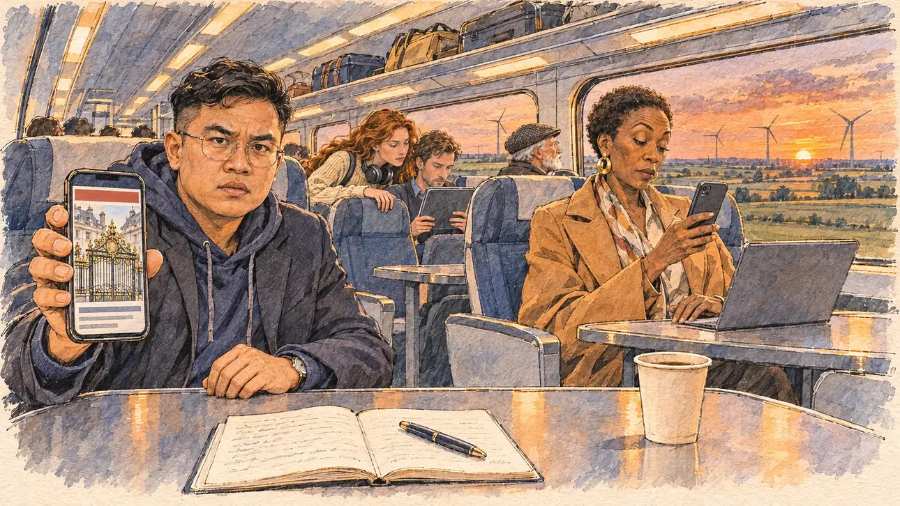

# `rnCassation` · La Cour de cassation tranche

**Proposée au PO le 25/11/2026**, au premier essai, avec `primeTime.webp` comme référence et le prompt mis à jour le même jour sur les visages. Elle sert telle quelle en clair et en sombre.



| Champ | Valeur |
| --- | --- |
| Carte | `rnCassation`, catégorie `institutions` (Institutions), carte ajoutée par la PR #533 de l'app (Mitchnsun/moi-president#204) |
| Style | Reportage dessiné, trait de `primeTime`, visages dessinés |
| Ton | Tendu |
| Date | 2026-11-25 |
| Outil | ChatGPT Images |
| Conversation | À remplir (le lien ne s'ouvre qu'avec le compte qui l'a créée) |
| Format rendu | 1672 × 941 (16:9) : export en 1290 × 726 px, WebP de qualité 75, 216 Ko, sans recadrage |
| Fichier d'origine | Image de ChatGPT, chez le PO. L'export du dépôt a été fait depuis la copie partagée dans la conversation avec Claude |
| Première édition | La prochaine Release qui suit le merge de la PR #533 de l'app |

## Texte de la carte

> **La Cour de cassation tranche**
>
> La Cour de cassation rejette le pourvoi de Martine La Peine : sa condamnation devient définitive, et avec elle son inéligibilité. Elle ne pourra pas être candidate. La liste officielle est publiée, l'élection n'est pas reportée, et le Rassemblement Hexagonal n'a plus personne à présenter. Son électorat cherche à qui donner sa voix.

Réponses : « Saluer l'État de droit », « Dénoncer le gouvernement des juges », « Tendre la main à son électorat » (jet de Proximité, difficulté 18 − 15 × la part d'extrême droite dans l'électorat du joueur, entre 11 et 18), « Rester sur son programme ». La carte n'est jamais tirée au hasard : elle remplace l'événement de la semaine 10 ou 11, dans une partie où l'inéligibilité frappe après le dépôt des parrainages (environ 1,5 % des parties) ; la crise des milices suit dans un tiers de ces parties, la consigne du RN peut suivre.

## Le moment choisi

Un soir d'avril, dans un TGV au crépuscule, à quelques semaines du premier tour. Le jeune collaborateur du candidat, assis en face, lui tend son téléphone : la grille dorée du Palais de justice sous un bandeau d'alerte. Autour, une voyageuse lit la nouvelle sur son téléphone, une étudiante se penche sur la tablette de son voisin, un homme âgé regarde les éoliennes. Au premier plan, le carnet ouvert du candidat, son stylo et son gobelet.

## Prompt complet

Dans une nouvelle conversation, avec [`primeTime.webp`](../../illustrations/media/primeTime.webp) comme seule image de référence :

```
Use the attached image as the style reference and copy its drawing: a realistic reportage drawing made on the spot for a newspaper, with quick, nervous pencil lines, often drawn twice, ink hatching in the shadows, transparent watercolour washes that spill a little over the lines, and the warm paper showing through. Take from the reference its line, its washes and its paper, not the finish of the presenter's face, which is the most finished and almost photographic part of it: every face here stays a drawing. Not the same scene and not the same people: never reuse the face or the hair of the woman in the reference.
Like in the reference, the setting can be full when the story needs it, with the things that say where we are and what is happening, but each one is sketched with a few pencil lines and a light wash, never rendered or finished, and the drawing gets looser and paler towards the edges until it fades into the bare paper.
This must look like a drawing made by hand on paper by a press illustrator, halfway between a quick sketch and a realistic picture: never a photograph, a film poster or a digital painting, and never a cartoon, a comic strip, a caricature or a children's book illustration. Continuous lines, never dotted or dashed outlines; the paper grain is the paper itself, never a mottled texture, speckles or hatching filter laid over the picture; no glossy highlights, no smooth gradients, in the sky and on the walls too. Colour can be rich in places, on a piece of clothing, a light or a flag, but it stays transparent and within the palette below. The fade into the paper at the edges stays narrow, without a wide white margin. No blur and no depth-of-field effect: everything, the foreground included, is drawn sharp, like a sketch made on the spot.
People are drawn from life with realistic anatomy and proportions: each face is drawn with the same visible pencil and ink lines, hatching and transparent washes as the clothes and the room, looser and sketchier than the presenter's face in the reference, with realistic features but never photographic (no photographic skin, no smooth shading, no airbrushed or digital-painting look). Expressions stay natural and restrained, even in laughter or tears: no exaggerated grins, no wide-open mouths full of teeth, no rubbery or cartoonish faces.

Editorial illustration, landscape 16:9 (1536 × 864 px), the scene filling the frame, with only a light fade into the paper at the edges. An April evening in 2027, in the upper deck of a high-speed train crossing the countryside at dusk, a few weeks before the first round: rows of seats, small tables, luggage racks, and through the wide windows green fields, a line of wind turbines and an orange sunset. The highest court has just made final the ineligibility of the leader of a big party, and the news spreads through the carriage. The player's candidate stays off-camera, the scene seen from their seat: in the foreground, only the candidate's open notebook with a pen and a paper coffee cup on the small table, nothing readable in the notebook. In the left third, sitting opposite across the table, the main character, the candidate's young aide, a short, round man in his late twenties of Cambodian origin, with straight black hair in a short undercut and thin metal glasses, in a navy hoodie under a blazer, holds his phone in his own hand and turns its screen towards the viewer: it shows a sketched picture of the ornate gilded wrought-iron gate of the old Palace of Justice in Paris, under a news banner, unreadable, with no face. He looks at the viewer with a tense, expectant face, his face above mid-height. Across the aisle, a tall businesswoman in her fifties of Ivorian origin, with short natural hair and large gold earrings, in a camel coat, has lowered her laptop screen and looks at her own phone, eyebrows raised. Behind her, a young student with long wavy red hair and headphones around her neck leans over the seat to read her neighbour's tablet, and an older man with a white beard and a wool cap looks out of the window. Only the aide looks at the viewer. Every object is held by a visible person or rests on a surface; nothing floats. Nothing on the phones, the tablet, the laptop, the notebook, the cup or the train's signs is readable.

Style: Reportage drawing made on the spot, like a press illustrator or courtroom sketch artist: pencil and ink with loose watercolour washes, lively unfinished lines, white paper showing through.

Palette: navy #13203F, vellum #F5EFE1, gold #A9802A, brick #B5523B, ochre #D9A441, sage #8FA58A, slate #5E7186, sand #DCC8A4, warm grey #8C8279; use 4 to 6 of them, subtle warm paper grain.

Tone: tense, the warm orange light of the sunset through the windows against the cold glow of the phone screens, the hush of a carriage taking in the news.

Constraints: realistic proportions, natural expressions, never cartoonish or caricatured faces, drawn like the rest of the illustration and never photographic; people of varied ages, genders, origins and body types (heavy, stocky, round, tall, short, wiry, not only slim), each with a distinct face and haircut (no two people alike), drawn with respect and never as a joke; each person's age, build and look plausible for their job and the scene (working people of working age), no stereotype tying an origin or a gender to a role, and no person of colour shown alone in a featured service or deferential role; anatomically correct hands with exactly five fingers, few hands visible, the others in pockets, behind objects or out of frame; every object is held by a visible person or rests on a surface, nothing floats in the air and no hand comes in from the edges of the picture; no readable text anywhere (the phones, the tablet, the laptop, the notebook, the cup and the train's signs stay unreadable, no rail company logo); no captions or speech bubbles; no logos or political party colours; no recognisable real person, no lookalike of a real politician, and no politician in the scene or on the screens; no explicit violence; no photographic rendering, no blur or bokeh, no dotted outlines, no texture or hatching filter over the picture, no oil-paint texture, no wide white margin or frame (a light fade into the paper at the edges is fine).

Format: if 16:9 is not available, make 1536 × 1024 and keep the top 80 px and the bottom 80 px free of anything important (faces, hands, the main action): they will be cropped.

```

## Décisions prises sur cette image

- Le candidat en déplacement, après le QG, la radio, le marché et le café : un TGV, sans micro.
- La décision dite par la grille dorée du Palais de justice de Paris, un monument réel, sur l'écran d'un téléphone, sans personne.
- Prompt mis à jour sur les visages (PO, 25/11/2026) : visages dessinés.

## Essais écartés

Aucun.

## Retouches

Aucune.

## Relecture

Faite par Claude le 25/11/2026, à valider par le PO.

- [x] Aucun texte lisible : le bandeau du téléphone n'a que des barres de couleur, le carnet que des lignes d'écriture illisibles, les autres écrans sont vides.
- [x] Aucun sosie d'une personne réelle, aucun responsable politique dans l'image.
- [x] Le candidat du joueur est hors champ ; son carnet, son stylo et son gobelet sont au premier plan.
- [x] Mains et visages sans défaut visible à 343 px de large : le collaborateur tient son téléphone, le pouce caché derrière ; la voyageuse tient le sien.
- [x] Aucune couleur ni aucun logo de parti. Des personnes variées par l'âge, le corps et l'origine (cambodgienne, ivoirienne).
- [ ] La grille du téléphone, avec ses toits d'ardoise, peut se lire comme celle de Versailles : à juger par le PO.
- [x] En 3:2 : sans objet, l'image est en 16:9.
- [ ] Lisible sur la page de l'événement, en clair et en sombre : à vérifier dans l'app, le kit installé.
