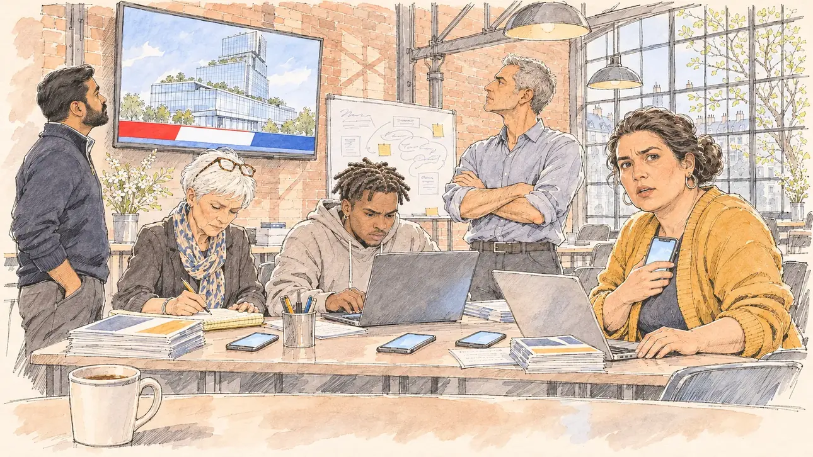

# `rnGranitella` · La Peine inéligible, Granitella candidat

**Proposée au PO le 25/11/2026**, au troisième essai, avec `primeTime.webp` comme référence. Elle sert telle quelle en clair et en sombre.



| Champ | Valeur |
| --- | --- |
| Carte | `rnGranitella`, catégorie `institutions` (Institutions), carte ajoutée par la PR #533 de l'app (Mitchnsun/moi-president#204) |
| Style | Reportage dessiné, trait de `primeTime` |
| Ton | Tendu |
| Date | 2026-11-25 |
| Outil | ChatGPT Images |
| Conversation | À remplir (le lien ne s'ouvre qu'avec le compte qui l'a créée) |
| Format rendu | 1672 × 941 (16:9) : export en 1290 × 726 px, WebP de qualité 75, 189 Ko, sans recadrage |
| Fichier d'origine | Image de ChatGPT, chez le PO. L'export du dépôt a été fait depuis la copie partagée dans la conversation avec Claude |
| Première édition | La prochaine Release qui suit le merge de la PR #533 de l'app |

## Texte de la carte

> **La Peine inéligible, Granitella candidat**
>
> Une décision de justice rend Martine La Peine inéligible. Le Rassemblement Hexagonal investit aussitôt Jordan Granitella, fragilisé par une affaire de messages anciens qu'il conteste. Les micros se tournent vers vous.

Réponses : « Saluer l'État de droit », « Dénoncer le gouvernement des juges », « Rester sur son programme », sans jet de dés. La carte n'est jamais tirée au hasard : elle remplace l'événement de la semaine de la décision, entre les semaines 2 et 6, dans une partie où l'inéligibilité frappe avant le dépôt des parrainages et où Granitella remplace La Peine (environ 0,6 % des parties).

## Le moment choisi

L'après-midi où tombe la décision, au QG de campagne du joueur, un atelier de briques reconverti. L'équipe s'est tournée vers l'écran de l'édition spéciale, qui montre le tribunal de Paris aux Batignolles. La responsable presse se retourne vers le candidat, son téléphone qui sonne à la main : la presse attend sa réaction. Sur la table, d'autres téléphones s'allument. Au premier plan, la tasse du candidat, seule.

## Prompt complet

Dans une nouvelle conversation, avec [`primeTime.webp`](../../illustrations/media/primeTime.webp) comme seule image de référence :

```
Use the attached image as the style reference and copy its drawing: a realistic reportage drawing made on the spot for a newspaper, with quick, nervous pencil lines, often drawn twice, ink hatching in the shadows, transparent watercolour washes that spill a little over the lines, and the warm paper showing through. Not the same scene and not the same people: never reuse the face or the hair of the woman in the reference.
Like in the reference, the setting can be full when the story needs it, with the things that say where we are and what is happening, but each one is sketched with a few pencil lines and a light wash, never rendered or finished, and the drawing gets looser and paler towards the edges until it fades into the bare paper.
This must look like a drawing made by hand on paper by a press illustrator, halfway between a quick sketch and a realistic picture: never a photograph, a film poster or a digital painting, and never a cartoon, a comic strip, a caricature or a children's book illustration. Continuous lines, never dotted or dashed outlines; no uniform texture, speckles or hatching filter laid over the picture; no glossy highlights, no smooth gradients, in the sky and on the walls too. Colour can be rich in places, on a piece of clothing, a light or a flag, but it stays transparent and within the palette below. The fade into the paper at the edges stays narrow, without a wide white margin. No blur and no depth-of-field effect: everything, the foreground included, is drawn sharp, like a sketch made on the spot.
People are drawn from life with realistic anatomy and proportions, like in the reference: faces shaped with pencil lines, hatching and light washes, a little more finished than the background but never photographic (no photographic skin, no airbrushed or digital-painting look). Expressions stay natural and restrained, even in laughter or tears: no exaggerated grins, no wide-open mouths full of teeth, no rubbery or cartoonish faces.

Editorial illustration, landscape 16:9 (1536 × 864 px), the scene filling the frame, with only a light fade into the paper at the edges. A weekday afternoon in spring 2027, in the open-plan headquarters of a presidential campaign, in a converted workshop with brick walls, large metal-framed windows, long shared desks, laptops, stacks of leaflets and a whiteboard covered in scribbles: a court has just declared the leader of a big party ineligible, and the news is breaking. The player's candidate stays off-camera, the scene seen from their place: in the foreground, only the candidate's coffee mug standing on the edge of a desk, nothing in front of it. In the middle ground, five members of the team stand in a loose group in front of a large wall screen showing a breaking news broadcast: a sketched courthouse facade and a news banner, unreadable, with no face on the screen. In the right third, the main character, the press officer, a woman in her late thirties of Moroccan origin, round and sturdy, with thick dark hair tied in a low bun and silver hoop earrings, in a mustard cardigan, has turned away from the screen towards the viewer; she holds her ringing phone in her own hand against her chest, its screen lit and unreadable, and looks at the viewer with an urgent, questioning face, her face above mid-height. Beside the screen, a tall, wiry campaign director in his fifties with a grey crew cut and rolled-up shirt sleeves keeps watching the broadcast, arms crossed. A young volunteer, short and stocky, of Antillean origin, with short twists and a hoodie, stares at his laptop where messages pour in. A woman in her sixties with a white pixie cut and reading glasses pushed on her head, the team's policy adviser, takes notes on a pad. On the desk, three phones lie flat, their screens lit up, unreadable. Only the press officer looks at the viewer; the others watch the screen or their devices. Nothing on the screen, the phones, the laptops, the leaflets or the whiteboard is readable.

Style: Reportage drawing made on the spot, like a press illustrator or courtroom sketch artist: pencil and ink with loose watercolour washes, lively unfinished lines, white paper showing through.

Palette: navy #13203F, vellum #F5EFE1, gold #A9802A, brick #B5523B, ochre #D9A441, sage #8FA58A, slate #5E7186, sand #DCC8A4, warm grey #8C8279; use 4 to 6 of them, subtle warm paper grain.

Tone: tense, the cold blue light of the screen against the grey daylight from the windows, hard shadows, the urgency of breaking news.

Constraints: realistic proportions, natural expressions, never cartoonish or caricatured faces, drawn like the rest of the illustration and never photographic; people of varied ages, genders, origins and body types (heavy, stocky, round, tall, short, wiry, not only slim), each with a distinct face and haircut (no two people alike), drawn with respect and never as a joke; each person's age, build and look plausible for their job and the scene (working people of working age), no stereotype tying an origin or a gender to a role, and no person of colour shown alone in a featured service or deferential role; anatomically correct hands with exactly five fingers, few hands visible, the others in pockets, behind objects or out of frame; every object is held by a visible person or rests on a surface, nothing floats in the air and no hand or microphone comes in from the edges of the picture; no readable text anywhere (the wall screen, the news banner, the phones, the laptops, the leaflets and the whiteboard stay unreadable, no channel logo); no captions or speech bubbles; no logos or political party colours; no recognisable real person, no lookalike of a real politician, and no politician shown on the screen; no explicit violence; no photographic rendering, no blur or bokeh, no dotted outlines, no texture or hatching filter over the picture, no oil-paint texture, no wide white margin or frame (a light fade into the paper at the edges is fine).

Format: if 16:9 is not available, make 1536 × 1024 and keep the top 80 px and the bottom 80 px free of anything important (faces, hands, the main action): they will be cropped.
```

Puis, dans la même conversation, le message de correction de l'essai 3 :

```
Keep the same scene, the same composition, the same places and the same poses, with three changes only. First, the wall screen no longer shows a building with columns: it shows the modern courthouse of Paris at the Batignolles, a tall tower of stacked glass blocks, with a plain red, white and blue news banner, and no letters or inscription anywhere on the building or the banner. Second, the woman standing on the far left is replaced by a different person: a man in his thirties of Indian origin, short and stocky, with a neat black beard and short side-parted hair, in a navy quarter-zip sweater, standing with one hand in his pocket and watching the screen. Third, match the rendering of the reference image much more closely: a quick reportage drawing on warm paper, continuous pencil and ink lines, loose transparent watercolour washes, plenty of white paper showing through, lighter and less saturated overall; no mottled or speckled texture laid over the picture, no painterly filter, no digital-painting look. Everything else stays the same: the press officer, the campaign director, the volunteer and the adviser unchanged, the coffee mug alone in the foreground, nothing readable, exactly five fingers on every visible hand.
```

## Décisions prises sur cette image

- Ni La Peine ni Granitella, ni de face ni de dos, ni à l'écran : la carte parle d'une décision de justice et de la réaction du joueur, pas de ses rivaux (même règle que la fin `paralysedCountry`).
- La presse passe par le téléphone de la responsable presse, pas par une forêt de micros : au premier essai, des micros tendus vers le spectateur sortaient de nulle part (PO, 25/11/2026).
- À l'écran, le tribunal judiciaire de Paris aux Batignolles, un monument réel, autorisé par le gabarit ; jamais un palais à colonnes, qui se lit comme l'Assemblée nationale.
- Une nouvelle contrainte : chaque objet est tenu par une personne visible ou posé sur un meuble, rien ne flotte et rien n'entre par les bords.

## Essais écartés

1. Le parvis du tribunal de Paris, une forêt de micros et de téléphones tendus vers le candidat : les micros du premier plan n'étaient tenus par personne (PO, 25/11/2026).
2. Le QG, premier rendu : l'écran montrait un palais à colonnes et à fronton sculpté, proche du Palais-Bourbon, sa frise couverte de pseudo-lettres ; une cinquième personne, à gauche, doublait la responsable presse (chignon de boucles, créoles) ; une texture marbrée couvrait toute l'image. Corrigé par le message ci-dessus.

## Retouches

Aucune.

## Relecture

Faite par Claude le 25/11/2026, à valider par le PO.

- [x] Aucun texte lisible : l'écran et son bandeau tricolore n'ont aucune lettre, les téléphones et les ordinateurs sont vides, le tableau blanc ne porte que des gribouillis et des encadrés.
- [x] Aucun sosie d'une personne réelle, aucun responsable politique dans l'image.
- [x] Le candidat du joueur est hors champ ; seule sa tasse est au premier plan.
- [x] Mains et visages sans défaut visible à 343 px de large : la responsable presse tient son téléphone d'une main, l'autre sur l'ordinateur, cinq doigts chacune ; le directeur a les bras croisés, la conseillère écrit.
- [x] Aucune couleur ni aucun logo de parti. Des personnes variées par l'âge, le corps, l'origine et la coiffure, aucune en double.
- [x] En 3:2 : sans objet, l'image est en 16:9.
- [x] Lisible sur la page de l'événement, en clair et en sombre : vérifié dans l'app web de la PR #533 (Chromium, 420 px), le kit servi en local, le 25/11/2026.
