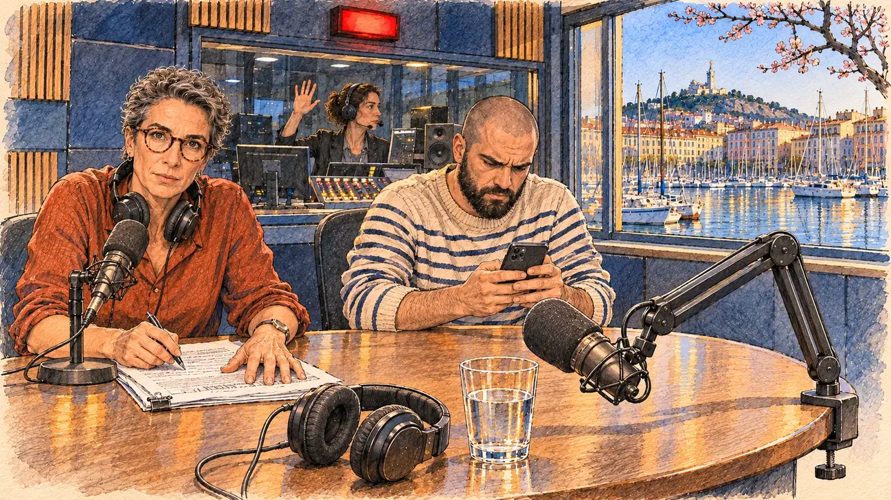

# `rnMarechaussee` · La Peine inéligible, Maréchaussée investie

**Validée par le PO le 25/11/2026**, au premier essai, avec `primeTime.webp` comme référence, et des écarts acceptés (voir « Décisions »). Elle sert telle quelle en clair et en sombre.



| Champ | Valeur |
| --- | --- |
| Carte | `rnMarechaussee`, catégorie `institutions` (Institutions), carte ajoutée par la PR #533 de l'app (Mitchnsun/moi-president#204) |
| Style | Reportage dessiné, trait de `primeTime` ; plus peint et texturé que la référence |
| Ton | Tendu |
| Date | 2026-11-25 |
| Outil | ChatGPT Images |
| Format rendu | 1672 × 941 (16:9) : export en 1290 × 726 px, WebP de qualité 75, 254 Ko, sans recadrage |
| Fichier d'origine | Image de ChatGPT, chez le PO. L'export du dépôt a été fait depuis la copie partagée dans la conversation avec Claude |
| Première édition | La prochaine Release qui suit le merge de la PR #533 de l'app |

## Texte de la carte

> **La Peine inéligible, Maréchaussée investie**
>
> Une décision de justice rend Martine La Peine inéligible. Le Rassemblement Hexagonal appelle Marion Maréchaussée, présidente de Racines et Fiertés, à porter ses couleurs. Les micros se tournent vers vous.

Réponses : « Saluer l'État de droit », « Dénoncer le gouvernement des juges », « Rester sur son programme », sans jet de dés. La carte n'est jamais tirée au hasard : elle remplace l'événement de la semaine de la décision, entre les semaines 2 et 6, dans une partie où l'inéligibilité frappe avant le dépôt des parrainages et où Maréchaussée seule remplace La Peine (environ 0,2 % des parties).

## Le moment choisi

Le candidat est l'invité d'une matinale de radio locale à Marseille quand la nouvelle tombe. L'animatrice se tourne vers lui, le chroniqueur lit l'alerte sur son téléphone, la régie signale le direct. Par la fenêtre, le Vieux-Port et Notre-Dame-de-la-Garde. Au premier plan, le micro du candidat sur son bras articulé, son casque et son verre d'eau.

## Prompt complet

Dans une nouvelle conversation, avec [`primeTime.webp`](../../illustrations/media/primeTime.webp) comme seule image de référence :

```
Use the attached image as the style reference and copy its drawing: a realistic reportage drawing made on the spot for a newspaper, with quick, nervous pencil lines, often drawn twice, ink hatching in the shadows, transparent watercolour washes that spill a little over the lines, and the warm paper showing through. Not the same scene and not the same people: never reuse the face or the hair of the woman in the reference.
Like in the reference, the setting can be full when the story needs it, with the things that say where we are and what is happening, but each one is sketched with a few pencil lines and a light wash, never rendered or finished, and the drawing gets looser and paler towards the edges until it fades into the bare paper.
This must look like a drawing made by hand on paper by a press illustrator, halfway between a quick sketch and a realistic picture: never a photograph, a film poster or a digital painting, and never a cartoon, a comic strip, a caricature or a children's book illustration. Continuous lines, never dotted or dashed outlines; no uniform texture, speckles or hatching filter laid over the picture; no glossy highlights, no smooth gradients, in the sky and on the walls too. Colour can be rich in places, on a piece of clothing, a light or a flag, but it stays transparent and within the palette below. The fade into the paper at the edges stays narrow, without a wide white margin. No blur and no depth-of-field effect: everything, the foreground included, is drawn sharp, like a sketch made on the spot.
People are drawn from life with realistic anatomy and proportions, like in the reference: faces shaped with pencil lines, hatching and light washes, a little more finished than the background but never photographic (no photographic skin, no airbrushed or digital-painting look). Expressions stay natural and restrained, even in laughter or tears: no exaggerated grins, no wide-open mouths full of teeth, no rubbery or cartoonish faces.

Editorial illustration, landscape 16:9 (1536 × 864 px), the scene filling the frame, with only a light fade into the paper at the edges. An early spring morning in 2027, live on the morning show of a local radio station in Marseille: a small studio with acoustic panels on the walls, a round wooden desk, monitors and a mixing console, and through a wide window the Old Port of Marseille with its sailing boats and its ochre and pink facades in the low sunlight. The news has just come in that a big party has chosen a new candidate after a court ruling, and the host turns the show to the player's candidate, who is the guest. The player's candidate stays off-camera, the scene seen from their place at the desk: in the foreground, only the guest's microphone on its articulated arm clamped to the desk, a pair of headphones lying beside it and a glass of water. In the left third, the main character, the host, a tall woman in her fifties of Comorian origin, with short natural grey hair and round tortoiseshell glasses, in a rust-coloured linen shirt, headphones around her neck, her own microphone on its arm in front of her, leans forward and looks at the viewer with a direct, expectant face, her face above mid-height; one hand rests on a printed news dispatch, unreadable. Beside her, the show's columnist, a round man in his thirties with a shaved head and a thick dark beard, in a striped sweater, reads the alert on his phone, frowning. Behind the studio glass, in the control room, a thin producer in his forties with wavy black hair and a headset raises one hand to signal that they are live. Only the host looks at the viewer. Every microphone stands on its arm fixed to the desk; nothing floats. Nothing on the dispatch, the phone, the monitors, the console or the walls is readable; the on-air light is a plain red lamp with no letters.

Style: Reportage drawing made on the spot, like a press illustrator or courtroom sketch artist: pencil and ink with loose watercolour washes, lively unfinished lines, white paper showing through.

Palette: navy #13203F, vellum #F5EFE1, gold #A9802A, brick #B5523B, ochre #D9A441, sage #8FA58A, slate #5E7186, sand #DCC8A4, warm grey #8C8279; use 4 to 6 of them, subtle warm paper grain.

Tone: tense, the warm low morning sun from the harbour against the cool light of the studio monitors, a held breath before the answer.

Constraints: realistic proportions, natural expressions, never cartoonish or caricatured faces, drawn like the rest of the illustration and never photographic; people of varied ages, genders, origins and body types (heavy, stocky, round, tall, short, wiry, not only slim), each with a distinct face and haircut (no two people alike), drawn with respect and never as a joke; each person's age, build and look plausible for their job and the scene (working people of working age), no stereotype tying an origin or a gender to a role, and no person of colour shown alone in a featured service or deferential role; anatomically correct hands with exactly five fingers, few hands visible, the others in pockets, behind objects or out of frame; every object is held by a visible person or rests on a surface, nothing floats in the air and no hand or microphone comes in from the edges of the picture; no readable text anywhere (the dispatch, the phone, the monitors, the console, the on-air light and the walls stay unreadable, no station logo); no captions or speech bubbles; no logos or political party colours; no recognisable real person, no lookalike of a real politician or of a real radio host, and no politician in the scene; no explicit violence; no photographic rendering, no blur or bokeh, no dotted outlines, no texture or hatching filter over the picture, no oil-paint texture, no wide white margin or frame (a light fade into the paper at the edges is fine).

Format: if 16:9 is not available, make 1536 × 1024 and keep the top 80 px and the bottom 80 px free of anything important (faces, hands, the main action): they will be cropped.
```

## Décisions prises sur cette image

- Ni La Peine ni Maréchaussée dans l'image : la carte parle de la réaction du joueur, comme `rnGranitella`.
- Un autre lieu que `rnGranitella` (le QG) : un studio de radio à Marseille, la ville et le Vieux-Port encore peu servis.
- Les micros sur leurs bras articulés, fixés au bureau, après les micros flottants du premier essai de `rnGranitella`.
- **Écarts acceptés par le PO** (25/11/2026), qui garde l'image telle quelle : l'animatrice, demandée d'origine comorienne, et les deux autres personnes ont l'air blanches ; la régie est tenue par une femme aux boucles brunes au lieu de l'homme demandé ; le rendu est plus peint et texturé que `primeTime`, le visage de l'animatrice presque photographique ; Notre-Dame-de-la-Garde, non demandée, situe Marseille.

## Essais écartés

Aucun.

## Retouches

Aucune.

## Relecture

Faite par Claude le 25/11/2026, image gardée par le PO le même jour.

- [x] Aucun texte lisible : la dépêche ne porte que des pseudo-lignes, la lampe d'antenne est une lampe rouge sans lettres, le téléphone et les écrans sont vides.
- [x] Aucun sosie d'une personne réelle, aucun responsable politique dans l'image.
- [x] Le candidat du joueur est hors champ ; son micro, son casque et son verre sont au premier plan.
- [x] Mains et visages sans défaut visible à 343 px de large, cinq doigts partout, la main levée de la régie comprise.
- [x] Aucune couleur ni aucun logo de parti.
- [ ] Des origines variées : non, écart accepté par le PO (voir « Décisions »).
- [x] En 3:2 : sans objet, l'image est en 16:9.
- [x] Lisible sur la page de l'événement, en clair et en sombre : vérifié dans l'app web de la PR #533 (Chromium, 420 px), le kit servi en local, le 25/11/2026.
