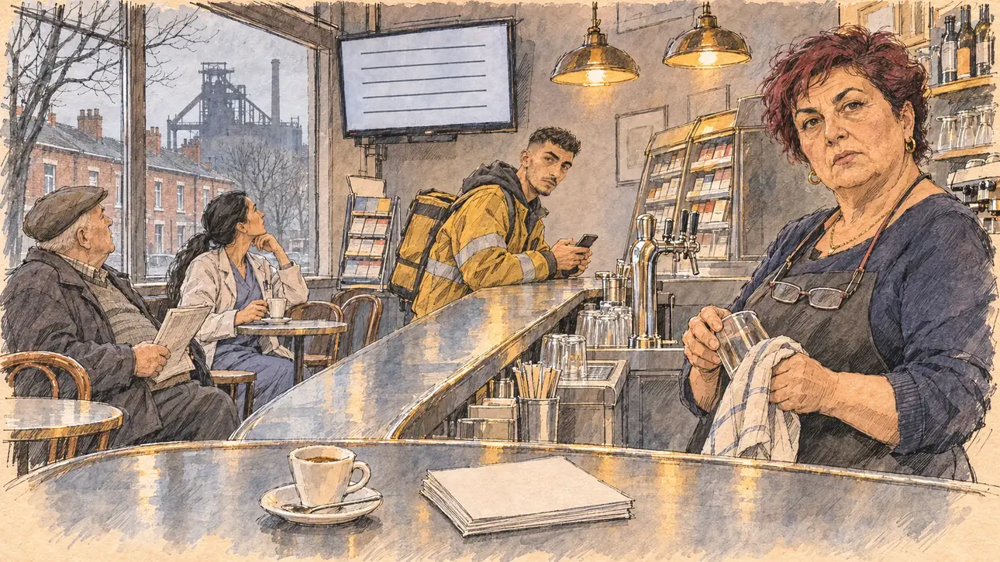

# `rnOffList` · La liste officielle sans La Peine

**Proposée au PO le 25/11/2026**, au premier essai, avec `primeTime.webp` comme référence et le prompt mis à jour le même jour sur les visages. Elle sert telle quelle en clair et en sombre.



| Champ | Valeur |
| --- | --- |
| Carte | `rnOffList`, catégorie `institutions` (Institutions), carte ajoutée par la PR #533 de l'app (Mitchnsun/moi-president#204) |
| Style | Reportage dessiné, trait de `primeTime`, visages dessinés |
| Ton | Observateur et inquiet |
| Date | 2026-11-25 |
| Outil | ChatGPT Images |
| Conversation | À remplir (le lien ne s'ouvre qu'avec le compte qui l'a créée) |
| Format rendu | 1672 × 941 (16:9) : export en 1290 × 726 px, WebP de qualité 75, 214 Ko, sans recadrage |
| Fichier d'origine | Image de ChatGPT, chez le PO. L'export du dépôt a été fait depuis la copie partagée dans la conversation avec Claude |
| Première édition | La prochaine Release qui suit le merge de la PR #533 de l'app |

## Texte de la carte

> **La liste officielle sans La Peine**
>
> Le Conseil constitutionnel publie la liste officielle des candidatures : Martine La Peine n'y figure pas, son inéligibilité court toujours. Les parrainages sont clos, le Rassemblement Hexagonal n'a plus personne à présenter, et son électorat cherche à qui donner sa voix.

Réponses : « Saluer l'État de droit », « Dénoncer le gouvernement des juges », « Tendre la main à son électorat » (jet de Proximité, difficulté 18 − 15 × la part d'extrême droite dans l'électorat du joueur, entre 11 et 18), « Rester sur son programme ». La carte n'est jamais tirée au hasard : elle remplace l'événement de la semaine 8, à la publication de la liste officielle, dans une partie où l'inéligibilité frappe après le dépôt des parrainages (environ 1,5 % des parties) ; la crise des milices suit dans un tiers de ces parties, la consigne du RN peut suivre.

## Le moment choisi

Un matin gris de mars, dans un café-tabac d'une ancienne ville sidérurgique de Moselle, un haut fourneau à l'arrêt derrière la vitre. La télévision affiche la liste officielle, une colonne de lignes vides. Le candidat vient d'entrer : la patronne le regarde, méfiante, un verre et un torchon à la main ; le livreur lève les yeux de son téléphone, l'infirmière et le retraité regardent l'écran. Au premier plan, son café et ses tracts posés sur le zinc.

## Prompt complet

Dans une nouvelle conversation, avec [`primeTime.webp`](../../illustrations/media/primeTime.webp) comme seule image de référence :

```
Use the attached image as the style reference and copy its drawing: a realistic reportage drawing made on the spot for a newspaper, with quick, nervous pencil lines, often drawn twice, ink hatching in the shadows, transparent watercolour washes that spill a little over the lines, and the warm paper showing through. Take from the reference its line, its washes and its paper, not the finish of the presenter's face, which is the most finished and almost photographic part of it: every face here stays a drawing. Not the same scene and not the same people: never reuse the face or the hair of the woman in the reference.
Like in the reference, the setting can be full when the story needs it, with the things that say where we are and what is happening, but each one is sketched with a few pencil lines and a light wash, never rendered or finished, and the drawing gets looser and paler towards the edges until it fades into the bare paper.
This must look like a drawing made by hand on paper by a press illustrator, halfway between a quick sketch and a realistic picture: never a photograph, a film poster or a digital painting, and never a cartoon, a comic strip, a caricature or a children's book illustration. Continuous lines, never dotted or dashed outlines; the paper grain is the paper itself, never a mottled texture, speckles or hatching filter laid over the picture; no glossy highlights, no smooth gradients, in the sky and on the walls too. Colour can be rich in places, on a piece of clothing, a light or a flag, but it stays transparent and within the palette below. The fade into the paper at the edges stays narrow, without a wide white margin. No blur and no depth-of-field effect: everything, the foreground included, is drawn sharp, like a sketch made on the spot.
People are drawn from life with realistic anatomy and proportions: each face is drawn with the same visible pencil and ink lines, hatching and transparent washes as the clothes and the room, looser and sketchier than the presenter's face in the reference, with realistic features but never photographic (no photographic skin, no smooth shading, no airbrushed or digital-painting look). Expressions stay natural and restrained, even in laughter or tears: no exaggerated grins, no wide-open mouths full of teeth, no rubbery or cartoonish faces.

Editorial illustration, landscape 16:9 (1536 × 864 px), the scene filling the frame, with only a light fade into the paper at the edges. A grey weekday morning in March 2027, in a corner café with a tobacco counter in a former steel town of Moselle, in Lorraine: a zinc bar, a few bistro tables, a lottery stand, a television high on the wall, and through the window a street of brick workers' houses with the silhouette of a disused blast furnace in the distance. The television announces the official list of the presidential candidates, a column of blank lines on a plain background, unreadable, with no face on the screen; one big party is missing from it, and its voters wonder who to vote for. The player's candidate has just walked in, the scene seen from their place at the bar: in the foreground, only a small cup of coffee on its saucer and a short stack of the candidate's campaign leaflets lying on the zinc counter, nothing readable on them. In the right third, behind the counter, the main character, the café owner, a stocky woman in her fifties of Italian origin, with short dyed burgundy hair and reading glasses on a cord, in a dark apron, holds a glass and a tea towel, and looks at the viewer with a wary, questioning face, her face above mid-height. At a table near the window, a nurse in her forties of Algerian origin, slim, with long dark hair in a ponytail and a coat over her scrubs, has turned to look at the television, her coffee in her hands. At the end of the bar, a young delivery driver of Turkish origin, tall and lanky, with a short fade haircut and a high-visibility jacket, glances up from his phone towards the viewer. By the window, a retired man in his seventies with a round belly, a bald head and a flat cap, sits with a folded newspaper, unreadable, and watches the screen. Only the café owner and the delivery driver look at the viewer. Every object is held by a visible person or rests on a surface; nothing floats. Nothing on the television, the newspaper, the leaflets, the lottery stand, the tobacco sign or the shop front is readable.

Style: Reportage drawing made on the spot, like a press illustrator or courtroom sketch artist: pencil and ink with loose watercolour washes, lively unfinished lines, white paper showing through.

Palette: navy #13203F, vellum #F5EFE1, gold #A9802A, brick #B5523B, ochre #D9A441, sage #8FA58A, slate #5E7186, sand #DCC8A4, warm grey #8C8279; use 4 to 6 of them, subtle warm paper grain.

Tone: observant and uneasy, the flat grey light of a March morning through the window against the warm glow of the bar's lamps, a silence after the news.

Constraints: realistic proportions, natural expressions, never cartoonish or caricatured faces, drawn like the rest of the illustration and never photographic; people of varied ages, genders, origins and body types (heavy, stocky, round, tall, short, wiry, not only slim), each with a distinct face and haircut (no two people alike), drawn with respect and never as a joke; each person's age, build and look plausible for their job and the scene (working people of working age), no stereotype tying an origin or a gender to a role, and no person of colour shown alone in a featured service or deferential role; anatomically correct hands with exactly five fingers, few hands visible, the others in pockets, behind objects or out of frame; every object is held by a visible person or rests on a surface, nothing floats in the air and no hand comes in from the edges of the picture; no readable text anywhere (the television, the newspaper, the leaflets, the lottery stand, the tobacco sign and the shop front stay unreadable, no channel or brand logo); no captions or speech bubbles; no logos or political party colours; no recognisable real person, no lookalike of a real politician, and no politician in the scene or on the screen; no explicit violence; no photographic rendering, no blur or bokeh, no dotted outlines, no texture or hatching filter over the picture, no oil-paint texture, no wide white margin or frame (a light fade into the paper at the edges is fine).

Format: if 16:9 is not available, make 1536 × 1024 and keep the top 80 px and the bottom 80 px free of anything important (faces, hands, the main action): they will be cropped.

```

## Décisions prises sur cette image

- L'électorat orphelin plutôt que la décision : un café de quartier, des électeurs qui hésitent, sans affiche ni couleur de parti qui les étiquette.
- La Moselle et sa sidérurgie, une région que la série n'avait pas encore montrée.
- Premier essai avec le prompt mis à jour sur les visages (PO, 25/11/2026) : visages dessinés, pas de texture plaquée.

## Essais écartés

Aucun.

## Retouches

Aucune.

## Relecture

Faite par Claude le 25/11/2026, à valider par le PO.

- [x] Aucun texte lisible : la télévision ne montre que des lignes vides, le journal, les tracts, les présentoirs de jeux et de tabac n'ont que des blocs de couleur.
- [x] Aucun sosie d'une personne réelle, aucun responsable politique dans l'image.
- [x] Le candidat du joueur est hors champ ; son café et ses tracts sont au premier plan.
- [x] Mains et visages sans défaut visible à 343 px de large : la patronne tient le verre et le torchon, cinq doigts ; le retraité tient son journal.
- [x] Aucune couleur ni aucun logo de parti. Des personnes variées par l'âge, le corps et l'origine (italienne, algérienne, turque).
- [x] En 3:2 : sans objet, l'image est en 16:9.
- [ ] Lisible sur la page de l'événement, en clair et en sombre : à vérifier dans l'app, le kit installé.
