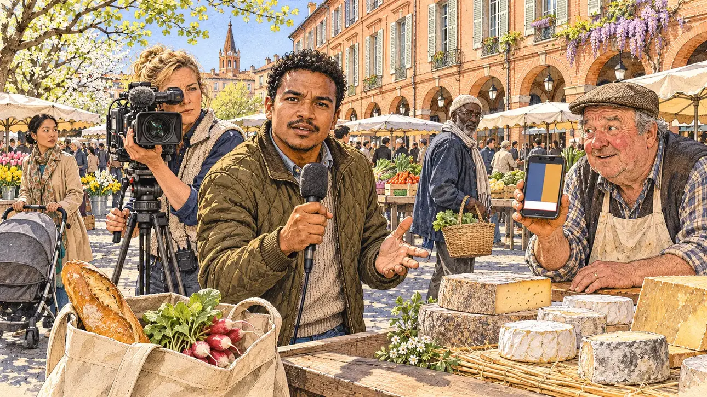

# `rnTwoCandidates` · La Peine inéligible, l'extrême droite divisée

**Validée par le PO le 25/11/2026**, au premier essai, avec `primeTime.webp` comme référence, et des écarts acceptés (voir « Décisions »). Elle sert telle quelle en clair et en sombre.



| Champ | Valeur |
| --- | --- |
| Carte | `rnTwoCandidates`, catégorie `institutions` (Institutions), carte ajoutée par la PR #533 de l'app (Mitchnsun/moi-president#204) |
| Style | Reportage dessiné, trait de `primeTime` ; plus fini et plus saturé que la référence |
| Ton | Tendu mais observateur |
| Date | 2026-11-25 |
| Outil | ChatGPT Images |
| Conversation | À remplir (le lien ne s'ouvre qu'avec le compte qui l'a créée) |
| Format rendu | 1672 × 941 (16:9) : export en 1290 × 726 px, WebP de qualité 75, 286 Ko, sans recadrage |
| Fichier d'origine | Image de ChatGPT, chez le PO. L'export du dépôt a été fait depuis la copie partagée dans la conversation avec Claude |
| Première édition | La prochaine Release qui suit le merge de la PR #533 de l'app |

## Texte de la carte

> **La Peine inéligible, l'extrême droite divisée**
>
> Une décision de justice rend Martine La Peine inéligible. Le Rassemblement Hexagonal investit Jordan Granitella, fragilisé par une affaire de messages anciens qu'il conteste ; Marion Maréchaussée se lance de son côté pour Racines et Fiertés. Les micros se tournent vers vous.

Réponses : « Saluer l'État de droit », « Dénoncer le gouvernement des juges », « Rester sur son programme », sans jet de dés. La carte n'est jamais tirée au hasard : elle remplace l'événement de la semaine de la décision, entre les semaines 2 et 6, dans une partie où l'inéligibilité frappe avant le dépôt des parrainages et où Granitella et Maréchaussée se présentent tous les deux (environ 0,2 % des parties).

## Le moment choisi

Un samedi matin de printemps, sur un marché de Toulouse, sous les arcades de brique rose, le clocher de Saint-Sernin au loin. Une équipe de télévision arrête le candidat en visite : le journaliste tend son micro, qu'il tient en main, à deux mètres ; derrière son étal, un fromager montre sur son téléphone l'écran partagé en deux de l'édition spéciale, qui dit la division sans montrer personne. Au premier plan, le cabas du candidat, une baguette et des radis.

## Prompt complet

Dans une nouvelle conversation, avec [`primeTime.webp`](../../illustrations/media/primeTime.webp) comme seule image de référence, le prompt d'avant la mise à jour du gabarit du 25/11/2026 sur les visages :

```
Use the attached image as the style reference and copy its drawing: a realistic reportage drawing made on the spot for a newspaper, with quick, nervous pencil lines, often drawn twice, ink hatching in the shadows, transparent watercolour washes that spill a little over the lines, and the warm paper showing through. Not the same scene and not the same people: never reuse the face or the hair of the woman in the reference.
Like in the reference, the setting can be full when the story needs it, with the things that say where we are and what is happening, but each one is sketched with a few pencil lines and a light wash, never rendered or finished, and the drawing gets looser and paler towards the edges until it fades into the bare paper.
This must look like a drawing made by hand on paper by a press illustrator, halfway between a quick sketch and a realistic picture: never a photograph, a film poster or a digital painting, and never a cartoon, a comic strip, a caricature or a children's book illustration. Continuous lines, never dotted or dashed outlines; no uniform texture, speckles or hatching filter laid over the picture; no glossy highlights, no smooth gradients, in the sky and on the walls too. Colour can be rich in places, on a piece of clothing, a light or a flag, but it stays transparent and within the palette below. The fade into the paper at the edges stays narrow, without a wide white margin. No blur and no depth-of-field effect: everything, the foreground included, is drawn sharp, like a sketch made on the spot.
People are drawn from life with realistic anatomy and proportions, like in the reference: faces shaped with pencil lines, hatching and light washes, a little more finished than the background but never photographic (no photographic skin, no airbrushed or digital-painting look). Expressions stay natural and restrained, even in laughter or tears: no exaggerated grins, no wide-open mouths full of teeth, no rubbery or cartoonish faces.

Editorial illustration, landscape 16:9 (1536 × 864 px), the scene filling the frame, with only a light fade into the paper at the edges. A spring Saturday morning in 2027, on an open-air market in Toulouse, under the arcades of a square of pink brick buildings with tall shuttered windows, stalls of vegetables, cheeses and flowers under canvas awnings: the news has just broken that the far right will run two rival candidates after a court ruling, and a television crew stops the player's candidate, who is visiting the market. The player's candidate stays off-camera, the scene seen from their place: in the foreground, only the candidate's canvas shopping bag with a bunch of radishes and a baguette sticking out, resting on the corner of a stall. In the middle ground, about two metres away, the television reporter, a stocky man in his late twenties of Malagasy origin, with short curly black hair and a trimmed moustache, in a quilted olive jacket, holds his own microphone in his right hand at chest height, clearly attached to his hand, and looks at the viewer with a direct, questioning face, his face above mid-height. Just behind him, the camerawoman, a tall woman in her forties with cropped blond hair and a fleece vest, films with a shoulder camera, her eye on the viewfinder. In the right third, behind his cheese stall, a heavy-set cheesemonger in his sixties with a flat cap and red cheeks holds out his phone towards the reporter: its screen is split in two halves by a vertical line, two plain coloured panels with a breaking news banner, unreadable, with no face on them; he raises his eyebrows, amused and worried. Behind them, a few shoppers, a young woman of Vietnamese origin with a stroller and an older man of Senegalese origin with a wicker basket, glance at the crew in passing. Only the reporter looks at the viewer. The microphone is held in the reporter's own hand; nothing floats. No supporters, no posters, no party colours. Nothing on the phone, the camera, the microphone, the price tags, the awnings or the shop fronts is readable.

Style: Reportage drawing made on the spot, like a press illustrator or courtroom sketch artist: pencil and ink with loose watercolour washes, lively unfinished lines, white paper showing through.

Palette: navy #13203F, vellum #F5EFE1, gold #A9802A, brick #B5523B, ochre #D9A441, sage #8FA58A, slate #5E7186, sand #DCC8A4, warm grey #8C8279; use 4 to 6 of them, subtle warm paper grain.

Tone: tense but observant, bright late-morning sun on the pink brick, crisp shadows under the arcades, the ordinary bustle of a market caught by the news.

Constraints: realistic proportions, natural expressions, never cartoonish or caricatured faces, drawn like the rest of the illustration and never photographic; people of varied ages, genders, origins and body types (heavy, stocky, round, tall, short, wiry, not only slim), each with a distinct face and haircut (no two people alike), drawn with respect and never as a joke; each person's age, build and look plausible for their job and the scene (working people of working age), no stereotype tying an origin or a gender to a role, and no person of colour shown alone in a featured service or deferential role; anatomically correct hands with exactly five fingers, few hands visible, the others in pockets, behind objects or out of frame; every object is held by a visible person or rests on a surface, nothing floats in the air and no hand or microphone comes in from the edges of the picture; no readable text anywhere (the phone, the camera, the microphone, the price tags, the awnings and the shop fronts stay unreadable, no channel logo); no captions or speech bubbles; no logos or political party colours; no recognisable real person, no lookalike of a real politician or of a real journalist, and no politician in the scene or on the screen; no explicit violence; no photographic rendering, no blur or bokeh, no dotted outlines, no texture or hatching filter over the picture, no oil-paint texture, no wide white margin or frame (a light fade into the paper at the edges is fine).

Format: if 16:9 is not available, make 1536 × 1024 and keep the top 80 px and the bottom 80 px free of anything important (faces, hands, the main action): they will be cropped.

```

## Décisions prises sur cette image

- Ni Granitella ni Maréchaussée dans l'image : l'écran partagé en deux, deux panneaux de couleur sans visage, dit la division.
- Un troisième lieu, après le QG (`rnGranitella`) et le studio de radio (`rnMarechaussee`) : la rue, un marché de Toulouse.
- Le micro au plan moyen, dans la main du journaliste, après les micros flottants du premier essai de `rnGranitella`.
- **Écarts acceptés par le PO** (25/11/2026), qui garde l'image telle quelle : les visages du journaliste, de la cadreuse et du fromager sont presque photographiques, et l'image plus finie et plus saturée que `primeTime` ; une pseudo-marque illisible sur l'objectif de la caméra.

## Essais écartés

Aucun.

## Retouches

Aucune.

## Relecture

Faite par Claude le 25/11/2026, image gardée par le PO le même jour.

- [x] Aucun texte lisible : l'écran du téléphone n'a que deux panneaux de couleur et un bandeau blanc ; une pseudo-marque illisible sur l'objectif, écart accepté.
- [x] Aucun sosie d'une personne réelle, aucun responsable politique dans l'image.
- [x] Le candidat du joueur est hors champ ; son cabas est au premier plan.
- [x] Mains et visages sans défaut visible à 343 px de large, cinq doigts partout, la main ouverte du journaliste comprise.
- [x] Aucune couleur ni aucun logo de parti. Des personnes variées par l'âge, le corps et l'origine (malgache, vietnamienne, sénégalaise).
- [x] En 3:2 : sans objet, l'image est en 16:9.
- [ ] Lisible sur la page de l'événement, en clair et en sombre : à vérifier dans l'app, le kit installé.
