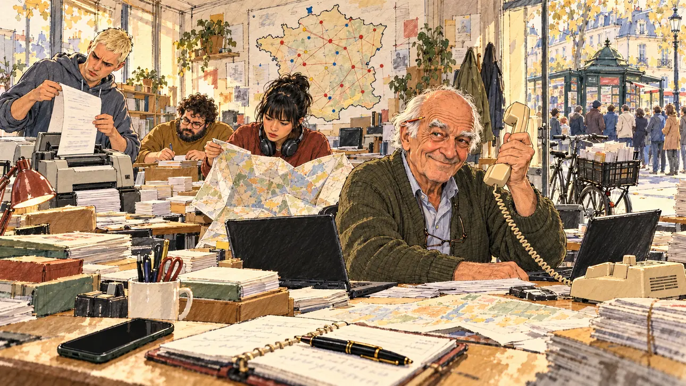

# `internetBlackout` · Internet s'éteint

**Validée par le PO le 31/10/2026**, au premier essai. Elle sert telle quelle en clair et en sombre.



| Champ | Valeur |
| --- | --- |
| Carte | `internetBlackout`, catégorie `farFetched` (Incroyable) |
| Style | Reportage dessiné ; visages dessinés comme le reste |
| Ton | Comique et un peu nostalgique |
| Date | 2026-10-31 |
| Outil | ChatGPT, ChatGPT Images 2.5 ; mode et effort : non précisés |
| Conversation | À remplir (le lien ne s'ouvre qu'avec le compte qui l'a créée) |
| Format rendu | 1672 × 941 (16:9) : export en 1290 × 726 px depuis le PNG d'origine, WebP de qualité 75, 200 Ko, sans recadrage |
| Fichier d'origine | PNG de ChatGPT, chez le PO, partagé aussi dans la conversation avec Claude |
| Première édition | À remplir |

## Texte de la carte

> **Internet s'éteint**
>
> Une panne mondiale coupe Internet pour des semaines. Plus de réseaux sociaux, plus de vidéos : on se méfie de tout, et la campagne revient au siècle dernier.

## Le moment choisi

Le QG de campagne, au troisième jour de la panne : tous les écrans sont noirs. Un vieux militant brandit le combiné d'un téléphone fixe et sourit au candidat, ravi de retrouver son époque ; autour de lui, les jeunes de l'équipe se débattent avec un fax, une carte routière et des fiches bristol. Au mur, une carte de France piquée d'épingles ; par la fenêtre, une file devant un kiosque à journaux. Le candidat est hors champ : au premier plan, son smartphone éteint, un agenda papier et un stylo-plume.

## Prompt complet

Dans une nouvelle conversation, avec [`oldTweet.webp`](oldTweet.webp) comme seule image de référence :

```
Use the attached image as the style reference: the same pencil and ink drawing with loose watercolour washes and warm paper grain. Not the same scene.
This must look like a drawing made by hand on paper, never like a photograph: the people are drawn with ink lines and flat washes, not modelled; large parts of the background are only suggested with a few pencil lines and a wash, leaving the warm paper bare.
Faces are drawn exactly like the clothes and the background: ink outlines, a few hatching strokes and flat watercolour washes for the skin, with the same level of detail as the rest of the drawing. No photographic skin, no realistic wrinkles or pores, no airbrushed or digital-painting look on the faces.

Editorial illustration, landscape 16:9 (1536 × 864 px), filling the whole frame edge to edge. The open-plan headquarters of the player's candidate's campaign in Paris, in the afternoon in 2027, on the third day of a worldwide Internet blackout: the campaign has gone back to the last century. The candidate stays off-camera: in the foreground, on the edge of a desk, only the candidate's smartphone with a black screen, next to a paper diary and a fountain pen. Every laptop screen in the room is black. In the right third, an old activist, a wiry man in his eighties with bushy white eyebrows, a bald crown with a fringe of white hair, a cardigan and a pencil behind his ear, holds up the handset of an old beige landline telephone with its curly cord and looks at the viewer with a mischievous, triumphant smile: this is his era again, his face above mid-height. Around him, the young staffers are lost: a tall young man with a bleached buzz cut and a hoodie stares at a fax machine spitting out paper as if it were an alien object; a young woman of East Asian origin with a heavy fringe and headphones around her neck struggles to fold a huge paper road map; a heavy-set young man with a curly beard and round glasses copies addresses onto index cards in a shoebox. On the wall, a large paper map of France studded with coloured pins and string; near the door, a bicycle with a delivery basket full of leaflets. Through the window, only sketched, a queue of people in front of a newspaper kiosk. Nothing on the screens, the papers, the cards, the map, the leaflets or the kiosk is readable.

Style: Reportage drawing made on the spot, like a press illustrator or courtroom sketch artist: pencil and ink with loose watercolour washes, lively unfinished lines, white paper showing through.

Palette: navy #13203F, vellum #F5EFE1, gold #A9802A, brick #B5523B, ochre #D9A441, sage #8FA58A, slate #5E7186, sand #DCC8A4, warm grey #8C8279; use 4 to 6 of them, subtle warm paper grain.

Tone: gently comic and a little nostalgic, warm afternoon light through the windows, as if the room had slipped back into the 1980s.

Constraints: realistic proportions, expressive but not caricatured faces, drawn like the rest of the illustration and never photographic; people of varied ages, genders, origins and body types (heavy, stocky, round, tall, short, wiry, not only slim), each with a distinct face and haircut (no two people alike), drawn with respect and never as a joke; anatomically correct hands with exactly five fingers, few hands visible, the others in pockets, behind objects or out of frame; no readable text anywhere (screens, papers, cards, maps, leaflets and signs stay unreadable); no captions or speech bubbles; no logos or political party colours; no recognisable real person, no lookalike of a real politician; no explicit violence; no photographic rendering, no hatching filter over a finished digital painting, no oil-paint texture, no white or ragged border.

Format: if 16:9 is not available, make 1536 × 1024 and keep the top 80 px and the bottom 80 px free of anything important (faces, hands, the main action): they will be cropped.
```

## Essais écartés

Aucun.

## Retouches

Aucune.

## Relecture

Faite et validée par le PO le 31/10/2026.

- [x] Aucun texte lisible : ni sur la carte de France, ni sur le kiosque, ni sur les papiers, qui n'ont que du faux texte.
- [x] Aucun sosie d'une personne réelle.
- [x] Le candidat du joueur est hors champ.
- [x] Mains, visages et foules sans défaut visible à 343 px de large.
- [x] Aucune couleur de parti, aucun symbole officiel. Des personnes variées par l'âge, le corps, l'origine et la coiffure.
- [x] En 3:2 : rien d'important dans les 80 px du haut et du bas. Sans objet ici : l'image est en 16:9.
- [x] Lisible sur la page de l'événement, en clair et en sombre.
