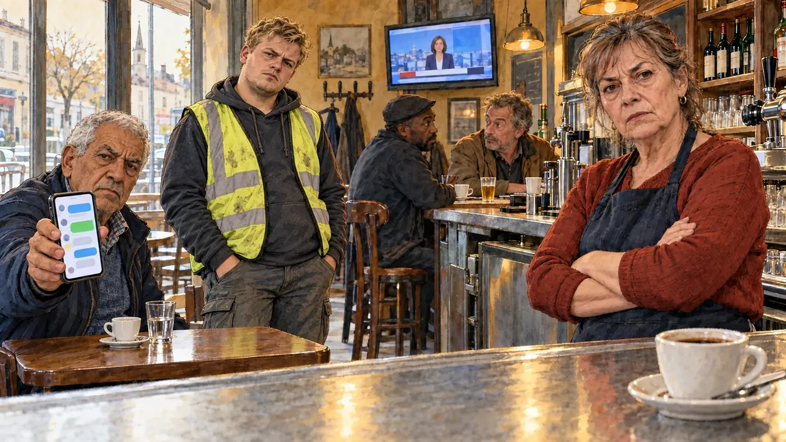

# `leakedChat` · Messages compromettants

**Validée par le PO le 31/10/2026**, au premier essai. Elle sert telle quelle en clair et en sombre.



| Champ | Valeur |
| --- | --- |
| Carte | `leakedChat`, catégorie `team` (Crise d'équipe) |
| Style | Reportage dessiné, rendu plus réaliste : visages presque photographiques, comme [`primeTime`](primeTime.md) |
| Ton | Tendu |
| Date | 2026-10-31 |
| Outil | ChatGPT, ChatGPT Images 2.5 ; mode et effort : non précisés |
| Conversation | À remplir (le lien ne s'ouvre qu'avec le compte qui l'a créée) |
| Format rendu | 1672 × 941 (16:9) : export en 1290 × 726 px, WebP de qualité 75, 133 Ko, sans recadrage |
| Fichier d'origine | PNG de ChatGPT, chez le PO. L'export du dépôt a été fait depuis la copie partagée dans la conversation avec Claude |
| Première édition | À remplir |

## Texte de la carte

> **Messages compromettants**
>
> Des captures de la messagerie de votre équipe fuitent : vos conseillers s'y moquent sans retenue de vos propres électeurs.

## Le moment choisi

La conséquence chez les électeurs : un café-bar de petite ville, le matin, au moment où le candidat entre pour une visite de campagne. La patronne, bras croisés, le regarde avec un reproche glacial ; un vieux monsieur lui tend son téléphone, la conversation à l'écran ; un jeune ouvrier le toise. Le café sur le zinc reste intact.

## Prompt complet

Dans une nouvelle conversation, avec [`oldTweet.webp`](oldTweet.webp) comme seule image de référence :

```
Use the attached image as the style reference: the same pencil and ink drawing with loose watercolour washes and warm paper grain. Faces, hands and objects are drawn with visible ink lines, never photographic. Not the same scene.

Editorial illustration, landscape 16:9 (1536 × 864 px), filling the whole frame edge to edge. A small-town café-bar in France, on a weekday morning in 2027, the day after screenshots of the candidate's team chat leaked: the candidate's advisers mocked their own voters. The player's candidate has just walked in for a campaign visit and stays off-camera: in the foreground, only the edge of the zinc counter with a cup of coffee nobody has touched. In the right third, behind the counter, the owner, a woman in her sixties, arms crossed, looks at the viewer with cold reproach, her face above mid-height. At a table, an old man holds up his smartphone towards the viewer, its screen showing chat bubbles; a young worker in a high-visibility vest looks at the viewer and shakes his head; two regulars at the bar look at each other with raised eyebrows. On the wall, a television shows the morning news. Only the owner, the old man and the young worker look at the viewer. Nothing on the screens, the menus or the walls is readable.

Style: Reportage drawing made on the spot, like a press illustrator or courtroom sketch artist: pencil and ink with loose watercolour washes, lively unfinished lines, white paper showing through.

Palette: navy #13203F, vellum #F5EFE1, gold #A9802A, brick #B5523B, ochre #D9A441, sage #8FA58A, slate #5E7186, sand #DCC8A4, warm grey #8C8279; use 4 to 6 of them, subtle warm paper grain.

Tone: tense, pale morning light through the café windows, warm light over the bar.

Constraints: realistic proportions, expressive but not caricatured faces, people of varied ages, genders and origins; anatomically correct hands with exactly five fingers, few hands visible, the others in pockets, behind objects or out of frame; no readable text anywhere (signs, menus, labels and screens stay blank or unreadable); no captions or speech bubbles; no logos, flags or political party colours; no recognisable real person, no lookalike of a real politician; no explicit violence; no oil-paint texture, no white or ragged border.

Format: if 16:9 is not available, make 1536 × 1024 and keep the top 80 px and the bottom 80 px free of anything important (faces, hands, the main action): they will be cropped.
```

## Essais écartés

Aucun.

## Décisions prises sur cette image

- **Le gilet jaune fluo** de l'ouvrier peut faire penser au mouvement des Gilets jaunes. Le PO garde l'image telle quelle (31/10/2026).

## Retouches

Aucune.

## Relecture

Faite et validée par le PO le 31/10/2026.

- [x] Aucun texte lisible : les bulles du téléphone, les étiquettes des bouteilles et l'enseigne de la rue ne se lisent pas.
- [x] Aucun sosie d'une personne réelle.
- [x] Le candidat du joueur est hors champ.
- [x] Mains, visages et foules sans défaut visible à 343 px de large.
- [x] Aucune couleur de parti, aucun symbole officiel. Des personnes variées. Le gilet jaune est accepté.
- [x] En 3:2 : rien d'important dans les 80 px du haut et du bas. Sans objet ici : l'image est en 16:9.
- [x] Lisible sur la page de l'événement, en clair et en sombre.
