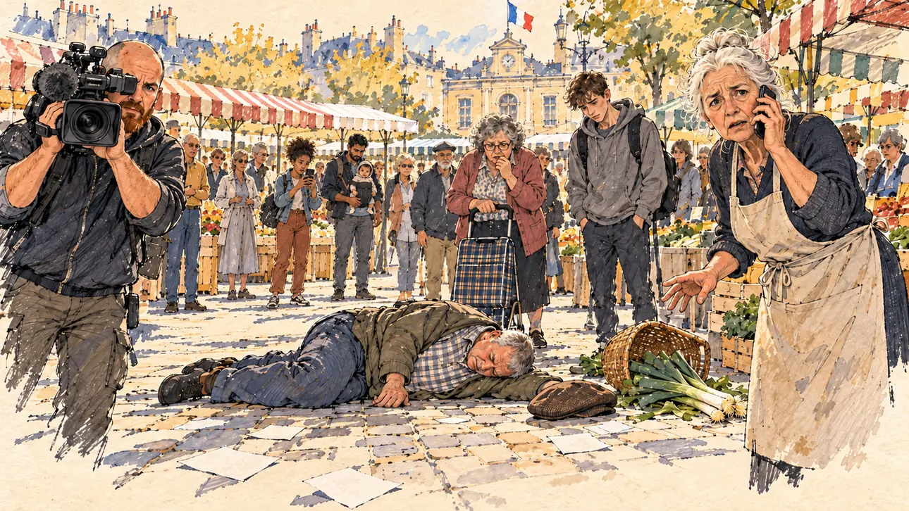

# `liveRescue` · Un malaise en direct

**Validée par le PO le 31/10/2026**, au premier essai. Elle sert telle quelle en clair et en sombre.



| Champ | Valeur |
| --- | --- |
| Carte | `liveRescue`, catégorie `breakthrough` (Coup de projecteur) |
| Style | Reportage dessiné ; visages dessinés comme le reste |
| Ton | Tendu, en suspens |
| Date | 2026-10-31 |
| Outil | ChatGPT, ChatGPT Images 2.5 ; mode et effort : non précisés |
| Conversation | À remplir (le lien ne s'ouvre qu'avec le compte qui l'a créée) |
| Format rendu | 1672 × 941 (16:9) : export en 1290 × 726 px depuis le PNG d'origine, WebP de qualité 75, 215 Ko, sans recadrage |
| Fichier d'origine | PNG de ChatGPT, chez le PO, partagé aussi dans la conversation avec Claude |
| Première édition | À remplir |

## Texte de la carte

> **Un malaise en direct**
>
> En plein bain de foule, un homme s'effondre à quelques mètres de vous. Les caméras tournent.

## Le moment choisi

Un jour de marché, sur la place d'une petite ville, pendant le bain de foule. Un homme vient de s'effondrer sur les pavés, son panier de poireaux renversé ; la foule a reculé et se fige. Une commerçante appelle les secours et regarde le candidat, la main tendue, comme pour lui demander d'agir ; un cadreur de télévision et une adolescente filment. Le candidat est hors champ : au premier plan, seulement ses tracts tombés par terre.

## Prompt complet

Dans une nouvelle conversation, avec [`oldTweet.webp`](oldTweet.webp) comme seule image de référence :

```
Use the attached image as the style reference: the same pencil and ink drawing with loose watercolour washes and warm paper grain. Not the same scene.
This must look like a drawing made by hand on paper, never like a photograph: the people are drawn with ink lines and flat washes, not modelled; large parts of the background are only suggested with a few pencil lines and a wash, leaving the warm paper bare.
Faces are drawn exactly like the clothes and the background: ink outlines, a few hatching strokes and flat watercolour washes for the skin, with the same level of detail as the rest of the drawing. No photographic skin, no realistic wrinkles or pores, no airbrushed or digital-painting look on the faces.

Editorial illustration, landscape 16:9 (1536 × 864 px), filling the whole frame edge to edge. The square of a small French town on market day, around noon in 2027, during the player's candidate's walkabout. A few metres from the candidate, a man has just collapsed, and the crowd has stepped back, leaving an empty circle on the cobblestones. The scene is seen from where the candidate stands, off-camera: in the foreground, only a scattered pile of blank campaign leaflets dropped on the ground. In the centre of the circle, a heavy-set man in his sixties with a grey crew cut and a checked shirt lies on his side, eyes closed, his flat cap and a basket of leeks fallen next to him; he is drawn with dignity, without blood or injury. In the right third, a market stallholder, a tall, bony woman in her seventies with white hair in a bun and a canvas apron, holds a phone to her ear, calling for help, and looks at the viewer anxiously, as if waiting to see what the candidate will do, her face above mid-height. On the left, a television cameraman, a stocky man in his forties with a shaved head and a red beard, keeps his shoulder camera on the scene, the lens turned towards the viewer; next to him, a teenage girl with an afro puff holds up her phone to film. Around the circle, the frozen crowd: a young father of South Asian origin with a baby carrier, a short, round woman with a grey perm and a shopping trolley, a lanky young man in a hoodie, all looking at the man on the ground. Behind them, the market stalls under striped awnings and the town hall with a French tricolour flag. Nothing on the leaflets, the stalls, the awnings or the camera is readable.

Style: Reportage drawing made on the spot, like a press illustrator or courtroom sketch artist: pencil and ink with loose watercolour washes, lively unfinished lines, white paper showing through.

Palette: navy #13203F, vellum #F5EFE1, gold #A9802A, brick #B5523B, ochre #D9A441, sage #8FA58A, slate #5E7186, sand #DCC8A4, warm grey #8C8279; use 4 to 6 of them, subtle warm paper grain.

Tone: tense and suspended, a moment that hangs in the air, hard midday sun and short shadows.

Constraints: realistic proportions, expressive but not caricatured faces, drawn like the rest of the illustration and never photographic; people of varied ages, genders, origins and body types (heavy, stocky, round, tall, short, wiry, not only slim), each with a distinct face and haircut (no two people alike), drawn with respect and never as a joke; anatomically correct hands with exactly five fingers, few hands visible, the others in pockets, behind objects or out of frame; no readable text anywhere (leaflets, signs, awnings and cameras stay unreadable); no captions or speech bubbles; no logos or political party colours; no recognisable real person, no lookalike of a real politician or journalist; no blood, no injury, no medical close-up, no explicit violence; no photographic rendering, no hatching filter over a finished digital painting, no oil-paint texture, no white or ragged border.

Format: if 16:9 is not available, make 1536 × 1024 and keep the top 80 px and the bottom 80 px free of anything important (faces, hands, the main action): they will be cropped.
```

## Décisions prises sur cette image

- **La ligne de style en tête du prompt** (« a drawing made by hand on paper, never like a photograph », fond seulement esquissé) a donné le bon rendu dès le premier essai, sur une scène pourtant chargée de monde.
- **L'homme à terre** est dessiné avec dignité, sans sang ni blessure : on lit un malaise, ni une agression ni un corps sans vie.

## Essais écartés

Aucun.

## Retouches

Aucune.

## Relecture

Faite et validée par le PO le 31/10/2026.

- [x] Aucun texte lisible : ni sur les tracts, ni sur les auvents, ni sur la caméra.
- [x] Aucun sosie d'une personne réelle.
- [x] Le candidat du joueur est hors champ.
- [x] Mains, visages et foules sans défaut visible à 343 px de large.
- [x] Aucune couleur de parti. Le drapeau tricolore signale la mairie. Des personnes variées par l'âge, le corps, l'origine et la coiffure.
- [x] En 3:2 : rien d'important dans les 80 px du haut et du bas. Sans objet ici : l'image est en 16:9.
- [x] Lisible sur la page de l'événement, en clair et en sombre.
