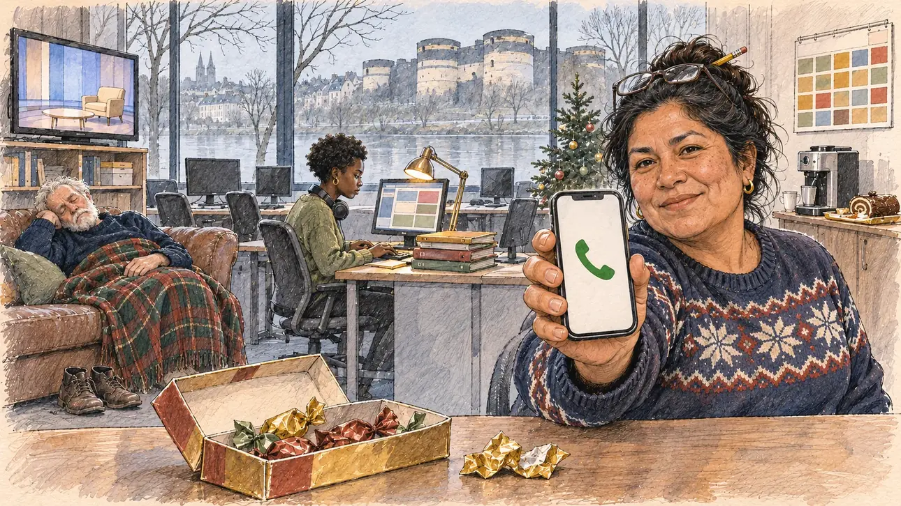

# `christmasTruce` · La trêve des confiseurs

**À générer.** Prompt prêt le 05/11/2026, pas encore d'image validée.



| Champ | Valeur |
| --- | --- |
| Carte | `christmasTruce`, catégorie `media` (Opportunité médiatique), carte ajoutée par la PR #297 de l'app |
| Style | Reportage dessiné, trait de `primeTime` |
| Ton | Calme et amusé |
| Date | À remplir |
| Outil | ChatGPT Images |
| Conversation | À remplir (le lien ne s'ouvre qu'avec le compte qui l'a créée) |
| Format rendu | À remplir |
| Fichier d'origine | À remplir |
| Première édition | À remplir |

## Texte de la carte

> **La trêve des confiseurs**
>
> Entre Noël et le jour de l'An, la vie politique se met en pause : les rédactions cherchent des invités, vos militants des raisons de se reposer.

## Le moment choisi

Le QG de campagne du candidat à Angers, un matin brumeux entre Noël et le jour de l'An, vu depuis le bureau où le candidat (hors champ) vient d'arriver : au premier plan, une boîte de papillotes à moitié vide et les papiers dorés froissés. L'attachée de presse, seule ou presque, tend au candidat son téléphone qui sonne : une matinale cherche un invité. Autour : les bureaux vides aux ordinateurs éteints, un bénévole endormi sur le canapé sous un plaid, un stagiaire qui avance le programme, un petit sapin, une télévision qui montre un plateau presque vide avec un fauteuil libre. Par la fenêtre : la Maine dans la brume et le château d'Angers aux tours rayées de schiste et de tuffeau.

## Prompt complet

Dans une nouvelle conversation, avec [`primeTime.webp`](../../illustrations/media/primeTime.webp) comme seule image de référence.

```
Use the attached image as the style reference and copy its drawing: a realistic reportage drawing made on the spot for a newspaper, with quick, nervous pencil lines, often drawn twice, ink hatching in the shadows, transparent watercolour washes that spill a little over the lines, and the warm paper showing through. Not the same scene and not the same people: never reuse the face or the hair of the woman in the reference.
Like in the reference, the setting can be full when the story needs it, with the things that say where we are and what is happening, but each one is sketched with a few pencil lines and a light wash, never rendered or finished, and the drawing gets looser and paler towards the edges until it fades into the bare paper.
This must look like a drawing made by hand on paper by a press illustrator, halfway between a quick sketch and a realistic picture: never a photograph, a film poster or a digital painting, and never a cartoon, a comic strip, a caricature or a children's book illustration. Continuous lines, never dotted or dashed outlines; no uniform texture, speckles or hatching filter laid over the picture; no glossy highlights, no smooth gradients, in the sky and on the walls too. Colour can be rich in places, on a piece of clothing, a light or a flag, but it stays transparent and within the palette below. The fade into the paper at the edges stays narrow, without a wide white margin. No blur and no depth-of-field effect: everything, the foreground included, is drawn sharp, like a sketch made on the spot.
People are drawn from life with realistic anatomy and proportions, like in the reference: faces shaped with pencil lines, hatching and light washes, a little more finished than the background but never photographic (no photographic skin, no airbrushed or digital-painting look). Expressions stay natural and restrained, even in laughter or tears: no exaggerated grins, no wide-open mouths full of teeth, no rubbery or cartoonish faces.

Editorial illustration, landscape 16:9 (1536 × 864 px), the scene filling the frame, with only a light fade into the paper at the edges. The campaign headquarters of the player's candidate in Angers, in Anjou, in the Loire valley, on a misty morning between Christmas and New Year 2026, during the truce of the confectioners, when political life goes on pause: newsrooms are looking for guests, and the candidate's activists for reasons to rest. The scene is seen from the desk where the candidate has just arrived, who stays off-camera: in the foreground, only a half-empty box of papillotes, the French Christmas chocolates in twisted coloured paper, and a few crumpled gold wrappers on the desk. In the right third, the team's press officer, a woman in her forties of Peruvian origin, short and stocky, with thick black hair in a messy bun held by a pencil, a Christmas jumper with a plain snowflake pattern and reading glasses on her head, holds out her ringing phone towards the viewer with an amused, conspiratorial look, as if to say that a morning show is looking for a guest, her face above mid-height. The phone shows only a green call icon. Around her, sketched in pencil and light washes: empty desks with switched-off computers and chairs pushed in; a volunteer in his sixties with a white beard asleep on a worn sofa under a tartan blanket, his shoes off; a young intern of Senegalese origin with headphones round her neck, alone at a desk typing on the programme, a pile of folders beside her; a small Christmas tree with a few baubles; a coffee machine and a tray of leftover Yule log; on a shelf, a television showing an almost empty morning-show set with one free armchair; a calendar on the wall with only coloured squares. Through the tall window, the Maine river in the winter mist and, on the other bank, the castle of Angers with its massive round towers striped in dark slate-grey schist and pale tuffeau stone, slate roofs of the town, bare trees. Only the press officer looks straight at the viewer. Nothing on the phone, the screens, the television, the folders, the calendar, the wrappers or the jumper is readable, and no logo of a real TV channel, radio or brand appears.

Style: Reportage drawing made on the spot, like a press illustrator or courtroom sketch artist: pencil and ink with loose watercolour washes, lively unfinished lines, white paper showing through.

Palette: navy #13203F, vellum #F5EFE1, gold #A9802A, brick #B5523B, ochre #D9A441, sage #8FA58A, slate #5E7186, sand #DCC8A4, warm grey #8C8279; use 4 to 6 of them, subtle warm paper grain.

Tone: calm and amused, the pale grey-blue light of a misty winter morning, the warm lamp over the intern's desk, and the gold and red of the chocolate wrappers as the festive patch.

Constraints: realistic proportions, natural expressions, never cartoonish or caricatured faces, drawn like the rest of the illustration and never photographic; people of varied ages, genders, origins and body types (heavy, stocky, round, tall, short, wiry, not only slim), each with a distinct face and haircut (no two people alike), drawn with respect and never as a joke; anatomically correct hands with exactly five fingers, few hands visible, the others in pockets, behind objects or out of frame; no readable text anywhere (the phone, the screens, the television, the folders, the calendar, the wrappers and the jumper stay unreadable); no captions or speech bubbles; no logos or political party colours; no recognisable real person, no lookalike of a real politician, and no logo of a real TV channel, radio or brand; no explicit violence; no photographic rendering, no blur or bokeh, no dotted outlines, no texture or hatching filter over the picture, no oil-paint texture, no wide white margin or frame (a light fade into the paper at the edges is fine).

Format: if 16:9 is not available, make 1536 × 1024 and keep the top 80 px and the bottom 80 px free of anything important (faces, hands, the main action): they will be cropped.
```

## Décisions prises sur cette image

Aucune pour l'instant.

## Essais écartés

Aucun pour l'instant.

## Retouches

Aucune.

## Relecture

À faire sur l'image validée.
