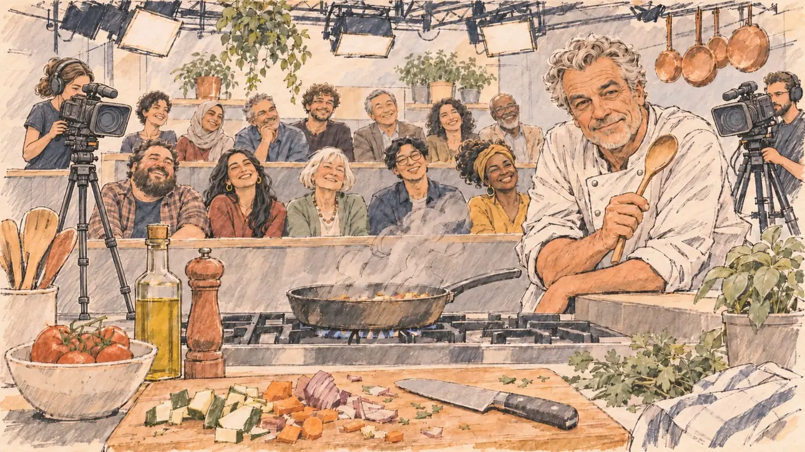

# `cookingShow` · Une émission de cuisine

**Validée par le PO le 31/10/2026**, au premier essai. Elle sert telle quelle en clair et en sombre.



| Champ | Valeur |
| --- | --- |
| Carte | `cookingShow`, catégorie `media` (Opportunité médiatique) |
| Style | Reportage dessiné |
| Ton | Chaleureux, avec une pointe d'ironie |
| Date | 2026-10-31 |
| Outil | ChatGPT avec le modèle GPT Sol 6.1 en effort « light », et ChatGPT Images 2.5 |
| Conversation | À remplir (le lien ne s'ouvre qu'avec le compte qui l'a créée) |
| Format rendu | 1672 × 941 (16:9) : export en 1290 × 726 px depuis le PNG d'origine, WebP de qualité 75, 206 Ko, sans recadrage ; réexportée le 01/11/2026, après une première version en qualité 60 pour tenir 180 Ko |
| Fichier d'origine | PNG de ChatGPT, chez le PO, partagé aussi dans la conversation avec Claude |
| Première édition | `kit-france-2611-0001` |

## Texte de la carte

> **Une émission de cuisine**
>
> Une émission culinaire très suivie vous invite à cuisiner en direct avec un grand chef. Le public adore voir les politiques en tablier.

## Le moment choisi

Le plateau vu depuis le plan de travail du candidat, hors champ : une planche aux légumes coupés n'importe comment, le couteau posé et un tablier froissé. En face, le grand chef tend sa cuillère en bois avec un sourire amusé ; entre eux, une poêle fume un peu trop. Derrière, le public rit et les caméras visent le candidat.

## Prompt complet

Dans une nouvelle conversation, avec [`oldTweet.webp`](../../illustrations/polemic/oldTweet.webp) comme seule image de référence :

```
Use the attached image as the style reference: the same pencil and ink drawing with loose watercolour washes and warm paper grain. Faces, hands and objects are drawn with visible ink lines, never photographic. Not the same scene.

Editorial illustration, landscape 16:9 (1536 × 864 px), filling the whole frame edge to edge. The set of a popular cooking show, live, in 2027, seen from the place of the player's candidate at the cooking counter, who stays off-camera: in the foreground, only a cutting board with clumsily chopped vegetables, a knife laid down and a slightly crumpled apron string. In the right third, the star chef, a broad-shouldered man in his sixties in a white chef's jacket, leans on the counter with a wooden spoon in one hand and looks at the viewer with an amused, encouraging grin, his face above mid-height. On the stove between them, a pan smokes a little too much. Behind, a small studio audience on tiered benches laughs and watches the viewer, two cameras point at the viewer, and copper pans hang under warm lights. Nothing on the set, the screens or the jars is readable.

Style: Reportage drawing made on the spot, like a press illustrator or courtroom sketch artist: pencil and ink with loose watercolour washes, lively unfinished lines, white paper showing through.

Palette: navy #13203F, vellum #F5EFE1, gold #A9802A, brick #B5523B, ochre #D9A441, sage #8FA58A, slate #5E7186, sand #DCC8A4, warm grey #8C8279; use 4 to 6 of them, subtle warm paper grain.

Tone: warm and gently ironic, soft afternoon-like studio light, warm pastels.

Constraints: realistic proportions, expressive but not caricatured faces, people of varied ages, genders and origins; anatomically correct hands with exactly five fingers, few hands visible, the others in pockets, behind objects or out of frame; no readable text anywhere (signs, banners, labels and screens stay blank); no captions or speech bubbles; no logos, flags or political party colours; no recognisable real person, no lookalike of a real politician or television chef; no explicit violence; no oil-paint texture, no white or ragged border.

Format: if 16:9 is not available, make 1536 × 1024 and keep the top 80 px and the bottom 80 px free of anything important (faces, hands, the main action): they will be cropped.
```

## Essais écartés

Aucun.

## Retouches

Aucune.

## Relecture

Faite et validée par le PO le 31/10/2026.

- [x] Aucun texte lisible : ni étiquette sur la bouteille et les bocaux, ni écran.
- [x] Aucun sosie d'une personne réelle. Ici surtout : le chef, à côté des vrais chefs de télévision.
- [x] Le candidat du joueur est hors champ.
- [x] Mains, visages et foules sans défaut visible à 343 px de large.
- [x] Aucune couleur de parti, aucun symbole officiel. Des personnes variées.
- [x] En 3:2 : rien d'important dans les 80 px du haut et du bas. Sans objet ici : l'image est en 16:9.
- [x] Lisible sur la page de l'événement, en clair et en sombre.

## Régénération demandée (04/11/2026)

**Pourquoi.** La revue de la première série note le style à 3/3 et les détails à 3/3 : c'est un autre style, une peinture numérique finie presque publicitaire, avec des reflets brillants sur la poêle, le couteau, la bouteille d'huile et les casseroles en cuivre, des légumes rendus comme une photo, un visage de chef modelé, une vapeur en halo, et aucun papier visible. Le cadre est un des plus chargés de la série : gradins d'une quinzaine de spectateurs, projecteurs, deux caméras, casseroles suspendues, plantes, et au premier plan torchon, planche, légumes, couteau, tomates, basilic, huile, moulin à poivre, ustensiles, citrons, ail. Le PO a décidé de régénérer l'image.

**Ce qui reste.** Le moment : le plan de travail du candidat vu depuis sa place, hors champ, le grand chef à droite qui tend sa cuillère en bois avec un sourire amusé en regardant le spectateur, la poêle qui fume un peu trop entre eux, la planche aux légumes coupés n'importe comment et le couteau posé, le public qui rit.

**Ce qui change.** Le public tombe de quinze spectateurs à six ou sept, esquissés en quelques traits. Sortent du décor : les projecteurs, la deuxième caméra, les casseroles suspendues, les plantes, le torchon, la bouteille d'huile, le moulin à poivre, les ustensiles, les citrons et l'ail. Restent la planche, le couteau, la poêle et une caméra. Le chef reçoit une coupe (boucles argentées, menton mal rasé) et un visage dessiné comme le reste, sans modelé ; la vapeur devient quelques boucles au crayon.

### Prompt de régénération

Dans une nouvelle conversation, avec [`oldTweet.webp`](../../illustrations/polemic/oldTweet.webp) comme seule image de référence.

```
Use the attached image as the style reference and copy its drawing: quick, nervous pencil lines, often drawn twice, loose ink hatching in the shadows, transparent watercolour washes that spill a little over the lines, and the warm paper showing through everywhere. Not the same scene.
Like in the reference, the setting can be full when the story needs it, with the things that say where we are and what is happening, but each one is sketched with a few pencil lines and a light wash, never rendered or finished, and the drawing gets looser and paler towards the edges until it fades into the bare paper.
This must look like a drawing made by hand on paper, never like a photograph, a film poster or a digital painting: the people are drawn with pencil and ink lines and washes, not modelled; continuous lines, never dotted or dashed outlines; no uniform texture, speckles or hatching filter laid over the picture; no dense colour, no glossy highlights, no smooth gradients, in the sky and on the walls too. The fade into the paper at the edges stays narrow, without a wide white margin. No blur and no depth-of-field effect: everything, the foreground included, is drawn sharp, like a sketch made on the spot.
Faces are drawn exactly like the clothes and the background: ink outlines, a few hatching strokes and flat watercolour washes for the skin, with the same level of detail as the rest of the drawing. No photographic skin, no realistic wrinkles or pores, no airbrushed or digital-painting look on the faces.

Editorial illustration, landscape 16:9 (1536 × 864 px), the scene filling the frame, with only a light fade into the paper at the edges. The set of a popular cooking show, live, in 2027, seen from the place of the player's candidate at the cooking counter, who stays off-camera: in the foreground, only a wooden cutting board with a few clumsily chopped vegetables and a knife laid down, drawn flat with ink lines and a pale wash, no shine on the blade. In the right third, the star chef, a broad-shouldered man in his sixties with short silver curls and a stubbled chin, in a white chef's jacket, leans on the counter with a wooden spoon in one hand and looks at the viewer with an amused, encouraging grin, his face above mid-height. On the stove between them, a pan smokes a little too much, the smoke drawn as a few loose pencil curls. Behind the stove, six or seven spectators on tiered benches are only sketched in a few quick ink strokes and pale washes, laughing and looking at the viewer: among them a heavy-set bearded man, a young woman with long dark hair, an older woman with a white bob. One television camera on a tripod points at the viewer on the left. Everything else of the studio is bare paper with a few pencil lines and a warm wash. Nothing on the set or the camera is readable.

Style: Reportage drawing made on the spot, like a press illustrator or courtroom sketch artist: pencil and ink with loose watercolour washes, lively unfinished lines, white paper showing through.

Palette: navy #13203F, vellum #F5EFE1, gold #A9802A, brick #B5523B, ochre #D9A441, sage #8FA58A, slate #5E7186, sand #DCC8A4, warm grey #8C8279; use 4 to 6 of them, subtle warm paper grain.

Tone: warm and gently ironic, soft afternoon-like studio light, warm pastels.

Constraints: realistic proportions, expressive but not caricatured faces, drawn like the rest of the illustration and never photographic; people of varied ages, genders, origins and body types (heavy, stocky, round, tall, short, wiry, not only slim), each with a distinct face and haircut (no two people alike), drawn with respect and never as a joke; anatomically correct hands with exactly five fingers, few hands visible, the others in pockets, behind objects or out of frame; no readable text anywhere (the set, the camera and the screens stay unreadable); no captions or speech bubbles; no logos or political party colours; no recognisable real person, no lookalike of a real politician or television chef; no explicit violence; no photographic rendering, no blur or bokeh, no dotted outlines, no texture or hatching filter over the picture, no oil-paint texture, no wide white margin or frame (a light fade into the paper at the edges is fine).

Format: if 16:9 is not available, make 1536 × 1024 and keep the top 80 px and the bottom 80 px free of anything important (faces, hands, the main action): they will be cropped.
```
