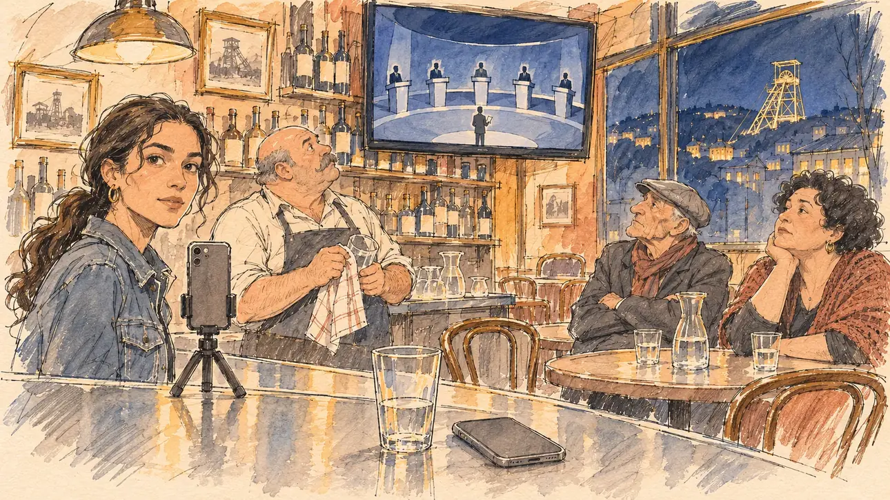

# `debateExcluded` · Le débat se fera sans vous

**Validée par le PO le 09/11/2026**, au premier essai. Elle sert telle quelle en clair et en sombre.



| Champ | Valeur |
| --- | --- |
| Carte | `debateExcluded`, catégorie `media` (Opportunité médiatique), poids 0,3, semaines 8 à 11, à 8 % ou moins du sondage |
| Style | Reportage dessiné |
| Ton | Ironique, un peu amer |
| Date | 2026-11-09 |
| Outil | ChatGPT Images, à compléter (modèle et effort) |
| Conversation | À compléter |
| Format rendu | 1672 × 941 (16:9) : export en 1290 × 726 px, WebP de qualité 75, 219 Ko, sans recadrage, fait depuis la copie WebP de la conversation (à refaire depuis le PNG d'origine) |
| Fichier d'origine | À compléter (hors du dépôt) |
| Première édition | À compléter |

## Texte de la carte

> **Le débat se fera sans vous**
>
> Une grande chaîne privée organise un débat entre les cinq candidatures en tête des sondages. Vous n'en êtes pas.

## Le moment choisi

Un bistrot de quartier à Saint-Étienne, le soir du débat : par la vitre, la colline et le chevalement éclairé d'un ancien puits de mine ; au-dessus du zinc, la télévision montre le plateau en plan large, cinq pupitres et des silhouettes sans visage. Le candidat reste hors champ : son verre d'eau à moitié bu et son téléphone retourné sur le comptoir. La responsable du numérique de la campagne, son téléphone déjà sur un trépied, regarde le spectateur : on lance le direct ? Le patron essuie un verre en regardant l'écran ; un vieux militant croise les bras, une militante soupire. Saint-Étienne n'avait encore servi à aucune carte.

## Prompt complet

Dans une nouvelle conversation, avec [`primeTime.webp`](../../illustrations/media/primeTime.webp) comme seule image de référence :

```
Use the attached image as the style reference and copy its drawing: a realistic reportage drawing made on the spot for a newspaper, with quick, nervous pencil lines, often drawn twice, ink hatching in the shadows, transparent watercolour washes that spill a little over the lines, and the warm paper showing through. Not the same scene and not the same people: never reuse the face or the hair of the woman in the reference.
Like in the reference, the setting can be full when the story needs it, with the things that say where we are and what is happening, but each one is sketched with a few pencil lines and a light wash, never rendered or finished, and the drawing gets looser and paler towards the edges until it fades into the bare paper.
This must look like a drawing made by hand on paper by a press illustrator, halfway between a quick sketch and a realistic picture: never a photograph, a film poster or a digital painting, and never a cartoon, a comic strip, a caricature or a children's book illustration. Continuous lines, never dotted or dashed outlines; no uniform texture, speckles or hatching filter laid over the picture; no glossy highlights, no smooth gradients, in the sky and on the walls too. Colour can be rich in places, on a piece of clothing, a light or a flag, but it stays transparent and within the palette below. The fade into the paper at the edges stays narrow, without a wide white margin. No blur and no depth-of-field effect: everything, the foreground included, is drawn sharp, like a sketch made on the spot.
People are drawn from life with realistic anatomy and proportions, like in the reference: faces shaped with pencil lines, hatching and light washes, a little more finished than the background but never photographic (no photographic skin, no airbrushed or digital-painting look). Expressions stay natural and restrained, even in laughter or tears: no exaggerated grins, no wide-open mouths full of teeth, no rubbery or cartoonish faces.

Editorial illustration, landscape 16:9 (1536 × 864 px), the scene filling the frame, with only a light fade into the paper at the edges. A corner bistro in Saint-Étienne, on an evening in late March 2027, while a big private channel broadcasts a debate between the five candidates leading the polls, without the player: a zinc counter, bottles on shelves, old framed photographs, a few tables; through the window at night, the hills of the city and the steel headframe of an old coal mine, lit up. On a TV screen high above the counter, the debate set in a wide shot: five lecterns in a semicircle, the candidates as tiny figures with no faces, a presenter in the middle, nothing readable and no channel logo. The player's candidate stays off-camera: in the foreground, only a half-drunk glass of water and a phone lying face down on the counter. In the left third, the campaign's digital manager, a young woman in her twenties of Tunisian descent, slim, with long dark wavy hair in a low ponytail and a denim jacket, has already set her phone on a small tripod on the counter and looks at the viewer, shall we go live, her face above mid-height. Behind the counter, the owner of the bistro, a heavy-set white man in his fifties, bald with a big grey moustache, dries a glass while watching the screen. At a table, an old activist, a thin man in his seventies of Polish descent with a flat cap and a scarf, shakes his head with his arms folded; next to him, a round woman in her forties of Italian descent with short black curls and a knitted shawl sighs, her chin in her hand. Only the digital manager looks at the viewer. Nothing on the TV, the bottles, the photographs, the phone or the window is readable.

Style: Reportage drawing made on the spot, like a press illustrator or courtroom sketch artist: pencil and ink with loose watercolour washes, lively unfinished lines, white paper showing through.

Palette: navy #13203F, vellum #F5EFE1, gold #A9802A, brick #B5523B, ochre #D9A441, sage #8FA58A, slate #5E7186, sand #DCC8A4, warm grey #8C8279; use 4 to 6 of them, subtle warm paper grain.

Tone: wry and a little bitter, evening, the warm amber light of the bistro against the cold blue glow of the TV and the night outside.

Constraints: realistic proportions, natural expressions, never cartoonish or caricatured faces, drawn like the rest of the illustration and never photographic; people of varied ages, genders, origins and body types (heavy, stocky, round, tall, short, wiry, not only slim), each with a distinct face and haircut (no two people alike), drawn with respect and never as a joke; each person's age, build and look plausible for their job and the scene (working people of working age), no stereotype tying an origin or a gender to a role, and no person of colour shown alone in a featured service or deferential role; anatomically correct hands with exactly five fingers, few hands visible, the others in pockets, behind objects or out of frame; no readable text anywhere (the TV, the bottles, the photographs, the phone and the window stay unreadable, no brand labels); no captions or speech bubbles; no logos, no TV channel name or logo, no political party colours; no faces of the candidates on the TV screen, no recognisable real person, no lookalike of a real politician or presenter; no explicit violence; no photographic rendering, no blur or bokeh, no dotted outlines, no texture or hatching filter over the picture, no oil-paint texture, no glow or halo around the lights or the screen, no wide white margin or frame (a light fade into the paper at the edges is fine).

Format: if 16:9 is not available, make 1536 × 1024 and keep the top 80 px and the bottom 80 px free of anything important (faces, hands, the main action): they will be cropped.
```

## Décisions prises sur cette image

Validée telle quelle par le PO (09/11/2026). Les cinq silhouettes du débat portent toutes costume et cravate, on y lit cinq hommes ; à la taille de la carte ce sont des taches, et le PO les garde. Les photos encadrées de puits de mine, au mur, disent Saint-Étienne avec le chevalement de la fenêtre.

## Essais écartés

Aucun.

## Retouches

Aucune.

## Relecture

Faite et validée par le PO le 09/11/2026.

- [x] Aucun texte lisible : la télévision ne montre que le plateau, sans logo ; les bouteilles ont des étiquettes vierges ; le téléphone est retourné.
- [x] Aucun sosie d'une personne réelle : les candidats du débat sont des silhouettes sans visage.
- [x] Le candidat du joueur est hors champ : seuls son verre d'eau et son téléphone, sur le zinc.
- [x] Mains et visages sans défaut visible à 343 px de large : le verre et le torchon du patron, les bras croisés, le menton dans la main.
- [x] Aucune couleur ni aucun logo de parti. Des personnes variées par l'âge, le corps, l'origine et la coiffure.
- [x] En 16:9 : pas de recadrage.
- [ ] Lisible sur la page de l'événement, en clair et en sombre : à vérifier dans l'app, une fois la carte publiée.
