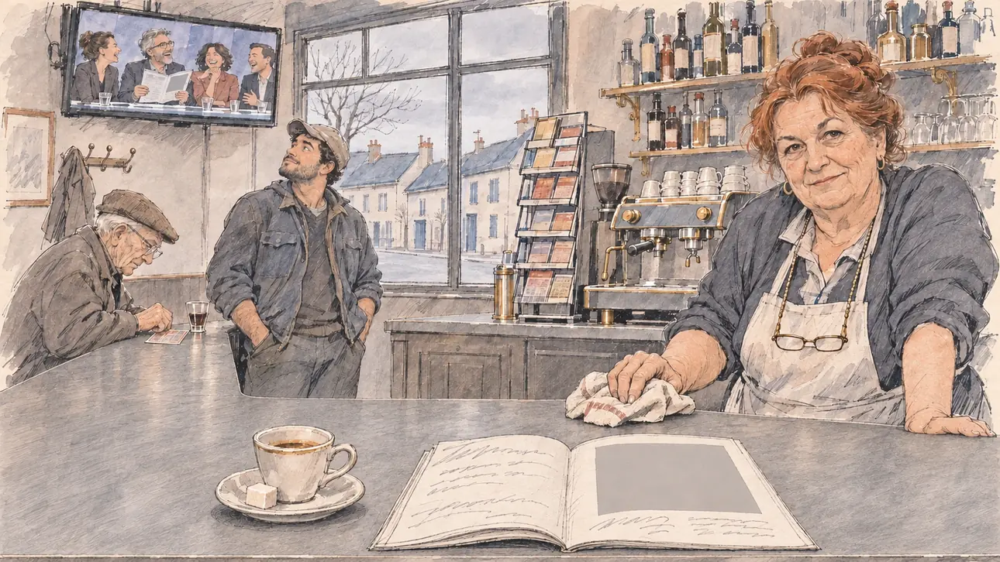

# `dullPortrait` · Le plus terne de la campagne

**Validée par le PO le 10/11/2026**, au premier essai. Elle sert telle quelle en clair et en sombre.



| Champ | Valeur |
| --- | --- |
| Carte | `dullPortrait`, catégorie `media` (Opportunité médiatique), poids 0,25, toute semaine ; un pari gagné sur une faiblesse (la normalité, sur un charisme bas) |
| Style | Reportage dessiné |
| Ton | Ironie sèche, matin gris |
| Date | 2026-11-10 |
| Outil | ChatGPT Images, à compléter (modèle et effort) |
| Conversation | À compléter |
| Format rendu | 1672 × 941 (16:9) : export en 1290 × 726 px, WebP de qualité 75, 162 Ko, sans recadrage, fait depuis la copie WebP de la conversation (à refaire depuis le PNG d'origine) |
| Fichier d'origine | À compléter (hors du dépôt) |
| Première édition | À compléter |

## Texte de la carte

> **Le plus terne de la campagne**
>
> Un grand magazine vous consacre son portrait de la semaine, sous un titre cruel : « La candidature la plus terne de la campagne ». Les plateaux s'en amusent.

## Le moment choisi

Un bar-tabac d'une petite ville du Berry, un mardi matin gris, pendant un arrêt de campagne. Le candidat reste hors champ, au comptoir : son petit café et son sucre sur le zinc, et le magazine ouvert à son portrait, qui ne montre qu'un grand rectangle gris à la place de la photo : la plaisanterie dit « terne » sans montrer le candidat. À la télévision du bar, un plateau rit, un chroniqueur brandit la même page grise. La patronne aux cheveux cuivrés, torchon à la main, regarde le spectateur, pince-sans-rire et bienveillante : terne, peut-être, mais vous êtes venu jusqu'ici. Un vieil habitué gratte ses tickets, un jeune agriculteur lève les yeux vers l'écran.

## Prompt complet

Dans une nouvelle conversation, avec [`primeTime.webp`](../../illustrations/media/primeTime.webp) comme seule image de référence :

```
Use the attached image as the style reference and copy its drawing: a realistic reportage drawing made on the spot for a newspaper, with quick, nervous pencil lines, often drawn twice, ink hatching in the shadows, transparent watercolour washes that spill a little over the lines, and the warm paper showing through. Not the same scene and not the same people: never reuse the face or the hair of the woman in the reference.
Like in the reference, the setting can be full when the story needs it, with the things that say where we are and what is happening, but each one is sketched with a few pencil lines and a light wash, never rendered or finished, and the drawing gets looser and paler towards the edges until it fades into the bare paper.
This must look like a drawing made by hand on paper by a press illustrator, halfway between a quick sketch and a realistic picture: never a photograph, a film poster or a digital painting, and never a cartoon, a comic strip, a caricature or a children's book illustration. Continuous lines, never dotted or dashed outlines; no uniform texture, speckles or hatching filter laid over the picture; no glossy highlights, no smooth gradients, in the sky and on the walls too. Colour can be rich in places, on a piece of clothing, a light or a flag, but it stays transparent and within the palette below. The fade into the paper at the edges stays narrow, without a wide white margin. No blur and no depth-of-field effect: everything, the foreground included, is drawn sharp, like a sketch made on the spot.
People are drawn from life with realistic anatomy and proportions, like in the reference: faces shaped with pencil lines, hatching and light washes, a little more finished than the background but never photographic (no photographic skin, no airbrushed or digital-painting look). Expressions stay natural and restrained, even in laughter or tears: no exaggerated grins, no wide-open mouths full of teeth, no rubbery or cartoonish faces.

Editorial illustration, landscape 16:9 (1536 × 864 px), the scene filling the frame, with only a light fade into the paper at the edges. A bar-tabac in a small town of the Berry, in the centre of France, on a grey Tuesday morning in February 2027, during a campaign stop, the week a big magazine ran its portrait of the player's candidate under a cruel title calling it the dullest candidacy of the campaign: a zinc counter, a coffee machine, bottles on shelves, a rack of scratch cards with no logo, and through the window a quiet street of low houses under a grey sky. On a television high on the wall, a talk-show panel laughs while one pundit holds up the magazine, its pages unreadable. The player's candidate stays off-camera, at the counter: in the foreground, only the candidate's small cup of coffee with a sugar cube on the zinc, and next to it the magazine, open at the portrait page, which shows only a large plain grey rectangle where the photo would be and a few lines of unreadable text: no face, no person, no silhouette. In the right third, the owner of the bar behind her counter, a round woman in her sixties with copper-dyed hair in a bun and reading glasses on a chain, leans on the counter with a cloth in her hand and looks at the viewer with a dry, kindly half-smile, dull maybe, but you came all the way here, her face above mid-height. Around her: an old regular, a thin man in his eighties in a flat cap, scratches his tickets at the end of the counter; a young farmer in his twenties, stocky, of Portuguese descent, in a cap and a work jacket, looks up at the screen and shrugs. Only the owner looks at the viewer. Nothing on the magazine, the television, the bottles, the tickets or the window is readable.

Style: Reportage drawing made on the spot, like a press illustrator or courtroom sketch artist: pencil and ink with loose watercolour washes, lively unfinished lines, white paper showing through.

Palette: navy #13203F, vellum #F5EFE1, gold #A9802A, brick #B5523B, ochre #D9A441, sage #8FA58A, slate #5E7186, sand #DCC8A4, warm grey #8C8279; use 4 to 6 of them, subtle warm paper grain.

Tone: dry irony, a grey, quiet morning, muted warm greys everywhere, the owner's copper hair and the brass of the coffee machine as the only warm notes.

Constraints: realistic proportions, natural expressions, never cartoonish or caricatured faces, drawn like the rest of the illustration and never photographic; people of varied ages, genders, origins and body types (heavy, stocky, round, tall, short, wiry, not only slim), each with a distinct face and haircut (no two people alike), drawn with respect and never as a joke; each person's age, build and look plausible for their job and the scene (working people of working age), no stereotype tying an origin or a gender to a role, and no person of colour shown alone in a featured service or deferential role; no picture, portrait or silhouette of the candidate anywhere, not on the magazine and not on the television; anatomically correct hands with exactly five fingers, few hands visible, the others in pockets, behind objects or out of frame; no readable text anywhere (the magazine, the television, the bottles, the scratch cards and the window stay unreadable, no title, no headline); no captions or speech bubbles; no logos, no magazine name, no television channel logo, no lottery or brand logo, no political party colours; no recognisable real person, no lookalike of a real politician or television personality; no explicit violence; no photographic rendering, no blur or bokeh, every outline a continuous pencil or ink line with no dotted or dashed outlines, no mottled, crackled or speckled texture over the faces, the clothes or the walls, no hatching filter over the picture, no oil-paint texture, no glow or halo around the lights or the television, no wide white margin or frame (a light fade into the paper at the edges is fine).

Format: if 16:9 is not available, make 1536 × 1024 and keep the top 80 px and the bottom 80 px free of anything important (faces, hands, the main action): they will be cropped.
```

## Décisions prises sur cette image

Validée telle quelle par le PO (10/11/2026). Un léger voile de hachures couvre le comptoir et le tablier (il passe pour la texture du zinc), et les chroniqueurs de la télévision rient bouche ouverte, en petit : gardés.

## Essais écartés

Aucun.

## Retouches

Aucune.

## Relecture

Faite et validée par le PO le 10/11/2026.

- [x] Aucun texte lisible : le magazine n'a qu'un rectangle gris et des gribouillis, l'écran aucun bandeau ; aucun logo sur le présentoir de tickets ni sur les bouteilles.
- [x] Aucun sosie d'une personne réelle ; aucune image du candidat, ni sur le magazine ni à la télévision.
- [x] Le candidat du joueur est hors champ : seuls son café et le magazine, sur le zinc.
- [x] Mains et visages sans défaut visible à 343 px de large : la main au torchon, celle qui gratte les tickets.
- [x] Aucune couleur ni aucun logo de parti. Des personnes variées par l'âge, le corps, l'origine et la coiffure.
- [x] En 16:9 : pas de recadrage.
- [ ] Lisible sur la page de l'événement, en clair et en sombre : à vérifier dans l'app, une fois la carte publiée.
