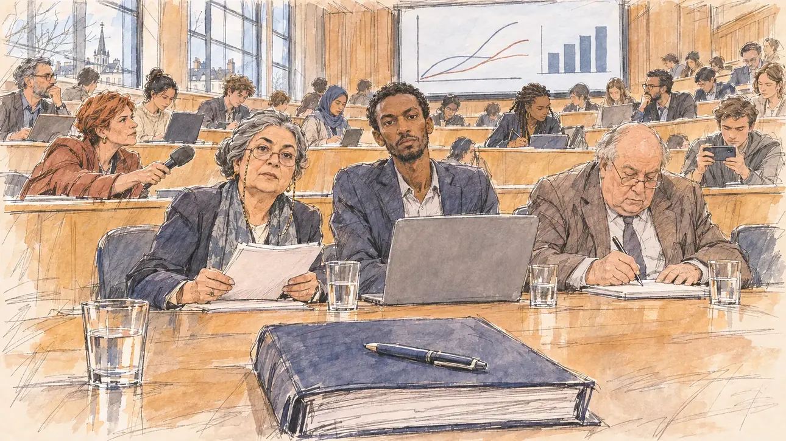

# `economistsOral` · Le grand oral des économistes

**Retenue par le PO le 15/11/2026**, au premier essai. Elle sert telle quelle en clair et en sombre.



| Champ | Valeur |
| --- | --- |
| Carte | `economistsOral`, catégorie `media` (Opportunité médiatique), poids 0,12, toute semaine ; une leçon de la campagne (expertise +2 sur le chiffrage complet), une seule des six par partie (Mitchnsun/moi-president, PO, 14/11/2026) |
| Style | Reportage dessiné |
| Ton | Observateur et tendu, lumière claire du matin |
| Date | 2026-11-15 |
| Outil | ChatGPT Images, modèle GPT 6.2, effort Light |
| Conversation | À compléter |
| Format rendu | 1672 × 941 (16:9) : export en 1290 × 726 px, WebP de qualité 75, 178 Ko, sans recadrage, fait depuis la copie WebP de la conversation |
| Fichier d'origine | Image de ChatGPT, chez le PO. L'export du dépôt a été fait depuis la copie partagée dans la conversation avec Claude |
| Première édition | `kit-france-2611-0004` |

## Texte de la carte

> **Le grand oral des économistes**
>
> Un cercle d'économistes vous invite à chiffrer vos trois mesures phares devant la presse, hypothèses comprises. Vos concurrents ont tous décliné.

## Le moment choisi

Un amphithéâtre lambrissé d'une école d'économie à Rennes, un matin de mars : gradins de bois, hautes fenêtres sur les toits et un clocher, un écran de courbes et de barres sans chiffres, la longue table du jury. Le candidat est assis face au jury, hors champ : seuls son épais classeur de chiffrage, fermé, un stylo dessus, et un verre d'eau. La présidente du jury, ses notes en main, le regarde : alors, vos hypothèses ? À côté, un jeune économiste derrière son ordinateur le regarde aussi ; un économiste âgé prend des notes ; dans les gradins, une journaliste tend un micro, des étudiants et des journalistes écrivent ou filment. Les précédents sont le chiffrage contesté d'un programme de 2017 et le grand oral des candidats devant le patronat (28 mars 2017) : personne n'y ressemble à un économiste connu.

## Prompt complet

Dans une nouvelle conversation, avec [`primeTime.webp`](../../illustrations/media/primeTime.webp) comme seule image de référence :

```
Use the attached image as the style reference and copy its drawing: a realistic reportage drawing made on the spot for a newspaper, with quick, nervous pencil lines, often drawn twice, ink hatching in the shadows, transparent watercolour washes that spill a little over the lines, and the warm paper showing through. Not the same scene and not the same people: never reuse the face or the hair of the woman in the reference.
Like in the reference, the setting can be full when the story needs it, with the things that say where we are and what is happening, but each one is sketched with a few pencil lines and a light wash, never rendered or finished, and the drawing gets looser and paler towards the edges until it fades into the bare paper.
This must look like a drawing made by hand on paper by a press illustrator, halfway between a quick sketch and a realistic picture: never a photograph, a film poster or a digital painting, and never a cartoon, a comic strip, a caricature or a children's book illustration. Continuous lines, never dotted or dashed outlines; no uniform texture, speckles or hatching filter laid over the picture; no glossy highlights, no smooth gradients, in the sky and on the walls too. Colour can be rich in places, on a piece of clothing, a light or a flag, but it stays transparent and within the palette below. The fade into the paper at the edges stays narrow, without a wide white margin. No blur and no depth-of-field effect: everything, the foreground included, is drawn sharp, like a sketch made on the spot.
People are drawn from life with realistic anatomy and proportions, like in the reference: faces shaped with pencil lines, hatching and light washes, a little more finished than the background but never photographic (no photographic skin, no airbrushed or digital-painting look). Expressions stay natural and restrained, even in laughter or tears: no exaggerated grins, no wide-open mouths full of teeth, no rubbery or cartoonish faces.

Editorial illustration, landscape 16:9 (1536 × 864 px), the scene filling the frame, with only a light fade into the paper at the edges. A wood-panelled lecture theatre of an economics school in Rennes, in Brittany, on a morning in March 2027, where a circle of economists asks the player's candidate to cost three flagship measures before the press: tiered wooden benches, high windows, a large screen showing only curves and bars with no figures, and a long table where the panel of economists sits; in the benches, journalists and students with their phones raised. The player's candidate sits at the table facing the panel and stays off-camera: in the foreground, only the candidate's thick costing binder, closed, with a pen lying on it. In the left third, the chair of the panel, an economist in her sixties of Iranian descent, short and round, with grey hair in a bun and glasses on a chain, holds a stack of notes and looks at the viewer with a polite but demanding look, as if asking for the assumptions, her face above mid-height. At the panel's table: a young economist of Congolese descent, tall and thin with a short beard, his laptop open, also looks at the viewer; an elderly economist, heavy-set and balding, takes notes. In the benches, a journalist in her forties with short red hair holds out a microphone, and a student films with his phone. Only the chair and the young economist look at the viewer. Nothing on the screen, the binder, the notes, the laptop, the microphone or the phones is readable.

Style: Reportage drawing made on the spot, like a press illustrator or courtroom sketch artist: pencil and ink with loose watercolour washes, lively unfinished lines, white paper showing through.

Palette: navy #13203F, vellum #F5EFE1, gold #A9802A, brick #B5523B, ochre #D9A441, sage #8FA58A, slate #5E7186, sand #DCC8A4, warm grey #8C8279; use 4 to 6 of them, subtle warm paper grain.

Tone: observant and tense, the clear morning light from the high windows on the blond wood, a silence before the first answer.

Constraints: realistic proportions, natural expressions, never cartoonish or caricatured faces, drawn like the rest of the illustration and never photographic; people of varied ages, genders, origins and body types (heavy, stocky, round, tall, short, wiry, not only slim), each with a distinct face and haircut (no two people alike), drawn with respect and never as a joke; each person's age, build and look plausible for their job and the scene (working people of working age), no stereotype tying an origin or a gender to a role, and no person of colour shown alone in a featured service or deferential role; anatomically correct hands with exactly five fingers, few hands visible, the others in pockets, behind objects or out of frame; no readable text anywhere (the screen, the binder, the notes, the laptop, the microphone and the phones stay unreadable, no figures, no equations, no nameplates); no captions or speech bubbles; no logos, no school or university logo, no television channel logo, no political party colours, no flags; no recognisable real person, no lookalike of a real politician or of a known economist; no explicit violence; no photographic rendering, no blur or bokeh, every outline a continuous pencil or ink line with no dotted or dashed outlines, no mottled, crackled or speckled texture over the faces, the clothes, the wood or the walls, no hatching filter over the picture, no oil-paint texture, no glow or halo, no wide white margin or frame (a light fade into the paper at the edges is fine).

Format: if 16:9 is not available, make 1536 × 1024 and keep the top 80 px and the bottom 80 px free of anything important (faces, hands, the main action): they will be cropped.
```

## Décisions prises sur cette image

Retenue telle quelle par le PO (15/11/2026). La présidente est au centre gauche plutôt que dans le tiers gauche ; l'écran montre des courbes et des barres sans aucun chiffre ni légende.

## Essais écartés

Aucun.

## Retouches

Aucune.

## Relecture

Faite le 15/11/2026, à confirmer par le PO.

- [x] Aucun texte lisible : l'écran n'a ni chiffres ni légendes ; classeur, notes, ordinateur et téléphones illisibles.
- [x] Aucun sosie d'une personne réelle.
- [x] Le candidat du joueur est hors champ : seuls son classeur, son stylo et son verre d'eau.
- [x] Mains et visages sans défaut visible à 343 px de large : les mains de la présidente sur ses notes, celle de l'économiste âgé qui écrit, la main de la journaliste au micro, celles de l'étudiant au téléphone.
- [x] Aucune couleur, aucun logo ni aucun drapeau de parti ou d'école. Des personnes variées par l'âge, le corps, l'origine et la coiffure.
- [x] En 16:9 : pas de recadrage.
- [ ] Lisible sur la page de l'événement, en clair et en sombre : à vérifier dans l'app, une fois la carte publiée.
