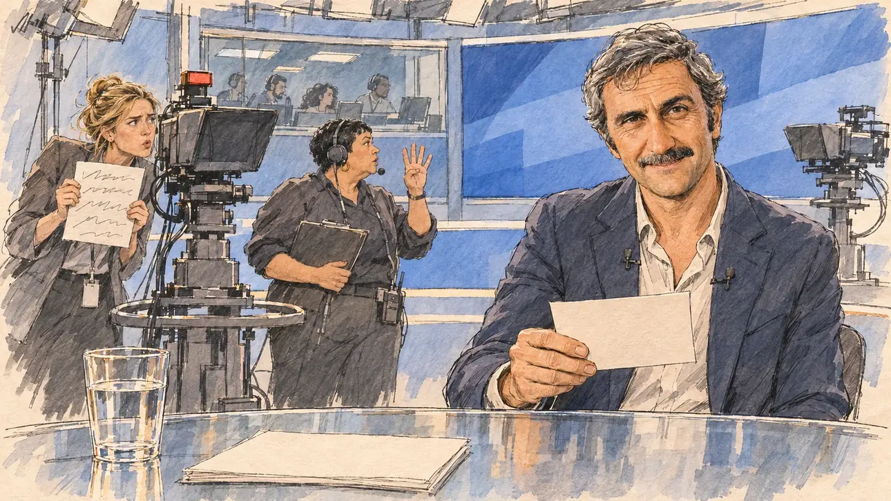

# `noAnswer` · Je n'ai pas la réponse

**Retenue par le PO le 16/11/2026**, au premier essai. Elle sert telle quelle en clair et en sombre.



| Champ | Valeur |
| --- | --- |
| Carte | `noAnswer`, catégorie `media` (Opportunité médiatique), poids 0,15, toute semaine ; une leçon gagnée sur une faiblesse (expertise +3, jet inversé), une seule de la série par partie (Mitchnsun/moi-president, PO, 16/11/2026) |
| Style | Reportage dessiné |
| Ton | Tendu et légèrement ironique, lumière de plateau |
| Date | 2026-11-16 |
| Outil | ChatGPT Images, à compléter (modèle et effort) |
| Conversation | À compléter |
| Format rendu | 1672 × 941 (16:9) : export en 1290 × 726 px, WebP de qualité 75, 165 Ko, sans recadrage, fait depuis la copie WebP de la conversation (à refaire depuis le PNG d'origine) |
| Fichier d'origine | À compléter (hors du dépôt) |
| Première édition | À compléter |

## Texte de la carte

> **Je n'ai pas la réponse**
>
> En direct, un journaliste vous interroge sur une règle technique du financement des collectivités. Vous ne la connaissez pas, et votre conseiller vous souffle un chiffre douteux.

## Le moment choisi

Le plateau d'une chaîne d'information en continu, un matin de mars, en direct : table de verre, écrans aux formes bleues abstraites, caméras sur pied, voyant rouge du direct, la régie derrière sa vitre. Le candidat est assis face au journaliste, hors champ : seuls ses notes retournées et un verre d'eau. Le journaliste, sa fiche blanche en main, attend la réponse, un sourcil levé ; derrière une caméra, la conseillère du candidat brandit une feuille griffonnée et articule un chiffre ; la régisseuse compte les secondes sur ses doigts. Aucun précédent fiable n'a été trouvé pour un aveu d'ignorance salué : la carte repose sur la règle du jeu.

## Prompt complet

Ressemblance voulue, étape 2 seulement (le PO a fourni un portrait déjà dessiné), selon le [gabarit de la ressemblance voulue](../gabarit-ressemblance.md) : dans une nouvelle conversation, avec deux images jointes dans cet ordre, [`primeTime.webp`](../../illustrations/media/primeTime.webp) pour le style, puis le portrait dessiné (hors du dépôt) :

```
Use the first attached image as the style reference and copy its drawing: a realistic reportage drawing made on the spot for a newspaper, with quick, nervous pencil lines, often drawn twice, ink hatching in the shadows, transparent watercolour washes that spill a little over the lines, and the warm paper showing through. Not the same scene and not the same people: never reuse the face or the hair of the woman in the reference.
Like in the reference, the setting can be full when the story needs it, with the things that say where we are and what is happening, but each one is sketched with a few pencil lines and a light wash, never rendered or finished, and the drawing gets looser and paler towards the edges until it fades into the bare paper.
Use the second attached image, a drawn portrait, only as the likeness reference for the journalist: give him this man's features, his wavy greying hair and his moustache, and draw his face with the same ink lines and washes as the other people in the scene. Keep the likeness through the drawing, never through photographic detail.
This must look like a drawing made by hand on paper by a press illustrator, halfway between a quick sketch and a realistic picture: never a photograph, a film poster or a digital painting, and never a cartoon, a comic strip, a caricature or a children's book illustration. Continuous lines, never dotted or dashed outlines; no uniform texture, speckles or hatching filter laid over the picture; no glossy highlights, no smooth gradients, in the sky and on the walls too. Colour can be rich in places, on a piece of clothing, a light or a flag, but it stays transparent and within the palette below. The fade into the paper at the edges stays narrow, without a wide white margin. No blur and no depth-of-field effect: everything, the foreground included, is drawn sharp, like a sketch made on the spot.
People are drawn from life with realistic anatomy and proportions, like in the reference: faces shaped with pencil lines, hatching and light washes, a little more finished than the background but never photographic (no photographic skin, no airbrushed or digital-painting look). Expressions stay natural and restrained, even in laughter or tears: no exaggerated grins, no wide-open mouths full of teeth, no rubbery or cartoonish faces.

Editorial illustration, landscape 16:9 (1536 × 864 px), the scene filling the frame, with only a light fade into the paper at the edges. The set of a rolling news channel, live, on a morning in March 2027: a glass desk, giant screens showing only abstract blue shapes, cameras on pedestals, the small red on-air light lit, and behind the control-room window, a few silhouettes. The player's candidate sits facing the journalist and stays off-camera: in the foreground, only the candidate's notes turned face down on the desk and a glass of water. In the right third, the journalist, the man from the portrait, in his fifties, in a navy jacket over an open-collared light shirt, holds a blank question card and looks at the viewer with one eyebrow raised and the hint of a smile, waiting for the answer, his face above mid-height. Off the set, behind a camera, the candidate's adviser, a young blond woman with a loosening bun and a panicked look, holds up a sheet covered with unreadable scribbles and silently mouths a figure. A floor manager, a short woman in her forties with close-cropped black hair and a headset, raises a hand to count down the seconds. Only the journalist looks at the viewer. Nothing on the screens, the desk, the question card, the sheet, the notes or the cameras is readable.

Style: Reportage drawing made on the spot, like a press illustrator or courtroom sketch artist: pencil and ink with loose watercolour washes, lively unfinished lines, white paper showing through.

Palette: navy #13203F, vellum #F5EFE1, gold #A9802A, brick #B5523B, ochre #D9A441, sage #8FA58A, slate #5E7186, sand #DCC8A4, warm grey #8C8279; use 4 to 6 of them, subtle warm paper grain.

Tone: tense and slightly ironic, the cold, even light of the studio, the small red on-air light, the adviser's panic as the comic note behind the camera.

Constraints: realistic proportions, natural expressions, never cartoonish or caricatured faces, drawn like the rest of the illustration and never photographic; people of varied ages, genders, origins and body types (heavy, stocky, round, tall, short, wiry, not only slim), each with a distinct face and haircut (no two people alike), drawn with respect and never as a joke; anatomically correct hands with exactly five fingers, few hands visible, the others in pockets, behind objects or out of frame; no readable text anywhere (the screens, the desk, the question card, the sheet, the notes and the cameras stay unreadable, no figures, no ticker, no on-air caption); no captions or speech bubbles; no logos, no television channel logo or political party colours; apart from the journalist, no recognisable real person and no lookalike of a real politician or of a known television journalist; no image of the candidate on the screens; no explicit violence; no photographic rendering, no blur or bokeh, no dotted outlines, no texture or hatching filter over the picture, no oil-paint texture, no wide white margin or frame (a light fade into the paper at the edges is fine).

Format: if 16:9 is not available, make 1536 × 1024 and keep the top 80 px and the bottom 80 px free of anything important (faces, hands, the main action): they will be cropped.
```

## Décisions prises sur cette image

Retenue telle quelle par le PO (16/11/2026). Ressemblance voulue : le journaliste a les traits d'un portrait dessiné fourni par le PO, avec l'accord de la personne, confirmé par le PO ; ni le portrait ni la photo ne sont dans le dépôt. Le rôle s'est adapté à la personne : le journaliste prévu (cheveux très courts, lunettes) a pris ses cheveux gris ondulés et sa moustache, en veste bleu marine sur une chemise ouverte ; aucun autre personnage ne lui ressemble.

## Essais écartés

Aucun.

## Retouches

Aucune.

## Relecture

Faite le 16/11/2026, à confirmer par le PO.

- [x] Aucun texte lisible : la fiche du journaliste est blanche, la feuille de la conseillère n'a que des vagues ; rien sur les écrans, les notes ni les caméras.
- [x] Aucun sosie d'une personne réelle, hors la ressemblance voulue notée plus haut.
- [x] Le candidat du joueur est hors champ : seuls ses notes retournées et son verre d'eau.
- [x] Mains et visages sans défaut visible à 343 px de large : la main du journaliste sur sa fiche, celles de la conseillère sur la feuille, la main levée de la régisseuse qui compte (quatre doigts tendus, le pouce replié).
- [x] Aucune couleur, aucun logo ni aucun drapeau de parti ou de chaîne. Des personnes variées par l'âge, le corps, l'origine et la coiffure.
- [x] En 16:9 : pas de recadrage.
- [ ] Lisible sur la page de l'événement, en clair et en sombre : à vérifier dans l'app, une fois la carte publiée.
