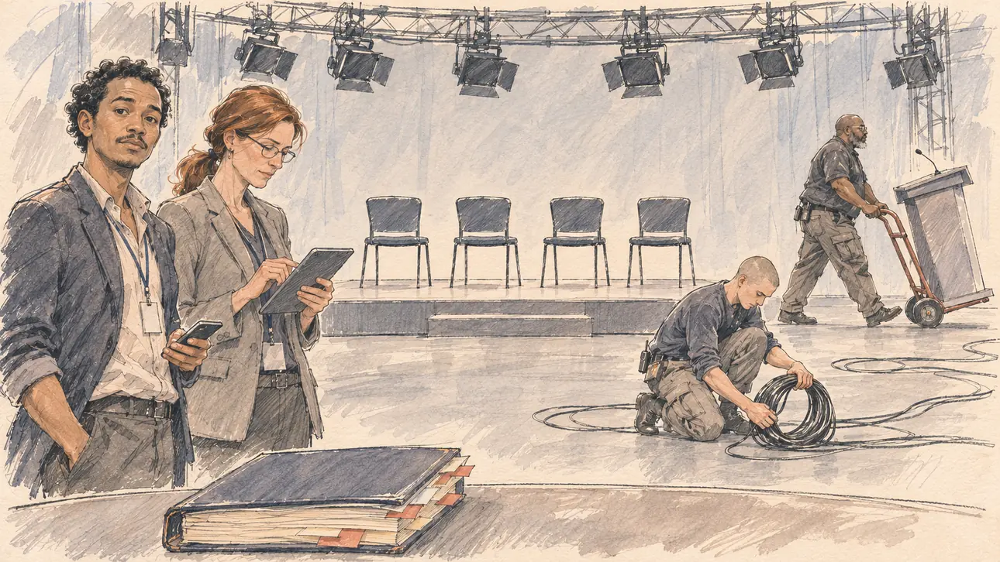

# `noFaceToFace` · Pas de face-à-face

**Validée par le PO le 09/11/2026**, au premier essai. Elle sert telle quelle en clair et en sombre.



| Champ | Valeur |
| --- | --- |
| Carte | `noFaceToFace`, catégorie `media` (Opportunité médiatique), poids 0,25, semaines 8 à 11, jamais dans une campagne qui a eu `televisedDebate` (et l'inverse) |
| Style | Reportage dessiné |
| Ton | Ironique, un peu dégonflé |
| Date | 2026-11-09 |
| Outil | ChatGPT Images, à compléter (modèle et effort) |
| Conversation | À compléter |
| Format rendu | 1672 × 941 (16:9) : export en 1290 × 726 px, WebP de qualité 75, 160 Ko, sans recadrage, fait depuis le PNG de la conversation |
| Fichier d'origine | À compléter (hors du dépôt) |
| Première édition | À compléter |

## Texte de la carte

> **Pas de face-à-face**
>
> Les chaînes ne s'entendent pas sur le format et renoncent au grand débat avant le premier tour. Elles proposent à la place une série d'interviews d'un quart d'heure.

## Le moment choisi

Un grand studio de télévision, le matin où le débat est abandonné, sans ville reconnaissable : sous les projecteurs éteints, les techniciens démontent le plateau, un pupitre part sur un diable, des câbles s'enroulent, une rangée de chaises reste vide, l'annonce de la réponse « face à une chaise vide ». Le candidat reste hors champ : son épais dossier de préparation au débat, refermé, devenu inutile. L'attaché de presse de la campagne regarde le spectateur, téléphone en main : un quart d'heure, c'est tout ce qu'ils proposent ; la productrice de la chaîne lit les créneaux d'interview sur sa tablette.

Le même jour, le PO a demandé que cette carte et le grand débat télévisé ne sortent jamais dans la même campagne : les deux cartes s'excluent dans le moteur (`excludes`).

## Prompt complet

Dans une nouvelle conversation, avec [`primeTime.webp`](../../illustrations/media/primeTime.webp) comme seule image de référence :

```
Use the attached image as the style reference and copy its drawing: a realistic reportage drawing made on the spot for a newspaper, with quick, nervous pencil lines, often drawn twice, ink hatching in the shadows, transparent watercolour washes that spill a little over the lines, and the warm paper showing through. Not the same scene and not the same people: never reuse the face or the hair of the woman in the reference.
Like in the reference, the setting can be full when the story needs it, with the things that say where we are and what is happening, but each one is sketched with a few pencil lines and a light wash, never rendered or finished, and the drawing gets looser and paler towards the edges until it fades into the bare paper.
This must look like a drawing made by hand on paper by a press illustrator, halfway between a quick sketch and a realistic picture: never a photograph, a film poster or a digital painting, and never a cartoon, a comic strip, a caricature or a children's book illustration. Continuous lines, never dotted or dashed outlines; no uniform texture, speckles or hatching filter laid over the picture; no glossy highlights, no smooth gradients, in the sky and on the walls too. Colour can be rich in places, on a piece of clothing, a light or a flag, but it stays transparent and within the palette below. The fade into the paper at the edges stays narrow, without a wide white margin. No blur and no depth-of-field effect: everything, the foreground included, is drawn sharp, like a sketch made on the spot.
People are drawn from life with realistic anatomy and proportions, like in the reference: faces shaped with pencil lines, hatching and light washes, a little more finished than the background but never photographic (no photographic skin, no airbrushed or digital-painting look). Expressions stay natural and restrained, even in laughter or tears: no exaggerated grins, no wide-open mouths full of teeth, no rubbery or cartoonish faces.

Editorial illustration, landscape 16:9 (1536 × 864 px), the scene filling the frame, with only a light fade into the paper at the edges. A large television studio on a morning in late March 2027, the day the channels give up the big debate before the first round: technicians dismantle the debate set under switched-off rigs of stage lights, a heavy-set Black technician in his forties with a grey beard wheels a lectern away on a hand truck, a young white technician with a shaved head coils cables on the floor, and a row of empty chairs stands alone on the bare stage. The player's candidate stays off-camera: in the foreground, only a thick, closed debate-preparation folder bristling with tabs, now useless, on the edge of a production desk. In the left third, the campaign's press attaché, a slim man in his thirties of Malagasy descent, with short curly hair, a thin moustache, an open-collared shirt and a phone in his hand, looks at the viewer, a quarter of an hour is all they offer, his face above mid-height. Next to him, the channel's producer, a tall white woman in her forties with straight auburn hair in a low ponytail, thin glasses and a grey blazer, reads the list of interview slots on her tablet without looking up. Only the press attaché looks at the viewer. Nothing on the folder, the tabs, the tablet, the phone or the set is readable, and no channel name or logo appears anywhere.

Style: Reportage drawing made on the spot, like a press illustrator or courtroom sketch artist: pencil and ink with loose watercolour washes, lively unfinished lines, white paper showing through.

Palette: navy #13203F, vellum #F5EFE1, gold #A9802A, brick #B5523B, ochre #D9A441, sage #8FA58A, slate #5E7186, sand #DCC8A4, warm grey #8C8279; use 4 to 6 of them, subtle warm paper grain.

Tone: wry and a little deflated, the flat grey working light of a studio with its stage lights off, the empty chairs as the centre of the picture.

Constraints: realistic proportions, natural expressions, never cartoonish or caricatured faces, drawn like the rest of the illustration and never photographic; people of varied ages, genders, origins and body types (heavy, stocky, round, tall, short, wiry, not only slim), each with a distinct face and haircut (no two people alike), drawn with respect and never as a joke; each person's age, build and look plausible for their job and the scene (working people of working age), no stereotype tying an origin or a gender to a role, and no person of colour shown alone in a featured service or deferential role; anatomically correct hands with exactly five fingers, few hands visible, the others in pockets, behind objects or out of frame; no readable text anywhere (the folder, the tabs, the tablet, the phone and the set stay unreadable); no captions or speech bubbles; no logos, no TV channel name or logo, no political party colours; no recognisable real person, no lookalike of a real politician or presenter; no explicit violence; no photographic rendering, no blur or bokeh, no dotted outlines, no texture or hatching filter over the picture, no oil-paint texture, no glow or halo around the lights, no wide white margin or frame (a light fade into the paper at the edges is fine).

Format: if 16:9 is not available, make 1536 × 1024 and keep the top 80 px and the bottom 80 px free of anything important (faces, hands, the main action): they will be cropped.
```

## Décisions prises sur cette image

Validée telle quelle par le PO (09/11/2026). Les deux techniciens, l'un noir, l'autre blanc, travaillent ensemble au démontage ; l'attaché de presse, d'origine malgache, tient le premier rôle.

## Essais écartés

Aucun.

## Retouches

Aucune.

## Relecture

Faite et validée par le PO le 09/11/2026.

- [x] Aucun texte lisible : les badges et les onglets du dossier sont vierges, la tablette est vue de dos, le téléphone est sombre ; aucun logo de chaîne.
- [x] Aucun sosie d'une personne réelle.
- [x] Le candidat du joueur est hors champ : seul son dossier de préparation, au premier plan.
- [x] Mains et visages sans défaut visible à 343 px de large : la main au téléphone, celles de la productrice sur la tablette, celles des techniciens au diable et aux câbles.
- [x] Aucune couleur ni aucun logo de parti. Des personnes variées par l'âge, le corps, l'origine et la coiffure.
- [x] En 16:9 : pas de recadrage.
- [ ] Lisible sur la page de l'événement, en clair et en sombre : à vérifier dans l'app, une fois la carte publiée.
