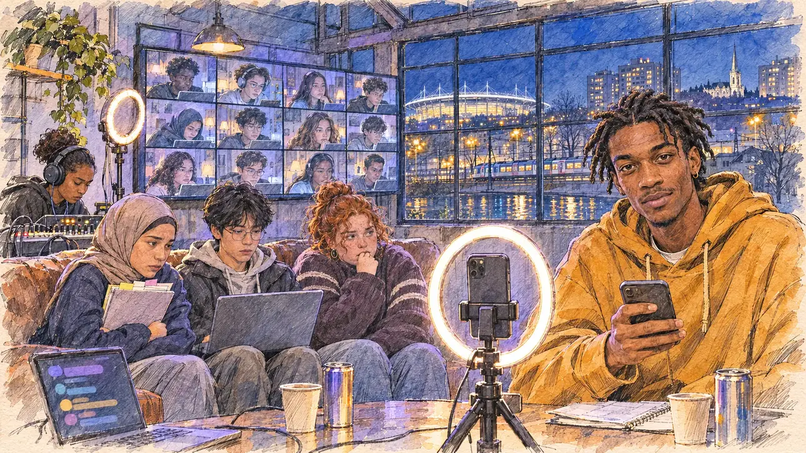

# `parcoursup` · Parcoursup, la nuit blanche

**À générer.** Prompt prêt le 05/11/2026, pas encore d'image validée.



| Champ | Valeur |
| --- | --- |
| Carte | `parcoursup`, catégorie `media` (Opportunité médiatique), carte ajoutée par la PR #297 de l'app |
| Style | Reportage dessiné, trait de `primeTime` |
| Ton | Électrique et bienveillant |
| Date | À remplir |
| Outil | ChatGPT Images |
| Conversation | À remplir (le lien ne s'ouvre qu'avec le compte qui l'a créée) |
| Format rendu | À remplir |
| Fichier d'origine | À remplir |
| Première édition | À remplir |

## Texte de la carte

> **Parcoursup, la nuit blanche**
>
> Avant la clôture des vœux Parcoursup, des lycéens racontent leur angoisse. Un média en ligne prisé des lycéens vous propose de répondre à leurs questions en direct.

## Le moment choisi

Le petit studio d'un média en ligne pour lycéens, à Saint-Denis, tard le soir début mars, avant la clôture des vœux, vu depuis le fauteuil où le candidat (hors champ) s'assoit pour le direct : au premier plan, un téléphone sur trépied qui filme à la verticale, son anneau lumineux allumé. Le jeune animateur, téléphone en main, lit une question du fil et regarde le candidat. Autour : trois lycéens invités sur le canapé, un ordinateur où défile le fil des questions, un mur d'écrans avec des dizaines de lycéens en direct de leur chambre, une technicienne au casque. Par la fenêtre : Saint-Denis la nuit, le Stade de France illuminé, les voies du RER, le canal, les tours et la flèche de la basilique.

## Prompt complet

Dans une nouvelle conversation, avec [`primeTime.webp`](../../illustrations/media/primeTime.webp) comme seule image de référence.

```
Use the attached image as the style reference and copy its drawing: a realistic reportage drawing made on the spot for a newspaper, with quick, nervous pencil lines, often drawn twice, ink hatching in the shadows, transparent watercolour washes that spill a little over the lines, and the warm paper showing through. Not the same scene and not the same people: never reuse the face or the hair of the woman in the reference.
Like in the reference, the setting can be full when the story needs it, with the things that say where we are and what is happening, but each one is sketched with a few pencil lines and a light wash, never rendered or finished, and the drawing gets looser and paler towards the edges until it fades into the bare paper.
This must look like a drawing made by hand on paper by a press illustrator, halfway between a quick sketch and a realistic picture: never a photograph, a film poster or a digital painting, and never a cartoon, a comic strip, a caricature or a children's book illustration. Continuous lines, never dotted or dashed outlines; no uniform texture, speckles or hatching filter laid over the picture; no glossy highlights, no smooth gradients, in the sky and on the walls too. Colour can be rich in places, on a piece of clothing, a light or a flag, but it stays transparent and within the palette below. The fade into the paper at the edges stays narrow, without a wide white margin. No blur and no depth-of-field effect: everything, the foreground included, is drawn sharp, like a sketch made on the spot.
People are drawn from life with realistic anatomy and proportions, like in the reference: faces shaped with pencil lines, hatching and light washes, a little more finished than the background but never photographic (no photographic skin, no airbrushed or digital-painting look). Expressions stay natural and restrained, even in laughter or tears: no exaggerated grins, no wide-open mouths full of teeth, no rubbery or cartoonish faces.

Editorial illustration, landscape 16:9 (1536 × 864 px), the scene filling the frame, with only a light fade into the paper at the edges. The small studio of an online media popular with high-school students, in a converted workshop in Saint-Denis, in the Paris suburbs, late in the evening in early March 2027, a few days before the deadline for the Parcoursup university applications: high-school students talk about their anxiety, and the media invites the player's candidate to answer their questions live. The scene is seen from the armchair where the candidate sits down for the live stream, who stays off-camera: in the foreground, only a phone on a small tripod filming vertically, with its ring light switched on. In the right third, the young host, a man in his twenties of Haitian origin, tall and lanky, with short locs, a small gold earring and an oversized hoodie, holds his phone and reads out a question from the live chat, looking up at the viewer with a friendly, direct, slightly challenging look, his face above mid-height. Around him, sketched in pencil and light washes: three high-school students invited on a worn sofa: a girl in a hijab hugging a folder of revision cards, a boy of Vietnamese origin with a laptop on his knees, a round, red-haired girl biting her thumbnail; a laptop on a desk where the chat scrolls as coloured bubbles; a wall of screens showing dozens of small video tiles of students live from their bedrooms at night, lit by their screens, none of them readable; a sound technician of Malagasy origin with headphones and a mixing desk; cables, a second ring light, a plant, coffee cups, energy-drink cans with no brand. Through the big workshop window, Saint-Denis at night: the huge lit oval of the Stade de France, the tracks of the suburban trains, the canal with its lights, tower blocks with lit windows, and the slender single spire of the basilica. Only the host looks straight at the viewer. Nothing on the phones, the laptop, the chat, the screens, the revision cards, the cans or the hoodie is readable, and no logo of a real media, social network or app appears.

Style: Reportage drawing made on the spot, like a press illustrator or courtroom sketch artist: pencil and ink with loose watercolour washes, lively unfinished lines, white paper showing through.

Palette: navy #13203F, vellum #F5EFE1, gold #A9802A, brick #B5523B, ochre #D9A441, sage #8FA58A, slate #5E7186, sand #DCC8A4, warm grey #8C8279; use 4 to 6 of them, subtle warm paper grain.

Tone: electric and kind, the violet and blue glow of the ring lights and the screens on the faces, the warm yellow lights of the city at night through the window, and the hoodie of the host as the bright patch.

Constraints: realistic proportions, natural expressions, never cartoonish or caricatured faces, drawn like the rest of the illustration and never photographic; people of varied ages, genders, origins and body types (heavy, stocky, round, tall, short, wiry, not only slim), each with a distinct face and haircut (no two people alike), drawn with respect and never as a joke; anatomically correct hands with exactly five fingers, few hands visible, the others in pockets, behind objects or out of frame; no readable text anywhere (the phones, the laptop, the chat, the screens, the revision cards, the cans and the hoodie stay unreadable); no captions or speech bubbles; no logos or political party colours; no recognisable real person, no lookalike of a real politician, and no logo of a real media, social network or app; no explicit violence; no photographic rendering, no blur or bokeh, no dotted outlines, no texture or hatching filter over the picture, no oil-paint texture, no wide white margin or frame (a light fade into the paper at the edges is fine).

Format: if 16:9 is not available, make 1536 × 1024 and keep the top 80 px and the bottom 80 px free of anything important (faces, hands, the main action): they will be cropped.
```

## Décisions prises sur cette image

Aucune pour l'instant.

## Essais écartés

Aucun pour l'instant.

## Retouches

Aucune.

## Relecture

À faire sur l'image validée.
