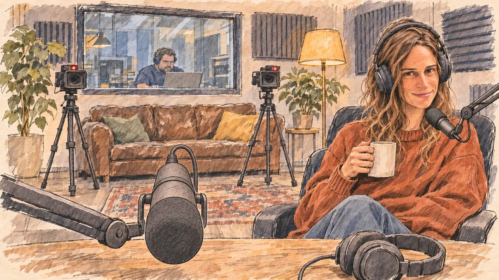

# `podcast` · Un podcast fleuve

**Validée par le PO le 31/10/2026**, au premier essai. Elle sert telle quelle en clair et en sombre.



| Champ | Valeur |
| --- | --- |
| Carte | `podcast`, catégorie `media` (Opportunité médiatique) |
| Style | Reportage dessiné |
| Ton | Observateur, détendu |
| Date | 2026-10-31 |
| Outil | ChatGPT avec le modèle GPT Sol 6.1 en effort « light », et ChatGPT Images 2.5 |
| Conversation | À remplir (le lien ne s'ouvre qu'avec le compte qui l'a créée) |
| Format rendu | 1672 × 941 (16:9) : export en 1290 × 726 px, WebP de qualité 75, 190 Ko, sans recadrage ; réexportée le 01/11/2026, après une première version en qualité 70 pour tenir 180 Ko |
| Fichier d'origine | PNG de ChatGPT, chez le PO. L'export du dépôt a été fait depuis la copie partagée dans la conversation avec Claude |
| Première édition | `kit-france-2611-0001` |

## Texte de la carte

> **Un podcast fleuve**
>
> Un podcast star chez les moins de 30 ans vous propose trois heures d'entretien, sans montage et sans filet.

## Le moment choisi

Un petit studio de podcast chaleureux, au tout début de l'entretien, vu depuis le fauteuil d'invité du candidat, hors champ : un gros micro et un casque sur la table. En face, l'animatrice, mug à la main, regarde le candidat avec un sourire curieux. Le prompt demandait une animatrice de fin de vingtaine : elle fait plutôt la quarantaine, ce que le PO a gardé.

## Prompt complet

Dans une nouvelle conversation, avec [`oldTweet.webp`](../../illustrations/polemic/oldTweet.webp) comme seule image de référence :

```
Use the attached image as the style reference: the same pencil and ink drawing with loose watercolour washes and warm paper grain. Faces, hands and objects are drawn with visible ink lines, never photographic. Not the same scene.

Editorial illustration, landscape 16:9 (1536 × 864 px), filling the whole frame edge to edge. A small, cosy podcast studio in 2027, a star show among the under-thirties, at the very start of a three-hour interview with no editing. The scene is seen from the guest's seat of the player's candidate, who stays off-camera: in the foreground, only a large microphone on its arm and a pair of headphones on the wooden table. In the right third, the host, a young woman in her late twenties with short curly hair, headphones on and an oversized sweater, leans back in her chair with one hand around a mug and looks at the viewer with a curious, slightly challenging smile, her face above mid-height. Around her: acoustic foam panels, plants, a worn leather sofa, a warm lamp and a soft LED strip. Two small cameras on tripods point at the viewer, a small red recording light glows, and behind a glass window a producer watches her laptop. Nothing on the walls, the screens or the mugs is readable.

Style: Reportage drawing made on the spot, like a press illustrator or courtroom sketch artist: pencil and ink with loose watercolour washes, lively unfinished lines, white paper showing through.

Palette: navy #13203F, vellum #F5EFE1, gold #A9802A, brick #B5523B, ochre #D9A441, sage #8FA58A, slate #5E7186, sand #DCC8A4, warm grey #8C8279; use 4 to 6 of them, subtle warm paper grain.

Tone: observant and relaxed, warm lamp light mixed with a soft slate-blue LED glow.

Constraints: realistic proportions, expressive but not caricatured faces, people of varied ages, genders and origins; anatomically correct hands with exactly five fingers, few hands visible, the others in pockets, behind objects or out of frame; no readable text anywhere (signs, banners, labels and screens stay blank); no captions or speech bubbles; no logos, flags or political party colours; no recognisable real person, no lookalike of a real politician or podcaster; no explicit violence; no oil-paint texture, no white or ragged border.

Format: if 16:9 is not available, make 1536 × 1024 and keep the top 80 px and the bottom 80 px free of anything important (faces, hands, the main action): they will be cropped.
```

## Essais écartés

Aucun.

## Retouches

Aucune.

## Relecture

Faite et validée par le PO le 31/10/2026.

- [x] Aucun texte lisible : ni sur les murs, ni sur les écrans, ni sur les mugs.
- [x] Aucun sosie d'une personne réelle. Ici surtout : l'animatrice, à côté des vrais animateurs de podcast.
- [x] Le candidat du joueur est hors champ.
- [x] Mains, visages et foules sans défaut visible à 343 px de large.
- [x] Aucune couleur de parti, aucun symbole officiel.
- [x] En 3:2 : rien d'important dans les 80 px du haut et du bas. Sans objet ici : l'image est en 16:9.
- [x] Lisible sur la page de l'événement, en clair et en sombre.

## Régénération demandée (04/11/2026)

**Pourquoi.** La revue de la première série note le style à 3/3 et les détails à 2/3 : c'est un autre style, une peinture numérique finie et saturée. Le casque et le bras du micro ont des reflets métalliques brillants, les bougies et la lampe font des halos, le visage de l'animatrice est modelé, le pull orange est dense, la lueur bleue des LED est marquée, et le papier ne se voit nulle part : le rendu d'une photo d'intérieur retouchée. Le décor est chargé : canapé et coussins, plantes, lampe, bougies, deux caméras sur pied, panneaux acoustiques, tapis, régie vitrée et sa productrice, et au premier plan un micro et un casque très détaillés. Le PO a décidé de régénérer l'image.

**Ce qui reste.** Le petit studio de podcast au début de l'entretien, vu depuis le fauteuil d'invité du candidat (hors champ) : le gros micro sur son bras et le casque sur la table en bois au premier plan, et l'animatrice du tiers droit, mug à la main, qui se renverse sur sa chaise et regarde le candidat avec un sourire curieux et un peu provocant. L'animatrice garde l'allure de l'image actuelle, que le PO a gardée : une quarantaine d'années, cheveux courts et bouclés, pull orange ample, casque sur les oreilles. Une seule plante.

**Ce qui change.** Le rendu : micro et casque dessinés à l'encre sans reflets métalliques, le visage de l'animatrice comme le reste du dessin, un pull en aplats, des lavis clairs et du papier nu. Le décor sort : canapé, coussins, tapis, panneaux acoustiques, bougies, deuxième caméra, régie vitrée et productrice. Il reste une plante, une lampe chaude et une seule petite caméra au voyant rouge, et la lueur bleue des LED disparaît. Le prompt dit désormais l'âge réel de l'animatrice, qu'il avait fixé à tort à la fin de la vingtaine.

### Prompt de régénération

Dans une nouvelle conversation, avec [`oldTweet.webp`](../../illustrations/polemic/oldTweet.webp) comme seule image de référence.

```
Use the attached image as the style reference and copy its drawing: quick, nervous pencil lines, often drawn twice, loose ink hatching in the shadows, transparent watercolour washes that spill a little over the lines, and the warm paper showing through everywhere. Not the same scene.
Like in the reference, the setting can be full when the story needs it, with the things that say where we are and what is happening, but each one is sketched with a few pencil lines and a light wash, never rendered or finished, and the drawing gets looser and paler towards the edges until it fades into the bare paper.
This must look like a drawing made by hand on paper, never like a photograph, a film poster or a digital painting: the people are drawn with pencil and ink lines and washes, not modelled; continuous lines, never dotted or dashed outlines; no uniform texture, speckles or hatching filter laid over the picture; no dense colour, no glossy highlights, no smooth gradients, in the sky and on the walls too. The fade into the paper at the edges stays narrow, without a wide white margin. No blur and no depth-of-field effect: everything, the foreground included, is drawn sharp, like a sketch made on the spot.
Faces are drawn exactly like the clothes and the background: ink outlines, a few hatching strokes and flat watercolour washes for the skin, with the same level of detail as the rest of the drawing. No photographic skin, no realistic wrinkles or pores, no airbrushed or digital-painting look on the faces.

Editorial illustration, landscape 16:9 (1536 × 864 px), the scene filling the frame, with only a light fade into the paper at the edges. A small, cosy podcast studio in 2027, a star show among the under-thirties, at the very start of a three-hour interview with no editing. The scene is seen from the guest's seat of the player's candidate, who stays off-camera: in the foreground, only a large microphone on its arm and a pair of headphones on the wooden table. In the right third, the host, a woman in her early forties with short dark curly hair, warm olive skin and brown eyes, headphones on and an oversized rust-orange sweater over jeans, leans back in her chair with one hand around a white mug and looks at the viewer with a curious, slightly challenging smile, her face above mid-height. Behind her, only one large leafy plant, one warm lamp, and one small camera on a tripod with a small red recording light, pointing at the viewer. The rest of the studio is only suggested with a few pencil lines and a light wash, leaving the warm paper bare. Nothing on the walls, the mug or the camera is readable.

Style: Reportage drawing made on the spot, like a press illustrator or courtroom sketch artist: pencil and ink with loose watercolour washes, lively unfinished lines, white paper showing through.

Palette: navy #13203F, vellum #F5EFE1, gold #A9802A, brick #B5523B, ochre #D9A441, sage #8FA58A, slate #5E7186, sand #DCC8A4, warm grey #8C8279; use 4 to 6 of them, subtle warm paper grain.

Tone: observant and relaxed, warm lamp light, soft and pale.

Constraints: realistic proportions, expressive but not caricatured faces, drawn like the rest of the illustration and never photographic; people of varied ages, genders, origins and body types (heavy, stocky, round, tall, short, wiry, not only slim), each with a distinct face and haircut (no two people alike), drawn with respect and never as a joke; anatomically correct hands with exactly five fingers, few hands visible, the others in pockets, behind objects or out of frame; no readable text anywhere (walls, mugs and the camera stay unreadable); no captions or speech bubbles; no logos or political party colours; no recognisable real person, no lookalike of a real politician or podcaster; no explicit violence; no photographic rendering, no blur or bokeh, no dotted outlines, no texture or hatching filter over the picture, no oil-paint texture, no wide white margin or frame (a light fade into the paper at the edges is fine).

Format: if 16:9 is not available, make 1536 × 1024 and keep the top 80 px and the bottom 80 px free of anything important (faces, hands, the main action): they will be cropped.
```
