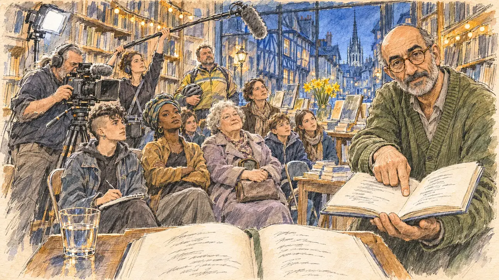

# `poetrySpring` · Le Printemps des poètes

**Validée par le PO le 05/11/2026**, au premier essai, avec `primeTime.webp` comme référence. Elle sert telle quelle en clair et en sombre.



| Champ | Valeur |
| --- | --- |
| Carte | `poetrySpring`, catégorie `media` (Opportunité médiatique), carte ajoutée par la PR #297 de l'app |
| Style | Reportage dessiné, trait de `primeTime` |
| Ton | Délicat et tendu |
| Date | 2026-11-05 |
| Outil | ChatGPT Images |
| Conversation | À remplir (le lien ne s'ouvre qu'avec le compte qui l'a créée) |
| Format rendu | 1672 × 941 (16:9) : export en 1290 × 726 px, WebP de qualité 75, 264 Ko, sans recadrage |
| Fichier d'origine | Image de ChatGPT, chez le PO. L'export du dépôt a été fait depuis la copie partagée dans la conversation avec Claude |
| Première édition | La prochaine Release qui suit le merge de la PR #297 de l'app |

## Texte de la carte

> **Le Printemps des poètes**
>
> Le Printemps des poètes bat son plein : une librairie vous propose de lire un poème en public devant les caméras d'une chaîne culturelle. Une lecture réussie vaut mille slogans, une lecture ratée tourne en boucle.

## Le moment choisi

Une librairie indépendante du vieux Rouen, un soir de mars, pendant le Printemps des poètes, vue depuis le petit pupitre où le candidat (hors champ) va lire : au premier plan, un recueil ouvert sur le pupitre, un marque-page et un verre d'eau. Le libraire tend au candidat un second recueil ouvert, avec un regard encourageant mais attentif. Autour : le public sur des chaises pliantes entre les rayonnages, une étudiante et son carnet, une slameuse, une vieille dame, une institutrice et deux élèves, l'équipe de la chaîne culturelle avec sa caméra et sa perche, un petit projecteur. Par la vitrine : les maisons à colombages penchées du vieux Rouen et la flèche ajourée de la cathédrale dans le soir bleu.

## Prompt complet

Dans une nouvelle conversation, avec [`primeTime.webp`](../../illustrations/media/primeTime.webp) comme seule image de référence.

```
Use the attached image as the style reference and copy its drawing: a realistic reportage drawing made on the spot for a newspaper, with quick, nervous pencil lines, often drawn twice, ink hatching in the shadows, transparent watercolour washes that spill a little over the lines, and the warm paper showing through. Not the same scene and not the same people: never reuse the face or the hair of the woman in the reference.
Like in the reference, the setting can be full when the story needs it, with the things that say where we are and what is happening, but each one is sketched with a few pencil lines and a light wash, never rendered or finished, and the drawing gets looser and paler towards the edges until it fades into the bare paper.
This must look like a drawing made by hand on paper by a press illustrator, halfway between a quick sketch and a realistic picture: never a photograph, a film poster or a digital painting, and never a cartoon, a comic strip, a caricature or a children's book illustration. Continuous lines, never dotted or dashed outlines; no uniform texture, speckles or hatching filter laid over the picture; no glossy highlights, no smooth gradients, in the sky and on the walls too. Colour can be rich in places, on a piece of clothing, a light or a flag, but it stays transparent and within the palette below. The fade into the paper at the edges stays narrow, without a wide white margin. No blur and no depth-of-field effect: everything, the foreground included, is drawn sharp, like a sketch made on the spot.
People are drawn from life with realistic anatomy and proportions, like in the reference: faces shaped with pencil lines, hatching and light washes, a little more finished than the background but never photographic (no photographic skin, no airbrushed or digital-painting look). Expressions stay natural and restrained, even in laughter or tears: no exaggerated grins, no wide-open mouths full of teeth, no rubbery or cartoonish faces.

Editorial illustration, landscape 16:9 (1536 × 864 px), the scene filling the frame, with only a light fade into the paper at the edges. An independent bookshop in the old town of Rouen, in Normandy, on an evening in mid-March 2027, during the Printemps des poètes, the national poetry festival: the bookshop has invited the player's candidate to read a poem in public in front of the cameras of a cultural TV channel, where a good reading is worth a thousand slogans and a failed one plays on a loop. The scene is seen from the small lectern where the candidate is about to read, who stays off-camera: in the foreground, only an open poetry collection on the wooden lectern, a ribbon bookmark and a glass of water. In the right third, the bookseller, a man in his fifties of Iranian origin, tall and slightly stooped, bald, with a short grey beard, round tortoiseshell glasses and a moss-green cardigan, holds out a second open collection towards the viewer, one finger on the chosen page, with an encouraging but watchful look, his face above mid-height. Around him, sketched in pencil and light washes: the audience on folding chairs between the tall wooden bookshelves: a student with an undercut and a notebook on her knees; a slam poet of Ivorian origin in her twenties, with a headwrap, arms crossed, waiting to judge; an elderly woman in a lilac coat with her hands folded on her handbag; a schoolteacher with two pupils of ten; a man in his forties in a cycling jacket standing at the back; the crew of the cultural channel, a heavy-set cameraman with a grey ponytail and his camera on a tripod, a young woman holding a boom microphone, a small spotlight on a stand; piles of books, a table of poetry collections, a vase of daffodils, string lights along the shelves. Through the shop window, the narrow street of old Rouen with its leaning half-timbered houses and their overhanging upper floors, and above the roofs the tall openwork cast-iron spire of the cathedral against the blue spring evening. Only the bookseller looks straight at the viewer. Nothing on the books, the spines, the posters, the notebook, the camera or the shop window is readable, and no logo of a real bookshop, publisher or TV channel appears.

Style: Reportage drawing made on the spot, like a press illustrator or courtroom sketch artist: pencil and ink with loose watercolour washes, lively unfinished lines, white paper showing through.

Palette: navy #13203F, vellum #F5EFE1, gold #A9802A, brick #B5523B, ochre #D9A441, sage #8FA58A, slate #5E7186, sand #DCC8A4, warm grey #8C8279; use 4 to 6 of them, subtle warm paper grain.

Tone: delicate and tense, the warm light of the bookshop lamps and string lights, the blue of the spring evening through the window, the yellow of the daffodils, and the white spotlight of the TV crew as the one cold note.

Constraints: realistic proportions, natural expressions, never cartoonish or caricatured faces, drawn like the rest of the illustration and never photographic; people of varied ages, genders, origins and body types (heavy, stocky, round, tall, short, wiry, not only slim), each with a distinct face and haircut (no two people alike), drawn with respect and never as a joke; anatomically correct hands with exactly five fingers, few hands visible, the others in pockets, behind objects or out of frame; no readable text anywhere (the books, the spines, the posters, the notebook, the camera and the shop window stay unreadable); no captions or speech bubbles; no logos or political party colours; no recognisable real person, no lookalike of a real politician, and no logo of a real bookshop, publisher or TV channel; no explicit violence; no photographic rendering, no blur or bokeh, no dotted outlines, no texture or hatching filter over the picture, no oil-paint texture, no wide white margin or frame (a light fade into the paper at the edges is fine).

Format: if 16:9 is not available, make 1536 × 1024 and keep the top 80 px and the bottom 80 px free of anything important (faces, hands, the main action): they will be cropped.
```

## Décisions prises sur cette image

Aucune.

## Essais écartés

Aucun.

## Retouches

Aucune.

## Relecture

Faite et validée par le PO le 05/11/2026.

- [x] Aucun texte lisible : les pages des recueils n'ont que des lignes griffonnées, comme une écriture, sans aucun mot lisible ; rien n'est lisible sur les dos des livres, les affiches, le carnet, la caméra ni la vitrine.
- [x] Aucun sosie d'une personne réelle.
- [x] Le candidat du joueur est hors champ.
- [x] Mains, visages et foules sans défaut visible à 343 px de large.
- [x] Aucune couleur ni aucun logo de parti. Des personnes variées par l'âge, le corps, l'origine et la coiffure.
- [x] En 3:2 : sans objet, l'image est en 16:9.
- [x] Lisible sur la page de l'événement, en clair et en sombre.

Ce que la relecture a accepté : le premier plan montre un grand livre ouvert sur une table plutôt qu'un pupitre ; le public regarde vers le pupitre, au-dessus du spectateur, et non le libraire.
