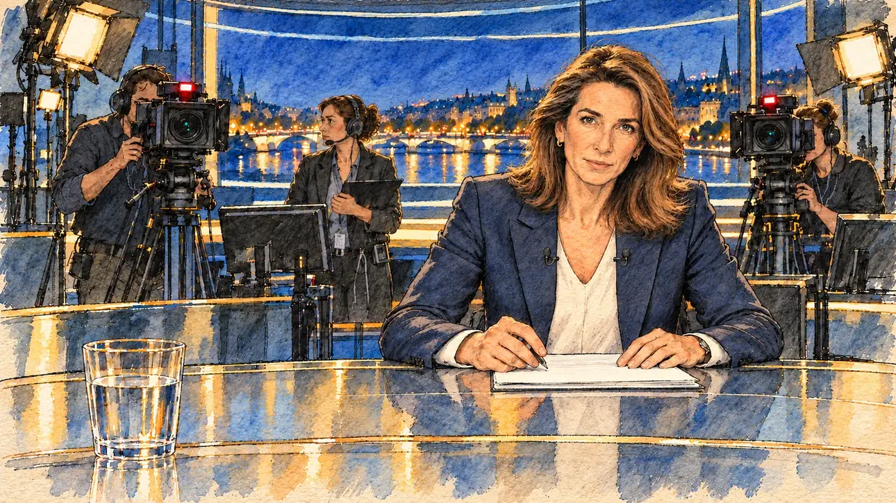

# `primeTime` · Invitation au 20 heures

**Validée par le PO le 30/10/2026**, à l'essai 2. Elle sert telle quelle en clair et en sombre.



| Champ | Valeur |
| --- | --- |
| Carte | `primeTime`, catégorie `media` (Opportunité médiatique) |
| Style | Reportage dessiné ; le visage de la présentatrice reste presque photographique sous les hachures |
| Ton | Tendu mais maîtrisé |
| Date | 2026-10-30 |
| Outil | ChatGPT avec le modèle GPT Sol 6.1 en effort « light », et ChatGPT Images 2.5 |
| Conversation | À remplir (le lien ne s'ouvre qu'avec le compte qui l'a créée) |
| Format rendu | 1672 × 941 (16:9) : export en 1290 × 726 px, WebP de qualité 75, 220 Ko, sans recadrage ; réexportée le 01/11/2026, après une première version en qualité 55 pour tenir 180 Ko |
| Fichier d'origine | PNG de ChatGPT, chez le PO. L'export du dépôt a été fait depuis la copie partagée dans la conversation avec Claude |
| Première édition | `kit-france-2611-0001` |

## Texte de la carte

> **Invitation au 20 heures**
>
> Le grand journal du soir vous propose un long entretien en direct. Des millions de téléspectateurs, et pas de seconde prise.

## Le moment choisi

Le plateau du journal, vu depuis le fauteuil d'invité du candidat, hors champ : le bord du bureau en verre et un verre d'eau au premier plan. En face, la présentatrice va poser la première question. Derrière, les caméras aux voyants rouges visent le candidat et une régisseuse attend. Le prompt demandait un présentateur, la cinquantaine, barbe grise : le générateur a dessiné une présentatrice, et le PO l'a gardée.

## Prompt complet

Avec deux images de référence jointes, [`marketGaffe.webp`](../../illustrations/polemic/marketGaffe.webp) et [`oldTweet.webp`](../../illustrations/polemic/oldTweet.webp) :

```
Use the two attached images as the style reference, halfway between them: visible pencil and ink lines with watercolour washes and warm paper grain, finished but never photographic. Not the same scenes.

Editorial illustration, landscape 16:9 (1536 × 864 px). The set of the big evening news programme, live, in 2027, seen from the guest's chair of the player's candidate, who stays off-camera: in the foreground, only the near edge of the glass desk and a glass of water. In the right third, across the desk, the news anchor, a man in his fifties with a trimmed grey beard, leans slightly forward with his notes and looks at the viewer, about to ask the first question, his face above mid-height. Behind him, two studio cameras with small red lights point at the viewer, their operators looking into the viewfinders, and a floor manager in headphones watches the anchor. A large screen behind the set shows a city at night. The dark studio, the bright desk and the stillness say that millions are watching and there is no second take. Nothing on the desk, the screens or the set is readable.

Style: Reportage drawing made on the spot, like a press illustrator or courtroom sketch artist: pencil and ink with loose watercolour washes, lively unfinished lines, white paper showing through.

Palette: navy #13203F, vellum #F5EFE1, gold #A9802A, brick #B5523B, ochre #D9A441, sage #8FA58A, slate #5E7186, sand #DCC8A4, warm grey #8C8279; use 4 to 6 of them, subtle warm paper grain.

Tone: tense but controlled, cool studio light, small red camera lights and one warm key light on the anchor.

Constraints: realistic proportions, expressive but not caricatured faces, people of varied ages, genders and origins; anatomically correct hands with exactly five fingers, few hands visible, the others in pockets, behind objects or out of frame; no readable text anywhere (signs, banners, price tags and screens stay blank); no captions or speech bubbles; no logos, flags or political party colours; no recognisable real person, no lookalike of a real politician or journalist; no explicit violence.

Format: if 16:9 is not available, make 1536 × 1024 and keep the top 80 px and the bottom 80 px free of anything important (faces, hands, the main action): they will be cropped.
```

### Message de correction

Envoyé après l'essai 1, avec [`oldTweet.webp`](../../illustrations/polemic/oldTweet.webp) comme seule référence :

```
Keep this scene, this framing and these people, but redraw it as a drawing in the style of the attached image: visible pencil and ink lines on the faces, hands and objects, loose watercolour washes, warm paper grain. No photographic faces and no oil-paint or brush-stroke texture. Fill the whole frame edge to edge, with no white or ragged border. Keep every hand anatomically correct, with five fingers, and no readable text anywhere.
```

## Essais écartés

- **Essai 1** (30/10/2026) : la consigne « à mi-chemin entre les deux images » a donné un visage photographique recouvert d'une texture de peinture, sans trait de crayon, et des bords blancs effilochés.

## Ce que cette image a appris

- Une seule image de référence marche mieux qu'un « mi-chemin » entre deux.
- Corriger en gardant « les mêmes personnes » garde aussi le rendu de leurs visages : pour des visages vraiment dessinés, il faut régénérer.
- Demander une image qui remplit tout le cadre, sans bord blanc.

## Retouches

Aucune.

## Relecture

Faite et validée par le PO le 30/10/2026, sur l'essai 2.

- [x] Aucun texte lisible : pancartes, banderoles, étiquettes, écrans.
- [x] Aucun sosie d'une personne réelle. Ici surtout : la présentatrice, à côté des vraies présentatrices du journal du soir.
- [x] Le candidat du joueur est hors champ, ou une silhouette lointaine de dos, sans genre marqué.
- [x] Mains, visages et foules sans défaut visible à 343 px de large.
- [x] Aucune couleur de parti, aucun symbole officiel. Des personnes variées.
- [x] En 3:2 : rien d'important dans les 80 px du haut et du bas. Sans objet ici : l'image est en 16:9.
- [x] Lisible sur la page de l'événement, en clair et en sombre.

## Régénération demandée (04/11/2026)

**Pourquoi.** La revue de la première série note le style à 2/3 et les détails à 1/3 : les lavis sont visibles sur les vêtements et le fond, mais le visage de la présentatrice reste presque photographique sous les hachures (déjà noté dans la fiche), et la table en verre porte des reflets brillants en bandes bleues et dorées. La composition est sobre et lisible (deux cadreurs, une régisseuse, des projecteurs, Paris la nuit en fond, un verre d'eau). Un défaut de ressemblance entre cartes : la présentatrice (longs cheveux châtains, blazer marine, chemisier blanc) a le même type de visage que l'animatrice de `pundit` et que la présentatrice qu'on voit à la télévision dans `leakedChat`. Le PO a décidé de régénérer l'image, avec ce commentaire : « on veut garder le style de la présentatrice, on veut qu'elle fasse penser à une présentatrice réelle du journal du soir, sans être une copie conforme » (décision du 04/11/2026, après rappel du risque : la ressemblance se fait par le type, l'allure et la coupe, jamais par un portrait ; aucun nom de personne réelle dans le prompt).

**Ce qui reste.** Le plateau du journal vu depuis le fauteuil d'invité du candidat (hors champ) : le bord du bureau en verre et un verre d'eau au premier plan, la présentatrice en face qui va poser la première question, une caméra aux voyants rouges, une régisseuse au casque, et Paris la nuit sur l'écran du fond. **Le style de la présentatrice** : cheveux châtains lissés au brushing, aux mèches plus claires, juste sous les épaules, blazer marine ajusté, chemisier blanc, regard calme et posé, l'assurance du journal du soir. Aucun nom, aucun traitement du visage d'une personne réelle : seulement le type.

**Ce qui change.** Le rendu, en dessin de presse réaliste dans le trait d'[`oldTweet`](../polemic/oldTweet.md) (PO, 04/11/2026) : le bureau en verre sans reflets (un lavis pâle et quelques lignes), aucun halo. Le plateau reste celui du grand journal, esquissé : deux caméras et leurs cadreurs aux voyants rouges, une régisseuse au casque avec sa tablette, la rampe de projecteurs, deux moniteurs, et le grand écran du fond avec Paris la nuit (la Seine, un pont, des toits, sans la tour Eiffel, déjà dans `televisedDebate`). **La présentatrice est décrite précisément** : quarante-huit ans, peau claire à reflets olive, visage ovale aux pommettes hautes et au nez droit, cheveux châtain moyen aux mèches miel, lissés au brushing, juste sous les épaules, rejetés en arrière et tournés vers l'extérieur aux pointes, jamais libres ni ébouriffés, petites boucles d'oreilles dorées, blazer marine, chemisier blanc à col en V, deux micros cravate, un stylo à la main. Le brushing la distingue de l'animatrice de [`podcast`](podcast.md), qui reprend depuis le 04/11/2026 les traits d'un portrait du PO, aux longs cheveux ondulés et libres. Les deux autres présentatrices de la série s'en écartent aussi : celle qu'on voit à la télévision dans `leakedChat` est rousse, en pixie, à lunettes rondes et en veste moutarde ; l'animatrice de `pundit` a les cheveux noirs en chignon bas, une frange et une veste vert sauge. La contrainte « pas de sosie » du prompt devient « aucune personne reconnaissable » : la présentatrice évoque le type des présentatrices du journal du soir, jamais le visage de l'une d'elles. Une première version de cette section, écrite avec la règle de « trois ou quatre objets au plus », réduisait le plateau à une caméra ; elle a été reprise quand le PO a demandé de ne pas trop simplifier les scènes.

### Prompt de régénération

Dans une nouvelle conversation, avec [`oldTweet.webp`](../../illustrations/polemic/oldTweet.webp) comme seule image de référence.

```
Use the attached image as the style reference and copy its drawing: a realistic reportage drawing made on the spot for a newspaper, with quick, nervous pencil lines, often drawn twice, ink hatching in the shadows, transparent watercolour washes that spill a little over the lines, and the warm paper showing through. Not the same scene.
Like in the reference, the setting can be full when the story needs it, with the things that say where we are and what is happening, but each one is sketched with a few pencil lines and a light wash, never rendered or finished, and the drawing gets looser and paler towards the edges until it fades into the bare paper.
This must look like a drawing made by hand on paper by a press illustrator, halfway between a quick sketch and a realistic picture: never a photograph, a film poster or a digital painting, and never a cartoon, a comic strip, a caricature or a children's book illustration. Continuous lines, never dotted or dashed outlines; no uniform texture, speckles or hatching filter laid over the picture; no glossy highlights, no smooth gradients, in the sky and on the walls too. Colour can be rich in places, on a piece of clothing, a light or a flag, but it stays transparent and within the palette below. The fade into the paper at the edges stays narrow, without a wide white margin. No blur and no depth-of-field effect: everything, the foreground included, is drawn sharp, like a sketch made on the spot.
People are drawn from life with realistic anatomy and proportions, like in the reference: faces shaped with pencil lines, hatching and light washes, a little more finished than the background but never photographic (no photographic skin, no airbrushed or digital-painting look). Expressions stay natural and restrained, even in laughter or tears: no exaggerated grins, no wide-open mouths full of teeth, no rubbery or cartoonish faces.

Editorial illustration, landscape 16:9 (1536 × 864 px), the scene filling the frame, with only a light fade into the paper at the edges. The set of the big evening news programme, live, in 2027, seen from the guest's chair of the player's candidate, who stays off-camera: in the foreground, only the near edge of the glass desk, drawn as a pale wash with a few ink lines and no reflections, and a glass of water. In the right third, across the desk, the news anchor, a woman of forty-eight with the poise of the great evening-news anchors: calm, authoritative, a level, attentive gaze and a firm, composed mouth. Fair skin with an olive undertone, a fine oval face with high cheekbones and a straight nose, smooth, blow-dried, mid-brown hair with honey highlights falling just past her shoulders, swept back from the face and turned out at the ends, polished, never loose or tousled, small gold stud earrings, a tailored navy blazer over a white silk blouse with a soft V-neck, two small lapel microphones and a thin pen in her hand over a sheet of notes. She leans slightly forward and looks at the viewer, about to ask the first question, her face above mid-height. Behind her, the set of the big evening news, sketched loosely in pencil and light washes: two studio cameras with small red lights, one on each side, their operators looking into the viewfinders, a floor manager in headphones holding a tablet and watching her, a rig of studio lights, two monitors, and a large screen behind the set showing Paris at night, the Seine, a bridge and rooftops, in light washes of navy and gold, without the Eiffel Tower. The stillness says that millions are watching and there is no second take. Nothing on the desk, the notes, the screen, the monitors, the tablet or the set is readable.

Style: Reportage drawing made on the spot, like a press illustrator or courtroom sketch artist: pencil and ink with loose watercolour washes, lively unfinished lines, white paper showing through.

Palette: navy #13203F, vellum #F5EFE1, gold #A9802A, brick #B5523B, ochre #D9A441, sage #8FA58A, slate #5E7186, sand #DCC8A4, warm grey #8C8279; use 4 to 6 of them, subtle warm paper grain.

Tone: tense but controlled, cool studio light, small red camera lights and one warm key light on the anchor.

Constraints: realistic proportions, natural expressions, never cartoonish or caricatured faces, drawn like the rest of the illustration and never photographic; people of varied ages, genders, origins and body types (heavy, stocky, round, tall, short, wiry, not only slim), each with a distinct face and haircut (no two people alike), drawn with respect and never as a joke; anatomically correct hands with exactly five fingers, few hands visible, the others in pockets, behind objects or out of frame; no readable text anywhere (the desk, the notes, the screen and the set stay unreadable); no captions or speech bubbles; no logos or political party colours; no recognisable real person: the anchor evokes the type of the great evening-news anchors, never the face of any one of them, and no one else looks like a real politician or journalist; no explicit violence; no photographic rendering, no blur or bokeh, no dotted outlines, no texture or hatching filter over the picture, no oil-paint texture, no wide white margin or frame (a light fade into the paper at the edges is fine).

Format: if 16:9 is not available, make 1536 × 1024 and keep the top 80 px and the bottom 80 px free of anything important (faces, hands, the main action): they will be cropped.
```
