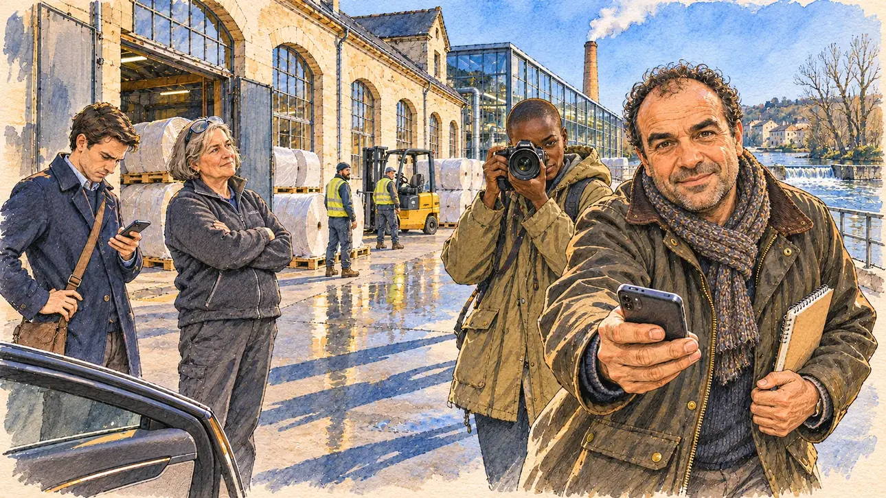

# `remindLocalPress` · La question du journal local

**À valider par le PO.**



| Champ | Valeur |
| --- | --- |
| Carte | `remindLocalPress`, catégorie `media` (Opportunité médiatique), carte ajoutée par la PR #561 de l'app (Mitchnsun/moi-president#499) |
| Style | Reportage dessiné |
| Ton | Observateur |
| Date | 2026-11-27 |
| Outil | ChatGPT Images |
| Conversation | À remplir (le lien ne s'ouvre qu'avec le compte qui l'a créée) |
| Format rendu | À remplir |
| Fichier d'origine | Image de ChatGPT, chez le PO. L'export du dépôt est fait depuis la copie partagée dans la conversation avec Claude |
| Première édition | La prochaine Release qui suit le merge de la PR #561 de l'app |

## Texte de la carte

> **La question du journal local**
>
> À la sortie d'une visite, un journaliste de la presse locale vous arrête : « Rappelez-nous votre mesure, en une phrase, pour nos lecteurs. »

Les réponses sont trois mesures d'un même thème, tirées pour chaque partie : celle du programme et deux qu'il ne tient pas. L'image ne montre donc ni le thème ni la réponse, ni le nom du journal.

## Le moment choisi

La cour d'une ancienne papeterie au bord de la Charente, près d'Angoulême, un matin froid et clair de mars : de longs bâtiments de calcaire clair aux fenêtres cintrées, une extension d'acier et de verre, des bobines de papier sur palettes, la rivière et son barrage derrière. Le candidat sort de la visite, hors champ : au premier plan, seulement la portière arrière ouverte de sa petite voiture électrique. Le journaliste du quotidien local lui barre un peu le chemin, téléphone tendu qui enregistre, carnet sous le bras ; sa jeune photographe lève l'appareil. Un membre de l'équipe regarde son téléphone, pressé de partir ; la directrice du site et deux ouvriers regardent depuis la porte. Angoulême et la Charente n'ont pas encore servi dans la série.

## Prompt complet

Dans une nouvelle conversation, avec [`primeTime.webp`](../../illustrations/media/primeTime.webp) comme seule image de référence :

```
Use the attached image as the style reference and copy its drawing: a realistic reportage drawing made on the spot for a newspaper, with quick, nervous pencil lines, often drawn twice, ink hatching in the shadows, transparent watercolour washes that spill a little over the lines, and the warm paper showing through. Take from the reference its line, its washes and its paper, not the finish of the presenter's face, which is the most finished and almost photographic part of it: every face here stays a drawing. Not the same scene and not the same people: never reuse the face or the hair of the woman in the reference.
Like in the reference, the setting can be full when the story needs it, with the things that say where we are and what is happening, but each one is sketched with a few pencil lines and a light wash, never rendered or finished, and the drawing gets looser and paler towards the edges until it fades into the bare paper.
This must look like a drawing made by hand on paper by a press illustrator, halfway between a quick sketch and a realistic picture: never a photograph, a film poster or a digital painting, and never a cartoon, a comic strip, a caricature or a children's book illustration. Continuous lines, never dotted or dashed outlines; the paper grain is the paper itself, never a mottled texture, speckles or hatching filter laid over the picture; no glossy highlights, no smooth gradients, in the sky and on the walls too. Colour can be rich in places, on a piece of clothing, a light or a flag, but it stays transparent and within the palette below. The fade into the paper at the edges stays narrow, without a wide white margin. No blur and no depth-of-field effect: everything, the foreground included, is drawn sharp, like a sketch made on the spot.
People are drawn from life with realistic anatomy and proportions: each face is drawn with the same visible pencil and ink lines, hatching and transparent washes as the clothes and the room, looser and sketchier than the presenter's face in the reference, with realistic features but never photographic (no photographic skin, no smooth shading, no airbrushed or digital-painting look). Expressions stay natural and restrained, even in laughter or tears: no exaggerated grins, no wide-open mouths full of teeth, no rubbery or cartoonish faces.

Editorial illustration, landscape 16:9 (1536 × 864 px), the scene filling the frame, with only a light fade into the paper at the edges. A bright, cold March morning in 2027, in the yard of an old paper mill on the banks of the Charente near Angoulême, in western France: long pale limestone buildings with tall arched windows and slate roofs, a modern steel-and-glass extension, rolls of paper wrapped on pallets, a forklift, the river and its weir behind. The player's candidate is leaving after a visit of the mill. The candidate stays off-camera, the scene seen from their place: in the foreground, only the open rear door of the candidate's small electric car at the bottom-left edge of the picture. In the right third, the main character, a reporter of the local newspaper, a man in his mid-forties of Portuguese origin, stocky, with short dark curly hair receding at the temples and three-day stubble, in a waxed jacket with a knitted scarf, a reporter's notebook tucked under his arm, steps forward and holds out his phone, recording, and looks at the viewer, friendly but insistent, waiting for one clear sentence for his readers, his face above mid-height. Just behind him, the paper's young photographer, a tall woman in her twenties of Malian origin with a shaved head and small hoop earrings, in a khaki parka, raises her camera to her eye towards the viewer. On the left, by the car, a member of the candidate's team, a short, wiry man in his thirties with a neat side parting and a navy coat, glances at his phone, in a hurry to leave. In the doorway of the mill, the plant manager, a round woman in her fifties with a grey bob and safety glasses pushed up on her head, in a work fleece, watches with her arms crossed, and two workers in high-visibility vests look on from the loading bay. Only the reporter and the photographer look at the viewer. Nothing on the notebook, the phones, the camera, the car, the vests, the paper rolls or the buildings is readable. No logo and no name of the newspaper or of the mill.

Style: Reportage drawing made on the spot, like a press illustrator or courtroom sketch artist: pencil and ink with loose watercolour washes, lively unfinished lines, white paper showing through.

Palette: navy #13203F, vellum #F5EFE1, gold #A9802A, brick #B5523B, ochre #D9A441, sage #8FA58A, slate #5E7186, sand #DCC8A4, warm grey #8C8279; use 4 to 6 of them, subtle warm paper grain.

Tone: observant, a bright cold March morning, clear light on the pale stone and long blue shadows.

Constraints: realistic proportions, natural expressions, never cartoonish or caricatured faces, drawn like the rest of the illustration and never photographic; people of varied ages, genders, origins and body types (heavy, stocky, round, tall, short, wiry, not only slim), each with a distinct face and haircut (no two people alike), drawn with respect and never as a joke; each person's age, build and look plausible for their job and the scene (working people of working age), no stereotype tying an origin or a gender to a role, and no person of colour shown alone in a featured service or deferential role; anatomically correct hands with exactly five fingers, few hands visible, the others in pockets, behind objects or out of frame; no readable text anywhere (the notebook, the phones, the camera, the car and the vests stay unreadable); no captions or speech bubbles; no logos or political party colours; no recognisable real person, no lookalike of a real politician or journalist; no explicit violence; no photographic rendering, no blur or bokeh, no dotted outlines, no texture or hatching filter over the picture, no oil-paint texture, no wide white margin or frame (a light fade into the paper at the edges is fine).

Format: if 16:9 is not available, make 1536 × 1024 and keep the top 80 px and the bottom 80 px free of anything important (faces, hands, the main action): they will be cropped.
```

## Essais écartés

Aucun.

## Retouches

Aucune.

## Relecture

À faire.

- [ ] Aucun texte lisible : carnet, téléphones, appareil photo, voiture, gilets, bobines, bâtiments.
- [ ] Aucun sosie d'une personne réelle, journaliste compris. Ni le journal ni la papeterie ne sont reconnaissables.
- [ ] Le candidat du joueur est hors champ ; toute image de lui (affiche, tract, double) n'a ni visage ni genre.
- [ ] Mains, visages et foules sans défaut visible à 343 px de large.
- [ ] Aucune couleur ni aucun logo de parti. Des personnes variées par l'âge, le corps, l'origine et la coiffure.
- [ ] En 3:2 : rien d'important dans les 80 px du haut et du bas.
- [ ] Lisible sur la page de l'événement, en clair et en sombre.
