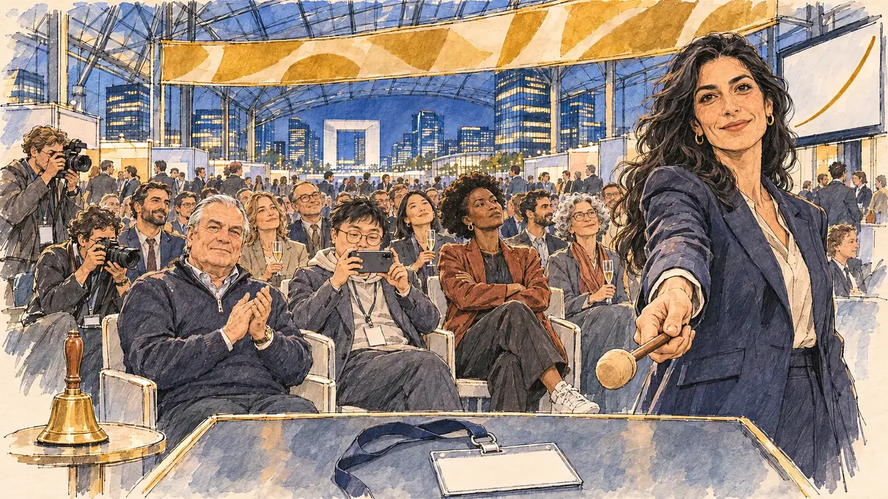

# `stockBell` · La cloche de la Bourse

**Retenue par le PO le 15/11/2026**, au premier essai. Elle sert telle quelle en clair et en sombre.



| Champ | Valeur |
| --- | --- |
| Carte | `stockBell`, catégorie `media` (Opportunité médiatique), poids 0,1, toute semaine ; un geste au bord de l'axe de l'économie, côté marché (Mitchnsun/moi-president, PO, 14/11/2026) |
| Style | Reportage dessiné |
| Ton | Ironique en douceur, lumière dorée de soirée |
| Date | 2026-11-15 |
| Outil | ChatGPT Images, modèle GPT 6.2, effort Light |
| Conversation | À compléter |
| Format rendu | 1672 × 941 (16:9) : export en 1290 × 726 px, WebP de qualité 75, 231 Ko, sans recadrage, fait depuis la copie WebP de la conversation |
| Fichier d'origine | Image de ChatGPT, chez le PO. L'export du dépôt a été fait depuis la copie partagée dans la conversation avec Claude |
| Première édition | À compléter |

## Texte de la carte

> **La cloche de la Bourse**
>
> Un salon de la finance et des start-up vous invite à sonner la cloche d'ouverture devant les investisseurs. Le slogan de la soirée s'affiche en lettres d'or : « Devenez milliardaires ».

## Le moment choisi

Une halle de verre et d'acier à La Défense, un soir de mars : par la verrière, les tours éclairées et la Grande Arche. Sur la scène, une cloche de laiton ; au-dessus, une banderole dorée aux formes abstraites à la place du slogan. Le candidat est au pupitre, hors champ : seul son badge de salon, blanc, posé dessus. L'animatrice lui tend le maillet de la cloche avec un sourire d'encouragement ; au premier rang, un investisseur applaudit déjà, un jeune fondateur filme, une fondatrice croise les bras, sceptique ; des photographes mitraillent. Le précédent est « des jeunes Français qui aient envie de devenir milliardaires » (janvier 2015) : personne n'y ressemble à un responsable politique ou à un patron connu.

## Prompt complet

Dans une nouvelle conversation, avec [`primeTime.webp`](../../illustrations/media/primeTime.webp) comme seule image de référence :

```
Use the attached image as the style reference and copy its drawing: a realistic reportage drawing made on the spot for a newspaper, with quick, nervous pencil lines, often drawn twice, ink hatching in the shadows, transparent watercolour washes that spill a little over the lines, and the warm paper showing through. Not the same scene and not the same people: never reuse the face or the hair of the woman in the reference.
Like in the reference, the setting can be full when the story needs it, with the things that say where we are and what is happening, but each one is sketched with a few pencil lines and a light wash, never rendered or finished, and the drawing gets looser and paler towards the edges until it fades into the bare paper.
This must look like a drawing made by hand on paper by a press illustrator, halfway between a quick sketch and a realistic picture: never a photograph, a film poster or a digital painting, and never a cartoon, a comic strip, a caricature or a children's book illustration. Continuous lines, never dotted or dashed outlines; no uniform texture, speckles or hatching filter laid over the picture; no glossy highlights, no smooth gradients, in the sky and on the walls too. Colour can be rich in places, on a piece of clothing, a light or a flag, but it stays transparent and within the palette below. The fade into the paper at the edges stays narrow, without a wide white margin. No blur and no depth-of-field effect: everything, the foreground included, is drawn sharp, like a sketch made on the spot.
People are drawn from life with realistic anatomy and proportions, like in the reference: faces shaped with pencil lines, hatching and light washes, a little more finished than the background but never photographic (no photographic skin, no airbrushed or digital-painting look). Expressions stay natural and restrained, even in laughter or tears: no exaggerated grins, no wide-open mouths full of teeth, no rubbery or cartoonish faces.

Editorial illustration, landscape 16:9 (1536 × 864 px), the scene filling the frame, with only a light fade into the paper at the edges. A large glass-and-steel hall at La Défense, near Paris, on an evening in March 2027, during a fair of finance and start-ups; through the glass roof, the lit office towers against the night. On a stage: a lectern and a polished brass bell with a wooden handle on a small stand; behind, a big screen shows only a rising golden curve, with no figures; above the stage, a long gilded banner shows only abstract golden shapes instead of words. In front of the stage, a crowd of investors and founders with glasses of champagne. The player's candidate stands at the lectern and stays off-camera: in the foreground, only the candidate's blank, unreadable fair badge lying flat on the lectern. In the right third, the evening's host, a tall woman in her thirties of Lebanese descent with long wavy black hair, in a navy suit, holds out the small mallet of the bell towards the viewer with an encouraging smile, her face above mid-height. In the front row: a heavy-set white investor in his sixties with silver hair slicked back, in a quarter-zip jumper over a shirt, already applauding and looking at the viewer; a short, round young founder of Chinese descent with round glasses, a hoodie under a blazer, filming with his phone; a tall founder of Ivorian descent with natural afro hair, white trainers and a structured jacket, arms crossed, sceptical. At the side, two press photographers. Only the host and the investor look at the viewer. Nothing on the screen, the banner, the badge, the lectern or the phones is readable.

Style: Reportage drawing made on the spot, like a press illustrator or courtroom sketch artist: pencil and ink with loose watercolour washes, lively unfinished lines, white paper showing through.

Palette: navy #13203F, vellum #F5EFE1, gold #A9802A, brick #B5523B, ochre #D9A441, sage #8FA58A, slate #5E7186, sand #DCC8A4, warm grey #8C8279; use 4 to 6 of them, subtle warm paper grain.

Tone: gently ironic, postures slightly exaggerated but never the faces, the golden light of the stage on the brass and the glasses, the night blue on the towers.

Constraints: realistic proportions, natural expressions, never cartoonish or caricatured faces, drawn like the rest of the illustration and never photographic; people of varied ages, genders, origins and body types (heavy, stocky, round, tall, short, wiry, not only slim), each with a distinct face and haircut (no two people alike), drawn with respect and never as a joke; each person's age, build and look plausible for their job and the scene (working people of working age), no stereotype tying an origin or a gender to a role, and no person of colour shown alone in a featured service or deferential role; anatomically correct hands with exactly five fingers, few hands visible, the others in pockets, behind objects or out of frame; no readable text anywhere (the screen, the banner, the badge, the lectern and the phones stay unreadable, no slogans, no figures, no stock ticker, no company names); no captions or speech bubbles; no logos, no stock exchange or bank logo, no television channel logo, no political party colours, no flags; no recognisable real person, no lookalike of a real politician or of a known business leader; no explicit violence; no photographic rendering, no blur or bokeh, every outline a continuous pencil or ink line with no dotted or dashed outlines, no mottled, crackled or speckled texture over the faces, the clothes, the glass or the sky, no hatching filter over the picture, no oil-paint texture, no glow, halo or lens flare around the lights, no wide white margin or frame (a light fade into the paper at the edges is fine).

Format: if 16:9 is not available, make 1536 × 1024 and keep the top 80 px and the bottom 80 px free of anything important (faces, hands, the main action): they will be cropped.
```

## Décisions prises sur cette image

Retenue telle quelle par le PO (15/11/2026). La cloche est une cloche de table, à gauche du pupitre, plutôt que sur un support ; la Grande Arche se voit par la verrière, un monument que le gabarit permet ; le badge pend à son cordon, blanc.

## Essais écartés

Aucun.

## Retouches

Aucune.

## Relecture

Faite le 15/11/2026, à confirmer par le PO.

- [x] Aucun texte lisible : la banderole n'a que des formes dorées, l'écran qu'une courbe ; badges, téléphone et pupitre illisibles.
- [x] Aucun sosie d'une personne réelle.
- [x] Le candidat du joueur est hors champ : seul son badge, sur le pupitre.
- [x] Mains et visages sans défaut visible à 343 px de large : la main qui tend le maillet, les mains qui applaudissent, celles autour du téléphone, les appareils des photographes.
- [x] Aucune couleur, aucun logo ni aucun drapeau de parti ou d'entreprise. Des personnes variées par l'âge, le corps, l'origine et la coiffure.
- [x] En 16:9 : pas de recadrage.
- [ ] Lisible sur la page de l'événement, en clair et en sombre : à vérifier dans l'app, une fois la carte publiée.
