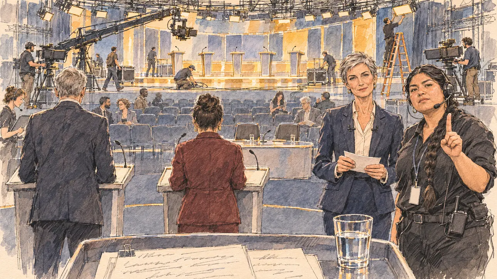

# `undercardDebate` · Le débat de première partie

**Validée par le PO le 09/11/2026**, au premier essai. Elle sert telle quelle en clair et en sombre.



| Champ | Valeur |
| --- | --- |
| Carte | `undercardDebate`, catégorie `media` (Opportunité médiatique), poids 0,3, semaines 9 à 11, à 10 % ou moins du sondage |
| Style | Reportage dessiné |
| Ton | Gentiment ironique |
| Date | 2026-11-09 |
| Outil | ChatGPT Images, à compléter (modèle et effort) |
| Conversation | À compléter |
| Format rendu | 1672 × 941 (16:9) : export en 1290 × 726 px, WebP de qualité 75, 224 Ko, sans recadrage, fait depuis le PNG de la conversation |
| Fichier d'origine | À compléter (hors du dépôt) |
| Première édition | À compléter |

## Texte de la carte

> **Le débat de première partie**
>
> Une chaîne coupe sa soirée de débat en deux : les candidatures en tête des sondages à 21 heures, les autres juste avant, devant une audience deux fois moindre. Vous êtes de la première partie.

## Le moment choisi

Un grand studio de télévision vers 20 heures, sans ville reconnaissable : devant, un petit plateau de première partie, des pupitres simples et des gradins à moitié vides ; derrière, sous les projecteurs, les techniciens qui montent déjà le grand plateau de 21 heures, cinq pupitres imposants. Le candidat reste hors champ, vu depuis son pupitre : ses notes et un verre d'eau. Les deux autres candidats de la première partie sont vus de dos, sans visage, comme le gabarit le permet aux candidats parodiés. La présentatrice regarde le spectateur avec un sourire professionnel, la régisseuse lève un doigt : à vous dans une minute.

## Prompt complet

Dans une nouvelle conversation, avec [`primeTime.webp`](../../illustrations/media/primeTime.webp) comme seule image de référence :

```
Use the attached image as the style reference and copy its drawing: a realistic reportage drawing made on the spot for a newspaper, with quick, nervous pencil lines, often drawn twice, ink hatching in the shadows, transparent watercolour washes that spill a little over the lines, and the warm paper showing through. Not the same scene and not the same people: never reuse the face or the hair of the woman in the reference.
Like in the reference, the setting can be full when the story needs it, with the things that say where we are and what is happening, but each one is sketched with a few pencil lines and a light wash, never rendered or finished, and the drawing gets looser and paler towards the edges until it fades into the bare paper.
This must look like a drawing made by hand on paper by a press illustrator, halfway between a quick sketch and a realistic picture: never a photograph, a film poster or a digital painting, and never a cartoon, a comic strip, a caricature or a children's book illustration. Continuous lines, never dotted or dashed outlines; no uniform texture, speckles or hatching filter laid over the picture; no glossy highlights, no smooth gradients, in the sky and on the walls too. Colour can be rich in places, on a piece of clothing, a light or a flag, but it stays transparent and within the palette below. The fade into the paper at the edges stays narrow, without a wide white margin. No blur and no depth-of-field effect: everything, the foreground included, is drawn sharp, like a sketch made on the spot.
People are drawn from life with realistic anatomy and proportions, like in the reference: faces shaped with pencil lines, hatching and light washes, a little more finished than the background but never photographic (no photographic skin, no airbrushed or digital-painting look). Expressions stay natural and restrained, even in laughter or tears: no exaggerated grins, no wide-open mouths full of teeth, no rubbery or cartoonish faces.

Editorial illustration, landscape 16:9 (1536 × 864 px), the scene filling the frame, with only a light fade into the paper at the edges. A large television studio around eight in the evening, in early April 2027, the night a channel splits its debate in two, the candidates low in the polls first and the leaders at nine: in the front, a small, plain set for the early debate, three simple lecterns, a low table for the presenter and a few rows of audience seats only half full; behind it, under bright rigs of stage lights, technicians are already setting up the big set for nine o'clock, five imposing lecterns in a semicircle, cameras on cranes, cables on the floor. The player's candidate stays off-camera, seen from their own lectern: in the foreground, only the edge of the lectern, a few pages of notes and a glass of water. At the two other early lecterns, the two other candidates of the first part are seen from behind only, with no faces: a tall figure with short grey hair in a dark jacket, and a short figure with a dark bun in a burgundy coat. In the right third, the presenter of the early debate, a slim white woman in her fifties with a sharp grey crop and a navy suit, cards in hand, looks at the viewer with a professional smile, you're on in one minute, her face above mid-height. Next to her, the floor manager, a stocky young woman of Peruvian descent with a long black braid, a headset and black clothes, raises one finger to the viewer. Only the presenter and the floor manager look at the viewer. Nothing on the lecterns, the cards, the notes, the cameras or the set is readable, and no channel name or logo appears anywhere.

Style: Reportage drawing made on the spot, like a press illustrator or courtroom sketch artist: pencil and ink with loose watercolour washes, lively unfinished lines, white paper showing through.

Palette: navy #13203F, vellum #F5EFE1, gold #A9802A, brick #B5523B, ochre #D9A441, sage #8FA58A, slate #5E7186, sand #DCC8A4, warm grey #8C8279; use 4 to 6 of them, subtle warm paper grain.

Tone: gently ironic, the modest dim light of the early set against the bright gold lights of the big set being prepared behind.

Constraints: realistic proportions, natural expressions, never cartoonish or caricatured faces, drawn like the rest of the illustration and never photographic; people of varied ages, genders, origins and body types (heavy, stocky, round, tall, short, wiry, not only slim), each with a distinct face and haircut (no two people alike), drawn with respect and never as a joke; each person's age, build and look plausible for their job and the scene (working people of working age), no stereotype tying an origin or a gender to a role, and no person of colour shown alone in a featured service or deferential role; anatomically correct hands with exactly five fingers, few hands visible, the others in pockets, behind objects or out of frame; no readable text anywhere (the lecterns, the cards, the notes, the cameras and the set stay unreadable); no captions or speech bubbles; no logos, no TV channel name or logo, no political party colours; the other candidates seen from behind only, never their faces; no recognisable real person, no lookalike of a real politician or presenter; no explicit violence; no photographic rendering, no blur or bokeh, no dotted outlines, no texture or hatching filter over the picture, no oil-paint texture, no glow or halo around the lights, no wide white margin or frame (a light fade into the paper at the edges is fine).

Format: if 16:9 is not available, make 1536 × 1024 and keep the top 80 px and the bottom 80 px free of anything important (faces, hands, the main action): they will be cropped.
```

## Décisions prises sur cette image

Validée telle quelle par le PO (09/11/2026).

## Essais écartés

Aucun.

## Retouches

Aucune.

## Relecture

Faite et validée par le PO le 09/11/2026.

- [x] Aucun texte lisible : les notes ne portent qu'une fausse écriture cursive, le badge de la régisseuse est vierge, rien sur les pupitres, les fiches ni les caméras ; aucun logo de chaîne.
- [x] Aucun sosie d'une personne réelle : les deux autres candidats sont de dos, sans visage.
- [x] Le candidat du joueur est hors champ : seuls ses notes, une pince et son verre d'eau, sur son pupitre.
- [x] Mains et visages sans défaut visible à 343 px de large : la main levée de la régisseuse (l'index tendu, les autres doigts repliés), celles de la présentatrice sur ses fiches.
- [x] Aucune couleur ni aucun logo de parti. Des personnes variées par l'âge, le corps, l'origine et la coiffure.
- [x] En 16:9 : pas de recadrage.
- [ ] Lisible sur la page de l'événement, en clair et en sombre : à vérifier dans l'app, une fois la carte publiée.
