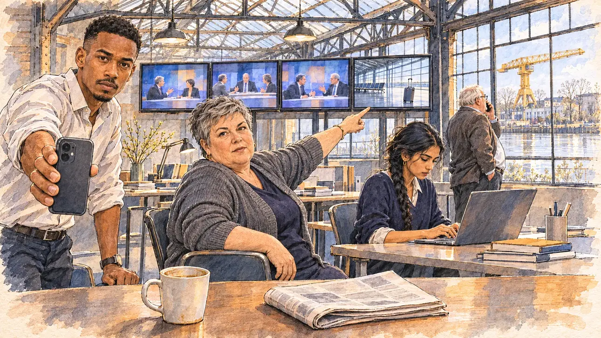

# `wealthExit` · Un fondateur plie bagage

**Validée par le PO le 20/11/2026**, au premier essai, avec `primeTime.webp` comme référence. Elle sert telle quelle en clair et en sombre.



| Champ | Valeur |
| --- | --- |
| Carte | `wealthExit`, catégorie `media` (Opportunité médiatique), poids 0,2, à partir de l'officialisation, une carte du programme : tirée si le programme tient un impôt sur la fortune ou un barème plus progressif (`wealthTax`, `financialWealthTax`, `progressiveTax`) (Mitchnsun/moi-president, PO, 17/11/2026) |
| Style | Reportage dessiné, trait de `primeTime` |
| Ton | Tendu, lumière blanche du matin |
| Date | 2026-11-20 (prompt écrit le 2026-11-18) |
| Outil | À compléter |
| Conversation | À remplir (le lien ne s'ouvre qu'avec le compte qui l'a créée) |
| Format rendu | 1672 × 941 (16:9) : export en 1290 × 726 px, WebP de qualité 75, 219 Ko, sans recadrage |
| Fichier d'origine | Image chez le PO. L'export du dépôt a été fait depuis la copie partagée dans la conversation avec Claude |
| Première édition | À compléter |

## Texte de la carte

> **Un fondateur plie bagage**
>
> Le fondateur d'une entreprise connue annonce qu'il s'installe à l'étranger, et cite votre programme fiscal dans son communiqué. Sur les chaînes d'information, des économistes disent que ces départs sont marginaux, d'autres que le pays perd ses meilleurs talents.

## Le moment choisi

Le QG de campagne du candidat sur l'île de Nantes, un matin de mars : un plateau de bureaux dans une ancienne halle, poutres métalliques, et par la verrière la Loire et la grue jaune des anciens chantiers. Sur le mur d'écrans, quatre chaînes d'information : des économistes en débat, minuscules et sans visage reconnaissable, et une image de hall d'aéroport où roule une seule valise. Le fondateur n'est jamais montré. Le candidat arrive, hors champ : au premier plan, son café à moitié bu et une revue de presse pliée. Le chargé de presse lui tend son téléphone, le communiqué à l'écran, et le regarde ; l'économiste de l'équipe montre un écran ; une bénévole cherche les études sur son ordinateur. La carte rappelle le rapport Henley & Partners et les 800 millionnaires partis en 2025 : personne n'y ressemble à un patron connu.

## Prompt complet

Dans une nouvelle conversation, avec [`primeTime.webp`](../../illustrations/media/primeTime.webp) comme seule image de référence :

```
Use the attached image as the style reference and copy its drawing: a realistic reportage drawing made on the spot for a newspaper, with quick, nervous pencil lines, often drawn twice, ink hatching in the shadows, transparent watercolour washes that spill a little over the lines, and the warm paper showing through. Not the same scene and not the same people: never reuse the face or the hair of the woman in the reference.
Like in the reference, the setting can be full when the story needs it, with the things that say where we are and what is happening, but each one is sketched with a few pencil lines and a light wash, never rendered or finished, and the drawing gets looser and paler towards the edges until it fades into the bare paper.
This must look like a drawing made by hand on paper by a press illustrator, halfway between a quick sketch and a realistic picture: never a photograph, a film poster or a digital painting, and never a cartoon, a comic strip, a caricature or a children's book illustration. Continuous lines, never dotted or dashed outlines; no uniform texture, speckles or hatching filter laid over the picture; no glossy highlights, no smooth gradients, in the sky and on the walls too. Colour can be rich in places, on a piece of clothing, a light or a flag, but it stays transparent and within the palette below. The fade into the paper at the edges stays narrow, without a wide white margin. No blur and no depth-of-field effect: everything, the foreground included, is drawn sharp, like a sketch made on the spot.
People are drawn from life with realistic anatomy and proportions, like in the reference: faces shaped with pencil lines, hatching and light washes, a little more finished than the background but never photographic (no photographic skin, no airbrushed or digital-painting look). Expressions stay natural and restrained, even in laughter or tears: no exaggerated grins, no wide-open mouths full of teeth, no rubbery or cartoonish faces.

Editorial illustration, landscape 16:9 (1536 × 864 px), the scene filling the frame, with only a light fade into the paper at the edges. The campaign headquarters of the player's candidate on the Île de Nantes, in western France, on a morning in March 2027: an open-plan office in an old industrial hall with metal beams and a glass roof, desks with laptops, and through the large windows the Loire and the tall yellow crane of the former shipyards. On the wall, a row of four television screens shows news channels: on three of them, small economists debating at studio desks, tiny and with no recognisable face; on the fourth, an airport departure hall with a single rolling suitcase. The founder of a well-known company has announced he is moving abroad and quoted the candidate's tax programme: he is never shown. The player's candidate has just arrived and stays off-camera: in the foreground, only the candidate's half-drunk coffee and a folded press review on a desk. In the left third, the main character, the campaign's press officer, a young man in his late twenties of Haitian descent, slim, with a short fade and a white shirt with rolled sleeves, holds out his phone towards the viewer, its screen turned away, and looks at the viewer with an urgent look, his face above mid-height. Around: the campaign's economist, a heavy-set white woman in her fifties with a grey pixie cut and a slate cardigan, points at one of the screens, looking at the viewer; at a desk, a volunteer student of Indian descent with a long braid searches on her laptop, not looking up; behind, a communications adviser in his sixties, short and round, with white hair, talks on the phone by the window. Only the press officer and the economist look at the viewer. Nothing on the screens, the phone, the press review, the laptop or the walls is readable.

Style: Reportage drawing made on the spot, like a press illustrator or courtroom sketch artist: pencil and ink with loose watercolour washes, lively unfinished lines, white paper showing through.

Palette: navy #13203F, vellum #F5EFE1, gold #A9802A, brick #B5523B, ochre #D9A441, sage #8FA58A, slate #5E7186, sand #DCC8A4, warm grey #8C8279; use 4 to 6 of them, subtle warm paper grain.

Tone: tense, the white morning light under the glass roof, the slate and navy of the office, the yellow of the crane outside as the warm note.

Constraints: realistic proportions, natural expressions, never cartoonish or caricatured faces, drawn like the rest of the illustration and never photographic; people of varied ages, genders, origins and body types (heavy, stocky, round, tall, short, wiry, not only slim), each with a distinct face and haircut (no two people alike), drawn with respect and never as a joke; each person's age, build and look plausible for their job and the scene (working people of working age), no stereotype tying an origin or a gender to a role, and no person of colour shown alone in a featured service or deferential role; anatomically correct hands with exactly five fingers, few hands visible, the others in pockets, behind objects or out of frame; no readable text anywhere (the screens, the phone, the press review, the laptop and the walls stay unreadable, no ticker, no on-screen captions, no numbers, no departure board with words); no captions or speech bubbles; no logos, no television channel logo, no company or airline logo, no political party colours; no recognisable real person, no lookalike of a real politician or of a known business founder; no explicit violence; no photographic rendering, no blur or bokeh, every outline a continuous pencil or ink line with no dotted or dashed outlines, no mottled, crackled or speckled texture over the faces, the clothes, the beams or the sky, no hatching filter over the picture, no oil-paint texture, no glow or halo, no wide white margin or frame (a light fade into the paper at the edges is fine).

Format: if 16:9 is not available, make 1536 × 1024 and keep the top 80 px and the bottom 80 px free of anything important (faces, hands, the main action): they will be cropped.
```

## Décisions prises sur cette image

Aucune pour le moment.

## Essais écartés

Aucun.

## Retouches

Aucune.

## Relecture

Faite et validée par le PO le 20/11/2026.

- [x] Aucun texte lisible : les écrans, le téléphone (dos tourné), la revue de presse, l'ordinateur et les murs ; aucun bandeau ni tableau des départs.
- [x] Aucun sosie d'une personne réelle ; le fondateur n'est jamais montré.
- [x] Le candidat du joueur est hors champ : son café entamé et la revue de presse pliée sur le bureau.
- [x] Mains, visages et foules sans défaut visible à 343 px de large.
- [x] Aucune couleur ni aucun logo de parti. Aucun logo de chaîne, d'entreprise, de compagnie aérienne ni de téléphone. Des personnes variées par l'âge, le corps, l'origine et la coiffure.
- [x] En 3:2 : sans objet, l'image est en 16:9.
- [x] Lisible sur la page de l'événement, en clair et en sombre.

Ce que la relecture a accepté : l'économiste est assise et non debout ; le téléphone, vu de dos, montre son double objectif, sans logo ; les économistes des écrans restent minuscules et sans visage reconnaissable.
