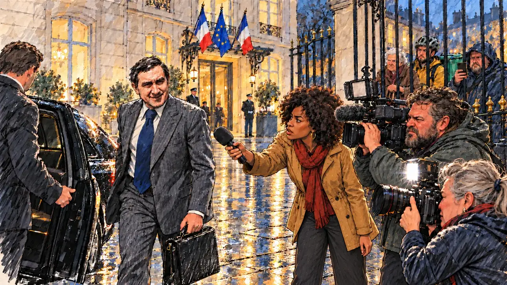

# `ministerResigns` · Démission au gouvernement

**Validée par le PO le 31/10/2026**, au premier essai. Elle sert telle quelle en clair et en sombre.



| Champ | Valeur |
| --- | --- |
| Carte | `ministerResigns`, catégorie `crisis` (Crise) |
| Style | Reportage dessiné ; certains visages restent presque photographiques |
| Ton | Tendu |
| Date | 2026-10-31 |
| Outil | ChatGPT avec le modèle GPT Sol 6.1 en effort « light », et ChatGPT Images 2.5 |
| Conversation | À remplir (le lien ne s'ouvre qu'avec le compte qui l'a créée) |
| Format rendu | 1670 × 941 (16:9) : export en 1290 × 726 px, WebP de qualité 75, 196 Ko, sans recadrage ; réexportée le 01/11/2026, après une première version en qualité 65 pour tenir 180 Ko |
| Fichier d'origine | PNG de ChatGPT, chez le PO. L'export du dépôt a été fait depuis la copie partagée dans la conversation avec Claude |
| Première édition | À remplir |

## Texte de la carte

> **Démission au gouvernement**
>
> Un secrétaire d'État démissionne, soupçonné d'avoir favorisé ses amis dans des marchés publics. La défiance envers les élites explose.

## Le moment choisi

La cour pavée d'un ministère, un soir de pluie, vue depuis la mêlée des journalistes. Le secrétaire d'État file vers la voiture officielle, serviette à la main, avec un sourire forcé ; une reporter lui tend son micro, un cadreur et une photographe le mitraillent. Derrière les grilles, des passants hostiles. Personne ne regarde le candidat, qui n'est pas acteur de la scène.

## Prompt complet

Dans une nouvelle conversation, avec deux images jointes : [`oldTweet.webp`](oldTweet.webp) pour le style, puis une photo de famille du PO pour la ressemblance du secrétaire d'État.

```
Use the first attached image as the style reference: the same pencil and ink drawing with loose watercolour washes and warm paper grain. Faces, hands and objects are drawn with visible ink lines, never photographic. Not the same scene.
Use the second attached image, an old photograph, only as the likeness reference for the junior minister: give him this man's face, hairstyle and build, at the same age as in the photograph, drawn in the same style as everyone else.

Editorial illustration, landscape 16:9 (1536 × 864 px), filling the whole frame edge to edge. The paved courtyard of a Paris ministry, an old private mansion with tall windows, on a rainy evening in 2027. Two French flags and a European flag hang above the entrance, so that the building is clearly an official one. A junior minister has just resigned, suspected of favouring his friends in public contracts. The scene is seen from inside the crowd of journalists: in the foreground, only the blurred back of a reporter's shoulder and a microphone. In the left third, the junior minister, the man from the photograph, in a grey pinstripe suit and a wide navy tie like in the photograph, walks quickly towards a black official car with its door held open, a briefcase in his hand, forcing a tight smile while looking away from the cameras, his face above mid-height. Around him, the press scrum: a young reporter with a voluminous afro holds out her microphone, a heavy-set bearded cameraman films, a short older photographer with a grey ponytail fires her flash. Behind the tall railings of the gate, passers-by watch with hostile faces: an elderly woman with a cane, a delivery cyclist with his helmet on, a stocky man in a raincoat filming with his phone. Nobody looks at the viewer. Nothing on the car, the building or the screens is readable.

Style: Reportage drawing made on the spot, like a press illustrator or courtroom sketch artist: pencil and ink with loose watercolour washes, lively unfinished lines, white paper showing through.

Palette: navy #13203F, vellum #F5EFE1, gold #A9802A, brick #B5523B, ochre #D9A441, sage #8FA58A, slate #5E7186, sand #DCC8A4, warm grey #8C8279; use 4 to 6 of them, subtle warm paper grain, with the blue, white and red of the flags as the only saturated colours.

Tone: tense, wet blue evening light on the paving stones, harsh white camera flashes.

Constraints: realistic proportions, expressive but not caricatured faces, people of varied ages, genders, origins and body types (heavy, stocky, round, tall, short, wiry, not only slim), each with a distinct face and haircut (no two people alike), drawn with respect and never as a joke; anatomically correct hands with exactly five fingers, few hands visible, the others in pockets, behind objects or out of frame; no readable text anywhere (signs, plates, labels and screens stay unreadable); no captions or speech bubbles; no logos or political party colours; apart from the junior minister, no recognisable real person and no lookalike of a real politician; no explicit violence; no oil-paint texture, no white or ragged border.

Format: if 16:9 is not available, make 1536 × 1024 and keep the top 80 px and the bottom 80 px free of anything important (faces, hands, the main action): they will be cropped.
```

## Décisions prises sur cette image

- **Les drapeaux** (deux tricolores et un européen) sont permis pour qu'on reconnaisse un bâtiment officiel (PO, 31/10/2026).
- **Le secrétaire d'État reprend les traits d'une photo de famille fournie par le PO**, avec l'accord de la famille (31/10/2026). La photo n'est pas dans ce dépôt.
- **Les visages** : ils ont souvent un rendu presque photographique à côté du reste du dessin. Les prompts suivants le corrigent.

## Essais écartés

Aucun.

## Retouches

Aucune.

## Relecture

Faite et validée par le PO le 31/10/2026.

- [x] Aucun texte lisible : ni sur la voiture, ni sur le bâtiment.
- [x] Aucun sosie d'une personne réelle, hors la ressemblance voulue du secrétaire d'État.
- [x] Le candidat du joueur est hors champ.
- [x] Mains, visages et foules sans défaut visible à 343 px de large.
- [x] Aucune couleur de parti. Les drapeaux sont permis ici.
- [x] En 3:2 : rien d'important dans les 80 px du haut et du bas. Sans objet ici : l'image est en 16:9.
- [x] Lisible sur la page de l'événement, en clair et en sombre.
