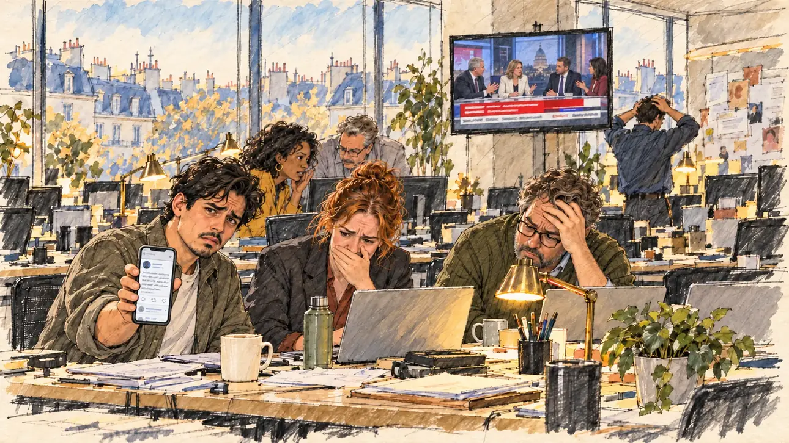

# `oldTweet` · Un vieux tweet ressurgit

**Validée par le PO le 30/10/2026**, à l'essai 2. Elle sert telle quelle en clair et en sombre.



| Champ | Valeur |
| --- | --- |
| Carte | `oldTweet`, catégorie `polemic` (Polémique) |
| Style | Reportage dessiné, trait plus esquissé que [`marketGaffe`](marketGaffe.md) |
| Ton | Ironique |
| Date | 2026-10-30 |
| Outil | ChatGPT avec le modèle GPT Sol 6.1 en effort « light », et ChatGPT Images 2.5 |
| Conversation | À remplir (le lien ne s'ouvre qu'avec le compte qui l'a créée) |
| Format rendu | 1672 × 941 (16:9) : export en 1290 × 726 px, WebP de qualité 75, 185 Ko, sans recadrage ; réexportée le 01/11/2026, après une première version en qualité 70 pour tenir 180 Ko |
| Fichier d'origine | PNG de ChatGPT, chez le PO. L'export du dépôt a été fait depuis la copie partagée dans la conversation avec Claude |
| Première édition | À remplir |

## Texte de la carte

> **Un vieux tweet ressurgit**
>
> Un tweet que vous aviez posté il y a dix ans refait surface. Une blague douteuse, que les réseaux redécouvrent avec délice.

## Le moment choisi

Le QG du candidat, tôt le matin, vu depuis sa place. Le tweet ne peut pas apparaître en clair : c'est l'équipe qui raconte l'affaire. L'attaché de presse tend son téléphone au candidat avec une grimace, et derrière lui l'équipe réagit, entre fou rire étouffé et main sur le front.

## Prompt complet

```
Use the attached image as the style reference: same line, paper grain and palette, not the same scene.

Editorial illustration, landscape 16:9 (1536 × 864 px). The open-plan headquarters of the player's candidate, early in the morning in 2027, seen from the candidate's place: the candidate stays off-camera. In the left third, the young press officer, a man in his late twenties with a coffee in one hand, holds his smartphone up towards the viewer, its screen turned away from us, with a pained, half-amused grimace, his face above mid-height. Behind him, the team discovers a joke the candidate posted ten years ago, now all over social media: two staffers stare at their laptops, one hides a laugh behind her hand, another rubs his forehead; a wall television shows a news programme with a blank banner. Only the press officer and one embarrassed adviser look at the viewer; the others look at their screens or at each other. Phones, laptops and the television show no readable text, only light.

Style: Reportage drawing made on the spot, like a press illustrator or courtroom sketch artist: pencil and ink with loose watercolour washes, lively unfinished lines, white paper showing through.

Palette: navy #13203F, vellum #F5EFE1, gold #A9802A, brick #B5523B, ochre #D9A441, sage #8FA58A, slate #5E7186, sand #DCC8A4, warm grey #8C8279; use 4 to 6 of them, subtle warm paper grain.

Tone: gently ironic, postures slightly exaggerated but never the faces, cold early-morning light from the windows and warm desk lamps.

Constraints: realistic proportions, expressive but not caricatured faces, people of varied ages, genders and origins; anatomically correct hands with exactly five fingers, few hands visible, the others in pockets, behind objects or out of frame; no readable text anywhere (signs, banners, price tags and screens stay blank); no captions or speech bubbles; no logos, flags or political party colours; no recognisable real person, no lookalike of a real politician; no explicit violence.

Format: if 16:9 is not available, make 1536 × 1024 and keep the top 80 px and the bottom 80 px free of anything important (faces, hands, the main action): they will be cropped.
```

### Message de correction

Envoyé après l'essai 1 :

```
Keep this scene and these people, but redraw it in the style of the attached reference image: visible pencil and ink lines, loose watercolour washes, warm paper grain, less photographic detail. The press officer on the left now turns his smartphone towards the viewer, its screen facing away from us, and looks at the viewer with a pained half-smile. The wall television shows a plain news set with a grey, empty banner and no channel colours. Keep every hand anatomically correct, with five fingers, and no readable text anywhere.
```

## Essais écartés

- **Essai 1** (30/10/2026) : le trait était trop photographique à côté des autres images, l'attaché de presse regardait son téléphone au lieu du candidat, et la télé montrait un bandeau aux couleurs d'une chaîne.

## Décisions prises sur cette image

- **Les ressemblances avec ce qui existe sont permises** (PO, 30/10/2026). Le téléphone montre une interface qui imite un réseau social, et la télé un plateau avec un dôme et un bandeau aux lettres déformées. Le faux texte n'est pas lisible.
- **Le trait** : celui-ci, plus esquissé, convient. La collection cherche un équilibre entre lui et le rendu plus fini de [`marketGaffe`](marketGaffe.md).

## Retouches

Aucune.

## Relecture

Faite et validée par le PO le 30/10/2026, sur l'essai 2.

- [x] Aucun texte lisible : pancartes, banderoles, étiquettes, écrans. Ici : le faux texte du téléphone et du bandeau de la télé n'est pas lisible, et il est accepté.
- [x] Aucun sosie d'une personne réelle.
- [x] Le candidat du joueur est hors champ, ou une silhouette lointaine de dos, sans genre marqué.
- [x] Mains, visages et foules sans défaut visible à 343 px de large.
- [x] Aucune couleur de parti, aucun symbole officiel. Des personnes variées. Les ressemblances avec des interfaces ou des habillages existants sont acceptées.
- [x] En 3:2 : rien d'important dans les 80 px du haut et du bas. Sans objet ici : l'image est en 16:9.
- [x] Lisible sur la page de l'événement, en clair et en sombre.
