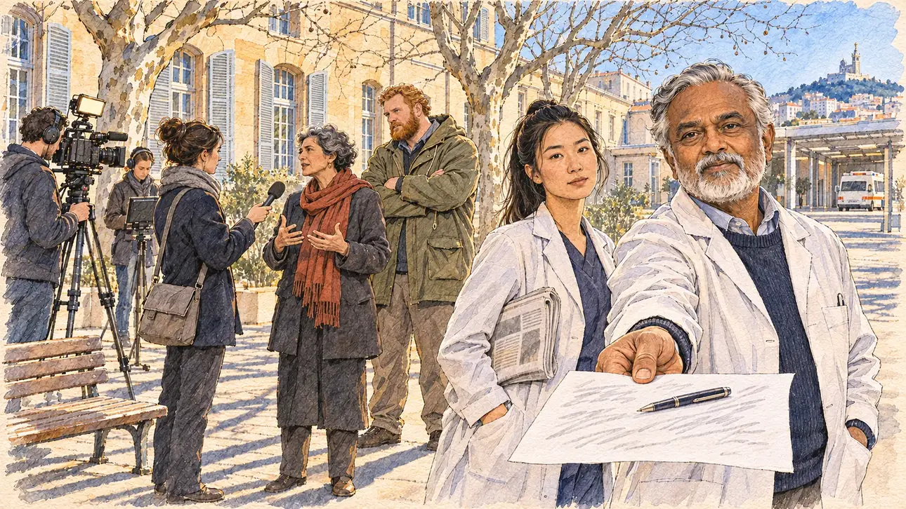

# `antiTobaccoPledge` · Une tribune contre le lobby du tabac

**Validée par le PO le 24/11/2026**, au premier essai, dans le trait de `primeTime`. Elle sert telle quelle en clair et en sombre.



| Champ | Valeur |
| --- | --- |
| Carte | `antiTobaccoPledge`, catégorie `openLetter` (Tribune collective) ; carte ajoutée par la PR #510 de l'app |
| Style | Reportage dessiné, trait de `primeTime` |
| Ton | Observateur |
| Date | 2026-11-24 |
| Outil | ChatGPT Images |
| Conversation | À remplir (le lien ne s'ouvre qu'avec le compte qui l'a créée) |
| Format rendu | 1672 × 941 (16:9) : export en 1290 × 726 px depuis l'image partagée dans la conversation avec Claude, WebP de qualité 75, 240 Ko, sans recadrage |
| Fichier d'origine | Image de ChatGPT, chez le PO. L'export du dépôt a été fait depuis la copie partagée dans la conversation avec Claude |
| Première édition | `kit-france-2611-0004` |

## Texte de la carte

> **Une tribune contre le lobby du tabac**
>
> Des médecins, des chercheurs et des associations de lutte contre le tabac publient une tribune : ils demandent à chaque candidature de ne rencontrer l'industrie du tabac, ni ses relais, qu'en public et au strict nécessaire, comme le veut une convention que la France a signée.

Les réponses : signer l'engagement (sans jet) ; ne pas répondre (sans jet) ; refuser, on ne met pas les buralistes au ban (sang-froid 11, plus facile à droite) ; signer et publier tout l'agenda de ses rencontres (expertise 14, le pari).

## Le moment choisi

Le matin de la publication, dans la cour d'un hôpital de Marseille : un pneumologue tend au candidat, hors champ, la feuille de l'engagement et un stylo ; une interne tient le journal du jour sous le bras ; derrière, le porte-parole d'une association écoute et une chercheuse répond à une journaliste devant une caméra. La règle réelle, l'article 5.3 de la convention-cadre de l'OMS, et les recommandations des associations sont dans `docs/NEWS_SOURCES.md` de l'app.

## Prompt complet

Dans une nouvelle conversation, avec [`primeTime.webp`](../../illustrations/media/primeTime.webp) comme seule image de référence.

```
Use the attached image as the style reference and copy its drawing: a realistic reportage drawing made on the spot for a newspaper, with quick, nervous pencil lines, often drawn twice, ink hatching in the shadows, transparent watercolour washes that spill a little over the lines, and the warm paper showing through. Not the same scene and not the same people: never reuse the face or the hair of the woman in the reference.
Like in the reference, the setting can be full when the story needs it, with the things that say where we are and what is happening, but each one is sketched with a few pencil lines and a light wash, never rendered or finished, and the drawing gets looser and paler towards the edges until it fades into the bare paper.
This must look like a drawing made by hand on paper by a press illustrator, halfway between a quick sketch and a realistic picture: never a photograph, a film poster or a digital painting, and never a cartoon, a comic strip, a caricature or a children's book illustration. Continuous lines, never dotted or dashed outlines; no uniform texture, speckles or hatching filter laid over the picture; no glossy highlights, no smooth gradients, in the sky and on the walls too. Colour can be rich in places, on a piece of clothing, a light or a flag, but it stays transparent and within the palette below. The fade into the paper at the edges stays narrow, without a wide white margin. No blur and no depth-of-field effect: everything, the foreground included, is drawn sharp, like a sketch made on the spot.
People are drawn from life with realistic anatomy and proportions, like in the reference: faces shaped with pencil lines, hatching and light washes, a little more finished than the background but never photographic (no photographic skin, no airbrushed or digital-painting look). Expressions stay natural and restrained, even in laughter or tears: no exaggerated grins, no wide-open mouths full of teeth, no rubbery or cartoonish faces.

Editorial illustration, landscape 16:9 (1536 × 864 px), the scene filling the frame, with only a light fade into the paper at the edges. The courtyard of a large public hospital in Marseille, on a bright winter morning in 2027: ochre stone buildings with tall shuttered windows, a few plane trees, a bench, an ambulance bay sketched in the background. Doctors, researchers and anti-tobacco charities have just published an open letter asking every candidate to meet the tobacco industry and its relays only in public and only when strictly necessary, and they present it to a few cameras, offering the player's candidate to sign the pledge on the spot. The candidate stays off-camera: in the foreground, only a single printed sheet held out towards the viewer with a pen lying on it, its lines only grey strokes. In the right third, the main character, a lung specialist in his sixties of Tamil descent, short and stocky, with thick grey hair combed back and a neat white beard, in a white coat over a navy jumper, holds out the sheet and the pen and looks at the viewer with a calm, expectant look, his face above mid-height. Beside him, a young hospital resident in her twenties of Chinese descent, slim, with a high ponytail, in a white coat, holds the day's newspaper folded under her arm, its page unreadable, and looks at the viewer. A little behind, a charity spokesman in his forties, white, tall and heavy-set, with a ginger beard and a sage parka, listens with his arms folded; a researcher in her fifties of Algerian descent, with short wavy grey hair and a brick-red scarf, answers a young reporter holding out a microphone, both turned away from the viewer. A camera on a tripod and a second operator, sketched. Only the lung specialist and the resident look at the viewer. Nothing on the sheet, the newspaper, the microphone, the camera, the coats or the ambulance is readable.

Style: Reportage drawing made on the spot, like a press illustrator or courtroom sketch artist: pencil and ink with loose watercolour washes, lively unfinished lines, white paper showing through.

Palette: navy #13203F, vellum #F5EFE1, gold #A9802A, brick #B5523B, ochre #D9A441, sage #8FA58A, slate #5E7186, sand #DCC8A4, warm grey #8C8279; use 4 to 6 of them, subtle warm paper grain.

Tone: observant and neutral, bright winter morning light, long soft shadows of the plane trees on the stone.

Constraints: realistic proportions, natural expressions, never cartoonish or caricatured faces, drawn like the rest of the illustration and never photographic; people of varied ages, genders, origins and body types (heavy, stocky, round, tall, short, wiry, not only slim), each with a distinct face and haircut (no two people alike), drawn with respect and never as a joke; each person's age, build and look plausible for their job and the scene (working people of working age), no stereotype tying an origin or a gender to a role, and no person of colour shown alone in a featured service or deferential role; anatomically correct hands with exactly five fingers, few hands visible, the others in pockets, behind objects or out of frame; no readable text anywhere (the sheet, the newspaper, the microphone, the camera, the white coats and the ambulance stay unreadable, no hospital sign with words, no name badge with words); no captions or speech bubbles; no logos, no hospital logo, no political party colours; no cigarettes, no cigarette packs, no smoke, no no-smoking sign and no tobacco brand; no recognisable real person, no lookalike of a real politician or of a known doctor; no explicit violence; no photographic rendering, no blur or bokeh, every outline a continuous pencil or ink line with no dotted or dashed outlines, no mottled, crackled or speckled texture over the faces, the clothes, the stone or the trees, no hatching filter over the picture, no oil-paint texture, no glow or halo, no wide white margin or frame (a light fade into the paper at the edges is fine).

Format: if 16:9 is not available, make 1536 × 1024 and keep the top 80 px and the bottom 80 px free of anything important (faces, hands, the main action): they will be cropped.
```

## Décisions prises sur cette image

- Notre-Dame-de-la-Garde sur sa colline, au fond à droite, que le prompt ne demandait pas : gardée, elle situe la scène à Marseille sans texte.
- La main qui tend la feuille ne montre que le pouce, les autres doigts derrière la feuille.
- Le rendu est un peu texturé sur les blouses et les manteaux, comme les autres images du lot.

## Essais écartés

Aucun.

## Retouches

Aucune.

## Relecture

Faite par Claude et validée par le PO le 24/11/2026.

- [x] Aucun texte lisible : la feuille ne porte que des traits gris, le journal n'a que des colonnes floues, la plaque et les bandes de l'ambulance ne sont qu'un gribouillis.
- [x] Aucun sosie d'une personne réelle.
- [x] Le candidat du joueur est hors champ (la feuille et le stylo qu'on lui tend au premier plan).
- [x] Mains et visages sans défaut visible à 343 px de large.
- [x] Aucune couleur ni aucun logo de parti ou d'hôpital, aucune cigarette ni fumée ni panneau. Des personnes variées par l'âge, le corps, l'origine et la coiffure.
- [x] En 3:2 : sans objet, l'image est en 16:9.
- [x] Lisible sur la page de l'événement, en clair et en sombre.
