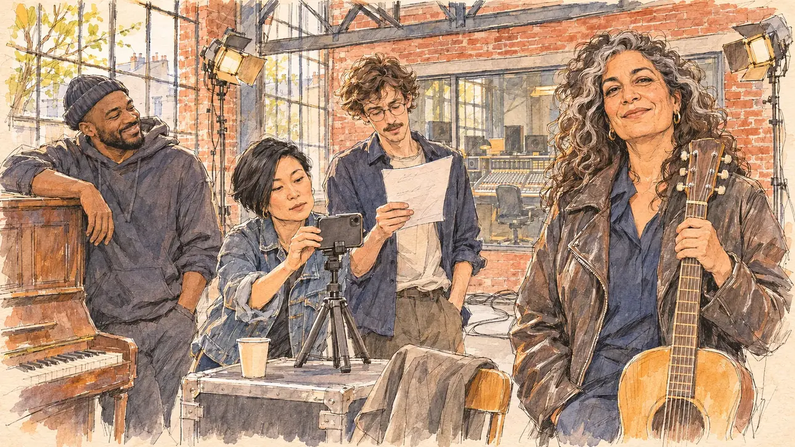

# `artistsLetter` · Des artistes appellent à voter pour vous

**Validée par le PO le 09/11/2026**, au premier essai. Elle sert telle quelle en clair et en sombre.



| Champ | Valeur |
| --- | --- |
| Carte | `artistsLetter`, catégorie `openLetter` (Tribune collective), poids 0,15, en campagne officielle |
| Style | Reportage dessiné |
| Ton | Chaleureux |
| Date | 2026-11-09 |
| Outil | ChatGPT Images, à compléter (modèle et effort) |
| Conversation | À compléter |
| Format rendu | 1672 × 941 (16:9) : export en 1290 × 726 px, WebP de qualité 75, 231 Ko, sans recadrage, fait depuis la copie WebP de la conversation (à refaire depuis le PNG d'origine) |
| Fichier d'origine | À compléter (hors du dépôt) |
| Première édition | À compléter |

## Texte de la carte

> **Des artistes appellent à voter pour vous**
>
> Trois cents chanteurs, comédiens et cinéastes publient une tribune qui appelle à voter pour vous. Les réseaux s'en emparent.

## Le moment choisi

Un studio d'enregistrement dans un ancien entrepôt de brique de Montreuil, un après-midi d'avril, le jour de la tribune : quatre signataires y tournent ensemble une vidéo de soutien pour les réseaux, devant un téléphone sur trépied. Le candidat reste hors champ : son manteau jeté sur une chaise et un gobelet de thé. Une chanteuse, guitare en main, regarde le spectateur avec un sourire complice ; un jeune comédien relit sa phrase, une réalisatrice cadre, un humoriste s'accoude au piano. Des artistes fictifs. Montreuil n'avait encore servi à aucune carte.

## Prompt complet

Dans une nouvelle conversation, avec [`primeTime.webp`](../../illustrations/media/primeTime.webp) comme seule image de référence :

```
Use the attached image as the style reference and copy its drawing: a realistic reportage drawing made on the spot for a newspaper, with quick, nervous pencil lines, often drawn twice, ink hatching in the shadows, transparent watercolour washes that spill a little over the lines, and the warm paper showing through. Not the same scene and not the same people: never reuse the face or the hair of the woman in the reference.
Like in the reference, the setting can be full when the story needs it, with the things that say where we are and what is happening, but each one is sketched with a few pencil lines and a light wash, never rendered or finished, and the drawing gets looser and paler towards the edges until it fades into the bare paper.
This must look like a drawing made by hand on paper by a press illustrator, halfway between a quick sketch and a realistic picture: never a photograph, a film poster or a digital painting, and never a cartoon, a comic strip, a caricature or a children's book illustration. Continuous lines, never dotted or dashed outlines; no uniform texture, speckles or hatching filter laid over the picture; no glossy highlights, no smooth gradients, in the sky and on the walls too. Colour can be rich in places, on a piece of clothing, a light or a flag, but it stays transparent and within the palette below. The fade into the paper at the edges stays narrow, without a wide white margin. No blur and no depth-of-field effect: everything, the foreground included, is drawn sharp, like a sketch made on the spot.
People are drawn from life with realistic anatomy and proportions, like in the reference: faces shaped with pencil lines, hatching and light washes, a little more finished than the background but never photographic (no photographic skin, no airbrushed or digital-painting look). Expressions stay natural and restrained, even in laughter or tears: no exaggerated grins, no wide-open mouths full of teeth, no rubbery or cartoonish faces.

Editorial illustration, landscape 16:9 (1536 × 864 px), the scene filling the frame, with only a light fade into the paper at the edges. A recording studio in a converted red-brick warehouse in Montreuil, east of Paris, on an afternoon in April 2027, the day three hundred singers, actors and film-makers publish an open letter calling to vote for the player: exposed brick walls, steel beams, an old piano, a mixing desk behind a glass window, cables and a few stage lights. Four signatories record a support video together in front of a phone on a small tripod. The player's candidate stays off-camera: in the foreground, only a coat thrown over the back of a chair and a paper cup of tea on a flight case. In the right third, a singer in her fifties of Algerian descent, sturdy, with long curly hair streaked with grey and a worn leather jacket, holds an acoustic guitar by the neck and looks at the viewer with a warm, complicit smile, her face above mid-height. Next to her: a young white actor in his twenties, lanky, with round glasses and a thin moustache, rehearses his line with a sheet of paper; a film director in her forties of Korean descent, small, with a short asymmetric black bob and a denim jacket, checks the framing on the phone; a stand-up comedian in his thirties, Black, broad-shouldered, in a beanie and a hoodie, leans on the piano and laughs quietly with his mouth closed. Only the singer looks at the viewer. These are fictional artists: no lookalike of any real singer, actor, film-maker or comedian. Nothing on the phone, the sheet, the flight case, the mixing desk or the walls is readable.

Style: Reportage drawing made on the spot, like a press illustrator or courtroom sketch artist: pencil and ink with loose watercolour washes, lively unfinished lines, white paper showing through.

Palette: navy #13203F, vellum #F5EFE1, gold #A9802A, brick #B5523B, ochre #D9A441, sage #8FA58A, slate #5E7186, sand #DCC8A4, warm grey #8C8279; use 4 to 6 of them, subtle warm paper grain.

Tone: warm, soft afternoon light through high industrial windows, light warm colours on the brick.

Constraints: realistic proportions, natural expressions, never cartoonish or caricatured faces, drawn like the rest of the illustration and never photographic; people of varied ages, genders, origins and body types (heavy, stocky, round, tall, short, wiry, not only slim), each with a distinct face and haircut (no two people alike), drawn with respect and never as a joke; each person's age, build and look plausible for their job and the scene (working people of working age), no stereotype tying an origin or a gender to a role, and no person of colour shown alone in a featured service or deferential role; anatomically correct hands with exactly five fingers, few hands visible, the others in pockets, behind objects or out of frame; no readable text anywhere (the phone, the sheet, the flight case, the mixing desk and the walls stay unreadable, no posters with words); no captions or speech bubbles; no logos or political party colours; no recognisable real person, no lookalike of a real politician or of a real singer, actor, film-maker or comedian; no explicit violence; no photographic rendering, no blur or bokeh, no dotted outlines, no texture or hatching filter over the picture, no oil-paint texture, no glow or halo around the lights, no wide white margin or frame (a light fade into the paper at the edges is fine).

Format: if 16:9 is not available, make 1536 × 1024 and keep the top 80 px and the bottom 80 px free of anything important (faces, hands, the main action): they will be cropped.
```

## Décisions prises sur cette image

Validée telle quelle par le PO (09/11/2026). Le profil de la chanteuse (origine algérienne, guitare, longs cheveux bouclés) est celui d'au moins une chanteuse réelle connue ; le visage n'est pas un portrait, et le PO n'y voit personne. La règle du gabarit sur le profil type d'une personne connue invite à varier ce profil à l'avenir (cheveux, instrument).

## Essais écartés

Aucun.

## Retouches

Aucune.

## Relecture

Faite et validée par le PO le 09/11/2026.

- [x] Aucun texte lisible : la feuille du comédien ne porte que des gribouillis, l'écran du téléphone est tourné vers l'objectif, la table de mixage et les murs sont vierges.
- [x] Aucun sosie d'une personne réelle (voir les décisions pour le profil de la chanteuse).
- [x] Le candidat du joueur est hors champ : seuls son manteau sur la chaise et son gobelet.
- [x] Mains et visages sans défaut visible à 343 px de large : la main sur le manche de la guitare, celles qui tiennent la feuille et le téléphone.
- [x] Aucune couleur ni aucun logo de parti. Des personnes variées par l'âge, le corps, l'origine et la coiffure.
- [x] En 16:9 : pas de recadrage.
- [ ] Lisible sur la page de l'événement, en clair et en sombre : à vérifier dans l'app, une fois la carte publiée.
