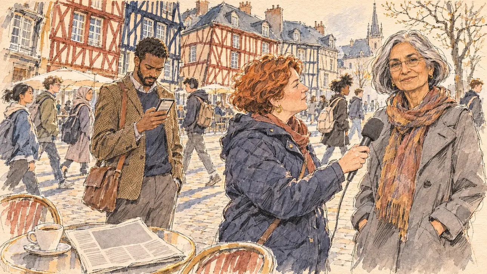

# `economistsBack` · Des économistes vous soutiennent

**Validée par le PO le 09/11/2026**, au premier essai. Elle sert telle quelle en clair et en sombre.



| Champ | Valeur |
| --- | --- |
| Carte | `economistsBack`, catégorie `openLetter` (Tribune collective), poids 0,15, à partir de l'officialisation |
| Style | Reportage dessiné |
| Ton | Chaleureux mais mesuré |
| Date | 2026-11-09 |
| Outil | ChatGPT Images, à compléter (modèle et effort) |
| Conversation | À compléter |
| Format rendu | 1672 × 941 (16:9) : export en 1290 × 726 px, WebP de qualité 75, 257 Ko, sans recadrage, fait depuis la copie WebP de la conversation (à refaire depuis le PNG d'origine) |
| Fichier d'origine | À compléter (hors du dépôt) |
| Première édition | À compléter |

## Texte de la carte

> **Des économistes vous soutiennent**
>
> Une quarantaine d'économistes publient une tribune : votre programme serait le plus sérieux de la campagne, même s'ils n'en approuvent pas tout.

## Le moment choisi

La terrasse d'un café de la place Sainte-Anne, à Rennes, un matin de mars lumineux et froid, le jour où paraît la tribune, devant les maisons à colombages de guingois. Le candidat reste hors champ : sa tasse de café et le journal ouvert sur la tribune, illisible. Une économiste signataire répond à une journaliste radio et regarde le spectateur avec un sourire réservé, qui dit « même si nous n'approuvons pas tout » ; un jeune collègue relit la tribune sur son téléphone, les sourcils un peu froncés ; des étudiants traversent la place. Rennes n'avait encore servi à aucune carte. La première carte de la catégorie `openLetter`.

## Prompt complet

Dans une nouvelle conversation, avec [`primeTime.webp`](../../illustrations/media/primeTime.webp) comme seule image de référence :

```
Use the attached image as the style reference and copy its drawing: a realistic reportage drawing made on the spot for a newspaper, with quick, nervous pencil lines, often drawn twice, ink hatching in the shadows, transparent watercolour washes that spill a little over the lines, and the warm paper showing through. Not the same scene and not the same people: never reuse the face or the hair of the woman in the reference.
Like in the reference, the setting can be full when the story needs it, with the things that say where we are and what is happening, but each one is sketched with a few pencil lines and a light wash, never rendered or finished, and the drawing gets looser and paler towards the edges until it fades into the bare paper.
This must look like a drawing made by hand on paper by a press illustrator, halfway between a quick sketch and a realistic picture: never a photograph, a film poster or a digital painting, and never a cartoon, a comic strip, a caricature or a children's book illustration. Continuous lines, never dotted or dashed outlines; no uniform texture, speckles or hatching filter laid over the picture; no glossy highlights, no smooth gradients, in the sky and on the walls too. Colour can be rich in places, on a piece of clothing, a light or a flag, but it stays transparent and within the palette below. The fade into the paper at the edges stays narrow, without a wide white margin. No blur and no depth-of-field effect: everything, the foreground included, is drawn sharp, like a sketch made on the spot.
People are drawn from life with realistic anatomy and proportions, like in the reference: faces shaped with pencil lines, hatching and light washes, a little more finished than the background but never photographic (no photographic skin, no airbrushed or digital-painting look). Expressions stay natural and restrained, even in laughter or tears: no exaggerated grins, no wide-open mouths full of teeth, no rubbery or cartoonish faces.

Editorial illustration, landscape 16:9 (1536 × 864 px), the scene filling the frame, with only a light fade into the paper at the edges. The terrace of a café on the Place Sainte-Anne in Rennes, in Brittany, on a bright cold March morning in 2027, the day an open letter from forty economists praising the player's programme comes out: the crooked, leaning half-timbered houses of the old town around the square, their timber frames painted in deep colours, café tables and chairs on the cobbles. The player's candidate stays off-camera: in the foreground, only a cup of coffee on a small round table, next to a folded newspaper open on a full-page opinion piece whose columns are pale grey blocks. In the right third, one of the signatory economists, a slim woman in her sixties of Indian descent, with a silver bob, thin-rimmed glasses and a long knitted scarf over a grey coat, answers a radio journalist and looks at the viewer with a small, reserved smile, approving but not entirely, her face above mid-height. The radio journalist, a round white woman in her forties with short red curly hair and a quilted jacket, holds out a microphone with a foam windscreen towards the economist. Next to them, a younger signatory, a tall Black man in his thirties with a close beard, a tweed jacket and a satchel, rereads the letter on his phone with a slight frown. Behind, students with backpacks cross the square, sketched into the distance. Only the economist looks at the viewer. Nothing on the newspaper, the phone, the microphone or the café is readable.

Style: Reportage drawing made on the spot, like a press illustrator or courtroom sketch artist: pencil and ink with loose watercolour washes, lively unfinished lines, white paper showing through.

Palette: navy #13203F, vellum #F5EFE1, gold #A9802A, brick #B5523B, ochre #D9A441, sage #8FA58A, slate #5E7186, sand #DCC8A4, warm grey #8C8279; use 4 to 6 of them, subtle warm paper grain.

Tone: warm but measured, low bright morning sun on the half-timbered façades, long soft shadows on the cobbles.

Constraints: realistic proportions, natural expressions, never cartoonish or caricatured faces, drawn like the rest of the illustration and never photographic; people of varied ages, genders, origins and body types (heavy, stocky, round, tall, short, wiry, not only slim), each with a distinct face and haircut (no two people alike), drawn with respect and never as a joke; each person's age, build and look plausible for their job and the scene (working people of working age), no stereotype tying an origin or a gender to a role, and no person of colour shown alone in a featured service or deferential role; anatomically correct hands with exactly five fingers, few hands visible, the others in pockets, behind objects or out of frame; no readable text anywhere (the newspaper, the phone, the microphone and the café front stay unreadable); no captions or speech bubbles; no logos or political party colours; no recognisable real person, no lookalike of a real politician, economist or journalist; no explicit violence; no photographic rendering, no blur or bokeh, no dotted outlines, no texture or hatching filter over the picture, no oil-paint texture, no glow or halo around the lights, no wide white margin or frame (a light fade into the paper at the edges is fine).

Format: if 16:9 is not available, make 1536 × 1024 and keep the top 80 px and the bottom 80 px free of anything important (faces, hands, the main action): they will be cropped.
```

## Décisions prises sur cette image

Validée telle quelle par le PO (09/11/2026).

## Essais écartés

Aucun.

## Retouches

Aucune.

## Relecture

Faite et validée par le PO le 09/11/2026.

- [x] Aucun texte lisible : les colonnes du journal sont des blocs gris, l'écran du téléphone n'a que des barres floues, rien sur le micro ni sur le café.
- [x] Aucun sosie d'une personne réelle, économiste ou journaliste.
- [x] Le candidat du joueur est hors champ : seuls sa tasse et le journal, sur la table du premier plan.
- [x] Mains et visages sans défaut visible à 343 px de large : la main au micro, celle qui tient le téléphone ; celles de l'économiste sont dans ses poches.
- [x] Aucune couleur ni aucun logo de parti. Des personnes variées par l'âge, le corps, l'origine et la coiffure, les deux économistes dans les rôles d'expertise.
- [x] En 16:9 : pas de recadrage.
- [ ] Lisible sur la page de l'événement, en clair et en sombre : à vérifier dans l'app, une fois la carte publiée.
