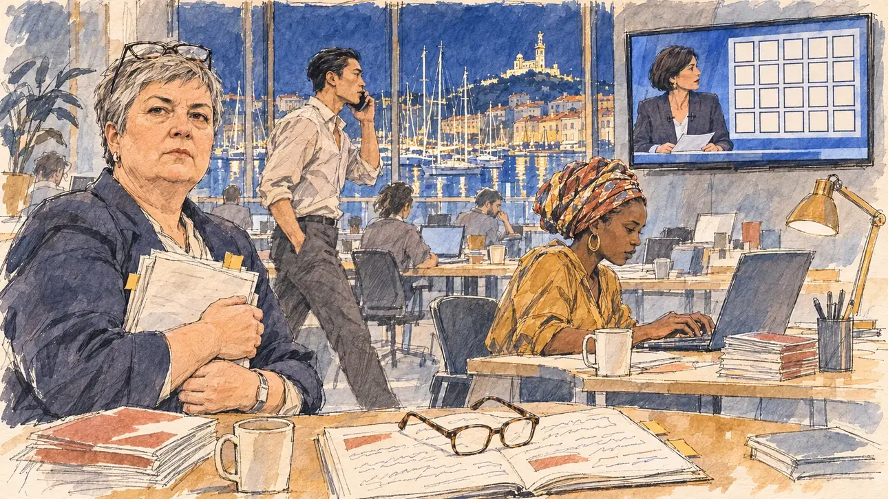

# `nobelLetter` · Des prix Nobel contre vous

**Validée par le PO le 09/11/2026**, au premier essai. Elle sert telle quelle en clair et en sombre.



| Champ | Valeur |
| --- | --- |
| Carte | `nobelLetter`, catégorie `openLetter` (Tribune collective), poids 0,15 (0,25 dans les deux premiers du sondage), à partir de l'officialisation |
| Style | Reportage dessiné |
| Ton | Tendu, soirée au QG |
| Date | 2026-11-09 |
| Outil | ChatGPT Images, à compléter (modèle et effort) |
| Conversation | À compléter |
| Format rendu | 1672 × 941 (16:9) : export en 1290 × 726 px, WebP de qualité 75, 212 Ko, sans recadrage, fait depuis la copie WebP de la conversation (à refaire depuis le PNG d'origine) |
| Fichier d'origine | À compléter (hors du dépôt) |
| Première édition | À compléter |

## Texte de la carte

> **Des prix Nobel contre vous**
>
> Vingt-cinq lauréats du prix Nobel d'économie signent une lettre : votre programme économique mènerait le pays à l'impasse. Elle fait la une du journal du soir.

## Le moment choisi

Le QG de campagne à Marseille, un soir, quand le journal télévisé ouvre sur la lettre : par la baie vitrée, les mâts du Vieux-Port et Notre-Dame-de-la-Garde éclairée sur sa colline. À l'écran, une présentatrice et une grille de cadres de portrait vides, sans visage : les lauréats sont des personnes réelles. Le candidat reste hors champ : ses lunettes de lecture posées sur son livret de programme annoté. La cheffe économiste de la campagne, sa pile de notes contre elle, regarde le spectateur, grave : on répond comment ? Le porte-parole fait les cent pas au téléphone, une collaboratrice tape déjà sur son ordinateur. Marseille n'avait encore servi à aucune carte.

## Prompt complet

Dans une nouvelle conversation, avec [`primeTime.webp`](../../illustrations/media/primeTime.webp) comme seule image de référence :

```
Use the attached image as the style reference and copy its drawing: a realistic reportage drawing made on the spot for a newspaper, with quick, nervous pencil lines, often drawn twice, ink hatching in the shadows, transparent watercolour washes that spill a little over the lines, and the warm paper showing through. Not the same scene and not the same people: never reuse the face or the hair of the woman in the reference.
Like in the reference, the setting can be full when the story needs it, with the things that say where we are and what is happening, but each one is sketched with a few pencil lines and a light wash, never rendered or finished, and the drawing gets looser and paler towards the edges until it fades into the bare paper.
This must look like a drawing made by hand on paper by a press illustrator, halfway between a quick sketch and a realistic picture: never a photograph, a film poster or a digital painting, and never a cartoon, a comic strip, a caricature or a children's book illustration. Continuous lines, never dotted or dashed outlines; no uniform texture, speckles or hatching filter laid over the picture; no glossy highlights, no smooth gradients, in the sky and on the walls too. Colour can be rich in places, on a piece of clothing, a light or a flag, but it stays transparent and within the palette below. The fade into the paper at the edges stays narrow, without a wide white margin. No blur and no depth-of-field effect: everything, the foreground included, is drawn sharp, like a sketch made on the spot.
People are drawn from life with realistic anatomy and proportions, like in the reference: faces shaped with pencil lines, hatching and light washes, a little more finished than the background but never photographic (no photographic skin, no airbrushed or digital-painting look). Expressions stay natural and restrained, even in laughter or tears: no exaggerated grins, no wide-open mouths full of teeth, no rubbery or cartoonish faces.

Editorial illustration, landscape 16:9 (1536 × 864 px), the scene filling the frame, with only a light fade into the paper at the edges. The player's campaign headquarters in Marseille, on an evening in March 2027, at the moment the evening news opens on an open letter from twenty-five Nobel laureates in economics against the player's programme: an open-plan office with desks, laptops, stacks of leaflets and coffee cups; through a large window, the masts of the boats in the Old Port and the basilica on its hill, lit up against the night sky. On a wall-mounted TV screen, a news presenter in her forties, of no recognisable identity, sits next to a graphic of twenty-five small empty portrait frames with no faces in them. The player's candidate stays off-camera: in the foreground, only a pair of reading glasses resting on an annotated programme booklet, its pages covered with unreadable scribbles. In the left third, the campaign's chief economist, a heavy-set white woman in her fifties with a grey pixie cut and reading glasses pushed up on her head, holds a stack of notes against her chest and looks at the viewer, grave and focused, her face above mid-height. Behind her, the spokesperson, a tall young man of Chinese descent in his late twenties with slicked-back black hair and an open shirt collar, paces with a phone at his ear; at a desk, a staffer in her thirties of Malian descent, with a patterned headwrap and hoop earrings, already types on her laptop. Only the economist looks at the viewer. Nothing on the TV screen, the laptops, the booklet, the notes or the leaflets is readable.

Style: Reportage drawing made on the spot, like a press illustrator or courtroom sketch artist: pencil and ink with loose watercolour washes, lively unfinished lines, white paper showing through.

Palette: navy #13203F, vellum #F5EFE1, gold #A9802A, brick #B5523B, ochre #D9A441, sage #8FA58A, slate #5E7186, sand #DCC8A4, warm grey #8C8279; use 4 to 6 of them, subtle warm paper grain.

Tone: tense, evening, the cold blue light of the TV against the warm pool of a desk lamp, the city lights beyond the window.

Constraints: realistic proportions, natural expressions, never cartoonish or caricatured faces, drawn like the rest of the illustration and never photographic; people of varied ages, genders, origins and body types (heavy, stocky, round, tall, short, wiry, not only slim), each with a distinct face and haircut (no two people alike), drawn with respect and never as a joke; each person's age, build and look plausible for their job and the scene (working people of working age), no stereotype tying an origin or a gender to a role, and no person of colour shown alone in a featured service or deferential role; anatomically correct hands with exactly five fingers, few hands visible, the others in pockets, behind objects or out of frame; no readable text anywhere (the TV screen, the laptops, the booklet, the notes and the leaflets stay unreadable); no captions or speech bubbles; no logos or political party colours; no recognisable real person, no lookalike of a real politician, economist, Nobel laureate or news presenter, no faces in the portrait frames on the screen; no explicit violence; no photographic rendering, no blur or bokeh, no dotted outlines, no texture or hatching filter over the picture, no oil-paint texture, no glow or halo around the lights or the screen, no wide white margin or frame (a light fade into the paper at the edges is fine).

Format: if 16:9 is not available, make 1536 × 1024 and keep the top 80 px and the bottom 80 px free of anything important (faces, hands, the main action): they will be cropped.
```

## Décisions prises sur cette image

Validée telle quelle par le PO (09/11/2026). La grille de l'écran compte 20 cadres au lieu de 25, invisible à la taille de la carte. La présentatrice, au carré brun, a un type générique de présentatrice du soir, sans sosie ni reprise de la référence. Une plante de bureau, esquissée, est restée à gauche.

## Essais écartés

Aucun.

## Retouches

Aucune.

## Relecture

Faite et validée par le PO le 09/11/2026.

- [x] Aucun texte lisible : le livret ne porte que des gribouillis, l'écran des cadres vides, rien sur les ordinateurs ni les notes.
- [x] Aucun sosie d'une personne réelle : aucun visage dans les cadres des lauréats, une présentatrice générique.
- [x] Le candidat du joueur est hors champ : seules ses lunettes, sur son livret.
- [x] Mains et visages sans défaut visible à 343 px de large : les deux mains de l'économiste sur sa pile de notes, celles de la collaboratrice sur le clavier, la main au téléphone.
- [x] Aucune couleur ni aucun logo de parti. Des personnes variées par l'âge, le corps, l'origine et la coiffure.
- [x] En 16:9 : pas de recadrage.
- [ ] Lisible sur la page de l'événement, en clair et en sombre : à vérifier dans l'app, une fois la carte publiée.
