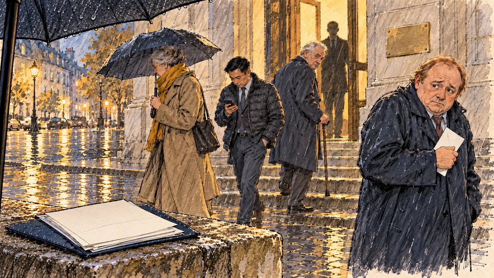

# `partyBan` · Un grand parti verrouille ses élus

**Validée par le PO le 01/11/2026**, au premier essai. Elle sert telle quelle en clair et en sombre.



| Champ | Valeur |
| --- | --- |
| Carte | `partyBan`, catégorie `sponsorships` (Parrainages), carte ajoutée par la PR #225 (lot R2 des parrainages, #213) |
| Style | Reportage dessiné, rendu assez fini : la pluie en hachures sur toute l'image (accepté par le PO) |
| Ton | Mélancolique, avec une pointe d'ironie |
| Date | 2026-11-01 |
| Outil | ChatGPT avec le modèle GPT Sol 6.1 en effort « light », et ChatGPT Images 2.5 |
| Conversation | À remplir (le lien ne s'ouvre qu'avec le compte qui l'a créée) |
| Format rendu | 1672 × 941 (16:9) : export en 1290 × 726 px depuis le PNG d'origine, WebP de qualité 75, 215 Ko, sans recadrage |
| Fichier d'origine | PNG de ChatGPT, chez le PO, partagé aussi dans la conversation avec Claude |
| Première édition | À remplir |

## Texte de la carte

Texte de la branche de la PR #225, avant sa fusion.

> **Un grand parti verrouille ses élus**
>
> Un grand parti interdit à ses élus de parrainer un autre candidat que le sien. Certains de ceux qui vous avaient promis leur signature hésitent.

## Le moment choisi

Un soir de pluie, devant la fédération départementale d'un grand parti. Les maires sortent de la réunion où la consigne est tombée. Un seul, qui avait promis sa signature, ose regarder le candidat, gêné, sa lettre à la main ; les autres l'évitent. Dans l'embrasure, le parti n'est qu'une silhouette à contre-jour. Le candidat attend en bas des marches, hors champ : le bord de son parapluie et sa chemise de formulaires vierges sur un muret.

## Prompt complet

Dans une nouvelle conversation, avec [`oldTweet.webp`](oldTweet.webp) comme seule image de référence :

```
Use the attached image as the style reference: the same pencil and ink drawing with loose watercolour washes and warm paper grain. Not the same scene.
This must look like a drawing made by hand on paper, never like a photograph or a film poster: the people are drawn with ink lines and flat washes, not modelled; the background is only suggested with a few pencil lines and light, transparent washes, so that the warm paper shows through; the drawing may fade lightly into the bare paper at the edges and in the corners, as on a sketchbook page, the fade staying narrow, without a wide white margin. Lighter and less saturated than a painting: no dense colour, no glossy highlights, no hatching filter laid over a finished image. No blur and no depth-of-field effect: everything, the foreground included, is drawn sharp with ink lines, like a sketch made on the spot.
Faces are drawn exactly like the clothes and the background: ink outlines, a few hatching strokes and flat watercolour washes for the skin, with the same level of detail as the rest of the drawing. No photographic skin, no realistic wrinkles or pores, no airbrushed or digital-painting look on the faces.

Editorial illustration, landscape 16:9 (1536 × 864 px), the scene filling the frame, with only a light fade into the paper at the edges. A rainy evening in 2027, in front of the departmental headquarters of a big political party in a French provincial town: a plain stone building with a lit doorway, no banner, no logo and a blank brass plate. The party has just forbidden its elected officials to sponsor any candidate but its own, and the local mayors are coming out of the meeting. The player's candidate is waiting at the bottom of the steps and stays off-camera: in the foreground, only the edge of the candidate's umbrella and a folder of blank sponsorship forms on a low wet wall. In the right third, one of the mayors who had promised a signature, a short, round man in his fifties with thinning ginger hair and a navy raincoat, a folded letter in his hand, gives the viewer an embarrassed, apologetic look, shoulders raised, his face above mid-height. The others avoid the viewer's eyes: a tall woman in her sixties with a grey chignon and a mustard scarf hides behind her umbrella; a young mayor in his thirties of Vietnamese origin with a neat side parting and a puffer jacket stares hard at his phone; an old mayor with white hair and a walking stick glances back at the door, looking guilty. In the lit doorway, a party official is only a dark silhouette against the light, holding the door and watching them leave. Nothing on the letter, the plate, the forms or the phone is readable.

Style: Reportage drawing made on the spot, like a press illustrator or courtroom sketch artist: pencil and ink with loose watercolour washes, lively unfinished lines, white paper showing through.

Palette: navy #13203F, vellum #F5EFE1, gold #A9802A, brick #B5523B, ochre #D9A441, sage #8FA58A, slate #5E7186, sand #DCC8A4, warm grey #8C8279; use 4 to 6 of them, subtle warm paper grain.

Tone: melancholic with a touch of irony, rain, wet cobblestones and yellow streetlights.

Constraints: realistic proportions, expressive but not caricatured faces, drawn like the rest of the illustration and never photographic; people of varied ages, genders, origins and body types (heavy, stocky, round, tall, short, wiry, not only slim), each with a distinct face and haircut (no two people alike), drawn with respect and never as a joke; anatomically correct hands with exactly five fingers, few hands visible, the others in pockets, behind objects or out of frame; no readable text anywhere (letters, plates, forms, phones and signs stay unreadable); no captions or speech bubbles; no logos, party symbols or political party colours, no rosettes or banners; no recognisable real person, no lookalike of a real politician or mayor; no explicit violence; no photographic rendering, no blur or bokeh, no hatching filter over a finished digital painting, no oil-paint texture, no wide white margin or frame (a light fade into the paper at the edges is fine).

Format: if 16:9 is not available, make 1536 × 1024 and keep the top 80 px and the bottom 80 px free of anything important (faces, hands, the main action): they will be cropped.
```

## Décisions prises sur cette image

- **Le parti n'est jamais nommé ni montré,** comme le veut la carte : pas de bannière, pas de logo, pas de couleur de parti, une plaque vierge et un cadre réduit à une silhouette.
- **Le vieux maire à la canne regarde le spectateur** plutôt que la porte : l'écart renforce sa culpabilité, il est gardé.

## Essais écartés

Aucun.

## Retouches

Aucune.

## Relecture

Faite et validée par le PO le 01/11/2026.

- [x] Aucun texte lisible : ni sur la lettre, ni sur la plaque, ni sur les formulaires.
- [x] Aucun sosie d'une personne réelle.
- [x] Le candidat du joueur est hors champ.
- [x] Mains, visages et foules sans défaut visible à 343 px de large.
- [x] Aucune couleur, aucun logo, aucun symbole de parti. Des personnes variées par l'âge, le corps, l'origine et la coiffure.
- [x] En 3:2 : rien d'important dans les 80 px du haut et du bas. Sans objet ici : l'image est en 16:9.
- [x] Lisible sur la page de l'événement, en clair et en sombre.
