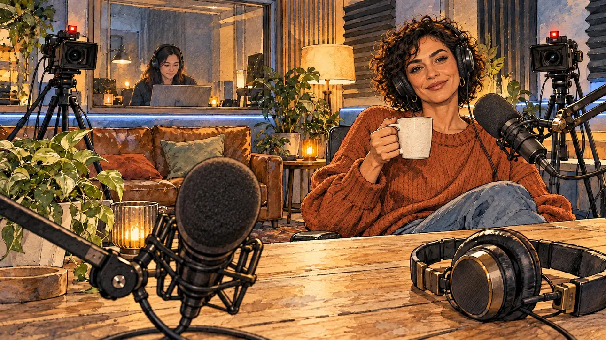

# `podcast` · Un podcast fleuve

**Validée par le PO le 31/10/2026**, au premier essai. Elle sert telle quelle en clair et en sombre.



| Champ | Valeur |
| --- | --- |
| Carte | `podcast`, catégorie `media` (Opportunité médiatique) |
| Style | Reportage dessiné |
| Ton | Observateur, détendu |
| Date | 2026-10-31 |
| Outil | ChatGPT avec le modèle GPT Sol 6.1 en effort « light », et ChatGPT Images 2.5 |
| Conversation | À remplir (le lien ne s'ouvre qu'avec le compte qui l'a créée) |
| Format rendu | 1672 × 941 (16:9) : export en 1290 × 726 px, WebP de qualité 75, 190 Ko, sans recadrage ; réexportée le 01/11/2026, après une première version en qualité 70 pour tenir 180 Ko |
| Fichier d'origine | PNG de ChatGPT, chez le PO. L'export du dépôt a été fait depuis la copie partagée dans la conversation avec Claude |
| Première édition | À remplir |

## Texte de la carte

> **Un podcast fleuve**
>
> Un podcast star chez les moins de 30 ans vous propose trois heures d'entretien, sans montage et sans filet.

## Le moment choisi

Un petit studio de podcast chaleureux, au tout début de l'entretien, vu depuis le fauteuil d'invité du candidat, hors champ : un gros micro et un casque sur la table. En face, l'animatrice, mug à la main, regarde le candidat avec un sourire curieux. Le prompt demandait une animatrice de fin de vingtaine : elle fait plutôt la quarantaine, ce que le PO a gardé.

## Prompt complet

Dans une nouvelle conversation, avec [`oldTweet.webp`](oldTweet.webp) comme seule image de référence :

```
Use the attached image as the style reference: the same pencil and ink drawing with loose watercolour washes and warm paper grain. Faces, hands and objects are drawn with visible ink lines, never photographic. Not the same scene.

Editorial illustration, landscape 16:9 (1536 × 864 px), filling the whole frame edge to edge. A small, cosy podcast studio in 2027, a star show among the under-thirties, at the very start of a three-hour interview with no editing. The scene is seen from the guest's seat of the player's candidate, who stays off-camera: in the foreground, only a large microphone on its arm and a pair of headphones on the wooden table. In the right third, the host, a young woman in her late twenties with short curly hair, headphones on and an oversized sweater, leans back in her chair with one hand around a mug and looks at the viewer with a curious, slightly challenging smile, her face above mid-height. Around her: acoustic foam panels, plants, a worn leather sofa, a warm lamp and a soft LED strip. Two small cameras on tripods point at the viewer, a small red recording light glows, and behind a glass window a producer watches her laptop. Nothing on the walls, the screens or the mugs is readable.

Style: Reportage drawing made on the spot, like a press illustrator or courtroom sketch artist: pencil and ink with loose watercolour washes, lively unfinished lines, white paper showing through.

Palette: navy #13203F, vellum #F5EFE1, gold #A9802A, brick #B5523B, ochre #D9A441, sage #8FA58A, slate #5E7186, sand #DCC8A4, warm grey #8C8279; use 4 to 6 of them, subtle warm paper grain.

Tone: observant and relaxed, warm lamp light mixed with a soft slate-blue LED glow.

Constraints: realistic proportions, expressive but not caricatured faces, people of varied ages, genders and origins; anatomically correct hands with exactly five fingers, few hands visible, the others in pockets, behind objects or out of frame; no readable text anywhere (signs, banners, labels and screens stay blank); no captions or speech bubbles; no logos, flags or political party colours; no recognisable real person, no lookalike of a real politician or podcaster; no explicit violence; no oil-paint texture, no white or ragged border.

Format: if 16:9 is not available, make 1536 × 1024 and keep the top 80 px and the bottom 80 px free of anything important (faces, hands, the main action): they will be cropped.
```

## Essais écartés

Aucun.

## Retouches

Aucune.

## Relecture

Faite et validée par le PO le 31/10/2026.

- [x] Aucun texte lisible : ni sur les murs, ni sur les écrans, ni sur les mugs.
- [x] Aucun sosie d'une personne réelle. Ici surtout : l'animatrice, à côté des vrais animateurs de podcast.
- [x] Le candidat du joueur est hors champ.
- [x] Mains, visages et foules sans défaut visible à 343 px de large.
- [x] Aucune couleur de parti, aucun symbole officiel.
- [x] En 3:2 : rien d'important dans les 80 px du haut et du bas. Sans objet ici : l'image est en 16:9.
- [x] Lisible sur la page de l'événement, en clair et en sombre.
