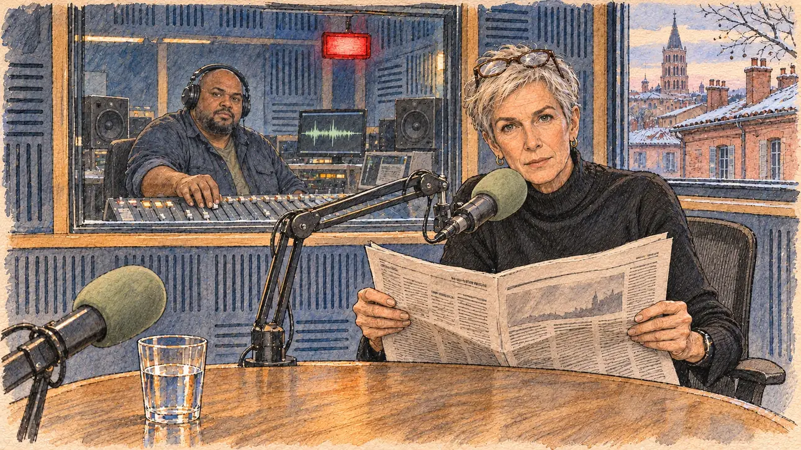

# `arsenicFollowUp` · La presse y revient

**Validée par le PO le 27/11/2026**, au premier essai, avec sa texture (voir « Décisions »). Elle sert telle quelle en clair et en sombre.



| Champ | Valeur |
| --- | --- |
| Carte | `arsenicFollowUp`, catégorie `polemic` (Polémique), tirée seulement avec l'étiquette du soutien pro-russe, deux semaines au moins après [`arsenicKiss`](../support/arsenicKiss.md) ; carte ajoutée pour Mitchnsun/moi-president#562 |
| Style | Reportage dessiné, trait de `primeTime`, avec une texture sur toute l'image (voir « Décisions ») |
| Ton | Tendu, lumière froide du matin |
| Date | 2026-11-27 |
| Outil | ChatGPT Images |
| Conversation | À remplir (le lien ne s'ouvre qu'avec le compte qui l'a créée) |
| Format rendu | 1672 × 941 (16:9) : export en 1290 × 726 px, WebP de qualité 75, 232 Ko, sans recadrage |
| Fichier d'origine | Image de ChatGPT, chez le PO. L'export du dépôt a été fait depuis la copie partagée dans la conversation avec Claude |
| Première édition | La prochaine Release qui suit le merge de la PR de Mitchnsun/moi-president#562 |

## Texte de la carte

> **La presse y revient**
>
> Un éditorial revient sur le soutien de la propagande pro-russe à votre candidature, que vous n'avez jamais désavoué. Une question vous suit dans chaque interview : « Qui défendez-vous vraiment ? »

Ses réponses : désavouer publiquement ce soutien, ne rien retirer, ramener le débat sur votre programme.

## Le moment choisi

Une matinale de radio à Toulouse, un matin d'hiver, le clocher de Saint-Sernin et les toits de brique rose par la fenêtre. Le candidat du joueur est hors champ, au micro invité, la scène vue de sa place : au premier plan, son micro à bonnette verte sans logo et son verre d'eau. L'intervieweuse tient l'éditorial du jour, illisible, et regarde le spectateur : « Qui défendez-vous vraiment ? » Derrière la vitre, le technicien de la régie le regarde aussi.

## Prompt complet

Dans une nouvelle conversation, avec [`primeTime.webp`](../../illustrations/media/primeTime.webp) comme seule image de référence :

```
Use the attached image as the style reference and copy its drawing: a realistic reportage drawing made on the spot for a newspaper, with quick, nervous pencil lines, often drawn twice, ink hatching in the shadows, transparent watercolour washes that spill a little over the lines, and the warm paper showing through. Take from the reference its line, its washes and its paper, not the finish of the presenter's face, which is the most finished and almost photographic part of it: every face here stays a drawing. Not the same scene and not the same people: never reuse the face or the hair of the woman in the reference.
Like in the reference, the setting can be full when the story needs it, with the things that say where we are and what is happening, but each one is sketched with a few pencil lines and a light wash, never rendered or finished, and the drawing gets looser and paler towards the edges until it fades into the bare paper.
This must look like a drawing made by hand on paper by a press illustrator, halfway between a quick sketch and a realistic picture: never a photograph, a film poster or a digital painting, and never a cartoon, a comic strip, a caricature or a children's book illustration. Continuous lines, never dotted or dashed outlines; the paper grain is the paper itself, never a mottled texture, speckles or hatching filter laid over the picture; no glossy highlights, no smooth gradients, in the sky and on the walls too. Colour can be rich in places, on a piece of clothing, a light or a flag, but it stays transparent and within the palette below. The fade into the paper at the edges stays narrow, without a wide white margin. No blur and no depth-of-field effect: everything, the foreground included, is drawn sharp, like a sketch made on the spot.
People are drawn from life with realistic anatomy and proportions: each face is drawn with the same visible pencil and ink lines, hatching and transparent washes as the clothes and the room, looser and sketchier than the presenter's face in the reference, with realistic features but never photographic (no photographic skin, no smooth shading, no airbrushed or digital-painting look). Expressions stay natural and restrained, even in laughter or tears: no exaggerated grins, no wide-open mouths full of teeth, no rubbery or cartoonish faces.

Editorial illustration, landscape 16:9 (1536 × 864 px), the scene filling the frame, with only a light fade into the paper at the edges. A winter morning in 2027 in the studio of a regional radio morning show in Toulouse, France: a round wooden table with microphones on articulated arms, headphones, a small red on-air lamp with no text, acoustic panels on the walls, and through a window the pink brick rooftops of Toulouse in a cold early light. Behind a large glass pane, the control room. The player's candidate stays off-camera, sitting at the guest's microphone, the scene seen from where they sit: in the bottom-left foreground, only the guest microphone on its arm, with a plain sage-green foam cover and no logo, and a glass of water. In the right third, the main character, the interviewer, a woman in her early sixties, white, very tall and wiry, a short silver pixie cut, a black turtleneck, reading glasses pushed up on her head, leans towards her microphone and holds up a folded newspaper open at an editorial, its page unreadable, looking straight at the viewer, calm and insistent, her face above mid-height. Behind the glass in the control room, a sound engineer in his forties of Caribbean origin, heavy-set, shaved head, a short beard, headphones on, one hand on the sliders of the mixing desk, also looking at the viewer through the glass. A small control-room screen shows only an unreadable sound waveform. Nobody smiles. Nothing on the newspaper, the screens, the panels or the window is readable.

Style: Reportage drawing made on the spot, like a press illustrator or courtroom sketch artist: pencil and ink with loose watercolour washes, lively unfinished lines, white paper showing through.

Palette: navy #13203F, vellum #F5EFE1, gold #A9802A, brick #B5523B, ochre #D9A441, sage #8FA58A, slate #5E7186, sand #DCC8A4, warm grey #8C8279; use 4 to 6 of them, subtle warm paper grain.

Tone: tense, cold low morning light through the window, the small red glow of the on-air lamp.

Constraints: realistic proportions, natural expressions, never cartoonish or caricatured faces, drawn like the rest of the illustration and never photographic; people of varied ages, genders, origins and body types (heavy, stocky, round, tall, short, wiry, not only slim), each with a distinct face and haircut (no two people alike), drawn with respect and never as a joke; each person's age, build and look plausible for their job and the scene (working people of working age), no stereotype tying an origin or a gender to a role, and no person of colour shown alone in a featured service or deferential role; anatomically correct hands with exactly five fingers, few hands visible, the others in pockets, behind objects or out of frame; no readable text anywhere (the newspaper, the screens, the on-air lamp and the walls stay unreadable); no captions or speech bubbles; no logos or political party colours, no radio station logo; no flags; no recognisable real person, no lookalike of a real politician or of a known radio or television journalist; no explicit violence; no photographic rendering, no blur or bokeh, no dotted outlines, no texture or hatching filter over the picture, no oil-paint texture, no wide white margin or frame (a light fade into the paper at the edges is fine).

Format: if 16:9 is not available, make 1536 × 1024 and keep the top 80 px and the bottom 80 px free of anything important (faces, hands, the main action): they will be cropped.
```

## Décisions prises sur cette image

- Une texture couvre toute l'image (les panneaux acoustiques, la table, le pull), comme sur [`troopsQuestion`](../abroad/troopsQuestion.md). Claude l'a relevée comme la « texture posée sur l'image » que le gabarit écarte et a proposé le message de correction ; le PO l'a gardée : elle ressemble à la texture du modèle `primeTime` (27/11/2026).

## Essais écartés

Aucun.

## Retouches

Aucune.

## Relecture

Faite par Claude le 27/11/2026 et validée par le PO le même jour.

- [x] Aucun texte lisible : le journal (des lignes et des blocs), la lampe « antenne », l'écran de la régie.
- [x] Aucun sosie d'une personne réelle relevé.
- [x] Le candidat du joueur est hors champ ; seuls son micro et son verre sont au premier plan.
- [x] Mains sans défaut visible (le journal, la console).
- [x] Aucune couleur ni aucun logo de parti ou de radio, aucun drapeau. Des personnes variées par l'âge, le corps, l'origine et la coiffure.
- [x] En 16:9 : pas de recadrage.
- [ ] Lisible sur la page de l'événement, en clair et en sombre : à voir dans l'app.
