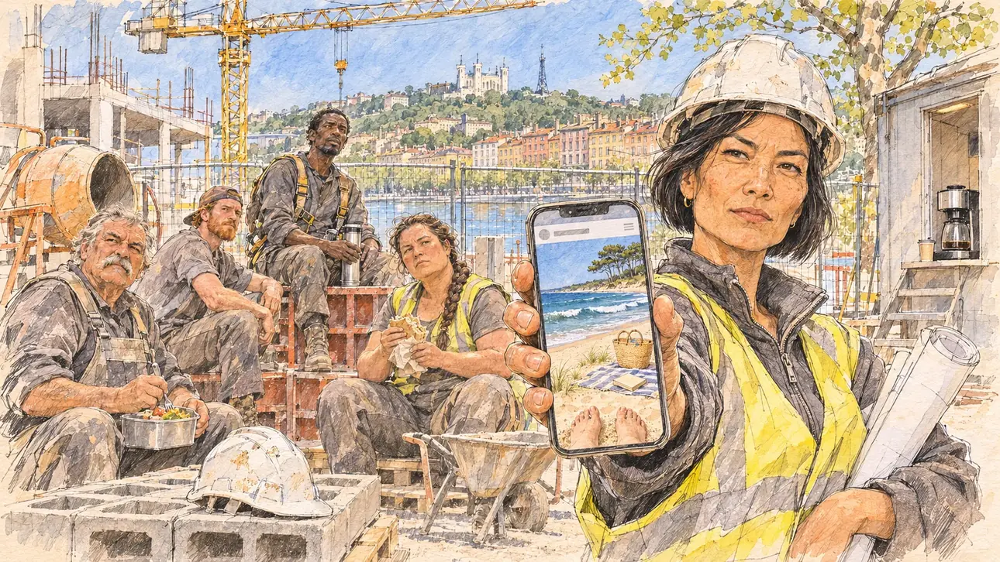

# `beachPhoto` · Une photo à la plage

**À générer.** Prompt prêt le 05/11/2026, pas encore d'image validée.



| Champ | Valeur |
| --- | --- |
| Carte | `beachPhoto`, catégorie `polemic` (Polémique), carte ajoutée par la PR #297 de l'app |
| Style | Reportage dessiné, trait de `primeTime` |
| Ton | Ironique, mordant |
| Date | À remplir |
| Outil | ChatGPT Images |
| Conversation | À remplir (le lien ne s'ouvre qu'avec le compte qui l'a créée) |
| Format rendu | À remplir |
| Fichier d'origine | À remplir |
| Première édition | À remplir |

## Texte de la carte

> **Une photo à la plage**
>
> Une photo de vous en maillot sur une plage de l'Atlantique, aux premiers beaux jours, en plein week-end de campagne, fait la une d'un site people. Dessous, un commentaire cinglant : « Pendant ce temps, le pays travaille. »

## Le moment choisi

Un chantier d'immeuble sur les quais de Saône, à Lyon, à la pause de midi d'un vendredi d'avril, au premier vrai soleil, vu depuis l'entrée du chantier où le candidat (hors champ) arrive pour une visite : au premier plan, un casque de chantier posé sur une palette de parpaings. Une conductrice de travaux, casque blanc, tend son téléphone au candidat : la photo du site people montre une grande plage de l'Atlantique, les dunes et les pins, une serviette rayée, et de la personne seulement les pieds nus dans le sable. Autour : les compagnons qui déjeunent au soleil sur les palettes et les banches, en sueur et couverts de poussière. Derrière : la grue, et de l'autre côté de la Saône les façades ocre et rose du Vieux Lyon sous la colline de Fourvière et sa basilique.

## Prompt complet

Dans une nouvelle conversation, avec [`primeTime.webp`](../../illustrations/media/primeTime.webp) comme seule image de référence.

```
Use the attached image as the style reference and copy its drawing: a realistic reportage drawing made on the spot for a newspaper, with quick, nervous pencil lines, often drawn twice, ink hatching in the shadows, transparent watercolour washes that spill a little over the lines, and the warm paper showing through. Not the same scene and not the same people: never reuse the face or the hair of the woman in the reference.
Like in the reference, the setting can be full when the story needs it, with the things that say where we are and what is happening, but each one is sketched with a few pencil lines and a light wash, never rendered or finished, and the drawing gets looser and paler towards the edges until it fades into the bare paper.
This must look like a drawing made by hand on paper by a press illustrator, halfway between a quick sketch and a realistic picture: never a photograph, a film poster or a digital painting, and never a cartoon, a comic strip, a caricature or a children's book illustration. Continuous lines, never dotted or dashed outlines; no uniform texture, speckles or hatching filter laid over the picture; no glossy highlights, no smooth gradients, in the sky and on the walls too. Colour can be rich in places, on a piece of clothing, a light or a flag, but it stays transparent and within the palette below. The fade into the paper at the edges stays narrow, without a wide white margin. No blur and no depth-of-field effect: everything, the foreground included, is drawn sharp, like a sketch made on the spot.
People are drawn from life with realistic anatomy and proportions, like in the reference: faces shaped with pencil lines, hatching and light washes, a little more finished than the background but never photographic (no photographic skin, no airbrushed or digital-painting look). Expressions stay natural and restrained, even in laughter or tears: no exaggerated grins, no wide-open mouths full of teeth, no rubbery or cartoonish faces.

Editorial illustration, landscape 16:9 (1536 × 864 px), the scene filling the frame, with only a light fade into the paper at the edges. A building site for a new housing block on the quays of the Saône in Lyon, at the lunch break of a Friday in early April 2027, on the first really warm and sunny day of the year: a celebrity website has published a photo of the player's candidate in swimwear on an Atlantic beach, taken on a campaign weekend, under a scathing comment saying that meanwhile the country is working. The scene is seen from the site entrance where the candidate arrives for a visit, who stays off-camera: in the foreground, only a spare white hard hat on a pallet of breeze blocks. In the right third, a site manager in her forties of Vietnamese origin, slim and wiry, with a short black bob under a white hard hat, a yellow high-visibility vest over a grey fleece and rolled-up plans under her arm, holds out her phone towards the viewer with a dry, mocking look, her face above mid-height. On the phone, the celebrity website's photo: a huge Atlantic beach in spring sunshine, rolling surf, sand dunes with beach grass and pine trees behind them, a striped towel, a straw bag and a paperback, and of the person only two bare feet half-buried in the sand at the bottom of the photo, nothing else of the body, no face, nothing that shows a man or a woman. Around her, sketched in pencil and light washes: building workers on their lunch break in the sun, sweaty and grey with concrete dust, sitting on pallets and on the steel formwork panels: a heavy-set mason in his sixties with a grey moustache and a lunchbox on his knees, a young apprentice with a red beard and a cap worn backwards, a tall scaffolder of Comorian origin with a harness still on, a stocky woman crane operator in her thirties with a thick plait, eating a sandwich, all looking at the viewer without a smile; a concrete mixer, rebar, wheelbarrows, a site hut with a coffee machine on its step, and a plane tree with fresh spring leaves behind the site fence. Above them, the yellow tower crane against a clear blue sky, and across the Saône the pastel ochre, pink and orange Renaissance façades of Vieux Lyon with their tall windows, and on the green hill above them the white basilica of Fourvière and its thin metal tower. Only the site manager looks straight at the viewer. Nothing on the phone, the website, the plans, the vests, the hard hats, the site hut or the site fence is readable, and no logo of a real company or website appears.

Style: Reportage drawing made on the spot, like a press illustrator or courtroom sketch artist: pencil and ink with loose watercolour washes, lively unfinished lines, white paper showing through.

Palette: navy #13203F, vellum #F5EFE1, gold #A9802A, brick #B5523B, ochre #D9A441, sage #8FA58A, slate #5E7186, sand #DCC8A4, warm grey #8C8279; use 4 to 6 of them, subtle warm paper grain.

Tone: ironic and biting, the warm spring sun on the dust and the sweat of the site, the yellow and orange of the vests and the crane, and the blue surf and pale sand of the photo on the phone as the one holiday patch.

Constraints: realistic proportions, natural expressions, never cartoonish or caricatured faces, drawn like the rest of the illustration and never photographic; people of varied ages, genders, origins and body types (heavy, stocky, round, tall, short, wiry, not only slim), each with a distinct face and haircut (no two people alike), drawn with respect and never as a joke; anatomically correct hands with exactly five fingers, few hands visible, the others in pockets, behind objects or out of frame; no readable text anywhere (the phone, the website, the plans, the vests, the hard hats, the site hut and the site fence stay unreadable); no captions or speech bubbles; no logos or political party colours; no recognisable real person, no lookalike of a real politician, and no logo of a real company or website; no explicit violence; no photographic rendering, no blur or bokeh, no dotted outlines, no texture or hatching filter over the picture, no oil-paint texture, no wide white margin or frame (a light fade into the paper at the edges is fine).

Format: if 16:9 is not available, make 1536 × 1024 and keep the top 80 px and the bottom 80 px free of anything important (faces, hands, the main action): they will be cropped.
```

## Décisions prises sur cette image

Aucune pour l'instant.

## Essais écartés

Aucun pour l'instant.

## Retouches

Aucune.

## Relecture

À faire sur l'image validée.
