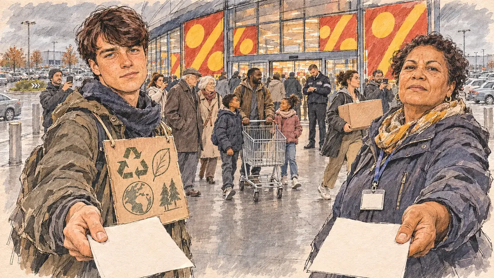

# `blackFriday` · Le Black Friday

**Validée par le PO le 05/11/2026**, au premier essai, avec `primeTime.webp` comme référence. Elle sert telle quelle en clair et en sombre.



| Champ | Valeur |
| --- | --- |
| Carte | `blackFriday`, catégorie `polemic` (Polémique), carte ajoutée par la PR #297 de l'app |
| Style | Reportage dessiné, trait de `primeTime` |
| Ton | Ironique, tendu |
| Date | 2026-11-05 |
| Outil | ChatGPT Images |
| Conversation | À remplir (le lien ne s'ouvre qu'avec le compte qui l'a créée) |
| Format rendu | 1672 × 941 (16:9) : export en 1290 × 726 px, WebP de qualité 75, 229 Ko, sans recadrage |
| Fichier d'origine | Image de ChatGPT, chez le PO. L'export du dépôt a été fait depuis la copie partagée dans la conversation avec Claude |
| Première édition | La prochaine Release qui suit le merge de la PR #297 de l'app |

## Texte de la carte

> **Le Black Friday**
>
> Le Black Friday approche : une association de consommateurs et un collectif écologiste vous demandent de vous positionner. Faut-il encadrer les promotions, ou laisser les ménages profiter des bonnes affaires ?

## Le moment choisi

L'entrée d'un grand centre commercial en périphérie de Nantes, un vendredi de fin novembre à l'ouverture, vue depuis la place du candidat (hors champ) : au premier plan, deux tracts tendus à la fois, l'un par chaque camp, vierges. À droite, la représentante de l'association de consommateurs défend les familles qui comptent chaque euro ; à gauche, un jeune militant écologiste en déguisement de carton pose une question sur la surconsommation. Entre eux, la foule des clients qui se pressent vers les portes automatiques, chariots et sacs, un père avec ses enfants, un vigile. Derrière : les vitrines aux affiches de promotion sans texte, le parking plein sous un ciel gris, les ronds-points et les entrepôts de la zone commerciale.

## Prompt complet

Dans une nouvelle conversation, avec deux images jointes, dans cet ordre : [`primeTime.webp`](../../illustrations/media/primeTime.webp) pour le style, puis le portrait dessiné fourni par le PO pour la ressemblance du jeune militant écologiste. Le portrait n'est pas dans ce dépôt.

```
Use the first attached image as the style reference and copy its drawing: a realistic reportage drawing made on the spot for a newspaper, with quick, nervous pencil lines, often drawn twice, ink hatching in the shadows, transparent watercolour washes that spill a little over the lines, and the warm paper showing through. Not the same scene and not the same people: never reuse the face or the hair of the woman in the reference.
Like in the reference, the setting can be full when the story needs it, with the things that say where we are and what is happening, but each one is sketched with a few pencil lines and a light wash, never rendered or finished, and the drawing gets looser and paler towards the edges until it fades into the bare paper.
Use the second attached image, a drawn portrait, only as the likeness reference for the young environmental activist: give him this man's features, his thick, tousled dark-brown hair with a fringe, his blue eyes and his freckles, clean-shaven, at the same age as in the portrait, and draw his face with the same pencil lines and washes as the other people in the scene. Keep the likeness through the drawing, never through photographic detail.
This must look like a drawing made by hand on paper by a press illustrator, halfway between a quick sketch and a realistic picture: never a photograph, a film poster or a digital painting, and never a cartoon, a comic strip, a caricature or a children's book illustration. Continuous lines, never dotted or dashed outlines; no uniform texture, speckles or hatching filter laid over the picture; no glossy highlights, no smooth gradients, in the sky and on the walls too. Colour can be rich in places, on a piece of clothing, a light or a flag, but it stays transparent and within the palette below. The fade into the paper at the edges stays narrow, without a wide white margin. No blur and no depth-of-field effect: everything, the foreground included, is drawn sharp, like a sketch made on the spot.
People are drawn from life with realistic anatomy and proportions, like in the reference: faces shaped with pencil lines, hatching and light washes, a little more finished than the background but never photographic (no photographic skin, no airbrushed or digital-painting look). Expressions stay natural and restrained, even in laughter or tears: no exaggerated grins, no wide-open mouths full of teeth, no rubbery or cartoonish faces.

Editorial illustration, landscape 16:9 (1536 × 864 px), the scene filling the frame, with only a light fade into the paper at the edges. The main entrance of a big out-of-town shopping centre on the edge of Nantes, on a grey Friday morning at the end of November 2026, at opening time on Black Friday: a consumers' association and an environmental collective both ask the player's candidate to take a stand. The scene is seen from the place of the candidate, who stays off-camera, caught between the two sides: in the foreground, only two blank leaflets held out towards the viewer at the same time, one from each side. In the right third, the representative of the consumers' association, a sturdy woman in her fifties of Réunion Island origin, with short curly hair, a practical anorak and a lanyard, holds out her leaflet and looks at the viewer with a firm, pragmatic face, defending the families who count every euro, her face above mid-height. In the left third, the young environmental activist, the man from the portrait, in a worn parka and a scarf, wearing a sandwich board made of cardboard boxes with only drawn symbols, holds out his leaflet and looks at the viewer with an earnest, ironic face. Between them, sketched in pencil and light washes: the crowd of shoppers hurrying towards the automatic glass doors, a father of Malian origin with two children and an empty trolley, an elderly couple, a young woman already carrying a big box, a security guard at the door looking at his watch, a few people filming on their phones. Behind them, the shopping centre: large glass shop windows covered with huge promotional posters showing only percentage-like shapes and bright colours with no readable words, the full car park, roundabouts, flat warehouses and a grey November sky. Only the two campaigners look at the viewer. Nothing on the leaflets, the posters, the boxes, the sandwich board or the shop fronts is readable, and no logo of a real shop or brand appears.

Style: Reportage drawing made on the spot, like a press illustrator or courtroom sketch artist: pencil and ink with loose watercolour washes, lively unfinished lines, white paper showing through.

Palette: navy #13203F, vellum #F5EFE1, gold #A9802A, brick #B5523B, ochre #D9A441, sage #8FA58A, slate #5E7186, sand #DCC8A4, warm grey #8C8279; use 4 to 6 of them, subtle warm paper grain.

Tone: gently ironic and tense, the flat grey light of a November morning, the bright reds and yellows of the promotional posters as the loudest notes.

Constraints: realistic proportions, natural expressions, never cartoonish or caricatured faces, drawn like the rest of the illustration and never photographic; people of varied ages, genders, origins and body types (heavy, stocky, round, tall, short, wiry, not only slim), each with a distinct face and haircut (no two people alike), drawn with respect and never as a joke; anatomically correct hands with exactly five fingers, few hands visible, the others in pockets, behind objects or out of frame; no readable text anywhere (the leaflets, the posters, the boxes, the sandwich board and the shop fronts stay unreadable); no captions or speech bubbles; no logos or political party colours; apart from the young activist, no recognisable real person and no lookalike of a real politician or of a real activist, and no logo of a real shop or brand; no explicit violence; no photographic rendering, no blur or bokeh, no dotted outlines, no texture or hatching filter over the picture, no oil-paint texture, no wide white margin or frame (a light fade into the paper at the edges is fine).

Format: if 16:9 is not available, make 1536 × 1024 and keep the top 80 px and the bottom 80 px free of anything important (faces, hands, the main action): they will be cropped.
```

## Décisions prises sur cette image

- **Le jeune militant écologiste reprend les traits d'un portrait dessiné fourni par le PO** (05/11/2026) : ses cheveux bruns épais en bataille, ses yeux bleus, ses taches de rousseur, rasé de près, à la place de la barbe rousse et du bonnet du premier prompt. L'accord de la personne est à confirmer par le PO avant la validation de l'image. Le portrait n'est pas dans ce dépôt, et la fiche ne nomme personne.

## Essais écartés

Aucun.

## Retouches

Aucune.

## Relecture

Faite et validée par le PO le 05/11/2026.

- [x] Aucun texte lisible : les tracts et le badge sont vierges, les affiches ne portent que des signes « % », l'homme-sandwich que des pictogrammes (recyclage, feuille, planète, sapins) ; aucune enseigne.
- [x] Aucun sosie d'une personne réelle autre que la ressemblance voulue du jeune militant, d'après un portrait dessiné fourni par le PO ; l'accord de la personne reste à confirmer par le PO.
- [x] Le candidat du joueur est hors champ.
- [x] Mains, visages et foules sans défaut visible à 343 px de large.
- [x] Aucune couleur ni aucun logo de parti. Des personnes variées par l'âge, le corps, l'origine et la coiffure.
- [x] En 3:2 : sans objet, l'image est en 16:9.
- [x] Lisible sur la page de l'événement, en clair et en sombre.

Ce que la relecture a accepté : des signes « % » sur les affiches, un symbole et non un mot ; un simple panneau de carton au cou du militant plutôt qu'un homme-sandwich complet.
