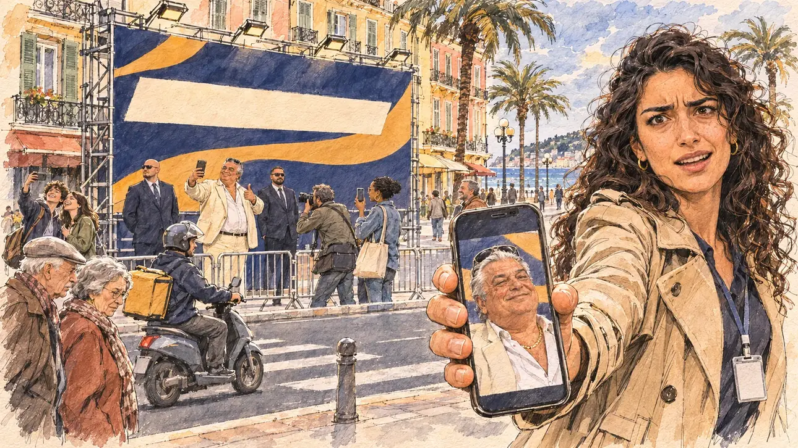

# `embarrassingBacker` · Un soutien encombrant

**Validée par le PO le 05/11/2026**, au premier essai, avec `primeTime.webp` comme référence. Elle sert telle quelle en clair et en sombre.



| Champ | Valeur |
| --- | --- |
| Carte | `embarrassingBacker`, catégorie `polemic` (Polémique), carte ajoutée par la PR #297 de l'app |
| Style | Reportage dessiné, trait de `primeTime` |
| Ton | Ironique |
| Date | 2026-11-05 |
| Outil | ChatGPT Images |
| Conversation | À remplir (le lien ne s'ouvre qu'avec le compte qui l'a créée) |
| Format rendu | 1672 × 941 (16:9) : export en 1290 × 726 px, WebP de qualité 75, 234 Ko, sans recadrage |
| Fichier d'origine | Image de ChatGPT, chez le PO. L'export du dépôt a été fait depuis la copie partagée dans la conversation avec Claude |
| Première édition | La prochaine Release qui suit le merge de la PR #297 de l'app |

## Texte de la carte

> **Un soutien encombrant**
>
> Un homme d'affaires, connu pour deux redressements fiscaux et une chaîne de clubs de nuit, annonce sur les réseaux qu'il vous soutient « de tout cœur » et finance un panneau d'affichage géant à votre nom.

## Le moment choisi

Un grand carrefour de Nice, près de la promenade, en fin d'après-midi de février, vu depuis le trottoir d'en face où se tient le candidat (hors champ) : au premier plan, un téléphone tendu qui montre la vidéo de l'homme d'affaires, sans texte lisible. La jeune attachée de presse de la campagne, catastrophée, tend le téléphone au candidat. En face, sous un panneau publicitaire géant aux couleurs de la campagne, sans visage ni texte, l'homme d'affaires flamboyant pose pour un selfie, pouce levé, entouré de deux gardes du corps et de son photographe. Des passants s'arrêtent et rient. Derrière : les façades ocre et rose de Nice aux volets verts, les palmiers, la mer et le ciel du soir.

## Prompt complet

Dans une nouvelle conversation, avec [`primeTime.webp`](../../illustrations/media/primeTime.webp) comme seule image de référence.

```
Use the attached image as the style reference and copy its drawing: a realistic reportage drawing made on the spot for a newspaper, with quick, nervous pencil lines, often drawn twice, ink hatching in the shadows, transparent watercolour washes that spill a little over the lines, and the warm paper showing through. Not the same scene and not the same people: never reuse the face or the hair of the woman in the reference.
Like in the reference, the setting can be full when the story needs it, with the things that say where we are and what is happening, but each one is sketched with a few pencil lines and a light wash, never rendered or finished, and the drawing gets looser and paler towards the edges until it fades into the bare paper.
This must look like a drawing made by hand on paper by a press illustrator, halfway between a quick sketch and a realistic picture: never a photograph, a film poster or a digital painting, and never a cartoon, a comic strip, a caricature or a children's book illustration. Continuous lines, never dotted or dashed outlines; no uniform texture, speckles or hatching filter laid over the picture; no glossy highlights, no smooth gradients, in the sky and on the walls too. Colour can be rich in places, on a piece of clothing, a light or a flag, but it stays transparent and within the palette below. The fade into the paper at the edges stays narrow, without a wide white margin. No blur and no depth-of-field effect: everything, the foreground included, is drawn sharp, like a sketch made on the spot.
People are drawn from life with realistic anatomy and proportions, like in the reference: faces shaped with pencil lines, hatching and light washes, a little more finished than the background but never photographic (no photographic skin, no airbrushed or digital-painting look). Expressions stay natural and restrained, even in laughter or tears: no exaggerated grins, no wide-open mouths full of teeth, no rubbery or cartoonish faces.

Editorial illustration, landscape 16:9 (1536 × 864 px), the scene filling the frame, with only a light fade into the paper at the edges. A big crossroads in Nice, close to the seafront promenade, at the end of a February afternoon in 2027: a businessman known for two tax reassessments and a chain of nightclubs has announced on social media that he supports the player's candidate 'with all his heart', and has paid for a giant billboard in the candidate's name. The scene is seen from the pavement opposite, where the candidate stands and stays off-camera: in the foreground, only a smartphone held out towards the viewer, its screen showing a small video of the businessman with no readable text. In the right third, the campaign's young press officer, a woman in her twenties of Kurdish origin, with long dark curly hair, a beige trench coat and a lanyard, holds out the phone and looks at the viewer with a horrified, half-laughing face, her face above mid-height. Across the street, sketched in pencil and light washes: a giant billboard on scaffolding in the campaign's colours, showing only large abstract shapes and a blank band where a slogan would be, with no portrait, no face and no text; under it, the businessman, a tanned, heavy-set man in his sixties with slicked-back silver hair, sunglasses pushed up on his head, an open white shirt and a cream linen jacket, poses for a selfie with a thumbs-up and a broad, self-satisfied smile, flanked by two bodyguards in dark suits and his own photographer; passers-by stopping to laugh or film, a delivery rider on a scooter, an elderly couple shaking their heads, two teenagers taking a selfie with the billboard. Behind them, the city of Nice: ochre, pink and yellow façades with green shutters and wrought-iron balconies, tall palm trees, a glimpse of the blue sea at the end of the avenue and a warm evening sky. Only the press officer looks at the viewer. Nothing on the phone, the billboard, the scaffolding, the shirts or the shop fronts is readable, and no logo of a real club or company appears.

Style: Reportage drawing made on the spot, like a press illustrator or courtroom sketch artist: pencil and ink with loose watercolour washes, lively unfinished lines, white paper showing through.

Palette: navy #13203F, vellum #F5EFE1, gold #A9802A, brick #B5523B, ochre #D9A441, sage #8FA58A, slate #5E7186, sand #DCC8A4, warm grey #8C8279; use 4 to 6 of them, subtle warm paper grain.

Tone: ironic, warm late-afternoon Mediterranean light, the campaign colours of the billboard and the white jacket of the businessman as the loudest notes.

Constraints: realistic proportions, natural expressions, never cartoonish or caricatured faces, drawn like the rest of the illustration and never photographic; people of varied ages, genders, origins and body types (heavy, stocky, round, tall, short, wiry, not only slim), each with a distinct face and haircut (no two people alike), drawn with respect and never as a joke; anatomically correct hands with exactly five fingers, few hands visible, the others in pockets, behind objects or out of frame; no readable text anywhere (the phone, the billboard, the scaffolding, the shirts and the shop fronts stay unreadable); no captions or speech bubbles; no logos or political party colours; no recognisable real person, no lookalike of a real politician or of a real businessman, and no logo of a real club or company; no explicit violence; no photographic rendering, no blur or bokeh, no dotted outlines, no texture or hatching filter over the picture, no oil-paint texture, no wide white margin or frame (a light fade into the paper at the edges is fine).

Format: if 16:9 is not available, make 1536 × 1024 and keep the top 80 px and the bottom 80 px free of anything important (faces, hands, the main action): they will be cropped.
```

## Décisions prises sur cette image

Aucune.

## Essais écartés

Aucun.

## Retouches

Aucune.

## Relecture

Faite et validée par le PO le 05/11/2026.

- [x] Aucun texte lisible : le panneau géant n'a que des formes marine et or et une bande blanche vierge, sans portrait ni texte ; rien sur le téléphone, le badge ni le sac du livreur.
- [x] Aucun sosie d'une personne réelle.
- [x] Le candidat du joueur est hors champ.
- [x] Mains, visages et foules sans défaut visible à 343 px de large.
- [x] Aucune couleur ni aucun logo de parti. Des personnes variées par l'âge, le corps, l'origine et la coiffure.
- [x] En 3:2 : sans objet, l'image est en 16:9.
- [x] Lisible sur la page de l'événement, en clair et en sombre.

Ce que la relecture a accepté : le panneau aux couleurs marine et or de la palette, qui ne sont celles d'aucun parti ; un homme d'affaires générique, sans ressemblance avec une personne réelle.
