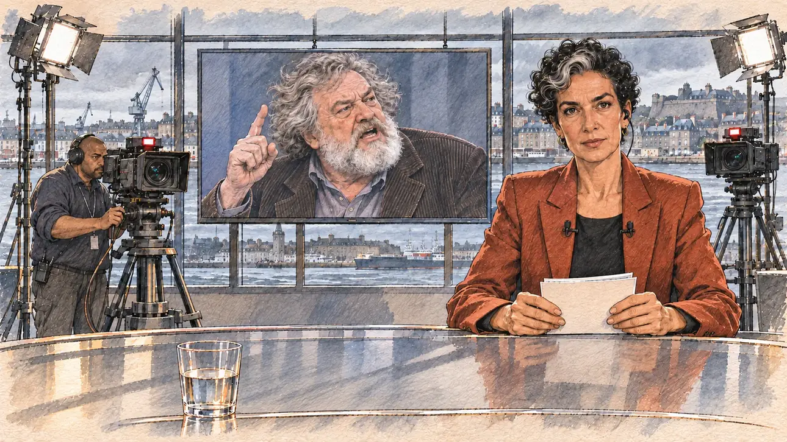

# `gameViolence` · Le jeu accusé après un fait divers

**Retenue par le PO le 21/11/2026**, au premier essai, sans retouche. Elle sert telle quelle en clair et en sombre.



| Champ | Valeur |
| --- | --- |
| Carte | `gameViolence`, catégorie `polemic` (Polémique), poids 0,6 à son pic, sans autre condition, datée du 19/11 au 12/12/2026 et décroissante (`fade` : 1, 0,5, 0,25, 0,1 de la semaine du 15/11 à celle du 6/12) : seules les campagnes longues (#218) l'atteignent (Mitchnsun/moi-president, PO, 20/11/2026) |
| Style | Reportage dessiné |
| Ton | Tendu, la lumière grise d'un matin breton par la baie vitrée contre les projecteurs blancs du plateau, ombres nettes |
| Date | 2026-11-21 |
| Outil | ChatGPT Images |
| Conversation | À remplir (le lien ne s'ouvre qu'avec le compte qui l'a créée) |
| Format rendu | 1672 × 941 (16:9) : export en 1290 × 726 px, WebP de qualité 75, 182 Ko, sans recadrage, fait depuis la copie WebP reçue |
| Fichier d'origine | Image de ChatGPT, chez le PO. L'export du dépôt a été fait depuis la copie partagée dans la conversation avec Claude |
| Première édition | `kit-france-2611-0004` |

## Texte de la carte

> **Le jeu accusé après un fait divers**
>
> Un adolescent est mis en examen pour une agression au couteau. Sur un plateau, un éditorialiste accuse le jeu vidéo sorti la semaine dernière de lui avoir « appris la violence », sans que l'enquête en dise un mot. On vous demande si vous êtes d'accord.

Réponses : « Laisser l'enquête parler, et penser à la victime », « C'est aux parents de décider, avec le contrôle parental », « Aucune étude n'a montré qu'un jeu rend violent », « Une vérification d'âge obligatoire à l'achat et en ligne » (plus facile pour un candidat d'autorité), « Interdire la vente aux mineurs, avec des sanctions » (le pari risqué).

## Le moment choisi

Le plateau de la matinale d'une chaîne d'info régionale à Brest, la rade grise derrière la baie vitrée. Sur le grand écran, l'éditorialiste, image arrêtée en pleine tirade, le doigt levé. La présentatrice vient de poser la question et attend la réponse du candidat, hors champ, assis au même bureau. Ni couteau, ni victime, ni image du jeu.

## Prompt complet

Dans une nouvelle conversation, avec [`primeTime.webp`](../../illustrations/media/primeTime.webp) comme seule image de référence :

```
Use the attached image as the style reference and copy its drawing: a realistic reportage drawing made on the spot for a newspaper, with quick, nervous pencil lines, often drawn twice, ink hatching in the shadows, transparent watercolour washes that spill a little over the lines, and the warm paper showing through. Not the same scene and not the same people: never reuse the face or the hair of the woman in the reference.
Like in the reference, the setting can be full when the story needs it, with the things that say where we are and what is happening, but each one is sketched with a few pencil lines and a light wash, never rendered or finished, and the drawing gets looser and paler towards the edges until it fades into the bare paper.
This must look like a drawing made by hand on paper by a press illustrator, halfway between a quick sketch and a realistic picture: never a photograph, a film poster or a digital painting, and never a cartoon, a comic strip, a caricature or a children's book illustration. Continuous lines, never dotted or dashed outlines; no uniform texture, speckles or hatching filter laid over the picture; no glossy highlights, no smooth gradients, in the sky and on the walls too. Colour can be rich in places, on a piece of clothing, a light or a flag, but it stays transparent and within the palette below. The fade into the paper at the edges stays narrow, without a wide white margin. No blur and no depth-of-field effect: everything, the foreground included, is drawn sharp, like a sketch made on the spot.
People are drawn from life with realistic anatomy and proportions, like in the reference: faces shaped with pencil lines, hatching and light washes, a little more finished than the background but never photographic (no photographic skin, no airbrushed or digital-painting look). Expressions stay natural and restrained, even in laughter or tears: no exaggerated grins, no wide-open mouths full of teeth, no rubbery or cartoonish faces.

Editorial illustration, landscape 16:9 (1536 × 864 px), the scene filling the frame, with only a light fade into the paper at the edges. Early morning in November 2027, on the set of the breakfast show of a regional news channel in Brest, in Brittany: a curved news desk, studio lights on stands, two cameras on pedestals, a large wall screen, and behind it a wide window on the grey harbour of Brest under a low sky, with cranes, grey granite buildings and slate roofs. On the large wall screen behind the desk, a frozen frame of a TV pundit from an earlier debate, mid-rant: a broad man in his sixties with a thick white beard, wild curly grey hair and a dark corduroy jacket, his finger raised; the screen shows nothing else, no image from any video game, no weapon, no victim, and no readable banner. The player's candidate stays off-camera, seated at the desk: in the foreground, only the candidate's table microphone and a glass of water at the bottom edge of the frame. In the right third, the main character, the presenter, a woman in her mid-forties of Algerian descent with short curly black hair with a grey streak at the front, sharp dark eyes, a slim build, an earpiece and a rust-coloured blazer over a black top, holds her question cards on the desk and looks at the viewer, waiting for the candidate's answer, calm and a little challenging, her face above mid-height. In the background, a stocky technician in his thirties of Malagasy descent with a shaved head and headphones watches from behind a camera, not looking at the viewer. Only the presenter looks at the viewer. Nothing on the screen, the cards, the desk, the cameras or the microphone is readable.

Style: Reportage drawing made on the spot, like a press illustrator or courtroom sketch artist: pencil and ink with loose watercolour washes, lively unfinished lines, white paper showing through.

Palette: navy #13203F, vellum #F5EFE1, gold #A9802A, brick #B5523B, ochre #D9A441, sage #8FA58A, slate #5E7186, sand #DCC8A4, warm grey #8C8279; use 4 to 6 of them, subtle warm paper grain.

Tone: tense, the cold grey light of a Breton morning through the window against the hard white studio lights, sharp shadows.

Constraints: realistic proportions, natural expressions, never cartoonish or caricatured faces, drawn like the rest of the illustration and never photographic; people of varied ages, genders, origins and body types (heavy, stocky, round, tall, short, wiry, not only slim), each with a distinct face and haircut (no two people alike), drawn with respect and never as a joke; each person's age, build and look plausible for their job and the scene (working people of working age), no stereotype tying an origin or a gender to a role, and no person of colour shown alone in a featured service or deferential role; anatomically correct hands with exactly five fingers, few hands visible, the others in pockets, behind objects or out of frame; no readable text anywhere (the screen, the banners, the cards, the desk, the cameras and the microphone stay unreadable); no captions or speech bubbles; no logos, no TV channel branding, no real video game's title, logo, characters or visual identity, no political party colours; no recognisable real person, no lookalike of a real politician, a real TV presenter or a real TV pundit; no knife, no weapon, no blood, no victim and no violent imagery anywhere, including on the screen; no explicit violence; no photographic rendering, no blur or bokeh, no dotted outlines, no texture or hatching filter over the picture, no oil-paint texture, no wide white margin or frame (a light fade into the paper at the edges is fine).

Format: if 16:9 is not available, make 1536 × 1024 and keep the top 80 px and the bottom 80 px free of anything important (faces, hands, the main action): they will be cropped.
```

## Décisions prises sur cette image

À la relecture, l'éditorialiste à l'écran (cheveux gris en bataille, barbe blanche, veste de velours) a été signalé comme pouvant évoquer un acteur réel ; le PO a jugé que ce n'était pas le cas et l'a retenue telle quelle (21/11/2026). La description du prompt (barbe blanche épaisse, cheveux bouclés en bataille) pousse vers ce type : à éviter pour un autre éditorialiste.

## Essais écartés

Aucun.

## Retouches

Aucune.

## Relecture

Faite le 21/11/2026 sur l'image reçue, zoomée sur le texte possible, l'écran et les mains ; retenue par le PO le même jour.

- [x] Aucun texte lisible : écran sans bandeau, fiches, badge du technicien et caméras sans inscription.
- [x] Ni couteau, ni victime, ni image du jeu, à l'écran comme ailleurs.
- [x] Le candidat du joueur est hors champ : seul son verre d'eau sur le bureau au premier plan.
- [x] Écarts au prompt : pas de micro de table devant le candidat, seulement le verre d'eau ; la présentatrice porte deux micros-cravates ; la ville derrière la baie, remparts et château, tient autant de Saint-Malo que de Brest.
- [x] Rendu : un léger grain craquelé, surtout sur la veste de la présentatrice et le bureau ; le PO l'a gardée telle quelle.
- [x] Sosie : voir les décisions ; aucun autre repéré.
- [x] Mains sans défaut visible.
- [x] Aucune couleur, aucun logo ni aucun drapeau de parti. Des personnes variées par l'âge, le corps, l'origine et la coiffure.
- [x] En 16:9 : pas de recadrage.
- [ ] Lisible sur la page de l'événement, en clair et en sombre : à vérifier dans l'app, une fois la carte publiée.
