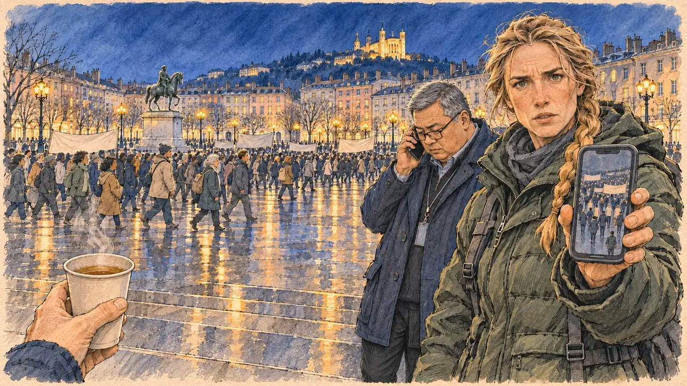

# `gazaMarch` · Des slogans dans le cortège

**Validée par le PO le 27/11/2026**, au premier essai. Elle sert telle quelle en clair et en sombre.



| Champ | Valeur |
| --- | --- |
| Carte | `gazaMarch`, catégorie `polemic` (Polémique), poids 0,2, 0,3 en tête des sondages ; carte ajoutée avec Gaza dans la campagne (Mitchnsun/moi-president#563) |
| Style | Reportage dessiné, trait et texture de `primeTime` |
| Ton | Tendu, tombée du jour |
| Date | 2026-11-27 |
| Outil | ChatGPT Images |
| Format rendu | 1672 × 941 (16:9) : export en 1290 × 726 px, WebP de qualité 75, 213 Ko, sans recadrage |
| Fichier d'origine | Image de ChatGPT, chez le PO. L'export du dépôt a été fait depuis la copie partagée dans la conversation avec Claude |
| Première édition | La prochaine Release qui suit le merge de Mitchnsun/moi-president#563 |

## Texte de la carte

> **Des slogans dans le cortège**
>
> Une marche pour Gaza traverse la ville où vous tenez meeting. Le soir, une vidéo montre quelques manifestants scander des slogans antisémites, et la presse demande à chaque candidature de réagir.
>
> (Texte réécrit le 27/11/2026 pour valoir pour toute candidature : l'image, faite avant, reste juste.)

Ses réponses : condamner ces slogans sans détour ; défendre la marche, des milliers de personnes pacifiques ; prendre vos distances avec la marche ; ne rien dire.

## Le moment choisi

Lyon, place Bellecour, à la tombée du jour, Fourvière éclairée sur sa colline et la statue équestre au milieu de la place. Au fond, la marche passe, pacifique et variée, avec des banderoles vierges et sans drapeau. Le candidat du joueur est hors champ, la scène vue de sa place : sa main tient un gobelet de thé au premier plan. La coordinatrice de terrain lui montre sur son téléphone la vidéo de la marche et le regarde, inquiète ; derrière elle, l'attaché de presse répond déjà à un journaliste. Les slogans ne sont ni montrés ni cités : la carte les nomme, l'image ne montre que la réaction de l'équipe.

## Prompt complet

Dans une nouvelle conversation, avec [`primeTime.webp`](../../illustrations/media/primeTime.webp) comme seule image de référence :

```
Use the attached image as the style reference and copy its drawing: a realistic reportage drawing made on the spot for a newspaper, with quick, nervous pencil lines, often drawn twice, ink hatching in the shadows, transparent watercolour washes that spill a little over the lines, and the warm paper showing through. Take from the reference its line, its washes and its paper, not the finish of the presenter's face, which is the most finished and almost photographic part of it: every face here stays a drawing. Not the same scene and not the same people: never reuse the face or the hair of the woman in the reference.
Like in the reference, the setting can be full when the story needs it, with the things that say where we are and what is happening, but each one is sketched with a few pencil lines and a light wash, never rendered or finished, and the drawing gets looser and paler towards the edges until it fades into the bare paper.
This must look like a drawing made by hand on paper by a press illustrator, halfway between a quick sketch and a realistic picture: never a photograph, a film poster or a digital painting, and never a cartoon, a comic strip, a caricature or a children's book illustration. Continuous lines, never dotted or dashed outlines; the fine mottled grain of the reference is welcome, as long as the pencil lines and the washes stay clearly visible under it, but never a heavy texture, an oil-paint look or a hatching filter laid over a finished picture; no glossy highlights, no smooth gradients, in the sky and on the walls too. Colour can be rich in places, on a piece of clothing, a light or a flag, but it stays transparent and within the palette below. The fade into the paper at the edges stays narrow, without a wide white margin. No blur and no depth-of-field effect: everything, the foreground included, is drawn sharp, like a sketch made on the spot.
People are drawn from life with realistic anatomy and proportions: each face is drawn with the same visible pencil and ink lines, hatching and transparent washes as the clothes and the room, looser and sketchier than the presenter's face in the reference, with realistic features but never photographic (no photographic skin, no smooth shading, no airbrushed or digital-painting look). Expressions stay natural and restrained, even in laughter or tears: no exaggerated grins, no wide-open mouths full of teeth, no rubbery or cartoonish faces.

Editorial illustration, landscape 16:9 (1536 × 864 px), the scene filling the frame, with only a light fade into the paper at the edges. Dusk in winter 2027 on the steps of a rally hall on the place Bellecour in Lyon, France: pastel façades, street lamps coming on, and on the hill behind, the basilica of Fourvière lit up against a deep blue sky. In the background, across the square, a peaceful march passes: a varied crowd of all ages and origins walking, a few hand-held banners whose lettering is unreadable, no flags, no signs that can be read, nobody shouting. The player's candidate stays off-camera, standing on the steps, the scene seen from where they stand: in the bottom-left foreground, only a paper cup of tea held in front of them. In the right third, the main character, the campaign's field coordinator, a woman in her late twenties, white, tall and sturdy, a long blond braid, a dark green padded jacket without any logo, holds her phone up towards the viewer to show a video on it (tiny sketched silhouettes of a crowd, nothing readable, nothing recognisable) and looks straight at the viewer, worried and urgent, her face above mid-height. Just behind her, a press officer in his fifties of Chinese origin, heavy-set, short grey hair, rectangular glasses, a navy coat, is already on his own phone with a journalist, looking down, frowning. Nobody smiles. Nothing on the phones, the banners or the façades is readable.

Style: Reportage drawing made on the spot, like a press illustrator or courtroom sketch artist: pencil and ink with loose watercolour washes, lively unfinished lines, white paper showing through.

Palette: navy #13203F, vellum #F5EFE1, gold #A9802A, brick #B5523B, ochre #D9A441, sage #8FA58A, slate #5E7186, sand #DCC8A4, warm grey #8C8279; use 4 to 6 of them, subtle warm paper grain.

Tone: tense, the blue of dusk against the orange of the street lamps, cold shadows.

Constraints: realistic proportions, natural expressions, never cartoonish or caricatured faces, drawn like the rest of the illustration and never photographic; people of varied ages, genders, origins and body types (heavy, stocky, round, tall, short, wiry, not only slim), each with a distinct face and haircut (no two people alike), drawn with respect and never as a joke; each person's age, build and look plausible for their job and the scene (working people of working age), no stereotype tying an origin or a gender to a role, and no person of colour shown alone in a featured service or deferential role; anatomically correct hands with exactly five fingers, few hands visible, the others in pockets, behind objects or out of frame; no readable text anywhere (the phones, the banners and the façades stay unreadable); no captions or speech bubbles; no logos or political party colours; no flags, no keffiyeh, no religious or national symbol, no hateful sign or gesture of any kind; no recognisable real person, no lookalike of a real politician; no violence, nobody aggressive in the march; no photographic rendering, no blur or bokeh, no dotted outlines, no heavy texture or hatching filter over a finished picture (the fine grain of the reference is fine), no oil-paint texture, no wide white margin or frame (a light fade into the paper at the edges is fine).

Format: if 16:9 is not available, make 1536 × 1024 and keep the top 80 px and the bottom 80 px free of anything important (faces, hands, the main action): they will be cropped.
```

## Décisions prises sur cette image

- La main du candidat est visible au premier plan, qui tient le gobelet (le prompt ne demandait que le gobelet) : une main sans bijou dans une manche bleu sombre, sans indice de genre, comme dans [`carSleeper`](../field/carSleeper.md) et [`wrongFigure`](wrongFigure.md). Gardée.
- La scène se passe sur la place même et non sur les marches d'une salle : gardée.

## Essais écartés

Aucun.

## Retouches

Aucune.

## Relecture

Faite par Claude le 27/11/2026 et validée par le PO le même jour.

- [x] Aucun texte lisible : les banderoles sont vierges, le téléphone montre la foule, le badge de l'attaché de presse est blanc.
- [x] Aucun drapeau, aucun symbole religieux ou national, aucun signe ni geste haineux ; les slogans ne sont ni montrés ni écrits.
- [x] Aucun sosie d'une personne réelle relevé.
- [x] Le candidat du joueur est hors champ ; seule sa main tient le gobelet, sans indice de genre.
- [x] Mains sans défaut visible (le gobelet, le téléphone, le téléphone de l'attaché).
- [x] Aucune couleur ni aucun logo de parti. Des personnes variées par l'âge, le corps, l'origine et la coiffure.
- [x] En 16:9 : pas de recadrage.
- [ ] Lisible sur la page de l'événement, en clair et en sombre : à voir dans l'app.
