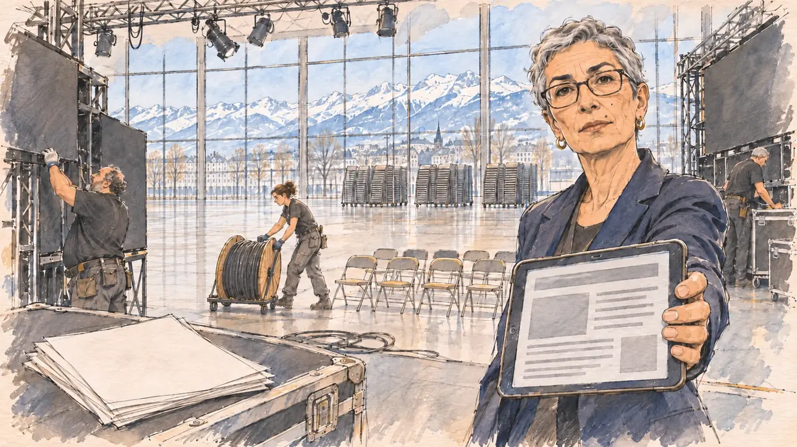

# `luxuryStage` · La scène à 80 000 euros

**Validée par le PO le 05/11/2026**, au premier essai, avec `primeTime.webp` comme référence. Elle sert telle quelle en clair et en sombre.



| Champ | Valeur |
| --- | --- |
| Carte | `luxuryStage`, catégorie `polemic` (Polémique), carte ajoutée par la PR #297 de l'app |
| Style | Reportage dessiné, trait de `primeTime` |
| Ton | Ironique, gêné |
| Date | 2026-11-05 |
| Outil | ChatGPT Images |
| Conversation | À remplir (le lien ne s'ouvre qu'avec le compte qui l'a créée) |
| Format rendu | 1672 × 941 (16:9) : export en 1290 × 726 px, WebP de qualité 75, 147 Ko, sans recadrage |
| Fichier d'origine | Image de ChatGPT, chez le PO. L'export du dépôt a été fait depuis la copie partagée dans la conversation avec Claude |
| Première édition | La prochaine Release qui suit le merge de la PR #297 de l'app |

## Texte de la carte

> **La scène à 80 000 euros**
>
> Un site de vérification publie la facture de votre dernier meeting : 80 000 € pour une scène, des écrans géants et un jeu de lumières, devant une salle à moitié vide.

## Le moment choisi

Le grand hall d'un palais des congrès de Grenoble, le lendemain matin du meeting, pendant le démontage, vu depuis le bord de l'immense scène où se tient le candidat (hors champ) : au premier plan, une liasse de feuilles de facture vierges posée sur un flight-case. La directrice financière de la campagne tend sa tablette, qui affiche l'article du site de vérification sans texte lisible, et regarde le candidat sans rien dire. Autour : les techniciens qui démontent les écrans géants et la rampe de lumières, un régisseur sur une nacelle, et devant la scène la moitié des chaises jamais dépliées, encore empilées. Par la baie vitrée : les montagnes enneigées autour de Grenoble.

## Prompt complet

Dans une nouvelle conversation, avec [`primeTime.webp`](../../illustrations/media/primeTime.webp) comme seule image de référence.

```
Use the attached image as the style reference and copy its drawing: a realistic reportage drawing made on the spot for a newspaper, with quick, nervous pencil lines, often drawn twice, ink hatching in the shadows, transparent watercolour washes that spill a little over the lines, and the warm paper showing through. Not the same scene and not the same people: never reuse the face or the hair of the woman in the reference.
Like in the reference, the setting can be full when the story needs it, with the things that say where we are and what is happening, but each one is sketched with a few pencil lines and a light wash, never rendered or finished, and the drawing gets looser and paler towards the edges until it fades into the bare paper.
This must look like a drawing made by hand on paper by a press illustrator, halfway between a quick sketch and a realistic picture: never a photograph, a film poster or a digital painting, and never a cartoon, a comic strip, a caricature or a children's book illustration. Continuous lines, never dotted or dashed outlines; no uniform texture, speckles or hatching filter laid over the picture; no glossy highlights, no smooth gradients, in the sky and on the walls too. Colour can be rich in places, on a piece of clothing, a light or a flag, but it stays transparent and within the palette below. The fade into the paper at the edges stays narrow, without a wide white margin. No blur and no depth-of-field effect: everything, the foreground included, is drawn sharp, like a sketch made on the spot.
People are drawn from life with realistic anatomy and proportions, like in the reference: faces shaped with pencil lines, hatching and light washes, a little more finished than the background but never photographic (no photographic skin, no airbrushed or digital-painting look). Expressions stay natural and restrained, even in laughter or tears: no exaggerated grins, no wide-open mouths full of teeth, no rubbery or cartoonish faces.

Editorial illustration, landscape 16:9 (1536 × 864 px), the scene filling the frame, with only a light fade into the paper at the edges. The vast main hall of a conference centre in Grenoble, the morning after the player's candidate's last rally, while the stage is being taken down: a fact-checking website has just published the invoice, eighty thousand euros for a stage, giant screens and a light show, in front of a half-empty hall. The scene is seen from the edge of the huge stage where the candidate stands, who stays off-camera: in the foreground, only a sheaf of blank invoice pages lying on a black flight case. In the right third, the campaign's finance director, a tall woman in her fifties of Lebanese origin, with short grey hair cut very short, rectangular glasses and a dark jacket, holds out a tablet showing the fact-checking article, only grey lines and blocks with nothing readable, and looks at the viewer with a long, silent, reproachful look, her face above mid-height. Around her, sketched in pencil and light washes: stage technicians in black T-shirts dismantling the two giant LED screens and the overhead lighting rig, cables everywhere on the floor; a stage manager of West African origin up on a cherry picker unhooking a spotlight; a young technician rolling a huge cable drum; in front of the stage, the hall itself, its first rows of chairs unfolded and the whole back half of the hall full of stacks of folding chairs that were never set out, an empty, enormous space. Behind them, through the tall glass wall of the conference centre, the snowy peaks of the Alps around Grenoble under a clear winter sky. Only the finance director looks at the viewer. Nothing on the invoices, the tablet, the screens, the flight cases or the walls is readable, and no logo of a real company or website appears.

Style: Reportage drawing made on the spot, like a press illustrator or courtroom sketch artist: pencil and ink with loose watercolour washes, lively unfinished lines, white paper showing through.

Palette: navy #13203F, vellum #F5EFE1, gold #A9802A, brick #B5523B, ochre #D9A441, sage #8FA58A, slate #5E7186, sand #DCC8A4, warm grey #8C8279; use 4 to 6 of them, subtle warm paper grain.

Tone: ironic and awkward, the cold morning light of an empty hall, the black of the stage equipment against the white of the snowy peaks outside.

Constraints: realistic proportions, natural expressions, never cartoonish or caricatured faces, drawn like the rest of the illustration and never photographic; people of varied ages, genders, origins and body types (heavy, stocky, round, tall, short, wiry, not only slim), each with a distinct face and haircut (no two people alike), drawn with respect and never as a joke; anatomically correct hands with exactly five fingers, few hands visible, the others in pockets, behind objects or out of frame; no readable text anywhere (the invoices, the tablet, the screens, the flight cases and the walls stay unreadable); no captions or speech bubbles; no logos or political party colours; no recognisable real person, no lookalike of a real politician, and no logo of a real company or website; no explicit violence; no photographic rendering, no blur or bokeh, no dotted outlines, no texture or hatching filter over the picture, no oil-paint texture, no wide white margin or frame (a light fade into the paper at the edges is fine).

Format: if 16:9 is not available, make 1536 × 1024 and keep the top 80 px and the bottom 80 px free of anything important (faces, hands, the main action): they will be cropped.
```

## Décisions prises sur cette image

Aucune.

## Essais écartés

Aucun.

## Retouches

Aucune.

## Relecture

Faite et validée par le PO le 05/11/2026.

- [x] Aucun texte lisible : les factures sont vierges, la tablette n'affiche que des blocs gris, rien sur les écrans ni sur les flight-cases.
- [x] Aucun sosie d'une personne réelle.
- [x] Le candidat du joueur est hors champ.
- [x] Mains, visages et foules sans défaut visible à 343 px de large.
- [x] Aucune couleur ni aucun logo de parti. Des personnes variées par l'âge, le corps, l'origine et la coiffure.
- [x] En 3:2 : sans objet, l'image est en 16:9.
- [x] Lisible sur la page de l'événement, en clair et en sombre.

Ce que la relecture a accepté : pas de régisseur sur nacelle ; la salle à moitié vide se lit par quelques rangées de chaises et les piles de chaises jamais dépliées au fond.
