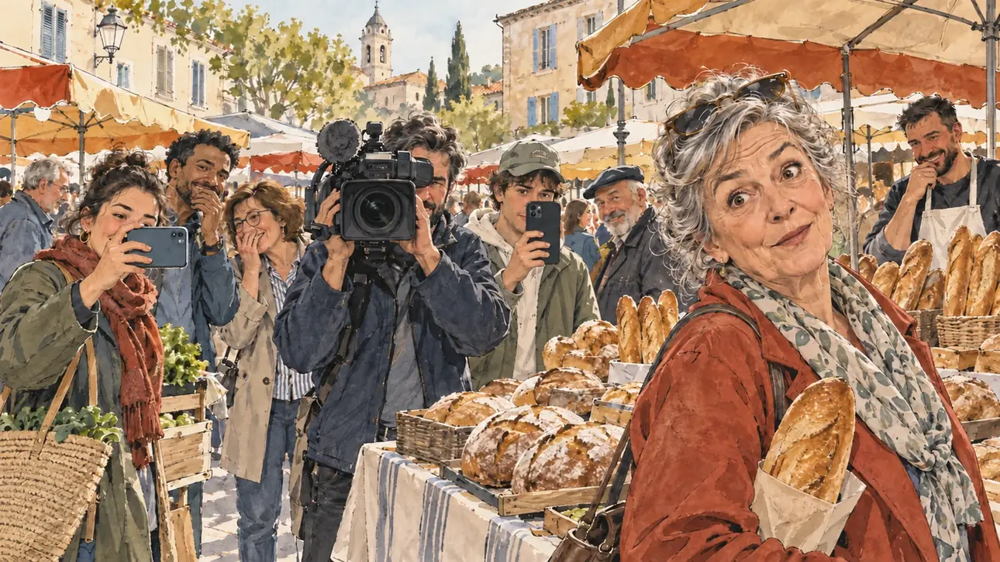

# `marketGaffe` · Gaffe au marché

**Essai de validation du reportage dessiné** (#159, K6.1) : **validé par le PO le 30/10/2026**, sur l'essai 4. L'image, [`marketGaffe.webp`](../../illustrations/polemic/marketGaffe.webp), est la référence du reportage dessiné, à joindre aux prompts suivants de ce style. Elle sert telle quelle en clair et en sombre.



| Champ | Valeur |
| --- | --- |
| Carte | `marketGaffe`, catégorie `polemic` (Polémique) |
| Style | Reportage dessiné (style par défaut de la catégorie) |
| Ton | Ironique |
| Date | 2026-10-30 |
| Outil | ChatGPT avec le modèle GPT Sol 6.1 en effort « light », et ChatGPT Images 2.5 |
| Conversation | À remplir (le lien ne s'ouvre qu'avec le compte qui l'a créée) |
| Format rendu | 1672 × 941 (16:9) : export en 1290 × 726 px, WebP de qualité 75, 164 Ko, sans recadrage |
| Fichier d'origine | PNG de ChatGPT, chez le PO (emplacement à remplir). L'export du dépôt a été fait depuis la copie partagée dans la conversation avec Claude |
| Première édition | À remplir |

## Texte de la carte

> **Gaffe au marché**
>
> Sur un marché, une passante vous demande le prix d'une baguette. Votre réponse, très loin du compte, tourne en boucle sur les réseaux.

## Le moment choisi

L'instant qui suit la réponse, vu de la place du candidat, qui reste hors champ. La passante est le personnage principal : sa réaction dit la gaffe, sans aucun texte. Les téléphones levés et la caméra de presse disent que la scène va tourner en boucle.

## Prompt complet

Essai 4, dans une nouvelle conversation : **retenu par le PO** (30/10/2026). Il reprend le prompt de l'essai 2, dont le PO préfère le trait, et dit où regarde chacun : la passante et une partie des badauds regardent le candidat, les téléphones et la caméra le visent, les autres font leurs courses.

Si l'image de l'essai 2 est jointe comme référence de style, cette ligne vient avant le prompt :

```
Use the attached image as the reference for the drawing style and the finish only: same pencil and watercolour rendering, same level of detail, same colours. Do not copy where people look.
```

```
Editorial illustration, landscape 16:9 (1536 × 864 px). An open-air market in a small French town on a weekday morning in 2027. In the right third, a woman in her sixties with a baguette tucked under her arm has just asked the price of bread. She faces the viewer in three-quarter view and looks at the viewer, eyebrows raised, half amused and half incredulous, her face above mid-height. The viewer is the player's candidate, who stays off-camera: the scene is seen from their place, just after an answer far from the real price. The gaffe is being filmed: two shoppers point their smartphones at the viewer and watch their screens, and a press camera operator points a shoulder camera at the viewer, looking through the viewfinder. Three or four onlookers of varied ages and origins look at the viewer with amused, knowing or disbelieving faces, some nudging or whispering to each other; they react naturally and do not pose. The other shoppers carry on with their shopping. Behind the bread stall, the baker stifles a laugh.

Style: Reportage drawing made on the spot, like a press illustrator or courtroom sketch artist: pencil and ink with loose watercolour washes, lively unfinished lines, white paper showing through.

Palette: navy #13203F, vellum #F5EFE1, gold #A9802A, brick #B5523B, ochre #D9A441, sage #8FA58A, slate #5E7186, sand #DCC8A4, warm grey #8C8279; use 4 to 6 of them, subtle warm paper grain.

Tone: gently ironic, postures slightly exaggerated but never the faces, soft morning light.

Constraints: realistic proportions, expressive but not caricatured faces, people of varied ages, genders and origins; anatomically correct hands with exactly five fingers, few hands visible, the others in pockets, behind objects or out of frame; no readable text anywhere (signs, banners, price tags and screens stay blank); no captions or speech bubbles; no logos, flags or political party colours; no recognisable real person, no lookalike of a real politician; no explicit violence.

Format: if 16:9 is not available, make 1536 × 1024 and keep the top 80 px and the bottom 80 px free of anything important (faces, hands, the main action): they will be cropped.
```

<details>
<summary>Prompts des essais précédents</summary>

Essai 2 :

```
Editorial illustration, landscape 16:9 (1536 × 864 px). An open-air market in a small French town on a weekday morning in 2027. In the right third, a woman in her sixties with a baguette tucked under her arm has just asked the price of bread: she looks straight at the viewer, eyebrows raised, half amused and half incredulous, her face above mid-height. Behind the bread stall, the baker turns away to hide a laugh. Around them, shoppers of varied ages and origins have turned round; two of them hold up a smartphone to film, and a press camera operator with a shoulder camera frames the scene. The player's candidate is off-camera: the scene is seen from their place, just after an answer far from the real price.

Style: Reportage drawing made on the spot, like a press illustrator or courtroom sketch artist: pencil and ink with loose watercolour washes, lively unfinished lines, white paper showing through.

Palette: navy #13203F, vellum #F5EFE1, gold #A9802A, brick #B5523B, ochre #D9A441, sage #8FA58A, slate #5E7186, sand #DCC8A4, warm grey #8C8279; use 4 to 6 of them, subtle warm paper grain.

Tone: gently ironic, postures slightly exaggerated but never the faces, soft morning light.

Constraints: realistic proportions, expressive but not caricatured faces, people of varied ages, genders and origins; anatomically correct hands with exactly five fingers, few hands visible, the others in pockets, behind objects or out of frame; no readable text anywhere (signs, banners, price tags and screens stay blank); no captions or speech bubbles; no logos, flags or political party colours; no recognisable real person, no lookalike of a real politician; no explicit violence.

Format: if 16:9 is not available, make 1536 × 1024 and keep the top 80 px and the bottom 80 px free of anything important (faces, hands, the main action): they will be cropped.
```

Message de correction envoyé après l'essai 2, qui a donné l'essai 3 :

```
Keep the same market, the same woman, the same baker and the same style, but change where people look. Only the woman looks towards the viewer. Nobody else looks at the viewer: two shoppers film her while watching their phone screens, two others whisper and laugh to each other, the rest carry on with their shopping. The camera operator looks through the viewfinder. Show the woman facing the viewer in three-quarter view, not turning back over her shoulder. Make it look more like a sketch made on the spot: visible pencil lines, loose ink, unfinished edges, much more white paper left blank, fewer details in the background. Keep every hand anatomically correct, with five fingers.
```

</details>

## Essais écartés

- **Essai 1** (30/10/2026) : des mains à six doigts. Son prompt montrait plus de mains : tous les clients filmaient, la passante tenait la baguette à la main, une perche de micro.
- **Essai 2** (30/10/2026) : mains correctes, rendu en 16:9 (1672 × 941). Écarté parce que tout le monde se retourne vers le spectateur, comme pour une photo de groupe, et que la passante se retourne par-dessus l'épaule. Son trait, plus fini, avec peu de papier blanc et un fond détaillé, est celui que le PO préfère.
- **Essai 3** (30/10/2026, après le premier message de correction) : le trait de reportage est juste, avec beaucoup de papier blanc, et la passante fait face. Écarté parce que plus personne ne regarde le candidat : le message demandait de filmer la passante, alors que la gaffe est celle du candidat. Les téléphones, la caméra et les badauds ne visent plus le spectateur, et la scène ne dit plus la gaffe. Le PO préfère aussi le trait plus fini de l'essai 2 à ce trait d'esquisse. Le message proposé ensuite, qui repartait de l'essai 2, n'a pas été envoyé : l'essai 4 se fait dans une nouvelle conversation.

## Retouches

Aucune pour l'instant.

## Relecture

Faite et validée par le PO le 30/10/2026, sur l'essai 4.

- [x] Aucun texte lisible : pancartes, banderoles, étiquettes, écrans. Ici surtout : les étiquettes de prix du stand et les écrans des téléphones. L'écusson brodé sur la casquette du jeune homme au téléphone, qui pouvait passer pour un logo, est accepté.
- [x] Aucun sosie d'une personne réelle.
- [x] Le candidat du joueur est hors champ, ou une silhouette lointaine de dos, sans genre marqué.
- [x] Mains, visages et foules sans défaut visible à 343 px de large. Ici surtout : les mains qui tiennent les téléphones et la baguette.
- [x] Aucune couleur de parti, aucun logo, aucun symbole officiel. Des personnes variées.
- [x] En 3:2 : rien d'important dans les 80 px du haut et du bas. Sans objet ici : l'image est en 16:9.
- [x] Lisible sur la page de l'événement, en clair et en sombre.
