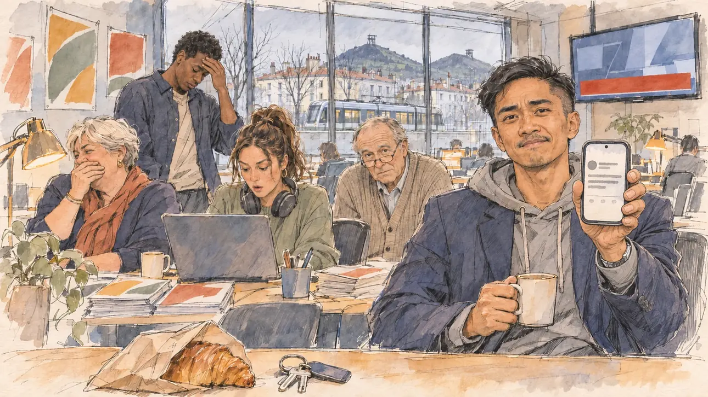

# `oldTweet` · Un vieux tweet ressurgit

**Régénérée et validée par le PO le 06/11/2026**, à l'essai 1 de la régénération, dans le trait de `primeTime` (la première version avait été validée le 30/10/2026, à l'essai 2). Elle sert telle quelle en clair et en sombre.



| Champ | Valeur |
| --- | --- |
| Carte | `oldTweet`, catégorie `polemic` (Polémique) |
| Style | Reportage dessiné, trait de `primeTime` |
| Ton | Ironique |
| Date | 2026-11-06 (première version : 2026-10-30) |
| Outil | ChatGPT Images (première version : ChatGPT avec le modèle GPT Sol 6.1 en effort « light », et ChatGPT Images 2.5) |
| Conversation | À remplir (le lien ne s'ouvre qu'avec le compte qui l'a créée) |
| Format rendu | 1672 × 941 (16:9) : export en 1290 × 726 px, WebP de qualité 75, 148 Ko, sans recadrage |
| Fichier d'origine | Image de ChatGPT, chez le PO. L'export du dépôt a été fait depuis la copie partagée dans la conversation avec Claude |
| Première édition | `kit-france-2611-0001` |

## Texte de la carte

> **Un vieux tweet ressurgit**
>
> Un tweet que vous aviez posté il y a dix ans refait surface. Une blague douteuse, que les réseaux redécouvrent avec délice.

## Le moment choisi

Le QG du candidat, tôt le matin, vu depuis sa place. Le tweet ne peut pas apparaître en clair : c'est l'équipe qui raconte l'affaire. L'attaché de presse tend son téléphone au candidat avec une grimace, et derrière lui l'équipe réagit, entre fou rire étouffé et main sur le front.

## Prompt complet

```
Use the attached image as the style reference: same line, paper grain and palette, not the same scene.

Editorial illustration, landscape 16:9 (1536 × 864 px). The open-plan headquarters of the player's candidate, early in the morning in 2027, seen from the candidate's place: the candidate stays off-camera. In the left third, the young press officer, a man in his late twenties with a coffee in one hand, holds his smartphone up towards the viewer, its screen turned away from us, with a pained, half-amused grimace, his face above mid-height. Behind him, the team discovers a joke the candidate posted ten years ago, now all over social media: two staffers stare at their laptops, one hides a laugh behind her hand, another rubs his forehead; a wall television shows a news programme with a blank banner. Only the press officer and one embarrassed adviser look at the viewer; the others look at their screens or at each other. Phones, laptops and the television show no readable text, only light.

Style: Reportage drawing made on the spot, like a press illustrator or courtroom sketch artist: pencil and ink with loose watercolour washes, lively unfinished lines, white paper showing through.

Palette: navy #13203F, vellum #F5EFE1, gold #A9802A, brick #B5523B, ochre #D9A441, sage #8FA58A, slate #5E7186, sand #DCC8A4, warm grey #8C8279; use 4 to 6 of them, subtle warm paper grain.

Tone: gently ironic, postures slightly exaggerated but never the faces, cold early-morning light from the windows and warm desk lamps.

Constraints: realistic proportions, expressive but not caricatured faces, people of varied ages, genders and origins; anatomically correct hands with exactly five fingers, few hands visible, the others in pockets, behind objects or out of frame; no readable text anywhere (signs, banners, price tags and screens stay blank); no captions or speech bubbles; no logos, flags or political party colours; no recognisable real person, no lookalike of a real politician; no explicit violence.

Format: if 16:9 is not available, make 1536 × 1024 and keep the top 80 px and the bottom 80 px free of anything important (faces, hands, the main action): they will be cropped.
```

### Message de correction

Envoyé après l'essai 1 :

```
Keep this scene and these people, but redraw it in the style of the attached reference image: visible pencil and ink lines, loose watercolour washes, warm paper grain, less photographic detail. The press officer on the left now turns his smartphone towards the viewer, its screen facing away from us, and looks at the viewer with a pained half-smile. The wall television shows a plain news set with a grey, empty banner and no channel colours. Keep every hand anatomically correct, with five fingers, and no readable text anywhere.
```

## Essais écartés

- **Essai 1** (30/10/2026) : le trait était trop photographique à côté des autres images, l'attaché de presse regardait son téléphone au lieu du candidat, et la télé montrait un bandeau aux couleurs d'une chaîne.

## Décisions prises sur cette image

- **Les ressemblances avec ce qui existe sont permises** (PO, 30/10/2026). Le téléphone montre une interface qui imite un réseau social, et la télé un plateau avec un dôme et un bandeau aux lettres déformées. Le faux texte n'est pas lisible.
- **Le trait** : celui-ci, plus esquissé, convient. La collection cherche un équilibre entre lui et le rendu plus fini de [`marketGaffe`](marketGaffe.md).

## Retouches

Aucune.

## Relecture

Faite et validée par le PO le 30/10/2026, sur l'essai 2.

- [x] Aucun texte lisible : pancartes, banderoles, étiquettes, écrans. Ici : le faux texte du téléphone et du bandeau de la télé n'est pas lisible, et il est accepté.
- [x] Aucun sosie d'une personne réelle.
- [x] Le candidat du joueur est hors champ, ou une silhouette lointaine de dos, sans genre marqué.
- [x] Mains, visages et foules sans défaut visible à 343 px de large.
- [x] Aucune couleur de parti, aucun symbole officiel. Des personnes variées. Les ressemblances avec des interfaces ou des habillages existants sont acceptées.
- [x] En 3:2 : rien d'important dans les 80 px du haut et du bas. Sans objet ici : l'image est en 16:9.
- [x] Lisible sur la page de l'événement, en clair et en sombre.

## Régénération annulée (04/11/2026)

Le PO avait demandé de régénérer l'image pour alléger les bureaux. Le même jour, après un premier essai de régénération trop dépouillé avec `mayorsCandidate.webp` comme référence ([`inflatedInvoices`](../affair/inflatedInvoices.md)), il a fait de cette image la référence du style à nouveau : elle reste telle quelle, et son trait sert de modèle au [gabarit](../gabarit.md).

Plus tard le même jour, après douze régénérations faites avec elle, le PO a choisi [`primeTime`](../media/primeTime.md) comme référence, pour un trait plus propre et plus calme ([`privateJet`](privateJet.md), [`ruralMayors`](../support/ruralMayors.md)). Cette image reste telle quelle.

## Régénération demandée (06/11/2026)

**Pourquoi.** Le PO l'a marquée « à régénérer » dans la revue du 06/11/2026 : c'est l'une des images d'avant `primeTime`, au trait plus esquissé que le reste de la série.

**Ce qui reste.** L'attaché de presse qui tend son téléphone, l'écran tourné vers lui, avec une grimace, et l'équipe qui réagit autour de lui, entre fou rire étouffé et main sur le front. Le tweet n'apparaît jamais.

**Ce qui change.** Le trait de [`primeTime`](../media/primeTime.md) et le gabarit en vigueur : le QG situé à Saint-Étienne, ses crassiers à l'horizon, des origines nommées, un premier plan sur le bureau du candidat.

### Prompt de régénération

Dans une nouvelle conversation, avec [`primeTime.webp`](../../illustrations/media/primeTime.webp) comme seule image de référence.

```
Use the attached image as the style reference and copy its drawing: a realistic reportage drawing made on the spot for a newspaper, with quick, nervous pencil lines, often drawn twice, ink hatching in the shadows, transparent watercolour washes that spill a little over the lines, and the warm paper showing through. Not the same scene and not the same people: never reuse the face or the hair of the woman in the reference.
Like in the reference, the setting can be full when the story needs it, with the things that say where we are and what is happening, but each one is sketched with a few pencil lines and a light wash, never rendered or finished, and the drawing gets looser and paler towards the edges until it fades into the bare paper.
This must look like a drawing made by hand on paper by a press illustrator, halfway between a quick sketch and a realistic picture: never a photograph, a film poster or a digital painting, and never a cartoon, a comic strip, a caricature or a children's book illustration. Continuous lines, never dotted or dashed outlines; no uniform texture, speckles or hatching filter laid over the picture; no glossy highlights, no smooth gradients, in the sky and on the walls too. Colour can be rich in places, on a piece of clothing, a light or a flag, but it stays transparent and within the palette below. The fade into the paper at the edges stays narrow, without a wide white margin. No blur and no depth-of-field effect: everything, the foreground included, is drawn sharp, like a sketch made on the spot.
People are drawn from life with realistic anatomy and proportions, like in the reference: faces shaped with pencil lines, hatching and light washes, a little more finished than the background but never photographic (no photographic skin, no airbrushed or digital-painting look). Expressions stay natural and restrained, even in laughter or tears: no exaggerated grins, no wide-open mouths full of teeth, no rubbery or cartoonish faces.

Editorial illustration, landscape 16:9 (1536 × 864 px), the scene filling the frame, with only a light fade into the paper at the edges. The open-plan campaign headquarters of the player's candidate in Saint-Étienne, in the Loire, early on a grey winter morning in 2027: a joke the candidate posted on social media ten years ago has resurfaced, and the networks are rediscovering it with delight. The scene is seen from the candidate's desk, where the candidate has just arrived, who stays off-camera: in the foreground, only the edge of the desk with a croissant in its paper bag and a set of keys. In the right third, the young press officer, a man in his late twenties of Filipino origin, slim, with short black hair in an undercut, a thin moustache, a grey hoodie under a navy blazer and a coffee in one hand, holds his smartphone up towards the viewer, its screen turned towards himself so that it cannot be seen, with a pained, half-amused grimace, his face above mid-height. Around him, sketched in pencil and light washes, the team discovering the old joke: a stocky woman in her fifties with short white hair hiding a laugh behind her hand; a tall young man of Congolese origin rubbing his forehead; a young woman with a high ponytail and big headphones staring at her laptop, her mouth half open; an older adviser in a cardigan with half-moon glasses, the only other person looking at the viewer, embarrassed; desks with laptops, coffee cups and piles of leaflets, a wall television showing a news programme with a blank red banner, campaign posters on the walls showing only colours and shapes, with no face. Through the big window, the roofs of Saint-Étienne in the grey morning, a tram passing, and on the horizon the two dark cone-shaped slag heaps of the old coal mines, now half green. Only the press officer and the embarrassed adviser look at the viewer. Nothing on the phone, the laptops, the television, the posters or the leaflets is readable, there is no photo or portrait of the candidate, and no logo of a real social network or TV channel appears.

Style: Reportage drawing made on the spot, like a press illustrator or courtroom sketch artist: pencil and ink with loose watercolour washes, lively unfinished lines, white paper showing through.

Palette: navy #13203F, vellum #F5EFE1, gold #A9802A, brick #B5523B, ochre #D9A441, sage #8FA58A, slate #5E7186, sand #DCC8A4, warm grey #8C8279; use 4 to 6 of them, subtle warm paper grain.

Tone: gently ironic, the cold grey early-morning light from the window, the warm desk lamps, and the red banner of the television as the loudest note.

Constraints: realistic proportions, natural expressions, never cartoonish or caricatured faces, drawn like the rest of the illustration and never photographic; people of varied ages, genders, origins and body types (heavy, stocky, round, tall, short, wiry, not only slim), each with a distinct face and haircut (no two people alike), drawn with respect and never as a joke; anatomically correct hands with exactly five fingers, few hands visible, the others in pockets, behind objects or out of frame; no readable text anywhere (the phone, the laptops, the television, the posters and the leaflets stay unreadable); no captions or speech bubbles; no logos or political party colours; no recognisable real person, no lookalike of a real politician, and no logo of a real social network or TV channel; no explicit violence; no photographic rendering, no blur or bokeh, no dotted outlines, no texture or hatching filter over the picture, no oil-paint texture, no wide white margin or frame (a light fade into the paper at the edges is fine).

Format: if 16:9 is not available, make 1536 × 1024 and keep the top 80 px and the bottom 80 px free of anything important (faces, hands, the main action): they will be cropped.
```

### Essais de la régénération

- **Essai 1** (06/11/2026), avec `primeTime.webp` comme référence et le prompt ci-dessus : **validé par le PO**.

### Relecture de la régénération

Faite et validée par le PO le 06/11/2026, sur l'essai 1.

- [x] Aucun texte lisible : le téléphone n'affiche qu'un message générique, un rond d'avatar, des barres grises et trois pictogrammes, sans un mot ; le bandeau de la télévision est vide, les affiches ne sont que des aplats de couleur ; rien n'est lisible sur les ordinateurs ni les tracts.
- [x] Aucun sosie d'une personne réelle.
- [x] Le candidat du joueur n'apparaît pas.
- [x] Mains, visages et foules sans défaut visible à 343 px de large.
- [x] Aucune couleur de parti. Des personnes variées par l'âge, le corps, l'origine et la coiffure.
- [x] En 3:2 : sans objet, l'image est en 16:9.
- [x] Lisible sur la page de l'événement, en clair et en sombre.

Ce que la relecture a accepté : le PO a tourné lui-même le téléphone vers le spectateur : le message reste illisible, sans nom ni photo, et le tweet ne se lit pas ; les crassiers sont coiffés d'un petit chevalement.
