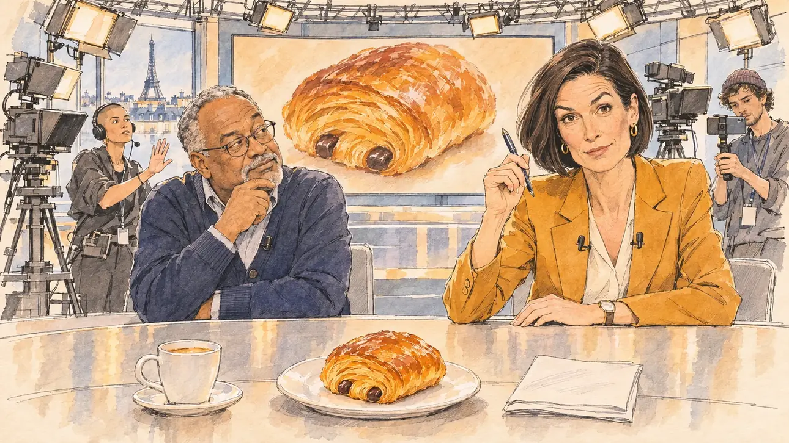

# `pastryPrice` · Le prix du pain au chocolat

**Validée par le PO le 10/11/2026**, au premier essai. Elle sert telle quelle en clair et en sombre.



| Champ | Valeur |
| --- | --- |
| Carte | `pastryPrice`, catégorie `polemic` (Polémique), poids 0,25 (0,35 dans les deux premiers du sondage), toute semaine ; un pari gagné sur une faiblesse (l'aveu, sur une expertise basse), et la « chocolatine » du PO (10/11/2026) |
| Style | Reportage dessiné |
| Ton | Suspense comique, plateau du matin |
| Date | 2026-11-10 |
| Outil | ChatGPT Images, à compléter (modèle et effort) |
| Conversation | À compléter |
| Format rendu | 1672 × 941 (16:9) : export en 1290 × 726 px, WebP de qualité 75, 162 Ko, sans recadrage, fait depuis la copie WebP de la conversation (à refaire depuis le PNG d'origine) |
| Fichier d'origine | À compléter (hors du dépôt) |
| Première édition | À compléter |

## Texte de la carte

> **Le prix du pain au chocolat**
>
> En direct, une matinale vous demande le prix d'un pain au chocolat. Le studio retient son souffle : chacun sait que la réponse fera le tour des réseaux.

## Le moment choisi

Le plateau d'une matinale télévisée à Paris, à 7 h 40, à l'instant où la question tombe, avant toute réponse : le studio de radio avait déjà servi pour [`strictEquality`](../airtime/strictEquality.md). Le candidat reste hors champ, au bureau du plateau : sa tasse de café, ses notes, et devant lui le pain au chocolat que la présentatrice vient de poser sur une petite assiette, que l'écran géant du fond montre en gros plan. La présentatrice, stylo levé, sourcil haussé, regarde le spectateur : alors, combien ? Son coéditorialiste retient son souffle, la régisseuse se fige main levée, un jeune community manager filme déjà la réponse.

## Prompt complet

Dans une nouvelle conversation, avec [`primeTime.webp`](../../illustrations/media/primeTime.webp) comme seule image de référence :

```
Use the attached image as the style reference and copy its drawing: a realistic reportage drawing made on the spot for a newspaper, with quick, nervous pencil lines, often drawn twice, ink hatching in the shadows, transparent watercolour washes that spill a little over the lines, and the warm paper showing through. Not the same scene and not the same people: never reuse the face or the hair of the woman in the reference.
Like in the reference, the setting can be full when the story needs it, with the things that say where we are and what is happening, but each one is sketched with a few pencil lines and a light wash, never rendered or finished, and the drawing gets looser and paler towards the edges until it fades into the bare paper.
This must look like a drawing made by hand on paper by a press illustrator, halfway between a quick sketch and a realistic picture: never a photograph, a film poster or a digital painting, and never a cartoon, a comic strip, a caricature or a children's book illustration. Continuous lines, never dotted or dashed outlines; no uniform texture, speckles or hatching filter laid over the picture; no glossy highlights, no smooth gradients, in the sky and on the walls too. Colour can be rich in places, on a piece of clothing, a light or a flag, but it stays transparent and within the palette below. The fade into the paper at the edges stays narrow, without a wide white margin. No blur and no depth-of-field effect: everything, the foreground included, is drawn sharp, like a sketch made on the spot.
People are drawn from life with realistic anatomy and proportions, like in the reference: faces shaped with pencil lines, hatching and light washes, a little more finished than the background but never photographic (no photographic skin, no airbrushed or digital-painting look). Expressions stay natural and restrained, even in laughter or tears: no exaggerated grins, no wide-open mouths full of teeth, no rubbery or cartoonish faces.

Editorial illustration, landscape 16:9 (1536 × 864 px), the scene filling the frame, with only a light fade into the paper at the edges. The set of a television morning show in Paris, at 7:40 in the morning in March 2027, the instant the host asks the player's candidate, live, the price of a pain au chocolat: a curved presenters' desk, studio cameras on pedestals, lights on a rig, and on the large screen at the back of the set only a big close-up of a pain au chocolat, no text. The player's candidate stays off-camera, sitting at the desk: in the foreground, only the candidate's cup of coffee and folded notes, and in front of them, on a small white plate the host has just set down, one pain au chocolat. In the right third, the host, a tall white woman in her forties with a sleek dark bob and an ochre blazer, leans on the desk, pen raised, one eyebrow lifted, and looks at the viewer with a playful, expectant look, so, how much?, her face above mid-height. Next to her, her co-host, a stocky man in his sixties of Martinican descent with a grey goatee and a navy cardigan, holds his breath, his hand on his chin. Behind the cameras, the floor manager, a young woman with a shaved head and a headset, freezes with one hand raised; a lanky young social media editor in a beanie already films the answer with a phone on a small gimbal. Only the host looks at the viewer. Nothing on the screen, the notes, the cameras, the desk or the walls is readable.

Style: Reportage drawing made on the spot, like a press illustrator or courtroom sketch artist: pencil and ink with loose watercolour washes, lively unfinished lines, white paper showing through.

Palette: navy #13203F, vellum #F5EFE1, gold #A9802A, brick #B5523B, ochre #D9A441, sage #8FA58A, slate #5E7186, sand #DCC8A4, warm grey #8C8279; use 4 to 6 of them, subtle warm paper grain.

Tone: comic suspense, the whole set holding its breath, the bright warm light of the studio, the golden pain au chocolat at the centre as the star of the picture.

Constraints: realistic proportions, natural expressions, never cartoonish or caricatured faces, drawn like the rest of the illustration and never photographic; people of varied ages, genders, origins and body types (heavy, stocky, round, tall, short, wiry, not only slim), each with a distinct face and haircut (no two people alike), drawn with respect and never as a joke; each person's age, build and look plausible for their job and the scene (working people of working age), no stereotype tying an origin or a gender to a role, and no person of colour shown alone in a featured service or deferential role; anatomically correct hands with exactly five fingers, few hands visible, the others in pockets, behind objects or out of frame; no readable text anywhere (the screen, the notes, the cameras, the desk and the walls stay unreadable, no price, no numbers, no on-air banner); no captions or speech bubbles; no logos, no television channel logo, no bakery name, no political party colours; no recognisable real person, no lookalike of a real politician or television host; no explicit violence; no photographic rendering, no blur or bokeh, every outline a continuous pencil or ink line with no dotted or dashed outlines, no mottled, crackled or speckled texture over the faces, the clothes, the desk or the walls, no hatching filter over the picture, no oil-paint texture, no glow or halo around the studio lights or the screen, no wide white margin or frame (a light fade into the paper at the edges is fine).

Format: if 16:9 is not available, make 1536 × 1024 and keep the top 80 px and the bottom 80 px free of anything important (faces, hands, the main action): they will be cropped.
```

## Décisions prises sur cette image

Validée telle quelle par le PO (10/11/2026). La présentatrice porte deux micros-cravates au lieu d'un, le bureau est brillant et reflète les personnages, et la tour Eiffel paraît par la baie du plateau : gardés, invisibles ou sans gêne à la taille de la carte.

## Essais écartés

Aucun.

## Retouches

Aucune.

## Relecture

Faite et validée par le PO le 10/11/2026.

- [x] Aucun texte lisible : ni sur l'écran, ni sur les notes, ni sur les caméras ; aucun prix, aucun bandeau, aucun logo de chaîne.
- [x] Aucun sosie d'une personne réelle.
- [x] Le candidat du joueur est hors champ : seuls son café, ses notes et le pain au chocolat posé devant lui.
- [x] Mains et visages sans défaut visible à 343 px de large : la main au stylo et celle posée sur le bureau, la main au menton, la main levée de la régisseuse, le téléphone sur sa perche.
- [x] Aucune couleur ni aucun logo de parti. Des personnes variées par l'âge, le corps, l'origine et la coiffure.
- [x] En 16:9 : pas de recadrage.
- [ ] Lisible sur la page de l'événement, en clair et en sombre : à vérifier dans l'app, une fois la carte publiée.
