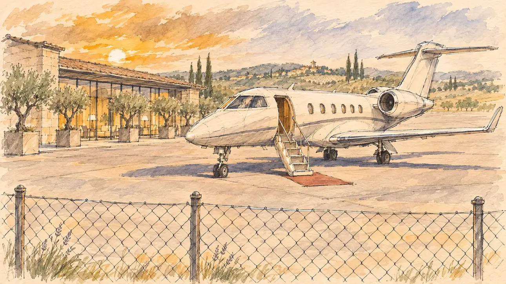

# `privateJet` · Le jet privé

**Validée par le PO le 30/10/2026**, au premier essai. Elle sert telle quelle en clair et en sombre.



| Champ | Valeur |
| --- | --- |
| Carte | `privateJet`, catégorie `polemic` (Polémique) |
| Style | Reportage dessiné |
| Ton | Ironique |
| Date | 2026-10-30 |
| Outil | ChatGPT avec le modèle GPT Sol 6.1 en effort « light », et ChatGPT Images 2.5 |
| Conversation | À remplir (le lien ne s'ouvre qu'avec le compte qui l'a créée) |
| Format rendu | 1672 × 941 (16:9) : export en 1290 × 726 px, WebP de qualité 75, 120 Ko, sans recadrage |
| Fichier d'origine | PNG de ChatGPT, chez le PO. L'export du dépôt a été fait depuis la copie partagée dans la conversation avec Claude |
| Première édition | `kit-france-2611-0001` |

## Texte de la carte

> **Le jet privé**
>
> Un ami chef d'entreprise vous a prêté son jet pour rejoindre un meeting à deux heures de train. Les photos du tarmac circulent.

## Le moment choisi

Choisi par le PO : le jet attend seul sur le tarmac d'un petit aéroport privé de luxe, sans personne à l'horizon. On devine un pilote dans le cockpit, et le terminal au fond. Le grillage flou du premier plan fait de l'image la photo prise de l'extérieur, celle qui circule.

Un premier prompt montrait une collaboratrice au pied de la passerelle, un photographe et des passionnés d'avions derrière le grillage. Le PO l'a refusé avant toute génération : la scène doit montrer le jet, pas les gens.

## Prompt complet

Dans une nouvelle conversation, avec [`oldTweet.webp`](../../illustrations/polemic/oldTweet.webp) comme seule image de référence :

```
Use the attached image as the style reference: the same pencil and ink drawing with loose watercolour washes and warm paper grain. Objects and buildings are drawn with visible ink lines, never photographic. Not the same scene.

Editorial illustration, landscape 16:9 (1536 × 864 px), filling the whole frame edge to edge. A small private jet waits alone on the tarmac of a small, luxurious private airport at the end of the afternoon in 2027. The jet stands in the right two thirds of the frame, in three-quarter view, its boarding stairs lowered onto a short carpet. Behind the cockpit windows, a pilot can just be made out, waiting. There is nobody else anywhere: no passengers, no staff, no onlookers. In the background, a low, elegant private terminal with tall glass windows, warm lights inside and a few olive trees in large planters, and beyond it flat countryside under a low sun. The scene is seen from just behind the airport's wire fence, a few blurred wires in the foreground, like a photo taken from outside. Everything is quiet, glossy and a little too perfect. Nothing on the jet, the terminal or the tarmac is readable: no registration number, no logos.

Style: Reportage drawing made on the spot, like a press illustrator or courtroom sketch artist: pencil and ink with loose watercolour washes, lively unfinished lines, white paper showing through.

Palette: navy #13203F, vellum #F5EFE1, gold #A9802A, brick #B5523B, ochre #D9A441, sage #8FA58A, slate #5E7186, sand #DCC8A4, warm grey #8C8279; use 4 to 6 of them, subtle warm paper grain.

Tone: gently ironic, low golden late-afternoon sun, long shadows on the empty tarmac.

Constraints: realistic proportions; no readable text anywhere (signs, registration numbers and screens stay blank); no captions or speech bubbles; no logos, flags or political party colours; no recognisable real person; no explicit violence; no oil-paint texture, no white or ragged border.

Format: if 16:9 is not available, make 1536 × 1024 and keep the top 80 px and the bottom 80 px free of anything important (the jet, the cockpit): they will be cropped.
```

## Essais écartés

Aucun.

## Retouches

Aucune.

## Relecture

Faite et validée par le PO le 30/10/2026.

- [x] Aucun texte lisible : ni immatriculation, ni logo, ni enseigne.
- [x] Aucun sosie d'une personne réelle. Le pilote est à peine visible.
- [x] Le candidat du joueur est hors champ.
- [x] Mains, visages et foules sans défaut visible à 343 px de large. Sans objet ici : personne d'autre que le pilote.
- [x] Aucune couleur de parti, aucun symbole officiel. Le jet ressemble à un vrai modèle d'avion d'affaires, ce que le PO a autorisé.
- [x] En 3:2 : rien d'important dans les 80 px du haut et du bas. Sans objet ici : l'image est en 16:9.
- [x] Lisible sur la page de l'événement, en clair et en sombre.

## Régénération demandée (04/11/2026)

**Pourquoi.** La revue de la première série note le style à 3/3 et les détails à 1/3 : c'est la plus photographique de la série, un rendu de photo ou une image 3D à peine teintée. Le jet a des reflets brillants, le tarmac est en miroir, le coucher de soleil orange est dense, et le grillage du premier plan est flou comme sur une photo (voulu par la fiche, mais le gabarit actuel interdit le flou). Il n'y a ni trait d'encre ni papier. Le décor, lui, est léger : le jet, la passerelle, un tapis, le terminal vitré et quelques oliviers et cyprès. Le PO a décidé de régénérer l'image.

**Ce qui reste.** L'idée de la photo volée à travers le grillage : le jet seul sur le tarmac d'un petit aéroport privé de luxe, vu en trois quarts dans les deux tiers droits, sa passerelle baissée sur un court tapis, le pilote à peine deviné derrière le pare-brise, le terminal vitré aux lumières chaudes au fond, un soleil bas. Personne d'autre : la scène montre le jet, pas les gens.

**Ce qui change.** Le rendu : le jet dessiné à l'encre, avec ses contours et un lavis clair, sans reflets brillants, le tarmac en papier nu avec quelques traits et de longues ombres, le ciel en lavis ocre pâle au lieu du coucher de soleil dense. **Le grillage du premier plan est dessiné net**, chaque maille à l'encre, au lieu d'être flou : c'est lui qui dit « photo prise de l'extérieur ». Le décor se limite au jet, au grillage, au terminal et à deux oliviers en bacs, avec la campagne esquissée au fond.

### Prompt de régénération

Dans une nouvelle conversation, avec [`oldTweet.webp`](../../illustrations/polemic/oldTweet.webp) comme seule image de référence.

```
Use the attached image as the style reference and copy its drawing: a realistic reportage drawing made on the spot for a newspaper, with quick, nervous pencil lines, often drawn twice, ink hatching in the shadows, transparent watercolour washes that spill a little over the lines, and the warm paper showing through. Not the same scene.
Like in the reference, the setting can be full when the story needs it, with the things that say where we are and what is happening, but each one is sketched with a few pencil lines and a light wash, never rendered or finished, and the drawing gets looser and paler towards the edges until it fades into the bare paper.
This must look like a drawing made by hand on paper by a press illustrator, halfway between a quick sketch and a realistic picture: never a photograph, a film poster or a digital painting, and never a cartoon, a comic strip, a caricature or a children's book illustration. Continuous lines, never dotted or dashed outlines; no uniform texture, speckles or hatching filter laid over the picture; no dense colour, no glossy highlights, no smooth gradients, in the sky and on the walls too. The fade into the paper at the edges stays narrow, without a wide white margin. No blur and no depth-of-field effect: everything, the foreground included, is drawn sharp, like a sketch made on the spot.
People are drawn from life with realistic anatomy and proportions, like in the reference: faces shaped with pencil lines, hatching and light washes, a little more finished than the background but never photographic (no photographic skin, no airbrushed or digital-painting look). Expressions stay natural and restrained, even in laughter or tears: no exaggerated grins, no wide-open mouths full of teeth, no rubbery or cartoonish faces.

Editorial illustration, landscape 16:9 (1536 × 864 px), the scene filling the frame, with only a light fade into the paper at the edges. A small private jet waits alone on the tarmac of a small, luxurious private airport at the end of the afternoon in 2027. The jet stands in the right two thirds of the frame, in three-quarter view, its boarding stairs lowered onto a short carpet. Behind the cockpit windows, a pilot can just be made out, waiting, drawn with a few ink lines. There is nobody else anywhere: no passengers, no staff, no onlookers. In the background on the left, a low, elegant private terminal with tall glass windows and warm lights inside, and two olive trees in large planters; beyond it, flat countryside only suggested with a few pencil lines under a pale ochre wash of low sun. The tarmac is bare warm paper with a few pencil lines and long soft shadows, no reflections. The scene is seen from just behind the airport's wire fence, like a photo taken from outside: the chain-link fence in the foreground is drawn sharp, every wire and post in ink lines, not blurred. Everything is quiet and a little too perfect. Nothing on the jet, the terminal or the tarmac is readable: no registration number, no logos.

Style: Reportage drawing made on the spot, like a press illustrator or courtroom sketch artist: pencil and ink with loose watercolour washes, lively unfinished lines, white paper showing through.

Palette: navy #13203F, vellum #F5EFE1, gold #A9802A, brick #B5523B, ochre #D9A441, sage #8FA58A, slate #5E7186, sand #DCC8A4, warm grey #8C8279; use 4 to 6 of them, subtle warm paper grain.

Tone: gently ironic, low golden late-afternoon sun, soft and pale, long shadows on the empty tarmac.

Constraints: realistic proportions; the only person is the pilot, barely visible, drawn with ink lines like the rest, with no photographic detail; no readable text anywhere (signs, registration numbers and screens stay blank); no captions or speech bubbles; no logos or political party colours; no recognisable real person; no explicit violence; no photographic rendering, no 3D look, no glossy reflections, no blur or bokeh, no dotted outlines, no texture or hatching filter over the picture, no oil-paint texture, no wide white margin or frame (a light fade into the paper at the edges is fine).

Format: if 16:9 is not available, make 1536 × 1024 and keep the top 80 px and the bottom 80 px free of anything important (faces, hands, the main action): they will be cropped.
```
