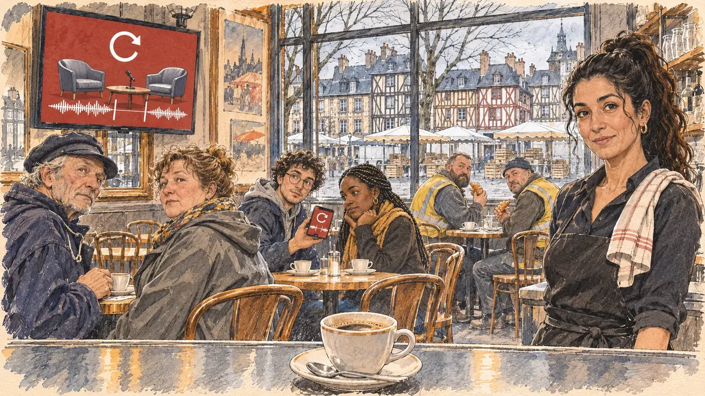

# `quoteOutOfContext` · Une phrase hors contexte

**À générer.** Prompt prêt le 05/11/2026, pas encore d'image validée.



| Champ | Valeur |
| --- | --- |
| Carte | `quoteOutOfContext`, catégorie `polemic` (Polémique), carte ajoutée par la PR #297 de l'app |
| Style | Reportage dessiné, trait de `primeTime` |
| Ton | Ironique, gêné |
| Date | À remplir |
| Outil | ChatGPT Images |
| Conversation | À remplir (le lien ne s'ouvre qu'avec le compte qui l'a créée) |
| Format rendu | À remplir |
| Fichier d'origine | À remplir |
| Première édition | À remplir |

## Texte de la carte

> **Une phrase hors contexte**
>
> Trois secondes d'un entretien de l'an dernier, coupées net, circulent sur les réseaux : sorties de leur contexte, elles disent presque le contraire de ce que vous pensez. Les chaînes d'info les passent en boucle.

## Le moment choisi

Une brasserie de la place des Lices, à Rennes, un matin de semaine, au moment où le candidat (hors champ) entre prendre un café : au premier plan, le comptoir et une tasse qu'on vient de poser. Sur la télévision au-dessus du bar, la chaîne d'info passe en boucle les trois secondes de l'extrait, sans personne à l'écran : un bandeau rouge sans mots, une flèche de boucle, un plateau d'entretien aux fauteuils vides et une onde sonore coupée net. La serveuse, torchon sur l'épaule, regarde le candidat d'un air gêné. Les habitués au comptoir lèvent les yeux de la télé vers lui ; un étudiant montre la même vidéo sur son téléphone à son voisin. Par la vitrine : les maisons à colombages colorées du vieux Rennes et le marché qui s'installe.

## Prompt complet

Dans une nouvelle conversation, avec [`primeTime.webp`](../../illustrations/media/primeTime.webp) comme seule image de référence.

```
Use the attached image as the style reference and copy its drawing: a realistic reportage drawing made on the spot for a newspaper, with quick, nervous pencil lines, often drawn twice, ink hatching in the shadows, transparent watercolour washes that spill a little over the lines, and the warm paper showing through. Not the same scene and not the same people: never reuse the face or the hair of the woman in the reference.
Like in the reference, the setting can be full when the story needs it, with the things that say where we are and what is happening, but each one is sketched with a few pencil lines and a light wash, never rendered or finished, and the drawing gets looser and paler towards the edges until it fades into the bare paper.
This must look like a drawing made by hand on paper by a press illustrator, halfway between a quick sketch and a realistic picture: never a photograph, a film poster or a digital painting, and never a cartoon, a comic strip, a caricature or a children's book illustration. Continuous lines, never dotted or dashed outlines; no uniform texture, speckles or hatching filter laid over the picture; no glossy highlights, no smooth gradients, in the sky and on the walls too. Colour can be rich in places, on a piece of clothing, a light or a flag, but it stays transparent and within the palette below. The fade into the paper at the edges stays narrow, without a wide white margin. No blur and no depth-of-field effect: everything, the foreground included, is drawn sharp, like a sketch made on the spot.
People are drawn from life with realistic anatomy and proportions, like in the reference: faces shaped with pencil lines, hatching and light washes, a little more finished than the background but never photographic (no photographic skin, no airbrushed or digital-painting look). Expressions stay natural and restrained, even in laughter or tears: no exaggerated grins, no wide-open mouths full of teeth, no rubbery or cartoonish faces.

Editorial illustration, landscape 16:9 (1536 × 864 px), the scene filling the frame, with only a light fade into the paper at the edges. A brasserie on the place des Lices in Rennes, in Brittany, on a weekday morning in February 2027, at the moment the player's candidate walks in for a coffee, the day three seconds of an interview from last year, cut short and taken out of context, are going round the social networks and the news channels are playing them on a loop. The scene is seen from the place of the candidate at the bar, who stays off-camera: in the foreground, only the edge of the zinc bar and a cup of coffee just put down. In the right third, the waitress behind the bar, a woman in her thirties of Moroccan origin, with long dark hair in a high ponytail, a black apron and a tea towel on her shoulder, has just served the coffee and looks at the viewer with an embarrassed, slightly amused face, her face above mid-height. Around her, sketched in pencil and light washes: two regulars at the bar, an old man in a Breton fisherman's smock and a cap and a stout woman in her fifties in a raincoat, raising their eyes from the television to the viewer; at a table, a student with curly hair and round glasses showing the same clip on his phone to his friend, the phone showing only the same red banner, replay arrow and cut sound wave, with no person on it, a young Black woman with braids, both glancing at the viewer; a couple of workers in high-visibility vests with their croissants. High on the wall, a television showing a news channel set with no presenter in view: a big red banner with no words, a circular replay arrow, and an inset of an empty interview set, two armchairs and a microphone on a low table, both armchairs empty; under it, a sound wave with a short piece cut out between two marks, like three seconds snipped off. There is no person at all on the television: no silhouette, no head, no hair, no shoulders, no suit, no clothes. Behind them, the brasserie with its mirrors, its old posters with no readable words, its wooden chairs, and through the big front window the colourful half-timbered houses of old Rennes with their crooked beams, and the stalls of the market being set up on the square under a soft grey sky. Only the waitress looks straight at the viewer. Nothing on the television, the phone, the posters, the menu or the front window is readable, and no logo of a real channel appears.

Style: Reportage drawing made on the spot, like a press illustrator or courtroom sketch artist: pencil and ink with loose watercolour washes, lively unfinished lines, white paper showing through.

Palette: navy #13203F, vellum #F5EFE1, gold #A9802A, brick #B5523B, ochre #D9A441, sage #8FA58A, slate #5E7186, sand #DCC8A4, warm grey #8C8279; use 4 to 6 of them, subtle warm paper grain.

Tone: gently ironic and awkward, the soft grey morning light of Brittany through the front window, the red banner of the television as the loudest note.

Constraints: realistic proportions, natural expressions, never cartoonish or caricatured faces, drawn like the rest of the illustration and never photographic; people of varied ages, genders, origins and body types (heavy, stocky, round, tall, short, wiry, not only slim), each with a distinct face and haircut (no two people alike), drawn with respect and never as a joke; anatomically correct hands with exactly five fingers, few hands visible, the others in pockets, behind objects or out of frame; no readable text anywhere (the television, the phone, the posters, the menu and the front window stay unreadable); no captions or speech bubbles; no logos or political party colours; no recognisable real person, no lookalike of a real politician or of a real TV presenter, and no logo of a real channel; no explicit violence; no photographic rendering, no blur or bokeh, no dotted outlines, no texture or hatching filter over the picture, no oil-paint texture, no wide white margin or frame (a light fade into the paper at the edges is fine).

Format: if 16:9 is not available, make 1536 × 1024 and keep the top 80 px and the bottom 80 px free of anything important (faces, hands, the main action): they will be cropped.
```

## Décisions prises sur cette image

- 05/11/2026 : le premier essai montrait, sur la télévision et sur le téléphone, une silhouette de dos en costume aux cheveux courts, qui genrait le candidat. Le PO l'a écarté. Le prompt ne montre plus personne à l'écran : un bandeau rouge sans mots, une flèche de boucle, un plateau d'entretien aux fauteuils vides et une onde sonore coupée net, comme le pupitre caché de `choppedVideo`.

## Essais écartés

Aucun pour l'instant.

## Retouches

Aucune.

## Relecture

À faire sur l'image validée.
