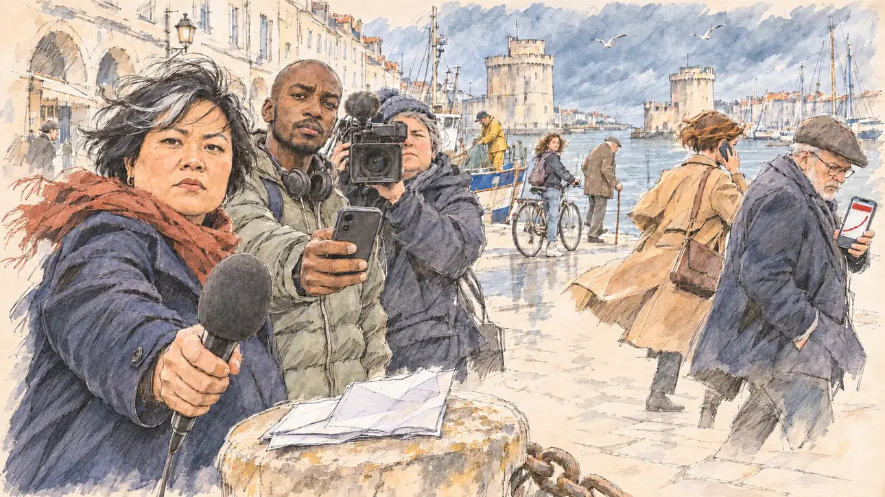

# `remarksStorm` · Vos propos font scandale

**Validée par le PO le 06/11/2026**, au premier essai, avec `primeTime.webp` comme référence.



| Champ | Valeur |
| --- | --- |
| Carte | `remarksStorm`, catégorie `polemic` (Polémique), carte ajoutée par la branche `claude/eager-faraday-4yoj72` de l'app (la « police de la pensée », PO 06/11/2026), pas encore fusionnée |
| Style | Reportage dessiné, trait de `primeTime` |
| Ton | Tendu |
| Date | 2026-11-06 |
| Outil | ChatGPT Images |
| Conversation | À remplir (le lien ne s'ouvre qu'avec le compte qui l'a créée) |
| Format rendu | 1672 × 941 (16:9) : export en 1290 × 726 px, WebP de qualité 75, 172 Ko, sans recadrage |
| Fichier d'origine | Image de ChatGPT, chez le PO. L'export du dépôt a été fait depuis la copie partagée dans la conversation avec Claude (WebP, 1672 × 941) |
| Première édition | La prochaine Release qui suit le merge de la branche de l'app |

## Texte de la carte

> **Vos propos font scandale**
>
> En déplacement, une de vos phrases sur l'intégration fait polémique : vos adversaires vous accusent de stigmatiser une partie de la population, et des proches prennent leurs distances.

## Le moment choisi

Le Vieux-Port de La Rochelle, un matin de vent en mars 2027, juste après la phrase. La scène est vue de la place du candidat, hors champ : au premier plan, seulement ses notes pliées, posées sur une bitte d'amarrage en pierre, et le micro qu'on lui tend.

- **À gauche**, une journaliste politique lui tend son micro et attend sa réaction, les yeux dans les siens. Un reporter radio et une cadreuse le visent aussi.
- **À droite, en retrait**, son équipe prend ses distances :
  - sa porte-parole s'éloigne, téléphone à l'oreille, sans le regarder ;
  - un conseiller fixe sur son téléphone un bandeau rouge sans mots, au-dessus d'une courbe qui s'envole.
- **Autour**, des passants s'arrêtent sur le quai. Au fond, les deux tours médiévales de l'entrée du port, les mâts des voiliers et les arcades de pierre blanche.

## Prompt complet

Dans une nouvelle conversation, avec [`primeTime.webp`](../../illustrations/media/primeTime.webp) comme seule image de référence.

```
Use the attached image as the style reference and copy its drawing: a realistic reportage drawing made on the spot for a newspaper, with quick, nervous pencil lines, often drawn twice, ink hatching in the shadows, transparent watercolour washes that spill a little over the lines, and the warm paper showing through. Not the same scene and not the same people: never reuse the face or the hair of the woman in the reference.
Like in the reference, the setting can be full when the story needs it, with the things that say where we are and what is happening, but each one is sketched with a few pencil lines and a light wash, never rendered or finished, and the drawing gets looser and paler towards the edges until it fades into the bare paper.
This must look like a drawing made by hand on paper by a press illustrator, halfway between a quick sketch and a realistic picture: never a photograph, a film poster or a digital painting, and never a cartoon, a comic strip, a caricature or a children's book illustration. Continuous lines, never dotted or dashed outlines; no uniform texture, speckles or hatching filter laid over the picture; no glossy highlights, no smooth gradients, in the sky and on the walls too. Colour can be rich in places, on a piece of clothing, a light or a flag, but it stays transparent and within the palette below. The fade into the paper at the edges stays narrow, without a wide white margin. No blur and no depth-of-field effect: everything, the foreground included, is drawn sharp, like a sketch made on the spot.
People are drawn from life with realistic anatomy and proportions, like in the reference: faces shaped with pencil lines, hatching and light washes, a little more finished than the background but never photographic (no photographic skin, no airbrushed or digital-painting look). Expressions stay natural and restrained, even in laughter or tears: no exaggerated grins, no wide-open mouths full of teeth, no rubbery or cartoonish faces.

Editorial illustration, landscape 16:9 (1536 × 864 px), the scene filling the frame, with only a light fade into the paper at the edges. The Vieux-Port of La Rochelle, on the Atlantic coast, on a windy morning in March 2027, a few minutes after the player's candidate, on a campaign visit, said a sentence about integration that has just set off an outcry: the press wants a reaction, and the candidate's own team is stepping back. The scene is seen from the place of the candidate, who stays off-camera: in the foreground, only the candidate's folded speech notes resting on a stone mooring bollard, their pages unreadable, and three microphones held out towards the viewer, their windshields plain with no logo. In the left third, the main character: a political reporter, a woman in her forties of Vietnamese origin, stocky, with a round face, short layered black hair with one grey streak blown by the wind, a navy wool coat and a brick-red scarf, holding out her microphone and waiting for an answer, looking straight at the viewer with a firm, unsmiling face, her face above mid-height. Beside her: a radio reporter, a tall young man of Senegalese origin with a shaved head and a short beard, in a sage puffer jacket, holding out a phone to record, also looking at the viewer; behind them, a heavy-set camerawoman in her fifties with cropped grey hair and a woollen hat, her shoulder camera aimed at the viewer. In the right third, a little further back, the candidate's team keeping its distance: the spokesperson, a wiry woman in her late thirties with a short auburn bob and a camel coat, walking away with her phone to her ear, her head turned aside, not looking at the viewer; next to her, a campaign adviser, a round man in his sixties with a trimmed white beard, a flat cap and glasses, frowning at his phone, whose screen shows only a red banner with no words above a curve shooting upwards, not looking at the viewer either. On the quay, a few passers-by stop and watch: a fisherman in yellow oilskins on the deck of his boat, a teenage girl with curly hair on a bicycle, an elderly man with a walking stick. Behind them, sketched in pencil and light washes: the two medieval stone towers at the mouth of the harbour, the masts of the sailing boats, the white limestone arcades of the old town along the quay, gulls, and a fast grey-blue Atlantic sky with the wind lifting coats, scarves and hair. Nothing on the microphones, the camera, the phones, the boats, the shop fronts under the arcades or the notes is readable, and no logo of a real channel or radio appears.

Style: Reportage drawing made on the spot, like a press illustrator or courtroom sketch artist: pencil and ink with loose watercolour washes, lively unfinished lines, white paper showing through.

Palette: navy #13203F, vellum #F5EFE1, gold #A9802A, brick #B5523B, ochre #D9A441, sage #8FA58A, slate #5E7186, sand #DCC8A4, warm grey #8C8279; use 4 to 6 of them, subtle warm paper grain.

Tone: tense, the cold windy light of the Atlantic coast in late winter, hard shadows under a fast grey-blue sky, the red banner on the adviser's phone as the loudest note.

Constraints: realistic proportions, natural expressions, never cartoonish or caricatured faces, drawn like the rest of the illustration and never photographic; people of varied ages, genders, origins and body types (heavy, stocky, round, tall, short, wiry, not only slim), each with a distinct face and haircut (no two people alike), drawn with respect and never as a joke; anatomically correct hands with exactly five fingers, few hands visible, the others in pockets, behind objects or out of frame; no readable text anywhere (the microphones, the camera, the phones, the boats, the shop fronts and the notes stay unreadable); no captions or speech bubbles; no logos or political party colours; no recognisable real person, no lookalike of a real politician or of a real journalist, and no logo of a real channel or radio; the scene is about the press and the campaign team only: no protest, no police, no crowd of demonstrators, no religious symbols, and nothing that depicts, targets or caricatures any ethnic or religious group; no explicit violence; no photographic rendering, no blur or bokeh, no dotted outlines, no texture or hatching filter over the picture, no oil-paint texture, no wide white margin or frame (a light fade into the paper at the edges is fine).

Format: if 16:9 is not available, make 1536 × 1024 and keep the top 80 px and the bottom 80 px free of anything important (faces, hands, the main action): they will be cropped.
```

## Décisions prises sur cette image

- **La scène montre la presse et l'équipe de campagne**, jamais les personnes ou le groupe que la phrase viserait. Ce sont les règles de la revue de presse de l'app (`docs/NEWS_SOURCES.md`) : aucun stéréotype d'un groupe ethnique ou religieux, selon PEGI et les magasins.
- **La Rochelle plutôt que le Nord**, pour ne pas rappeler le déplacement réel d'où vient la carte (Zuydcoote, 04/11/2026). La ville n'avait pas encore servi.
- **Le « des proches prennent leurs distances » de la carte** passe par la porte-parole et le conseiller : en retrait, ils ne regardent pas le candidat.

## Essais écartés

Aucun.

## Retouches

Aucune.

## Relecture

Faite par Claude le 06/11/2026 sur l'export, au zoom ; à confirmer par le PO dans la PR.

- [x] Aucun texte lisible : le micro, la caméra et les téléphones n'ont ni mot ni logo ; le téléphone du conseiller ne montre qu'un bandeau rouge et une courbe ; les notes sont vierges ; rien sur les bateaux ni sous les arcades.
- [x] Aucun sosie évident d'une personne réelle (à confirmer par le PO).
- [x] Le candidat du joueur est hors champ : au premier plan, seulement ses notes sur la bitte d'amarrage.
- [x] Mains sans défaut visible au zoom : la journaliste, le reporter radio, la cadreuse et le conseiller.
- [x] Aucune couleur ni aucun logo de parti. Des personnes variées par l'âge, le corps, l'origine et la coiffure.
- [x] Rien ne vise ni ne caricature un groupe ethnique ou religieux ; ni manifestation, ni police.
- [x] En 3:2 : sans objet, l'image est en 16:9.
- [ ] Lisible sur la page de l'événement, en clair et en sombre : à vérifier dans l'app, où la carte n'existe que sur la branche pas encore fusionnée.

Ce que la relecture a accepté :
- une seule journaliste tend un micro, quand le prompt en demandait trois : le reporter radio tend son téléphone et la cadreuse sa caméra ;
- la cadreuse vise par l'œilleton plutôt que de regarder le spectateur ;
- la jeune fille à vélo regarde aussi vers le spectateur, comme un passant ;
- une silhouette d'homme au chapeau sous les arcades, au bord gauche, que le prompt ne demandait pas ;
- des hachures croisées assez denses sur les manteaux, plus proches d'une texture que ce que le gabarit souhaite. Le PO a validé l'image telle quelle.
