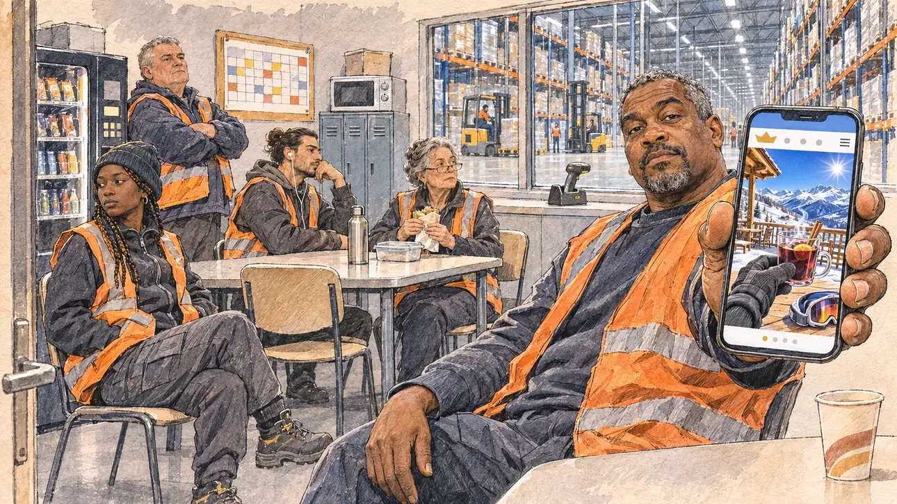

# `skiTerrace` · Un week-end à la montagne, au soleil de la station

**Validée par le PO le 05/11/2026**, au premier essai, avec `primeTime.webp` comme référence. Elle sert telle quelle en clair et en sombre.



| Champ | Valeur |
| --- | --- |
| Carte | `skiTerrace`, catégorie `polemic` (Polémique), carte ajoutée par la PR #297 de l'app |
| Style | Reportage dessiné, trait de `primeTime` |
| Ton | Ironique, mordant |
| Date | 2026-11-05 |
| Outil | ChatGPT Images |
| Conversation | À remplir (le lien ne s'ouvre qu'avec le compte qui l'a créée) |
| Format rendu | 1672 × 941 (16:9) : export en 1290 × 726 px, WebP de qualité 75, 226 Ko, sans recadrage |
| Fichier d'origine | Image de ChatGPT, chez le PO. L'export du dépôt a été fait depuis la copie partagée dans la conversation avec Claude |
| Première édition | La prochaine Release qui suit le merge de la PR #297 de l'app |

## Texte de la carte

> **Un week-end à la montagne, au soleil de la station**
>
> Une photo de vous, lunettes de soleil sur le nez et verre en main, sur la terrasse d'une station de ski en pleines vacances d'hiver, est publiée par un site people. Dessous, un commentaire : « Le pays compte ses jours de congé, pas vous. »

## Le moment choisi

La salle de pause d'un grand entrepôt logistique près du Mans, à la pause de dix heures, un jour de février, vue depuis le seuil où entre le candidat (hors champ), venu visiter le site : au premier plan, un gobelet du distributeur posé sur la table. Un cariste, gilet orange, tend au candidat son téléphone : la photo du site people montre une terrasse de station au soleil, des montagnes enneigées, une table avec un verre et des lunettes de ski, et de la personne seulement une main gantée qui tient le verre. Autour : les préparatrices et préparateurs de commandes en pause, gilets et chaussures de sécurité, qui regardent le candidat sans un sourire, le planning des congés punaisé au mur. Par la vitre : les rayonnages immenses de l'entrepôt et les chariots élévateurs.

## Prompt complet

Dans une nouvelle conversation, avec [`primeTime.webp`](../../illustrations/media/primeTime.webp) comme seule image de référence.

```
Use the attached image as the style reference and copy its drawing: a realistic reportage drawing made on the spot for a newspaper, with quick, nervous pencil lines, often drawn twice, ink hatching in the shadows, transparent watercolour washes that spill a little over the lines, and the warm paper showing through. Not the same scene and not the same people: never reuse the face or the hair of the woman in the reference.
Like in the reference, the setting can be full when the story needs it, with the things that say where we are and what is happening, but each one is sketched with a few pencil lines and a light wash, never rendered or finished, and the drawing gets looser and paler towards the edges until it fades into the bare paper.
This must look like a drawing made by hand on paper by a press illustrator, halfway between a quick sketch and a realistic picture: never a photograph, a film poster or a digital painting, and never a cartoon, a comic strip, a caricature or a children's book illustration. Continuous lines, never dotted or dashed outlines; no uniform texture, speckles or hatching filter laid over the picture; no glossy highlights, no smooth gradients, in the sky and on the walls too. Colour can be rich in places, on a piece of clothing, a light or a flag, but it stays transparent and within the palette below. The fade into the paper at the edges stays narrow, without a wide white margin. No blur and no depth-of-field effect: everything, the foreground included, is drawn sharp, like a sketch made on the spot.
People are drawn from life with realistic anatomy and proportions, like in the reference: faces shaped with pencil lines, hatching and light washes, a little more finished than the background but never photographic (no photographic skin, no airbrushed or digital-painting look). Expressions stay natural and restrained, even in laughter or tears: no exaggerated grins, no wide-open mouths full of teeth, no rubbery or cartoonish faces.

Editorial illustration, landscape 16:9 (1536 × 864 px), the scene filling the frame, with only a light fade into the paper at the edges. The break room of a huge logistics warehouse near Le Mans, at the ten o'clock break on a grey weekday in February 2027, during the winter school holidays: a celebrity website has published a photo of the player's candidate on the sunny terrace of a ski resort, sunglasses on and a glass in hand, under a comment saying that the French count their days off, unlike the candidate. The scene is seen from the doorway where the candidate comes in to visit the site, who stays off-camera: in the foreground, only a paper cup from the vending machine on the edge of a formica table. In the right third, a forklift driver in his forties of Guadeloupean origin, broad-shouldered, with short grey-black hair, a goatee and an orange high-visibility vest over a sweatshirt, holds out his phone towards the viewer with an ironic, unimpressed look, his face above mid-height. On the phone, the celebrity website's photo: a ski-resort terrace in bright sunshine with snowy peaks, a wooden table with a glass of mulled wine and ski goggles, and of the person only one gloved hand holding the glass, nothing else of the body, no face, nothing that shows a man or a woman. Around him, sketched in pencil and light washes: order pickers on their break in high-visibility vests and safety shoes, a young woman of Malian origin with braids under a beanie, a heavy-set man in his fifties with a grey crew cut, a young man with a bun and earphones, an older woman with reading glasses eating a sandwich, all looking at the viewer without a smile; a vending machine, lockers, a microwave, and on the wall a cork board with the holiday rota pinned up, only small coloured boxes and no readable words. Through the big window of the break room, the huge warehouse: endless high metal racks full of pallets and boxes, forklifts and a scanner gun on a charging dock, under cold white lights. Only the forklift driver looks straight at the viewer. Nothing on the phone, the website, the rota, the vests, the boxes or the lockers is readable, and no logo of a real company or website appears.

Style: Reportage drawing made on the spot, like a press illustrator or courtroom sketch artist: pencil and ink with loose watercolour washes, lively unfinished lines, white paper showing through.

Palette: navy #13203F, vellum #F5EFE1, gold #A9802A, brick #B5523B, ochre #D9A441, sage #8FA58A, slate #5E7186, sand #DCC8A4, warm grey #8C8279; use 4 to 6 of them, subtle warm paper grain.

Tone: ironic and biting, the cold white neon light of the warehouse, the orange and yellow of the high-visibility vests, and the bright snow and sun of the photo on the phone as the one holiday patch.

Constraints: realistic proportions, natural expressions, never cartoonish or caricatured faces, drawn like the rest of the illustration and never photographic; people of varied ages, genders, origins and body types (heavy, stocky, round, tall, short, wiry, not only slim), each with a distinct face and haircut (no two people alike), drawn with respect and never as a joke; anatomically correct hands with exactly five fingers, few hands visible, the others in pockets, behind objects or out of frame; no readable text anywhere (the phone, the website, the rota, the vests, the boxes and the lockers stay unreadable); no captions or speech bubbles; no logos or political party colours; no recognisable real person, no lookalike of a real politician, and no logo of a real company or website; no explicit violence; no photographic rendering, no blur or bokeh, no dotted outlines, no texture or hatching filter over the picture, no oil-paint texture, no wide white margin or frame (a light fade into the paper at the edges is fine).

Format: if 16:9 is not available, make 1536 × 1024 and keep the top 80 px and the bottom 80 px free of anything important (faces, hands, the main action): they will be cropped.
```

## Décisions prises sur cette image

Aucune.

## Essais écartés

Aucun.

## Retouches

Aucune.

## Relecture

Faite et validée par le PO le 05/11/2026.

- [x] Aucun texte lisible : le site people n'a qu'une couronne dorée inventée, des points et un menu ; le planning n'a que des cases de couleur, et rien n'est lisible sur le distributeur, les casiers, les cartons, les gilets ni le gobelet.
- [x] Aucun sosie d'une personne réelle.
- [x] Le candidat du joueur est hors champ.
- [x] Mains, visages et foules sans défaut visible à 343 px de large.
- [x] Aucune couleur ni aucun logo de parti. Des personnes variées par l'âge, le corps, l'origine et la coiffure.
- [x] En 3:2 : sans objet, l'image est en 16:9.
- [x] Lisible sur la page de l'événement, en clair et en sombre.

Ce que la relecture a accepté : sur la photo du téléphone, une main gantée et une manche grise sans indice de genre, qui partent du bord de l'écran ; les préparateurs regardent ailleurs et non vers le spectateur ; l'entrepôt et l'écran du téléphone sont un peu plus finis que dans `primeTime`.
