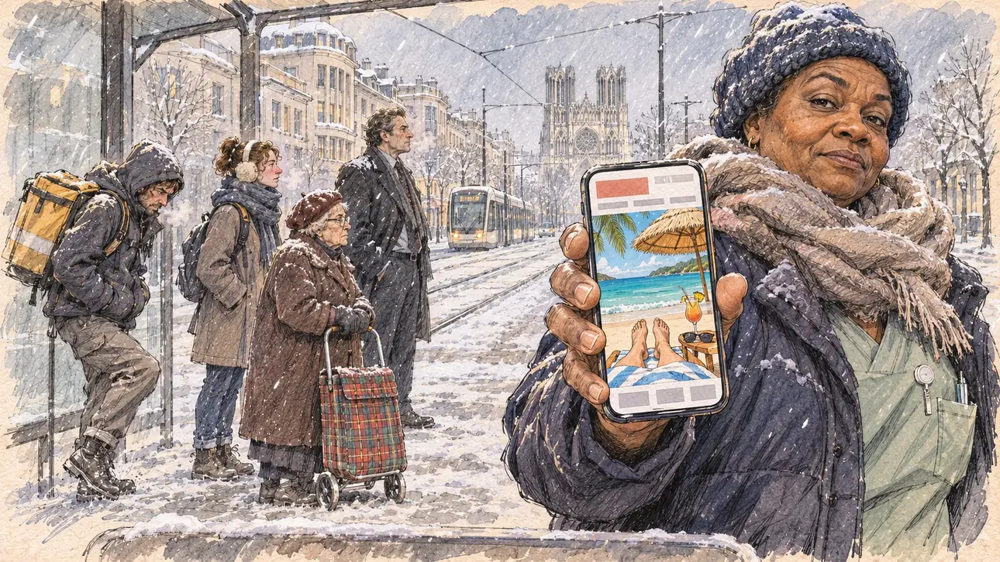

# `sunnyGetaway` · Un week-end au soleil, en plein hiver

**Validée par le PO le 05/11/2026**, au premier essai, avec `primeTime.webp` comme référence. Elle sert telle quelle en clair et en sombre.



| Champ | Valeur |
| --- | --- |
| Carte | `sunnyGetaway`, catégorie `polemic` (Polémique), carte ajoutée par la PR #297 de l'app |
| Style | Reportage dessiné, trait de `primeTime` |
| Ton | Ironique, mordant |
| Date | 2026-11-05 |
| Outil | ChatGPT Images |
| Conversation | À remplir (le lien ne s'ouvre qu'avec le compte qui l'a créée) |
| Format rendu | 1672 × 941 (16:9) : export en 1290 × 726 px, WebP de qualité 75, 238 Ko, sans recadrage |
| Fichier d'origine | Image de ChatGPT, chez le PO. L'export du dépôt a été fait depuis la copie partagée dans la conversation avec Claude |
| Première édition | La prochaine Release qui suit le merge de la PR #297 de l'app |

## Texte de la carte

> **Un week-end au soleil, en plein hiver**
>
> Une photo de vous en maillot sur une plage lointaine, prise pendant un week-end à l'étranger en plein hiver de campagne, fait la une d'un site people. Dessous, un éditorialiste ironise : « Dix heures d'avion pour un week-end, pendant que le pays grelotte. »

## Le moment choisi

Un arrêt de tramway sous la neige à Reims, un lundi matin de février, vu depuis l'abri où le candidat (hors champ) attend lui aussi : au premier plan, le bord du banc de l'abri couvert de givre. Une employée d'un hôpital, emmitouflée, tend son téléphone au candidat : la photo du site people montre un transat sous un parasol de paille sur une plage tropicale, une serviette, des lunettes de soleil et un cocktail, et de la personne seulement les pieds nus. Autour, les gens qui grelottent en attendant le tram, un livreur, un étudiant, une vieille dame. Derrière : la neige sur les façades de Reims et la cathédrale au bout de la rue.

## Prompt complet

Dans une nouvelle conversation, avec [`primeTime.webp`](../../illustrations/media/primeTime.webp) comme seule image de référence.

```
Use the attached image as the style reference and copy its drawing: a realistic reportage drawing made on the spot for a newspaper, with quick, nervous pencil lines, often drawn twice, ink hatching in the shadows, transparent watercolour washes that spill a little over the lines, and the warm paper showing through. Not the same scene and not the same people: never reuse the face or the hair of the woman in the reference.
Like in the reference, the setting can be full when the story needs it, with the things that say where we are and what is happening, but each one is sketched with a few pencil lines and a light wash, never rendered or finished, and the drawing gets looser and paler towards the edges until it fades into the bare paper.
This must look like a drawing made by hand on paper by a press illustrator, halfway between a quick sketch and a realistic picture: never a photograph, a film poster or a digital painting, and never a cartoon, a comic strip, a caricature or a children's book illustration. Continuous lines, never dotted or dashed outlines; no uniform texture, speckles or hatching filter laid over the picture; no glossy highlights, no smooth gradients, in the sky and on the walls too. Colour can be rich in places, on a piece of clothing, a light or a flag, but it stays transparent and within the palette below. The fade into the paper at the edges stays narrow, without a wide white margin. No blur and no depth-of-field effect: everything, the foreground included, is drawn sharp, like a sketch made on the spot.
People are drawn from life with realistic anatomy and proportions, like in the reference: faces shaped with pencil lines, hatching and light washes, a little more finished than the background but never photographic (no photographic skin, no airbrushed or digital-painting look). Expressions stay natural and restrained, even in laughter or tears: no exaggerated grins, no wide-open mouths full of teeth, no rubbery or cartoonish faces.

Editorial illustration, landscape 16:9 (1536 × 864 px), the scene filling the frame, with only a light fade into the paper at the edges. A tram stop in the snow in Reims, in Champagne, on a freezing Monday morning in February 2027: a celebrity website has published a photo of the player's candidate in swimwear on a far-away beach, taken during a weekend abroad in the middle of the winter campaign, under the comment of a columnist: ten hours of flight for a weekend, while the country shivers. The scene is seen from the tram shelter where the candidate is also waiting, who stays off-camera: in the foreground, only the edge of the shelter's frosted bench. In the right third, a hospital worker in her fifties of Cameroonian origin, wrapped up in a big scarf and a wool hat, a padded coat over her hospital clothes, holds out her phone towards the viewer with a sharp, mocking look, her face above mid-height. On the phone, the celebrity website's photo: a sun lounger under a straw parasol on a white tropical beach, a towel, sunglasses and a cocktail on the sand, and of the person only two bare feet at the end of the lounger, nothing else of the body, no face, nothing that shows a man or a woman. Around her, sketched in pencil and light washes: commuters shivering while they wait for the tram, a delivery rider stamping his feet, a student with a red nose and earmuffs, an elderly woman with a tartan shopping trolley, a man in a suit with snow on his shoulders, breath steaming in the cold air. Behind them, the snowy street of Reims, the pale stone Art Deco façades with snow on their ledges, the tram lines and the overhead wires, and at the end of the street the tall Gothic towers of the cathedral in the grey snowy sky. Only the hospital worker looks at the viewer. Nothing on the phone, the website, the shelter, the tram or the shop fronts is readable, and no logo of a real website appears.

Style: Reportage drawing made on the spot, like a press illustrator or courtroom sketch artist: pencil and ink with loose watercolour washes, lively unfinished lines, white paper showing through.

Palette: navy #13203F, vellum #F5EFE1, gold #A9802A, brick #B5523B, ochre #D9A441, sage #8FA58A, slate #5E7186, sand #DCC8A4, warm grey #8C8279; use 4 to 6 of them, subtle warm paper grain.

Tone: ironic and biting, the cold grey-blue light of a snowy morning, the turquoise and white of the tropical photo on the phone as the one warm, bright patch.

Constraints: realistic proportions, natural expressions, never cartoonish or caricatured faces, drawn like the rest of the illustration and never photographic; people of varied ages, genders, origins and body types (heavy, stocky, round, tall, short, wiry, not only slim), each with a distinct face and haircut (no two people alike), drawn with respect and never as a joke; anatomically correct hands with exactly five fingers, few hands visible, the others in pockets, behind objects or out of frame; no readable text anywhere (the phone, the website, the shelter, the tram and the shop fronts stay unreadable); no captions or speech bubbles; no logos or political party colours; no recognisable real person, no lookalike of a real politician, and no logo of a real website; no explicit violence; no photographic rendering, no blur or bokeh, no dotted outlines, no texture or hatching filter over the picture, no oil-paint texture, no wide white margin or frame (a light fade into the paper at the edges is fine).

Format: if 16:9 is not available, make 1536 × 1024 and keep the top 80 px and the bottom 80 px free of anything important (faces, hands, the main action): they will be cropped.
```

## Décisions prises sur cette image

Aucune.

## Essais écartés

Aucun.

## Retouches

Aucune.

## Relecture

Faite et validée par le PO le 05/11/2026.

- [x] Aucun texte lisible : le site people n'a que des blocs de couleur, rien sur l'abri ni sur les façades ; la girouette du tram porte quelques pseudo-lettres illisibles à la taille de l'app.
- [x] Aucun sosie d'une personne réelle.
- [x] Le candidat du joueur est hors champ.
- [x] Mains, visages et foules sans défaut visible à 343 px de large.
- [x] Aucune couleur ni aucun logo de parti. Des personnes variées par l'âge, le corps, l'origine et la coiffure.
- [x] En 3:2 : sans objet, l'image est en 16:9.
- [x] Lisible sur la page de l'événement, en clair et en sombre.

Ce que la relecture a accepté : la photo du téléphone montre les jambes jusqu'aux genoux et non les seuls pieds, minces et sans indice de genre marqué ; une infirmière à la place d'une employée d'hôpital.
