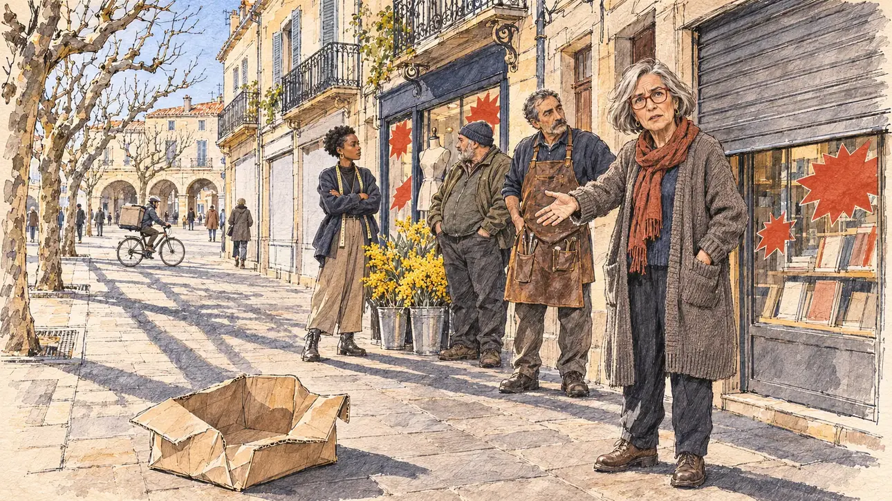

# `winterSales` · Les soldes d'hiver

**Validée par le PO le 05/11/2026**, au premier essai, avec `primeTime.webp` comme référence. Elle sert telle quelle en clair et en sombre.



| Champ | Valeur |
| --- | --- |
| Carte | `winterSales`, catégorie `polemic` (Polémique), carte ajoutée par la PR #297 de l'app |
| Style | Reportage dessiné, trait de `primeTime` |
| Ton | Préoccupé, tendu |
| Date | 2026-11-05 |
| Outil | ChatGPT Images |
| Conversation | À remplir (le lien ne s'ouvre qu'avec le compte qui l'a créée) |
| Format rendu | 1672 × 941 (16:9) : export en 1290 × 726 px, WebP de qualité 75, 260 Ko, sans recadrage |
| Fichier d'origine | Image de ChatGPT, chez le PO. L'export du dépôt a été fait depuis la copie partagée dans la conversation avec Claude |
| Première édition | La prochaine Release qui suit le merge de la PR #297 de l'app |

## Texte de la carte

> **Les soldes d'hiver**
>
> C'est le mois des soldes d'hiver : des commerçants de centre-ville, inquiets des ventes en ligne, vous réunissent devant une boutique aux rideaux à moitié baissés.

## Le moment choisi

La rue commerçante du centre-ville d'une ville moyenne de l'Hérault, un après-midi de janvier pendant les soldes, vue depuis la place du candidat (hors champ) : au premier plan, un carton de colis de vente en ligne abandonné sur le trottoir. Devant une boutique au rideau de fer à moitié baissé, la présidente des commerçants, une libraire, interpelle le candidat. Autour d'elle : un cordonnier, un fleuriste, une jeune créatrice de vêtements, chacun devant sa vitrine aux étiquettes de soldes sans chiffres. Derrière : les cellules vides aux vitrines blanchies, un livreur à vélo qui passe avec son gros sac, les façades de pierre claire à balcons de fer, les platanes taillés et une place à arcades.

## Prompt complet

Dans une nouvelle conversation, avec [`primeTime.webp`](../../illustrations/media/primeTime.webp) comme seule image de référence.

```
Use the attached image as the style reference and copy its drawing: a realistic reportage drawing made on the spot for a newspaper, with quick, nervous pencil lines, often drawn twice, ink hatching in the shadows, transparent watercolour washes that spill a little over the lines, and the warm paper showing through. Not the same scene and not the same people: never reuse the face or the hair of the woman in the reference.
Like in the reference, the setting can be full when the story needs it, with the things that say where we are and what is happening, but each one is sketched with a few pencil lines and a light wash, never rendered or finished, and the drawing gets looser and paler towards the edges until it fades into the bare paper.
This must look like a drawing made by hand on paper by a press illustrator, halfway between a quick sketch and a realistic picture: never a photograph, a film poster or a digital painting, and never a cartoon, a comic strip, a caricature or a children's book illustration. Continuous lines, never dotted or dashed outlines; no uniform texture, speckles or hatching filter laid over the picture; no glossy highlights, no smooth gradients, in the sky and on the walls too. Colour can be rich in places, on a piece of clothing, a light or a flag, but it stays transparent and within the palette below. The fade into the paper at the edges stays narrow, without a wide white margin. No blur and no depth-of-field effect: everything, the foreground included, is drawn sharp, like a sketch made on the spot.
People are drawn from life with realistic anatomy and proportions, like in the reference: faces shaped with pencil lines, hatching and light washes, a little more finished than the background but never photographic (no photographic skin, no airbrushed or digital-painting look). Expressions stay natural and restrained, even in laughter or tears: no exaggerated grins, no wide-open mouths full of teeth, no rubbery or cartoonish faces.

Editorial illustration, landscape 16:9 (1536 × 864 px), the scene filling the frame, with only a light fade into the paper at the edges. The main shopping street in the old centre of a mid-sized town in the Hérault, in Languedoc, on a sunny but cold afternoon in January 2027, during the winter sales: town-centre shopkeepers, worried about online sales, have gathered the player's candidate in front of a shop whose metal shutter is half down. The scene is seen from the place of the candidate, who stays off-camera: in the foreground, only an empty cardboard parcel box from online shopping, crushed on the pavement. In the right third, the president of the shopkeepers' association, a bookseller in her sixties of Spanish origin, small and lively, with a silver bob, red-framed glasses and a long wool cardigan, stands in front of the half-shuttered shop and speaks to the viewer with a worried, combative face, one hand open towards the empty street, her face above mid-height. Around her, sketched in pencil and light washes: a shoe repairer in his fifties of Armenian origin with a leather apron, a stocky florist with a beanie and buckets of mimosa at his feet, a young clothes designer of Senegalese origin in her twenties with her arms crossed in front of her small boutique; shop windows with sale stickers showing only red shapes and no figures or words. Behind them, the street: two empty shops with whitewashed windows, a delivery rider on a bicycle passing with a big square bag on his back, few passers-by, the pale stone façades of Languedoc with wrought-iron balconies and closed shutters, pruned plane trees, and at the end of the street a little square with stone arcades under a clear winter sky. Only the bookseller looks at the viewer. Nothing on the shop fronts, the stickers, the shutters, the box or the delivery bag is readable, and no logo of a real online retailer or delivery company appears.

Style: Reportage drawing made on the spot, like a press illustrator or courtroom sketch artist: pencil and ink with loose watercolour washes, lively unfinished lines, white paper showing through.

Palette: navy #13203F, vellum #F5EFE1, gold #A9802A, brick #B5523B, ochre #D9A441, sage #8FA58A, slate #5E7186, sand #DCC8A4, warm grey #8C8279; use 4 to 6 of them, subtle warm paper grain.

Tone: preoccupied and tense, the low clear winter sun of the south throwing long shadows, the yellow of the mimosa and the red of the sale stickers as the brightest notes.

Constraints: realistic proportions, natural expressions, never cartoonish or caricatured faces, drawn like the rest of the illustration and never photographic; people of varied ages, genders, origins and body types (heavy, stocky, round, tall, short, wiry, not only slim), each with a distinct face and haircut (no two people alike), drawn with respect and never as a joke; anatomically correct hands with exactly five fingers, few hands visible, the others in pockets, behind objects or out of frame; no readable text anywhere (the shop fronts, the stickers, the shutters, the box and the delivery bag stay unreadable); no captions or speech bubbles; no logos or political party colours; no recognisable real person, no lookalike of a real politician, and no logo of a real online retailer or delivery company; no explicit violence; no photographic rendering, no blur or bokeh, no dotted outlines, no texture or hatching filter over the picture, no oil-paint texture, no wide white margin or frame (a light fade into the paper at the edges is fine).

Format: if 16:9 is not available, make 1536 × 1024 and keep the top 80 px and the bottom 80 px free of anything important (faces, hands, the main action): they will be cropped.
```

## Décisions prises sur cette image

Aucune.

## Essais écartés

Aucun.

## Retouches

Aucune.

## Relecture

Faite et validée par le PO le 05/11/2026.

- [x] Aucun texte lisible : les étiquettes de soldes ne sont que des étoiles rouges, rien sur le rideau, les vitrines, le carton ni le sac du livreur.
- [x] Aucun sosie d'une personne réelle.
- [x] Le candidat du joueur est hors champ.
- [x] Mains, visages et foules sans défaut visible à 343 px de large.
- [x] Aucune couleur ni aucun logo de parti. Des personnes variées par l'âge, le corps, l'origine et la coiffure.
- [x] En 3:2 : sans objet, l'image est en 16:9.
- [x] Lisible sur la page de l'événement, en clair et en sombre.

Ce que la relecture a accepté : la libraire tend la main vers la rue en regardant un peu à côté du spectateur ; le cordonnier en tablier de cuir et le fleuriste au bonnet sont proches l'un de l'autre, mais distincts.
