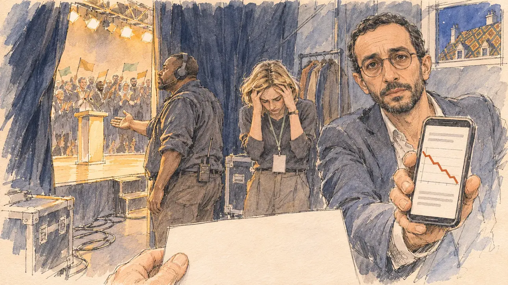

# `wrongFigure` · Un chiffre faux en meeting

**À générer.** Prompt prêt le 04/11/2026, pas encore d'image validée.



| Champ | Valeur |
| --- | --- |
| Carte | `wrongFigure`, catégorie `polemic` (Polémique), carte ajoutée par la PR #297 de l'app |
| Style | Reportage dessiné, trait de `primeTime` |
| Ton | Ironique, gêné |
| Date | À remplir |
| Outil | ChatGPT Images |
| Conversation | À remplir (le lien ne s'ouvre qu'avec le compte qui l'a créée) |
| Format rendu | À remplir |
| Fichier d'origine | À remplir |
| Première édition | À remplir |

## Texte de la carte

> **Un chiffre faux en meeting**
>
> En meeting, vous annoncez que le déficit du pays a doublé en cinq ans. Des vérificateurs de faits publient le chiffre exact avant la fin de la soirée : il a baissé. La salle a applaudi, la presse non.

## Le moment choisi

Les coulisses d'un meeting à Dijon, un soir de mars, à l'instant où le candidat (hors champ) quitte la scène sous les applaudissements : au premier plan, la fiche du discours vierge qu'il tient encore. Le conseiller économique de la campagne, livide, lui tend son téléphone qui affiche l'article des vérificateurs, sans texte lisible. Derrière lui, une collaboratrice se prend la tête dans les mains, une régisseuse au casque fait signe de remonter saluer. Par l'entrebâillement du rideau, la salle debout qui applaudit encore, les drapeaux sans inscription. Par une fenêtre du couloir, les toits de tuiles vernissées multicolores de Bourgogne dans la nuit.

## Prompt complet

Dans une nouvelle conversation, avec [`primeTime.webp`](../../illustrations/media/primeTime.webp) comme seule image de référence.

```
Use the attached image as the style reference and copy its drawing: a realistic reportage drawing made on the spot for a newspaper, with quick, nervous pencil lines, often drawn twice, ink hatching in the shadows, transparent watercolour washes that spill a little over the lines, and the warm paper showing through. Not the same scene and not the same people: never reuse the face or the hair of the woman in the reference.
Like in the reference, the setting can be full when the story needs it, with the things that say where we are and what is happening, but each one is sketched with a few pencil lines and a light wash, never rendered or finished, and the drawing gets looser and paler towards the edges until it fades into the bare paper.
This must look like a drawing made by hand on paper by a press illustrator, halfway between a quick sketch and a realistic picture: never a photograph, a film poster or a digital painting, and never a cartoon, a comic strip, a caricature or a children's book illustration. Continuous lines, never dotted or dashed outlines; no uniform texture, speckles or hatching filter laid over the picture; no glossy highlights, no smooth gradients, in the sky and on the walls too. Colour can be rich in places, on a piece of clothing, a light or a flag, but it stays transparent and within the palette below. The fade into the paper at the edges stays narrow, without a wide white margin. No blur and no depth-of-field effect: everything, the foreground included, is drawn sharp, like a sketch made on the spot.
People are drawn from life with realistic anatomy and proportions, like in the reference: faces shaped with pencil lines, hatching and light washes, a little more finished than the background but never photographic (no photographic skin, no airbrushed or digital-painting look). Expressions stay natural and restrained, even in laughter or tears: no exaggerated grins, no wide-open mouths full of teeth, no rubbery or cartoonish faces.

Editorial illustration, landscape 16:9 (1536 × 864 px), the scene filling the frame, with only a light fade into the paper at the edges. The backstage area of a campaign rally in Dijon, in Burgundy, on an evening in March 2027, at the very moment the player's candidate leaves the stage to applause, having just told the hall that the country's deficit has doubled in five years; fact-checkers will publish the true figure before the end of the evening: it has gone down. The scene is seen from the place of the candidate in the wings, who stays off-camera: in the foreground, only a blank speech card still held at the bottom edge of the picture. In the right third, the campaign's economic adviser, a thin man in his forties of Tunisian origin, with short black hair, a trimmed beard, round glasses and an open-necked shirt, pale as a sheet, holds out his phone showing the fact-checkers' article, only grey lines and a red chart going down with nothing readable, and looks at the viewer with a stricken face, his face above mid-height. Behind him, sketched in pencil and light washes: a young campaign aide, a woman with a blond bob and a lanyard, holding her head in her hands; a stage manager of Senegalese origin with a headset, waving the candidate back on stage for a bow; cables, flight cases and a coat rack in the wings. Through the gap in the heavy black curtain, the lit stage with an empty lectern, and the hall standing and applauding, small figures waving flags in the campaign's colours with no lettering. Through a small window of the backstage corridor, the glazed, multicoloured diamond-patterned tile roofs of Burgundy in the night. Only the economic adviser looks at the viewer. Nothing on the card, the phone, the flags, the flight cases or the walls is readable.

Style: Reportage drawing made on the spot, like a press illustrator or courtroom sketch artist: pencil and ink with loose watercolour washes, lively unfinished lines, white paper showing through.

Palette: navy #13203F, vellum #F5EFE1, gold #A9802A, brick #B5523B, ochre #D9A441, sage #8FA58A, slate #5E7186, sand #DCC8A4, warm grey #8C8279; use 4 to 6 of them, subtle warm paper grain.

Tone: ironic and awkward, the dim blue light of the wings against the warm glare of the stage through the curtain, the red of the falling chart as the sharpest note.

Constraints: realistic proportions, natural expressions, never cartoonish or caricatured faces, drawn like the rest of the illustration and never photographic; people of varied ages, genders, origins and body types (heavy, stocky, round, tall, short, wiry, not only slim), each with a distinct face and haircut (no two people alike), drawn with respect and never as a joke; anatomically correct hands with exactly five fingers, few hands visible, the others in pockets, behind objects or out of frame; no readable text anywhere (the card, the phone, the flags, the flight cases and the walls stay unreadable); no captions or speech bubbles; no logos or political party colours; no recognisable real person, no lookalike of a real politician; no explicit violence; no photographic rendering, no blur or bokeh, no dotted outlines, no texture or hatching filter over the picture, no oil-paint texture, no wide white margin or frame (a light fade into the paper at the edges is fine).

Format: if 16:9 is not available, make 1536 × 1024 and keep the top 80 px and the bottom 80 px free of anything important (faces, hands, the main action): they will be cropped.
```

## Décisions prises sur cette image

Aucune pour l'instant.

## Essais écartés

Aucun pour l'instant.

## Retouches

Aucune.

## Relecture

À faire sur l'image validée.
