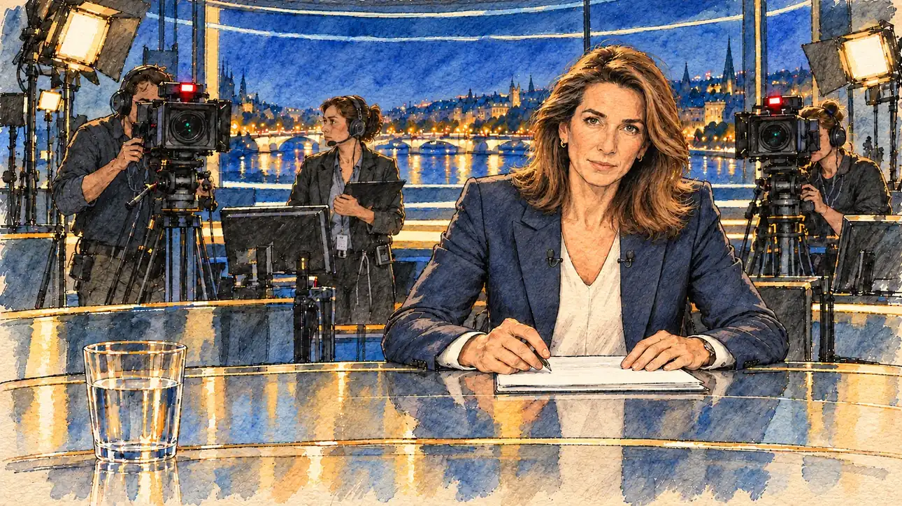

# `primeTime` · Invitation au 20 heures

**Validée par le PO le 30/10/2026**, à l'essai 2. Elle sert telle quelle en clair et en sombre.



| Champ | Valeur |
| --- | --- |
| Carte | `primeTime`, catégorie `media` (Opportunité médiatique) |
| Style | Reportage dessiné ; le visage de la présentatrice reste presque photographique sous les hachures |
| Ton | Tendu mais maîtrisé |
| Date | 2026-10-30 |
| Outil | ChatGPT avec le modèle GPT Sol 6.1 en effort « light », et ChatGPT Images 2.5 |
| Conversation | À remplir (le lien ne s'ouvre qu'avec le compte qui l'a créée) |
| Format rendu | 1672 × 941 (16:9) : export en 1290 × 726 px, WebP de qualité 75, 220 Ko, sans recadrage ; réexportée le 01/11/2026, après une première version en qualité 55 pour tenir 180 Ko |
| Fichier d'origine | PNG de ChatGPT, chez le PO. L'export du dépôt a été fait depuis la copie partagée dans la conversation avec Claude |
| Première édition | À remplir |

## Texte de la carte

> **Invitation au 20 heures**
>
> Le grand journal du soir vous propose un long entretien en direct. Des millions de téléspectateurs, et pas de seconde prise.

## Le moment choisi

Le plateau du journal, vu depuis le fauteuil d'invité du candidat, hors champ : le bord du bureau en verre et un verre d'eau au premier plan. En face, la présentatrice va poser la première question. Derrière, les caméras aux voyants rouges visent le candidat et une régisseuse attend. Le prompt demandait un présentateur, la cinquantaine, barbe grise : le générateur a dessiné une présentatrice, et le PO l'a gardée.

## Prompt complet

Avec deux images de référence jointes, [`marketGaffe.webp`](marketGaffe.webp) et [`oldTweet.webp`](oldTweet.webp) :

```
Use the two attached images as the style reference, halfway between them: visible pencil and ink lines with watercolour washes and warm paper grain, finished but never photographic. Not the same scenes.

Editorial illustration, landscape 16:9 (1536 × 864 px). The set of the big evening news programme, live, in 2027, seen from the guest's chair of the player's candidate, who stays off-camera: in the foreground, only the near edge of the glass desk and a glass of water. In the right third, across the desk, the news anchor, a man in his fifties with a trimmed grey beard, leans slightly forward with his notes and looks at the viewer, about to ask the first question, his face above mid-height. Behind him, two studio cameras with small red lights point at the viewer, their operators looking into the viewfinders, and a floor manager in headphones watches the anchor. A large screen behind the set shows a city at night. The dark studio, the bright desk and the stillness say that millions are watching and there is no second take. Nothing on the desk, the screens or the set is readable.

Style: Reportage drawing made on the spot, like a press illustrator or courtroom sketch artist: pencil and ink with loose watercolour washes, lively unfinished lines, white paper showing through.

Palette: navy #13203F, vellum #F5EFE1, gold #A9802A, brick #B5523B, ochre #D9A441, sage #8FA58A, slate #5E7186, sand #DCC8A4, warm grey #8C8279; use 4 to 6 of them, subtle warm paper grain.

Tone: tense but controlled, cool studio light, small red camera lights and one warm key light on the anchor.

Constraints: realistic proportions, expressive but not caricatured faces, people of varied ages, genders and origins; anatomically correct hands with exactly five fingers, few hands visible, the others in pockets, behind objects or out of frame; no readable text anywhere (signs, banners, price tags and screens stay blank); no captions or speech bubbles; no logos, flags or political party colours; no recognisable real person, no lookalike of a real politician or journalist; no explicit violence.

Format: if 16:9 is not available, make 1536 × 1024 and keep the top 80 px and the bottom 80 px free of anything important (faces, hands, the main action): they will be cropped.
```

### Message de correction

Envoyé après l'essai 1, avec [`oldTweet.webp`](oldTweet.webp) comme seule référence :

```
Keep this scene, this framing and these people, but redraw it as a drawing in the style of the attached image: visible pencil and ink lines on the faces, hands and objects, loose watercolour washes, warm paper grain. No photographic faces and no oil-paint or brush-stroke texture. Fill the whole frame edge to edge, with no white or ragged border. Keep every hand anatomically correct, with five fingers, and no readable text anywhere.
```

## Essais écartés

- **Essai 1** (30/10/2026) : la consigne « à mi-chemin entre les deux images » a donné un visage photographique recouvert d'une texture de peinture, sans trait de crayon, et des bords blancs effilochés.

## Ce que cette image a appris

- Une seule image de référence marche mieux qu'un « mi-chemin » entre deux.
- Corriger en gardant « les mêmes personnes » garde aussi le rendu de leurs visages : pour des visages vraiment dessinés, il faut régénérer.
- Demander une image qui remplit tout le cadre, sans bord blanc.

## Retouches

Aucune.

## Relecture

Faite et validée par le PO le 30/10/2026, sur l'essai 2.

- [x] Aucun texte lisible : pancartes, banderoles, étiquettes, écrans.
- [x] Aucun sosie d'une personne réelle. Ici surtout : la présentatrice, à côté des vraies présentatrices du journal du soir.
- [x] Le candidat du joueur est hors champ, ou une silhouette lointaine de dos, sans genre marqué.
- [x] Mains, visages et foules sans défaut visible à 343 px de large.
- [x] Aucune couleur de parti, aucun symbole officiel. Des personnes variées.
- [x] En 3:2 : rien d'important dans les 80 px du haut et du bas. Sans objet ici : l'image est en 16:9.
- [x] Lisible sur la page de l'événement, en clair et en sombre.
