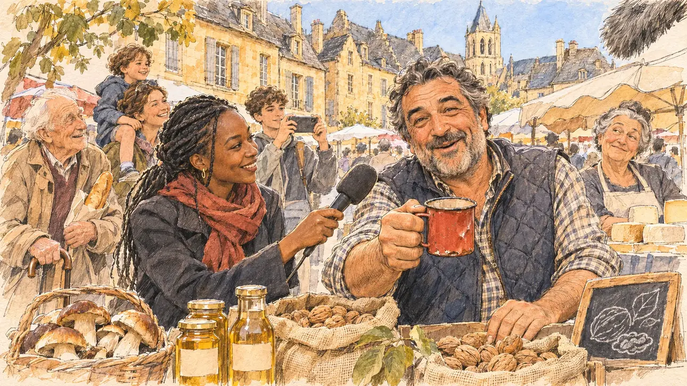

# `childhoodFriend` · Un ami d'enfance raconte tout

**Validée par le PO le 06/11/2026**, au premier essai, avec `primeTime.webp` comme référence. Elle sert telle quelle en clair et en sombre.



| Champ | Valeur |
| --- | --- |
| Carte | `childhoodFriend`, catégorie `private` (Vie privée), carte ajoutée par la PR #297 de l'app |
| Style | Reportage dessiné, trait de `primeTime` |
| Ton | Chaleureux et amusé |
| Date | 2026-11-06 |
| Outil | ChatGPT Images |
| Conversation | À remplir (le lien ne s'ouvre qu'avec le compte qui l'a créée) |
| Format rendu | 1672 × 941 (16:9) : export en 1290 × 726 px, WebP de qualité 75, 244 Ko, sans recadrage |
| Fichier d'origine | Image de ChatGPT, chez le PO. L'export du dépôt a été fait depuis la copie partagée dans la conversation avec Claude |
| Première édition | La prochaine Release qui suit le merge de la PR #297 de l'app |

## Texte de la carte

> **Un ami d'enfance raconte tout**
>
> Croisé sur un marché de votre ville natale, un ami d'enfance raconte à un journaliste que vous êtes « bien plus drôle en vrai qu'à la télé », anecdotes de colonie de vacances à l'appui. La phrase est reprise partout, avec un grand sourire.

## Le moment choisi

Le marché du samedi matin à Sarlat, dans le Périgord, ville natale du candidat (absent de la scène), vu depuis la caméra de l'équipe de télévision qui interroge l'ami d'enfance : au premier plan, la bonnette poilue d'une perche de son. L'ami d'enfance, producteur de noix derrière son étal, rit en racontant une histoire de colonie et brandit un vieux quart en émail cabossé, souvenir de la colo. Autour : la journaliste qui rit aussi, des clients qui écoutent, une voisine d'étal qui lève les yeux au ciel, des sacs de noix, des cèpes, des fromages. Derrière : les maisons médiévales en pierre dorée et aux toits de lauze de Sarlat, la place du marché et la tour de la cathédrale.

## Prompt complet

Dans une nouvelle conversation, avec [`primeTime.webp`](../../illustrations/media/primeTime.webp) comme seule image de référence.

```
Use the attached image as the style reference and copy its drawing: a realistic reportage drawing made on the spot for a newspaper, with quick, nervous pencil lines, often drawn twice, ink hatching in the shadows, transparent watercolour washes that spill a little over the lines, and the warm paper showing through. Not the same scene and not the same people: never reuse the face or the hair of the woman in the reference.
Like in the reference, the setting can be full when the story needs it, with the things that say where we are and what is happening, but each one is sketched with a few pencil lines and a light wash, never rendered or finished, and the drawing gets looser and paler towards the edges until it fades into the bare paper.
This must look like a drawing made by hand on paper by a press illustrator, halfway between a quick sketch and a realistic picture: never a photograph, a film poster or a digital painting, and never a cartoon, a comic strip, a caricature or a children's book illustration. Continuous lines, never dotted or dashed outlines; no uniform texture, speckles or hatching filter laid over the picture; no glossy highlights, no smooth gradients, in the sky and on the walls too. Colour can be rich in places, on a piece of clothing, a light or a flag, but it stays transparent and within the palette below. The fade into the paper at the edges stays narrow, without a wide white margin. No blur and no depth-of-field effect: everything, the foreground included, is drawn sharp, like a sketch made on the spot.
People are drawn from life with realistic anatomy and proportions, like in the reference: faces shaped with pencil lines, hatching and light washes, a little more finished than the background but never photographic (no photographic skin, no airbrushed or digital-painting look). Expressions stay natural and restrained, even in laughter or tears: no exaggerated grins, no wide-open mouths full of teeth, no rubbery or cartoonish faces.

Editorial illustration, landscape 16:9 (1536 × 864 px), the scene filling the frame, with only a light fade into the paper at the edges. The Saturday-morning market in Sarlat, in the Périgord, in the South-West, the hometown of the player's candidate, who is not in the scene, on a bright morning in early 2027: met by chance by a TV crew, a childhood friend of the candidate tells the journalist that the candidate is much funnier in real life than on television, with stories from a summer holiday camp to prove it, and the line is quoted everywhere with a big smile. The scene is seen from the TV crew's camera, as the crew interviews him: in the foreground, only the furry windshield of a boom microphone. In the right third, the childhood friend, a walnut grower of Italian origin, stocky and broad-shouldered, with thick greying dark hair, a short salt-and-pepper beard, laughter lines and a quilted waistcoat over a checked shirt, standing behind his market stall, laughs warmly while telling his story, his mouth only slightly open, and holds up towards the viewer a dented old enamel camp mug, a souvenir of the holiday camp, his face above mid-height; there is no photo of anyone and no picture of children anywhere. Around him, sketched in pencil and light washes: the TV journalist, a young woman of Chadian origin with long braids tied back and a red scarf, holding her plain foam microphone out to him and laughing too; a few customers stopping to listen, an elderly man with a cane and a baguette under his arm, bare-headed with white hair, a mother with a child on her shoulders, a teenager filming with her phone; the neighbouring stallholder, a woman in her sixties with a grey bun selling cheeses, rolling her eyes with a smile; on the stall, jute sacks of walnuts, jars of walnut oil with plain labels, baskets of ceps and a chalk board with only doodles. Behind them, the market square of Sarlat: tall medieval houses of warm golden limestone with steep roofs of grey stone slabs, mullioned windows and wooden shutters, and above them the bell tower of the cathedral under a clear blue sky. Only the childhood friend looks straight at the viewer. Nothing on the mug, the jars, the sacks, the chalk board, the microphone or the shop fronts is readable, and no logo of a real TV channel or brand appears.

Style: Reportage drawing made on the spot, like a press illustrator or courtroom sketch artist: pencil and ink with loose watercolour washes, lively unfinished lines, white paper showing through.

Palette: navy #13203F, vellum #F5EFE1, gold #A9802A, brick #B5523B, ochre #D9A441, sage #8FA58A, slate #5E7186, sand #DCC8A4, warm grey #8C8279; use 4 to 6 of them, subtle warm paper grain.

Tone: warm and amused, the clear golden light of a Périgord market morning on the honey-coloured stone, the browns of the walnuts and the ceps, and the red scarf of the journalist and the dented enamel mug as the bright notes.

Constraints: realistic proportions, natural expressions, never cartoonish or caricatured faces, drawn like the rest of the illustration and never photographic; people of varied ages, genders, origins and body types (heavy, stocky, round, tall, short, wiry, not only slim), each with a distinct face and haircut (no two people alike), drawn with respect and never as a joke; anatomically correct hands with exactly five fingers, few hands visible, the others in pockets, behind objects or out of frame; no readable text anywhere (the mug, the jars, the sacks, the chalk board, the microphone and the shop fronts stay unreadable); no captions or speech bubbles; no logos or political party colours; no recognisable real person, no lookalike of a real politician, and no logo of a real TV channel or brand; no explicit violence; no photographic rendering, no blur or bokeh, no dotted outlines, no texture or hatching filter over the picture, no oil-paint texture, no wide white margin or frame (a light fade into the paper at the edges is fine).

Format: if 16:9 is not available, make 1536 × 1024 and keep the top 80 px and the bottom 80 px free of anything important (faces, hands, the main action): they will be cropped.
```

## Décisions prises sur cette image

Aucune.

## Essais écartés

Aucun.

## Retouches

Aucune.

## Relecture

Faite et validée par le PO le 06/11/2026.

- [x] Aucun texte lisible : le quart en émail, les pots d'huile et les sacs n'ont ni étiquette ni marque, l'ardoise n'a qu'une noix et une feuille à la craie ; rien n'est lisible sur le micro ni les façades.
- [x] Aucun sosie d'une personne réelle.
- [x] Le candidat du joueur est hors champ.
- [x] Mains, visages et foules sans défaut visible à 343 px de large.
- [x] Aucune couleur ni aucun logo de parti. Des personnes variées par l'âge, le corps, l'origine et la coiffure.
- [x] En 3:2 : sans objet, l'image est en 16:9.
- [x] Lisible sur la page de l'événement, en clair et en sombre.

Ce que la relecture a accepté : l'ami d'enfance tient le quart rouge plutôt qu'il ne le brandit, et rit la bouche entrouverte ; plusieurs passants sourient franchement.
